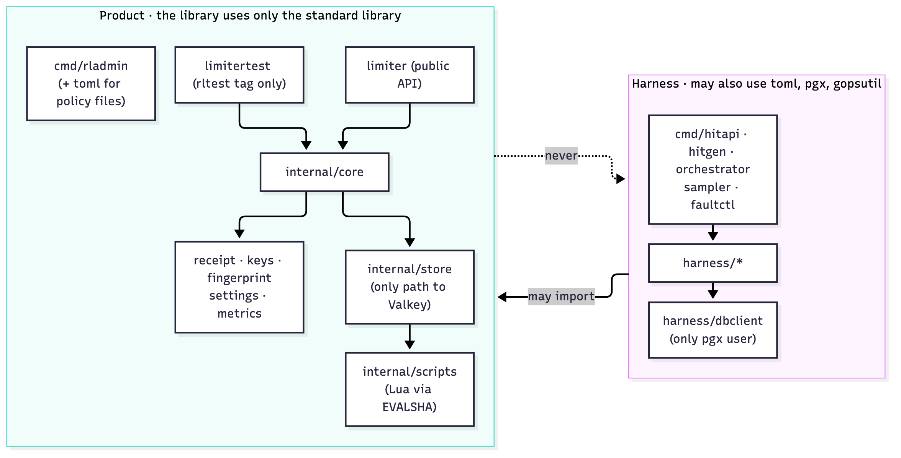
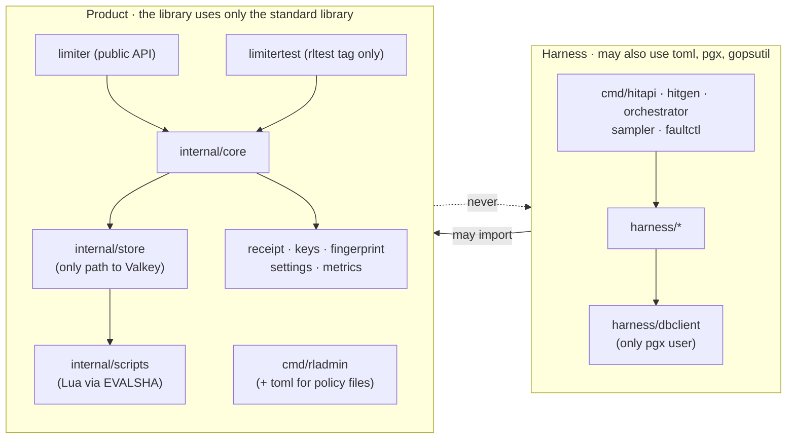

# AGENTS.md

Coding rules for any agent (Claude, Codex) working in this repo. They say **how** to write the code. SPEC.md, DESIGN.md and IMPLEMENTATION_PLAN.md say **what** to build, and they win any conflict: follow them, and list the conflict in your slice report. Stop only when a lint rule rejects code the docs require, or when a plan §5 trigger fires.

Linters and `tools/trace` enforce most rules. A failure means the code took a banned path: change the code, not the check.

## 0. How to work

1. Follow IMPLEMENTATION_PLAN.md one slice at a time, and read the DESIGN sections each slice lists first.
2. Use the home DESIGN gives each concern (§1). If it lacks something, extend it there. Never work around it.
3. If a cross-cutting concern has no home in DESIGN, stop and report (plan §5). Don't write it inline.
4. `make fmt` fixes formatting. Run `make check` before finishing any step, and `make slice-check S=<id>` before calling a slice done. Under an orchestrator (plan §7), a builder runs `make check` and its task's tests, and the orchestrator runs the Verify block and `slice-check`.
5. Never add an inline suppression or edit a lint config to get a pass. That covers `//nolint`, `#nosec`, `//lint:ignore`, `//exhaustive:ignore`, `# noqa`, `# type: ignore`, `-- luacheck:` and `-- stylua:`, in any spelling. `tools/trace suppress` rejects them, and ruff runs with `--ignore-noqa`. If a rule blocks code the docs require, stop and report: the owner adds a scoped exception, with its reason, in the config file.
6. Work in small steps: build and test a package before the code that uses it.

## 1. Rules for all code

| Concern | Use | Never | Checked by |
|---|---|---|---|
| Settings | **Library:** `Policy`, `Instance` and `StoreOptions`, passed to `New` and validated there (`internal/settings`). **Harness:** `harness/config`, loaded once (TOML decoded onto defaults; unknown keys are an error) | The library reading env, files or flags. Env reads outside `main*.go`, `harness/config` and `internal/testutil` | forbidigo `[env]` |
| Secrets | **Library:** takes the store password in `StoreOptions` from the host (CFG-7). **Our binaries:** passwords come only from the `RL_*_PASSWORD` variables (DESIGN §A2) and the rendered ACL file (mode 0600, in the run or test directory). The signing key comes from `crypto/rand` and never leaves the process | A password or key in code or TOML, or formatted into an error, `Diag`, `Health`, a metric, a log, a report or `context.json` | gosec; S5 and H3 leak tests |
| Logging | **Library:** none, and no logger option. It reports through `Result.Diag`, `Health`, `Metrics` and refund events, and `New` returns its error for the host to log. Where DESIGN says a library defect is "logged", it means reported in `Diag` (reason and store error) and counted as `outcome_unknown`. **Harness:** one `log/slog` JSON logger to stderr, made in main and passed down. Run logs go only through `harness/runlog`. CLI output goes through the `io.Writer` that main passes in | `fmt.Print*`, `log.*`, `print`, or the default slog logger | forbidigo `[print]`, sloglint |
| Errors | `Acquire` outcomes are `Result` kinds, a closed set. Inside, wrap with `fmt.Errorf("doing x: %w", err)` and compare with `errors.Is` / `errors.As`. RESP error replies become typed errors once, in `internal/store` | Ignored errors, matching on `err.Error()` text, `panic` (allowed only in tests and `internal/scripts` package initialization) | errcheck, errorlint, forbidigo `[panic]` |
| Input | Validate at every boundary: host settings and keys; every store reply, decoded per script and code and range-checked (§A4.9; anything else is `outcome_unknown` or an integrity result); receipts (MAC check first); HTTP requests, TOML, scenario files and run logs | Trusting any input | tests, fuzzing (§5) |
| Time | Budget time comes only from the store, inside scripts. Go code uses local time only for deadlines, timers and monotonic durations. The harness uses wall-clock ns only for HARNESS log fields. Python uses UTC-aware datetimes | Wall-clock numbers (`Unix*`) in product code; naive datetimes | forbidigo `[walltime]`, ruff DTZ |
| Randomness | `crypto/rand` for secrets and identities that must never repeat: the signing key, epoch IDs and generated passwords. Product jitter uses the global `math/rand/v2` functions. **Harness:** only `rand.New(rand.NewPCG(seed, stream))`, so runs repeat; request IDs are deterministic (H2) | `math/rand` (v1); `math/rand/v2` in `receipt`, `fingerprint` or `rladmin`; global `math/rand/v2` functions in the harness | depguard, forbidigo `[seeded]` |
| Dependencies | **Library** (`limiter`, `limitertest`, `internal/*`, tests included): standard library only. **`cmd/rladmin`:** also BurntSushi/toml (policy files). **Harness:** also toml, pgx v5 and gopsutil v4. **Python:** standard library only at runtime | Any other module. Adding one is a stop-and-report. A version whose `go.mod` needs more than `go 1.24` (it would raise this module's `go` line): take the newest one that doesn't | depguard |
| Store access | Library code (`limiter`, `limitertest`, `internal/core`) reaches the store only through the `internal/store` adapter; `internal/store` is the only library package that imports `net`. `cmd/rladmin` uses `internal/store/resp`, `internal/scripts` and the decoder `store.Decode` as `rl_admin` (DESIGN §A6). Test helpers, fixtures and harness tools use the `storeproc` client or `internal/store/resp` (L2 tests go through `scriptrun`, §5), with the ACL user the plan names for each. The product's Lua lives only in `internal/scripts` (S1's probes live in `internal/testutil/conformance/testdata/`) | Raw commands from other library packages; `MULTI`/`WATCH`; locks kept in the store | depguard (`net`), tools/trace `boundary` and `acl`, review |
| Database | Only `harness/dbclient` imports pgx and holds SQL; it offers what the others need (H1) | pgx or SQL anywhere else, tests included | depguard |
| HTTP (harness only) | Clients and servers built in main with explicit timeouts (servers set `ReadHeaderTimeout`). Requests made with `http.NewRequestWithContext`; response bodies closed | `http.Get`, `Post`, `DefaultClient`, `ListenAndServe`; any HTTP from the product | forbidigo `[http]`, noctx, bodyclose, depguard |
| Queues | Every channel, queue and worker pool has a fixed capacity. When it is full, count a drop (listener, run log) or refuse explicitly (`busy`, overloaded). Run logs: one `write(2)` per line, no buffer | Blocking or growing when full; `bufio` in `harness/runlog` | T-REF-7, T-FLT-6, T-HFLT-1; depguard |
| Metrics | Label values come only from fixed sets (result kinds, script names, connection kinds) | Keys, IDs or any input as a label value | T-OBS-1 |
| State | Dependencies passed through constructors. State is per instance: one process may run several `Limiter`s (§A5.2). In-process `sync.Mutex`, `sync.Cond` and atomics are fine | Package-level variables or `func init()` in product code. The one exception: the script values `internal/scripts` exports (S4), set by package-level initializers from the embedded files | gochecknoglobals, gochecknoinits |

**Imports point one way.** The harness may import product packages; product code never imports the harness (`tools/trace boundary`). Inside the library, `limiter` imports `internal/core`, which imports `internal/store` (which imports `internal/scripts`) and the leaf packages.

Diagram source (mermaid — flowchart)

## 2. Go

- **Layout:**
  - As in DESIGN §A1. A binary's `main*.go` files parse flags and read env, build the logger, clients and dependencies, handle signals and set exit codes. Its other files and packages take all of that as parameters.
  - Allowed sites:
    - `os.Exit`: only in `main*.go`.
    - `context.Background`: in `main*.go`, `internal/core/limiter.go` (the lifetime context) and tests.
    - Env reads: in `main*.go`, `harness/config`, `internal/testutil` and tests.
- **Context:**
  - Every operation that waits on the network, the disk or another process for a caller takes `ctx context.Context` first. That includes test helpers, which take a ctx or a `testing.TB`.
  - Exceptions: lifecycle methods like `Close()` (bounded by their drain timeout plus a short listener grace), standard interfaces like `io.Reader`, RESP primitives that take an explicit deadline, which the adapter derives from ctx, and the test-only `storeproc` client and the helpers that reach the store only through such a connection (`storestate.Snapshot`, `storeproc.LoadPaddingAt`, and in tests `harness/fixtures`' `Clock` and `Tamper`), whose every command has the client's own 30 s I/O deadline (the teardown audits run in `t.Cleanup`, after `t.Context()` has ended). `faultctl` and the orchestrator talk to the store over connections of their own (`harness/fixtures`' `opsConn`, which `StoreConn` wraps and `StoreDown` and `StorePause` also use, and the orchestrator's `storeConn`), each dialed with a ctx whose deadline (200 ms to 5 min, by what the connection is for) bounds the dial; the calls made on them take no ctx, and each command such a call sends ends by that deadline, or at once when that ctx ends: `opsConn`'s `do` and `info`, `StoreConn.Do` and `Info`, `faultctl`'s `configGet`, the orchestrator's `storeConn.do`, `storeConn.command`, `persistenceInfo` and `fixtureConn.Do`, and `Clock` and `Tamper`.
  - Regular-file I/O (opening, reading, writing, appending, syncing or renaming a regular file) takes no ctx, because a ctx cannot interrupt it (a regular file takes no deadline, and a hung mount holds the call): for example `harness/config`'s `Load` and `LoadScenario`, `runlog.Open`, `runlog.Append` and `runlog.WritePIDs`, `rladmin`'s policy load, the driver's `SaveOpLog`, `hitgen`'s `writeSchedule` and the orchestrator's `writeNewFile`.
  - A store call's deadline is `min(ctx deadline, start + D)`.
  - Work that outlives a call (refunds, cleanup, the epoch watch) runs on the instance lifetime context that `internal/core/limiter.go` creates, with its own deadlines.
  - Code that must not end when its caller gives up uses `context.WithoutCancel(ctx)` and adds its own deadline. For example, `hitapi`'s `P` deadline must survive a client disconnect.
- **Child processes:** `exec.CommandContext` kills the child the moment its ctx ends.
  - A child that must outlive its starter, or stop gracefully, is started with `context.WithoutCancel(ctx)` (or sets `cmd.Cancel` and `cmd.WaitDelay`). It is stopped explicitly: SIGTERM, a grace period, then SIGKILL.
  - This applies to `storeproc`, `StartStack`, the orchestrator's children, and the `StoreDown`/`KillAPI` restarts.
- **Goroutines:**
  - Each one has an owner that tracks it and a way to stop it: `Close` drains, and `limitertest.Kill` stops at once. No fire-and-forget `go func()`.
  - `recover()` appears only in the listener dispatcher, because host code may panic.
  - `TestMain` in `internal/store`, `internal/core` and `harness/spectest` calls `testutil.VerifyNoLeaks`.
- **Build tags:**
  - A `_rltest.go` file name does not tag a file. Every rltest-only file, and every file in `limitertest/`, `harness/{fixtures,driver,spectest,pgtest,e2e}/` and `*_rltest*.go`, starts with `//go:build rltest`. A `*_stub.go` file starts with `//go:build !rltest` (`tools/trace tags`).
  - Code used only by tagged files carries the same constraint (for example `//go:build rltest || scripttest`), or the other builds report it as unused.
- **Numbers:**
  - Budget math uses `int64` with a guarded multiply, never floats. Anything sent to a script stays below 2^53 (DESIGN §A3.1).
  - Before a conversion that could overflow (`uint16(n)`, `uint64(g)`, or `int(n)` from a parsed reply), check the bounds on a local variable right before converting: `n := len(enc); if n > math.MaxUint16 { … }; uint16(n)`. gosec G115 recognizes this form.
- **Lookup tables** in product code (reply layouts, permit transitions, metric names): a `switch` in a function, or a field built by the constructor. Never a package-level `var`.
- **Switches** on our closed sets (`Result` kinds, reply codes, permit states) list every case. Enums from other packages (signals, errnos, file modes) are exempt in the config. If a new external enum trips the check, stop and report.
- **Interfaces:** small, declared where they're used. DESIGN fixes two exceptions, `store.Adapter` and the signer, which the `limitertest` wrappers alias.
- **Discarded errors:** write `_ = x.Close()` explicitly, and only where the error can't change the outcome.
- **Tests:**
  - Table-driven when the cases differ only by data.
  - Use `t.Context()` in test bodies (in `t.Cleanup`, `context.WithoutCancel(t.Context())`), `t.TempDir()` and `t.Setenv()`.
  - Never `t.Skip`: a missing store or tool is a failure.
  - Use `-race` for L1 and L3.
  - Order is shuffled: `bin/trace gotest` adds `-shuffle=on`, and the saved stream holds the seed. Repeat an order with `-shuffle=<seed>`.
  - No mutable package-level state in `_test.go` files or in test-helper packages (under `internal/testutil/` and `harness/{driver,fixtures,spectest,e2e,pgtest}/`): no assignment, `++`/`--`, map or slice element write, `&v`, send, `delete`/`clear`/`copy`/`close`, in-place standard-library mutation (`sort.Strings`, `slices.Sort`, …) or pointer-receiver method call outside the declaration (DESIGN §C7 has the exact forms), and no package-level variable that holds a value that exists to be mutated (a `sync` or `sync/atomic` value, a channel, a `strings.Builder`, a `bytes.Buffer` or a `math/rand/v2` generator). Read-only tables, constants and `//go:embed` vars are fine. Only the hooks `measurements` and `maxInFlight` (§5) may be written. `bin/trace testglobals` checks this.
- **Checked by:** golangci-lint v2 (`.golangci.yml`), run once per build: untagged, `-tags rltest`, `-tags conformance` and `-tags scripttest`.

## 3. Lua (store scripts in `internal/scripts`)

Scripts run inside Valkey's Lua 5.1 sandbox. When a script fails halfway, its earlier writes are not rolled back. So:

- **Lua 5.1 only:** no `goto`, `//`, bit operators or integer subtype. Numbers are doubles.
- **Number to string:** only through `string.format('%d', n)`. Never `tostring` or `..` on a number: they can print `1.76e+15` (§A4.8 rule 4). Use `..` only on strings, and `table.concat` for strings built in loops.
- **Locals only.**
  - The prelude is the only shared code: the loader sends the header line, then the prelude, then the body.
  - No `require`, modules or metatables, and no `print` or `redis.log`.
- **Checks before writes:** every read and check comes first. After the first write nothing may fail: no `error`, no `assert`, no arithmetic on values that haven't been validated.
- **`pcall` and `redis.pcall`** only where DESIGN §A4 uses them. Every caught error becomes a defined reply code; never discard one.
- **Commands:** a string literal names every command, in one of three forms: `redis.call('X', …)`, `redis.pcall('X', …)` or `pcall(redis.call, 'X', …)`. The ACL check reads those names.
- **Keys and values:**
  - Every key goes in `KEYS` and every value in `ARGV`.
  - Per-key KEYS are asserted (§A4.1).
  - Replies follow §A4.9 exactly, with no `nil`.
- **Bounded work:**
  - At most 500 list arguments per command (§A4.8 rule 3).
  - Chunked deletes go through the prelude helpers `hdel_chunked` and `zrem_chunked` (S7). Their two `unpack(` lines are the only ones marked `-- lint:chunked(500)`.
  - Loops are bounded by DESIGN caps. No `KEYS` command and no unbounded scans.
- **Names:** reply codes use the §A4.9 names (`E_ALLOWED`, …), defined once in the prelude, as is `CHUNK = 500`. When copying DESIGN's snippets, rename variables as luacheck asks; never suppress a warning.
- **Checked by:**
  - luacheck on each script as the store receives it (`.luacheckrc`, run by `tools/trace lua`);
  - `stylua --check`;
  - `tools/trace lua`, `acl` and `replies` (every code and reason a script returns is one DESIGN lists, and each is seen in an L2 test);
  - L2 tests against a real Valkey. They use times ≥ 10^15 µs and compare stored strings exactly, which is what catches a number printed with `..`.
  - The discipline run (S4): `make test-scripts` runs the L2 tests again with `RL_SCRIPT_AUDIT=1`, through an instrumented copy of each script built by `scriptrun`. A test fails on a read after the first write (§A4.8 rule 2); a second clock read, or one before the epoch read (rule 7); a write to a key not read or deleted earlier in the run (`DEL` and `UNLINK` need no prior read); or a key argument not in `KEYS`.
  - There's no Lua unit-test framework: a desktop Lua (5.4 or LuaJIT) handles numbers differently, so scripts are tested where they run.

## 4. Python (`refmodel/`, `report/`)

- **Dependencies:** standard library only at runtime. Dev tools (pytest, ruff, mypy) are pinned in `requirements-dev.txt` and installed by `make setup`. No ad hoc `pip install`.
- **Types:** full type hints, and `mypy --strict` passes.
- **refmodel:**
  - Computes with `int` (and `fractions.Fraction`) only: no floats and no `/` in `model.py` and `check_bud11.py`. A test checks this, so use `Path.joinpath` there.
  - It may mirror SPEC's names (`C(t)`, `S(t)`) so it reads line by line against SPEC.
  - It shares no code or generated tables with the Go code (§C6).
- **Inputs and errors:** validate every input record (op logs, run logs). Raise an exception class defined in the package, naming the record and the field. No bare or blind `except`.
- **Environment:** `pathlib.Path` for paths and UTC-aware datetimes. No env, network or subprocesses.
- **Printing:** `print` only in the modules the plan runs as CLIs. They are listed in `pyproject.toml`: `refmodel/replay.py`, `refmodel/check_bud11.py`, `report/__main__.py`, `validate.py`, `completion.py`, `budget.py` and `thresholds.py`.
- **Tests:** never `pytest.skip`: a missing tool or input is a failure.
- **Checked by:** `ruff check --ignore-noqa`, `ruff format --check` and `mypy` (settings in `pyproject.toml`), plus pytest.

## 5. Tests

- **Layers** (DESIGN §C1):
  - L1 uses fakes (the fake RESP server and wrappers).
  - L0, L2 and L3 use a real Valkey: each test spawns its own with `storeproc.Start(t, …)` (L2 script tests: `scriptrun.Store`) or gets one through the driver, on a free port with fresh passwords.
  - L4 uses the local PostgreSQL and the `bin/test` binaries.
  - Never a shared or remote store, and never the internet.
- **Independence:** tests don't depend on their order or on each other's data. Go runs shuffle the order (§2), and so does pytest (root `conftest.py`; `--shuffle-seed=N` repeats an order).
  - No package-level mutable test state, except two hooks: S1's measurement collector `measurements` (`internal/testutil/conformance`) and H2's in-flight cap `maxInFlight` (`cmd/hitgen`). `bin/trace testglobals` checks this (§2).
  - `t.Parallel()` only with separate stores.
- **Test IDs:** one test per SPEC or HARNESS ID, named after it. Never skip, weaken or delete a test to get a pass. If a test looks wrong against SPEC, stop and report.
- **Plan-named tests:** every test a slice's **Tests** section names exists under that name and passes wherever `slice-check` runs it. `bin/trace slices` checks this, since `go test -run X` passes when nothing matches X.
- **Expected values** come from literals, `math/big` or the reference model, never from the code under test. `bin/trace oracle` rejects `core.RetryAfterNs` and `core.DecisionNs` in `harness/spectest` and `internal/scripts` tests.
- **Checkers are tested too:** each has a must-fail fixture for every rule or change it must catch: `storestate.Snapshot` and `storestate.Audit`, `refmodel.replay` and `refmodel.check_bud11`, `report/validate.py`, `golden.Match`, each `bin/trace` check and `bin/mutate`. A new rule lands with its fixture.
- **Golden files** (`harness/runlog/testdata/golden/`, DESIGN §C5) are written by hand from DESIGN §B8 and the plan, never captured from the code's output. When a golden test fails, fix the code. A golden line changes only together with the doc text it follows, or to correct a departure from that text (say so in the slice report).
- **Store audit:** every L2 script test's store and every driver store is audited at teardown (`storestate.Audit`). L2 tests get their store from `scriptrun.Store(t, …)` and call scripts through `scriptrun.Run`; the driver audits once every instance is closed or killed. A test that damages state on purpose declares exactly those keys: `Damaged(keys…)` on the `scriptrun.Store` handle at L2, while the driver's `Tamper()` and `Fixture()` writes declare theirs automatically. Checker self-tests and the prelude probes the plan names (`TestPreludeValidators`, `TestPreludeRefillCeilDiv`) use plain stores. If the audit or the discipline run (§3) rejects behavior DESIGN requires, stop and report (plan §5).
- **BUD-11 at teardown:** the driver runs `refmodel.check_bud11` on every L3 test's op log, sequential or concurrent. Only tests that used `Tamper()` or `Fixture()` writes are exempt.
- **Fuzzing:** the targets are `FuzzReader` (RESP), `FuzzDecode` (store replies: never a panic; unknown shapes and out-of-range values are `outcome_unknown`), `FuzzValidate` (settings) and `FuzzEncodeInjective` (keys). Their seed corpora run in `make test-unit`.
- **Mutation testing** (`bin/mutate`, `make mutate`): mutants run only L1, L2 and pytest tests, never L3.
  - Each curated planted bug (DESIGN §C9, PB1…) must make one of its named tests fail with an assertion; a panic, a build error or a timeout is not a kill. `slice-check` runs `bin/mutate --curated` for every row whose file exists. If one can't be killed without a contract change, stop and report (plan §5).
  - Each survivor of the operator sweep (`bin/mutate --sweep`, at the end of S4–S8 on the slice's product files; S4's first sweep also covers S2's and S3's) needs a killing test or a one-line "equivalent because …" in the slice report. Two other verdicts are allowed, each with its reason in the slice report, and only within these limits:
    - "not killed (panic): crash-only": no input reaches the change without crashing first, so the mutant's only effect is a crash before any output a test could assert on. The crash stays visible to `bin/mutate`: never caught by a `recover` or a disguised one (such as `fmt` recovering a panic in a `String` method), and never counted as a kill through a child process's crash (`testutil.InChild` reports a child's crash as a crash).
    - "not killed, by orchestrator decision": only `testing/synctest` could kill the mutant, because it differs only on an exact timer tie. §7 excludes a fake clock for Go timers, and synctest is newer than the module's `go 1.24` line. Only the orchestrator (plan §7) records this verdict, and it is not an equivalence.

## 6. Who owns retries, timeouts and contracts

| Concern | Single owner | Nobody else may |
|---|---|---|
| Acquire | Nobody retries it: an `outcome_unknown` may already have deducted, so the host decides. The only resend is after `NOSCRIPT` (below), when the script provably never ran | Retry it in the library or in `hitapi` |
| Refunds | The refund workers. Retrying is safe because the deduction marker makes refunds idempotent | — |
| Store reconnects | The connection: backoff, then fail fast | Resend a command that may have been sent |
| `NOSCRIPT` | Exactly one resend, and only after `NOSCRIPT`. This happens in `Adapter.Call` within the call deadline, in `store/maint.go`'s cleanup pipeline once per pass (S7), and in `cmd/rladmin` (S8) | — |
| Cleanup | The next pass | — |
| HTTP retries | `hitgen`, only after a `429` (TRF-5), reusing the same IDs | `hitapi`, `dbclient`, or Go's `http.Transport`. The transport silently resends an idempotent request when a reused connection fails before the reply, so `hitgen` makes `/hit` requests non-replayable (H2) |
| DB writes | Nobody retries. `harness/dbclient` classifies the outcome (`Result.Class`; `pgconn.SafeToRetry` means nothing was sent), and `hitapi` maps it to `done()` or `release()` | Retry an insert |
| Timeouts | Every store attempt, refunds included: `min(caller or lifetime deadline, start + D)`. A refund job ends on a final result, its retention timer (`receipt_lifetime` since acquire) or the end of `Close`. `refund_deadline` is checked at startup (§A5.6) and is never a timer | Set an inner timeout longer than the outer one |
| Contracts | The owner. A needed change to SPEC, DESIGN §A3.2 keys, §A4.9 replies, §A2 ACLs or HARNESS formats is a stop-and-report (plan §5) | Change a contract in code or in the docs |
| Coordination | Atomic scripts | Add locks kept in the store, leader election or `MULTI`/`WATCH` (in-process mutexes and atomics are fine) |
| Stored formats | The epoch `schema` field: a new layout means a new epoch | Change a stored format in place |

## 7. Deliberately not used

| Idea | Why not |
|---|---|
| A shared HTTP client with built-in retries | Retries are measured behavior (TRF-5). Hidden retries would distort the results |
| A fake clock injected into Go timers | Budget time belongs to the store, and tests drive it through the controlled clock. Socket deadlines need real time |
| `go-redis`, `errgroup`, testify, goleak | Product code uses only the standard library. The leak check is a few lines in `internal/testutil` |
| OpenTelemetry, an outbox, event schemas, a workflow engine, IaC, Kubernetes | They don't fit this system: one library, one store and a local harness |
| Pydantic, uv | The Python code uses only the standard library, so a pinned requirements file is enough |
| busted (Lua unit tests) | Numbers behave differently outside Valkey (§3) |
| Semgrep, pre-commit | `tools/trace` and `tools/mutate` hold the project-specific checks; `make check` and `make slice-check` are the gates |

## 8. Done checklist (every step)

- [ ] Used the abstraction DESIGN names, and extended it instead of bypassing it
- [ ] `make check` passes, with no new suppressions or config exceptions
- [ ] New I/O takes `ctx` and has a deadline, or is one of §2's exceptions. Nothing retries outside its owner (§6)
- [ ] Anything retried is idempotent, or provably never ran (`NOSCRIPT`)
- [ ] No contract change was needed (or the work stopped and was reported)
- [ ] Tests are at the right layer, and `make slice-check S=<id>` passes at the end of the slice (run by the orchestrator under plan §7)
- [ ] Every plan-named test up to this slice exists and passes, and every curated mutant whose file exists is killed (both checked by `slice-check`)
- [ ] Each operator-sweep survivor (S4–S8) has a killing test, a one-line "equivalent because …" or another verdict §5 allows in the slice report
