# High-level architecture: the rate limiter

**What this is:** the shape of the rate limiter product: its parts, where its data lives, and how its main flows move. It answers **"what are the pieces and how do they fit"**.

**What this is not:** product picks (language, store), exact data formats, and code layout; those go in the Detailed Design. The test harness and its architecture are in [HARNESS.md](HARNESS.md).

- Requirements live in [SPEC.md](SPEC.md). Rule IDs like `BUD-3` point there.
- Each section starts with a picture. The bullets under it are the parts you need to remember.

## 1. System at a glance

| View | Answers |
|---|---|
| 1.1 The rate limiter by itself | What is the product, and what are its parts? |
| 1.2 The rate limiter inside an app | How does any app use it, and who runs what? |

Colours: **blue = rate limiter (the product)**, grey = the app using it, yellow = what the operator provides.

### 1.1 The rate limiter by itself

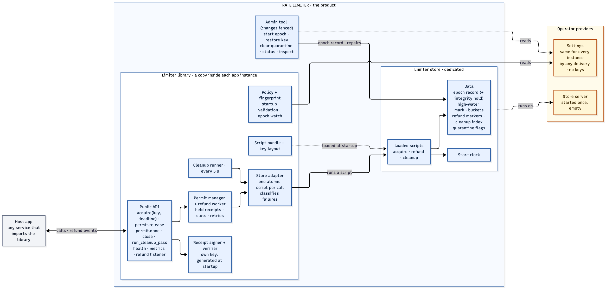

<details><summary>Diagram source (mermaid — flowchart)</summary>

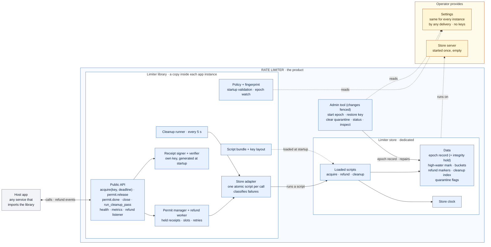

</details>

The product has **three parts**:

| Part | Where it runs | What it does |
|---|---|---|
| Limiter library | Inside each app instance (imported) | Public API, permits and receipts, refund retries, signing, cleanup, talking to the store (`CMP-1`) |
| Limiter store | One dedicated store server | Holds all shared state; runs the library's scripts atomically, one at a time, using its own clock (`CMP-2`) |
| Admin tool | Run by the operator | Starts an epoch, repairs quarantined keys, shows status and per-key state; every change is fenced in the same atomic step: by the expected `epoch_id`, or for a first or recovery start by "no readable epoch record" (`CMP-3`, `ADM-*`) |

- **The library defines everything inside the store:** the key layout and the scripts. It loads the scripts at startup. The operator only starts an empty store server.
- **The operator provides two things:** the store server, and identical settings for every instance, delivered however the app likes (`CFG-7`). No keys: each library instance generates its own receipt signing key at startup and keeps it in memory (`RCP-4`).
- **The fingerprint includes the store schema version**, which changes only on incompatible layout or script changes. Library versions with the same schema version can be rolled out side by side; an incompatible one refuses to serve instead of corrupting data (`CFG-1`).
- **The public API is the only door.** The host never touches the store, receipts, or retries (`CMP-1`).

### 1.2 The rate limiter inside an app

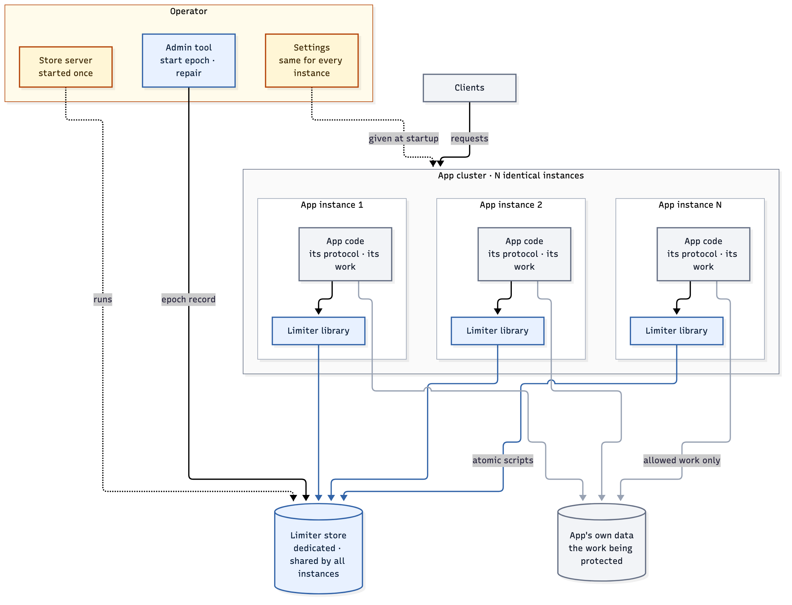

<details><summary>Diagram source (mermaid — flowchart)</summary>

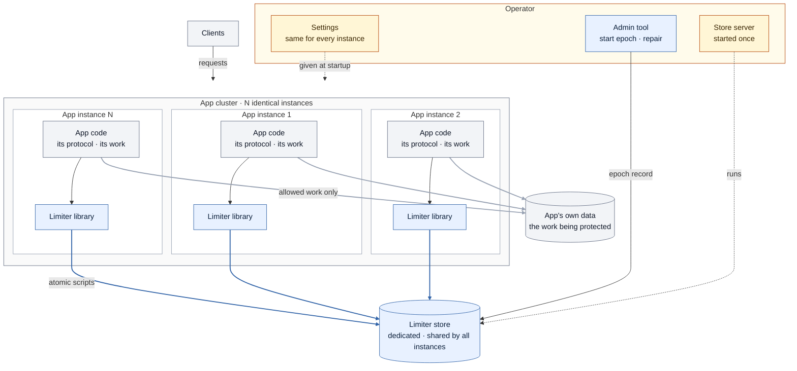

</details>

**Who owns and runs what**

| Piece | Owned by | Started by | Lost on restart? |
|---|---|---|---|
| App code | App team | Deploying the app | Its in-flight work |
| Limiter library | Rate limiter (imported into the app) | Starts with each app instance | Its pending refunds (`REF-8`) |
| Limiter store | Rate limiter defines its contents; operator runs the server | Operator, once | Must not lose data; if it does, the library refuses (`STA-9`, `STA-10`) |
| Admin tool | Rate limiter | Operator, once per epoch or repair | n/a |
| App's own data | App team | App team | n/a; the limiter never touches it (`CMP-8`) |

**What the app writes** (the whole integration, `HOST-1`…`HOST-8`):

```
r = limiter.acquire(key, deadline)            # key: any string the app chooses
switch r.result:
  allowed, degraded:  do the work
                      on confirmed failure:  r.permit.release()
                      otherwise (success or unknown):  r.permit.done()
  limited:            quota rejection, tell the caller to retry after r.retry_after_ns
  anything else:      refuse as a service failure (never as a quota rejection)
                      e.g. busy, cancelled, unavailable, outcome_unknown, config_error

on shutdown:  stop new work, finish in-flight work, limiter.close()   # default drain 35 s
```

- **The limiter is a library, not a service.** Installing it adds code only. No limiter process, no sidecar, no cluster. Scaling the app means adding instances.
- **The store is not installed with the library.** The operator starts it once.
- **The app keeps no limiter state.** It holds the permit during a call, the way it holds a database connection. The permit's `deduction_id` lets the app match refund events to its own requests.
- **One instance stopping** leaves balances untouched. A graceful stop drains pending refunds first; a crash loses them (`STA-15`, `REF-8`). The platform's kill grace period must cover the drain (`HOST-6`).
- Pattern: the common "library + shared store" design. Alternatives are compared in `AD-1`.
- How the test harness plays the "app" role: [HARNESS.md §9](HARNESS.md#9-harness-architecture).

## 2. Inside the library

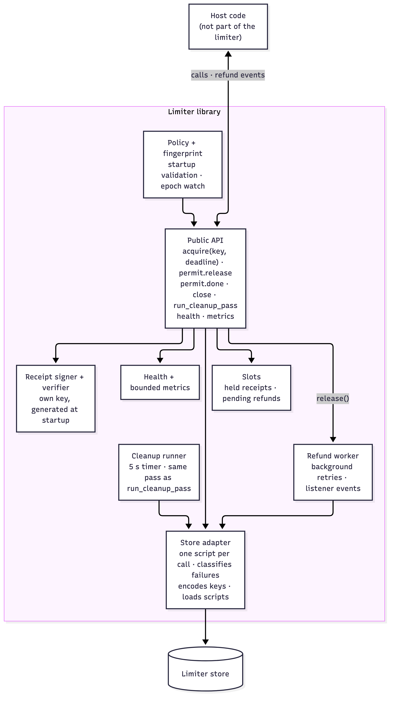

<details><summary>Diagram source (mermaid — flowchart)</summary>

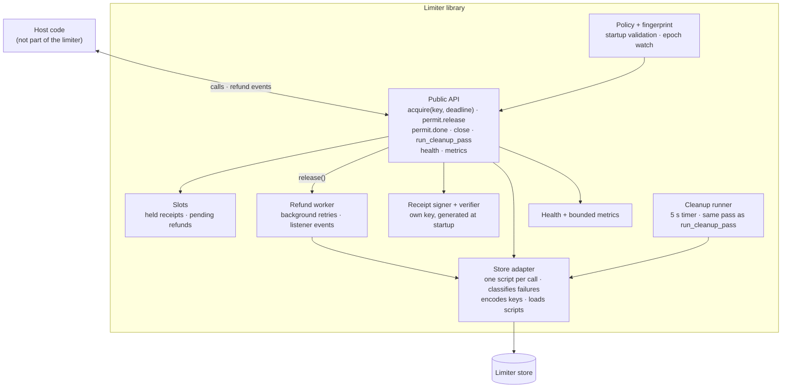

</details>

| Block | Job | Spec |
|---|---|---|
| Public API | Transport-neutral calls with an optional per-call deadline; returns typed results; permits follow a fixed lifecycle | `API-1`…`API-1h` |
| Slots | Reserve one receipt slot and one refund slot inside acquire; full → `busy`, nothing sent; freed per the permit lifecycle | `RCP-9`, `STA-6b`, `API-1h` |
| Refund worker | Gets the receipt on `release()`, which returns at once; retries until final, until its retention timer ends, or until the drain ends; one listener event per released permit, with the credit's original time, through a bounded queue | `REF-2`…`REF-6`, `API-1d` |
| Receipt signer + verifier | Signs confirmed deductions with a key it generates at startup; verifies only its own receipts | `RCP-1`…`RCP-4` |
| Policy + fingerprint | Validates settings and the receipt-lifetime bound at startup; watches the epoch record and joins any matching epoch, including a replacement; refuses on mismatch | `CFG-1`…`CFG-8`, `RCP-8` |
| Cleanup runner | A pass every 5 s and on demand, through the store adapter | `STA-3`…`STA-5`, `API-1f` |
| Store adapter | Encodes keys, loads scripts under schema-derived names, sends exactly one script per call, labels failures `unavailable` (provably not sent, or refused before running because the store was not ready: still loading, or busy), `cancelled`, or `outcome_unknown` (everything else, including other error replies, unless the design proves a reply implies no writes, which then maps to an existing non-bypass refusal); a "script not loaded" reply gets one reload and retry within the call | `API-1`, `API-11`, `API-12`, `API-22` |
| Health + metrics | Readiness with a reason, epoch, clock source; minimum metric set (slots, pending refunds, cleanup, clock lag, listener drops, integrity hold, acquire results, store-call latency, tracked buckets, live markers, quarantined keys); no per-key series | `API-1g`, `STA-13`, `STA-14` |

## 3. Where data lives

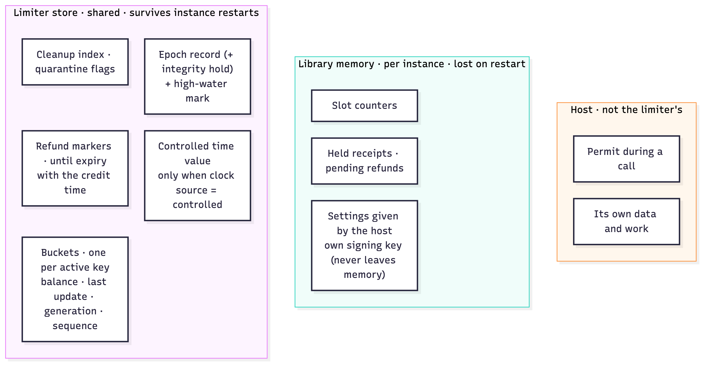

<details><summary>Diagram source (mermaid — flowchart)</summary>

```mermaid
flowchart LR
  subgraph store["Limiter store · shared · survives instance restarts"]
    direction TB
    rr["Epoch record (+ integrity hold)<br/>+ high-water mark"]
    bk["Buckets · one per active key<br/>balance · last update · generation · sequence"]
    mk["Refund markers · until expiry<br/>with the credit time"]
    ix["Cleanup index · quarantine flags"]
    ct["Controlled time value<br/>only when clock source = controlled"]
  end
  subgraph lm["Library memory · per instance · lost on restart"]
    direction TB
    rc["Held receipts · pending refunds"]
    sl["Slot counters"]
    ks["Settings given by the host<br/>own signing key (never leaves memory)"]
  end
  subgraph hm["Host · not the limiter's"]
    direction TB
    pm["Permit during a call"]
    hd["Its own data and work"]
  end
  store ~~~ lm ~~~ hm
```

</details>

- **Limiter store:** small and bounded. It grows with active keys and recent refunds, never with total requests (`RCP-7`).
- **Library memory:** short-lived work plus settings. A crash loses unfinished refunds, but budgets are safe (`REF-8`, `STA-2`).
- **Signing keys never leave the instance.** Each instance generates its own at startup; receipts are verified only by the instance that issued them (`RCP-4`).
- **The store must keep what it acknowledges** across restarts and never evict limiter data on its own (`STA-16`).
- **The host keeps only the permit** for the call in progress.

## 4. Key flows

### 4.1 Allowed call

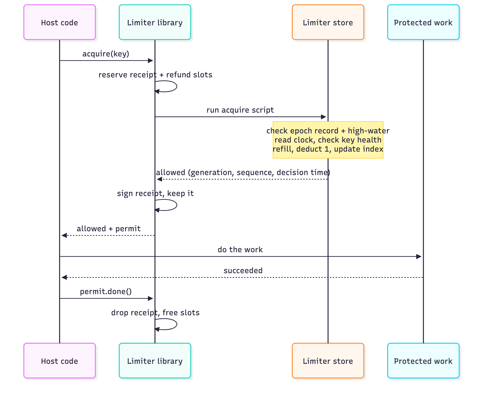

<details><summary>Diagram source (mermaid — sequence diagram)</summary>

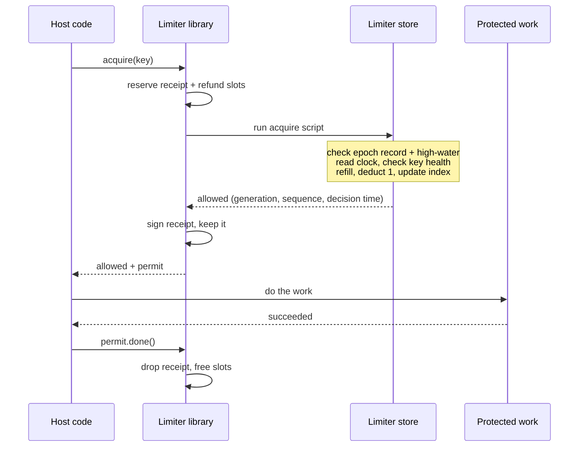

</details>

- **One round trip to the store per call.** All checks and the deduction happen in a single atomic step (`API-1a`).
- The receipt is signed after the store confirms the deduction and stays inside the library (`RCP-3`, `RCP-9`).

### 4.2 Confirmed failure and refund

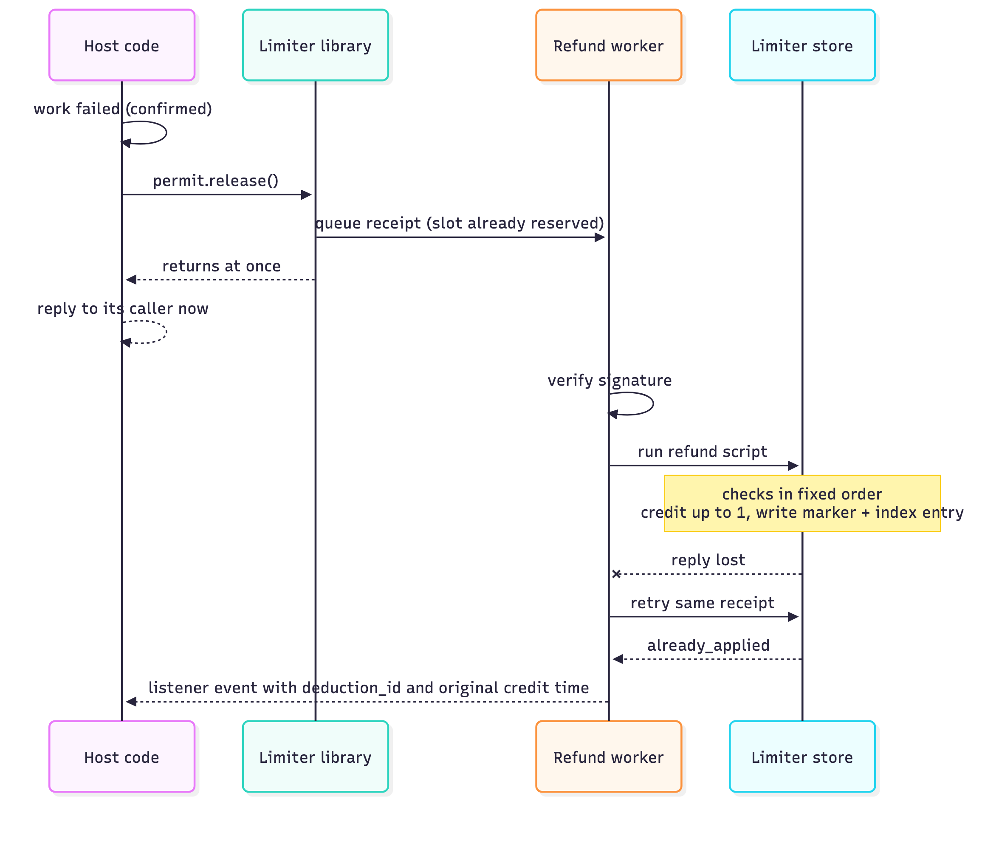

<details><summary>Diagram source (mermaid — sequence diagram)</summary>

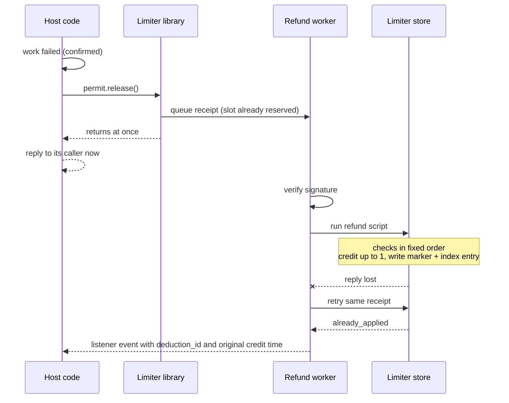

</details>

- `release()` queues the receipt before the host replies, so a failed reply can't lose the refund. The caller never waits for it (`REF-4`).
- The host only says "this failed". Retrying, stopping, and expiry are the library's job (`REF-4a`).
- Unknown outcome → the host calls `done()`: no refund (`REF-7`, `HOST-2`).
- Retrying is safe because credit and marker are written together (`API-14`).

### 4.3 Cleanup pass

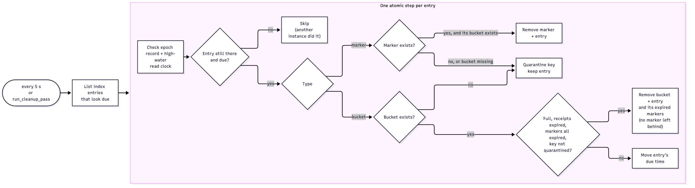

<details><summary>Diagram source (mermaid — flowchart)</summary>

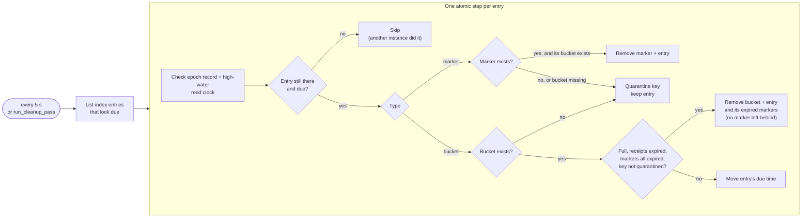

</details>

- Every instance runs cleanup. That is safe because every entry is re-checked inside its own atomic step: if another instance already removed it, the step does nothing (`STA-4`, `STA-5`).
- Each step does the same epoch-record and clock checks as acquire, so an instance from an old epoch can't clean up (`CFG-3`, `CLK-1`).
- It never uses the store's own expiry timers: those run on raw store time, ignore the high-water mark, and can't detect orphaned entries (`STA-3`).
- No marker outlives its bucket: removing a bucket also deletes its expired markers and their index entries in the same atomic step, so a returning key is never mistaken for state loss (`STA-4`).
- A quarantined key's bucket is never removed by cleanup, so a restored key stays in place until its quarantine is cleared (`STA-4`).
- Every due entry is reclaimed, or its key quarantined, by the end of the first completed pass that starts after it becomes due, unless it stops being due first (`STA-5`).
- `run_cleanup_pass()` returns counts plus a status, and stops at the first epoch-wide error or store failure (`API-1f`).

### 4.4 Epoch start, join, and repair

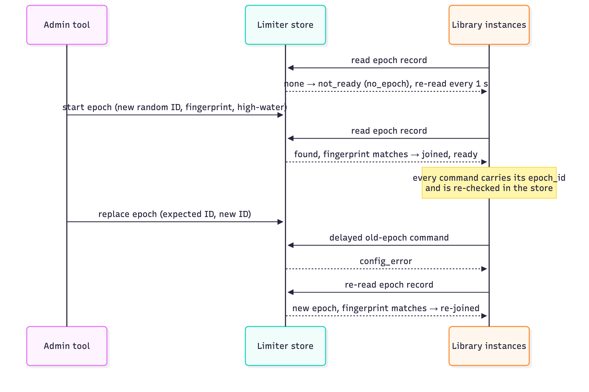

<details><summary>Diagram source (mermaid — sequence diagram)</summary>

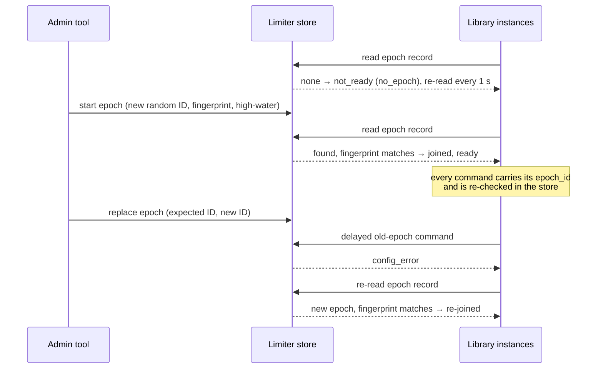

</details>

| Admin operation | Effect | Spec |
|---|---|---|
| Start epoch | Creates the epoch record and high-water mark. Replacing a readable epoch record needs an explicit flag plus the expected `epoch_id` (a missing or malformed record is replaced without the flag); resets every budget, and clears an integrity hold; old-epoch data is isolated and reclaimed later | `ADM-1`, `CFG-5` |
| Restore key | Clears all of a quarantined key's stored data except the flag, then gives it a chosen balance (default 0) with a fresh generation; its old receipts become invalid | `ADM-2` |
| Clear quarantine | Only after a bucket is present and the key's state checks consistent; never resumes as an unchosen fresh full bucket | `ADM-3`, `STA-10` |
| Status and inspect | Read-only counts, epoch info, and one key's stored state | `ADM-4` |

- Only the admin tool creates an epoch. Instances only join, and keep watching: a replacement epoch with a matching fingerprint is joined automatically (`CFG-2`, `CFG-6`).
- Commands sent under an old epoch get `config_error`; an old receipt refunded after re-joining gets `receipt_invalid` (`CFG-3`, `CFG-5`).
- A mismatched instance returns `config_error` and reports not ready (`fingerprint_mismatch`). After a store wipe, a malformed epoch record, or an integrity hold, joined instances return `state_integrity_error` until a new epoch; a restarted instance reports not ready until one exists: `no_epoch` after a wipe, `state_lost` for a malformed record, `integrity_hold` under a hold (`STA-9`, `CFG-6`).

**Operator procedures**

| Goal | Steps | Effect |
|---|---|---|
| Reset a live epoch with the same settings (e.g., to clear an integrity hold) | `ADM-1` replace with the expected `epoch_id` | Instances re-join within one re-read interval; every budget restarts full |
| Recover after a store wipe or a malformed epoch record | `ADM-1` without the replace flag (no readable record exists) | Instances re-join within one re-read interval; every budget restarts full |
| Change the policy or an incompatible schema version | 1. Deploy instances with the new settings (they wait not ready: `fingerprint_mismatch`). 2. `ADM-1` replace with the new settings. 3. Retire old-settings instances | New instances join; old ones refuse with `config_error` until retired; every budget restarts full. A rollout gated on readiness pauses until step 2 |
| Repair one quarantined key | `ADM-4` inspect, `ADM-2` restore a balance, `ADM-3` clear | Only that key changes; its old receipts become invalid |
| Rolling upgrade, same schema version | Normal rolling deploy | No epoch change |
| Planned store restart | Restart the store process (data kept) | Calls not yet sent, and calls refused while it reloads its data, get `unavailable` (closed mode refuses, open mode degrades); calls in flight when it stopped get `outcome_unknown`. Budgets continue afterwards |
| Store backup restore or replica promotion | Never onto a live epoch: start a new epoch (`ADM-1`) right after, before traffic resumes | A rolled-back store is a stale snapshot, which is undetectable in general (`STA-11`); a new epoch makes the loss explicit |

### 4.5 Graceful shutdown of one instance

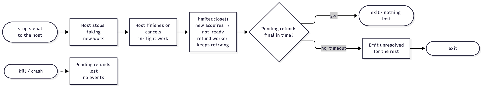

<details><summary>Diagram source (mermaid — flowchart)</summary>

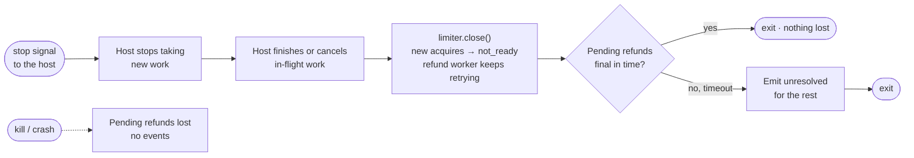

</details>

- Balances never depend on this: they live in the store. Shutdown only decides whether **pending refunds** get finished (`STA-15`, `HOST-6`).
- The drain defaults to `refund_deadline + outage_tolerance` (35 s) so a graceful stop keeps the refund guarantee; `close` returns early once all refunds are final and the listener has their events; a slow listener holds it until the drain deadline at most (or 100 ms past the drain's end, when that is later). The platform's kill grace period must exceed the release delay plus the drain (`HOST-6`). Other instances keep serving throughout.

## 5. Failure handling: where each outcome is decided

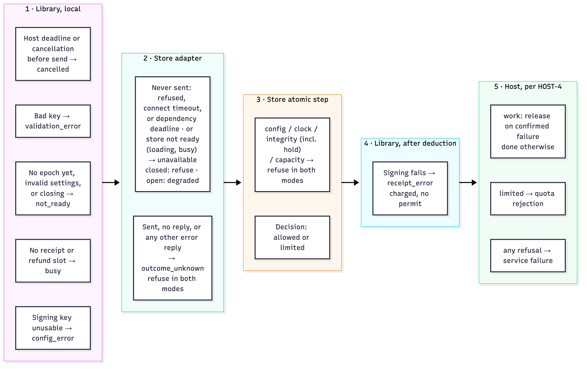

<details><summary>Diagram source (mermaid — flowchart)</summary>

```mermaid
flowchart LR
  subgraph loc["1 · Library, local"]
    v["Bad key → validation_error"]
    nr["No epoch yet, invalid settings,<br/>or closing → not_ready"]
    cn["Host deadline or cancellation<br/>before send → cancelled"]
    bz["No receipt or refund slot → busy"]
    key["Signing key unusable → config_error"]
  end
  subgraph ad["2 · Store adapter"]
    un["Never sent: refused, connect timeout,<br/>or dependency deadline · or store not ready<br/>(loading, busy) → unavailable<br/>closed: refuse · open: degraded"]
    uk["Sent, no reply, or any other error reply<br/>→ outcome_unknown<br/>refuse in both modes"]
  end
  subgraph st["3 · Store atomic step"]
    c["config / clock / integrity (incl. hold)<br/>/ capacity → refuse in both modes"]
    d["Decision: allowed or limited"]
  end
  subgraph after["4 · Library, after deduction"]
    sg["Signing fails → receipt_error<br/>charged, no permit"]
  end
  subgraph host["5 · Host, per HOST-4"]
    q["limited → quota rejection"]
    f["any refusal → service failure"]
    w["work: release on confirmed failure<br/>done otherwise"]
  end
  loc --> ad --> st --> after --> host
```

</details>

- **The store adapter is the only place that decides "definitely not applied" versus "unknown".** Everything else trusts its label, and production construction cannot swap it out (`API-22`, `CMP-9`).
- Open mode only affects one box: `unavailable`, which means the store could not be reached and nothing was sent, or the store refused the command before running it because it was not ready (loading, busy) (`API-11`, `API-21`, `API-22`).
- **How a host maps results to its protocol is the host's choice**, within `HOST-4`. The harness's HTTP mapping is in HARNESS.md §3.

## 6. Testability without test code in the product

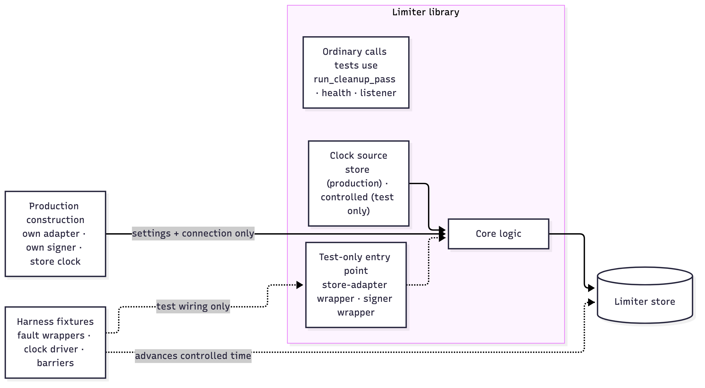

<details><summary>Diagram source (mermaid — flowchart)</summary>

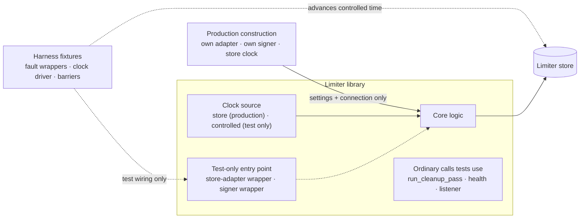

</details>

| Need | Product provides | Spec |
|---|---|---|
| Same controlled time in every instance | Clock source `controlled`, only through the test-only entry point: scripts read a time value in the store; fingerprinted, reported in health | `CLK-2` |
| Faults at exact points | The test-only entry point accepts wrappers around the store adapter and signer | `CMP-9` |
| Per-key state for checks | `ADM-4` inspect | `ADM-4` |
| Explicit cleanup passes | `run_cleanup_pass()`, the same pass the timer runs | `API-1f` |
| Observing refunds | The refund listener | `API-1d` |

- **Production construction takes settings and connection details only** and always uses the product's own store adapter, signer, and store clock. A production-built instance configured with the controlled clock never becomes ready (`CMP-9`, `CFG-4`).
- **No hooks or test flags in production construction.** Fixtures live in the harness and attach only through the test-only entry point (`CMP-9`) in test runs; benchmarks refuse them (HARNESS `HAR-24`).

## 7. Architecture decisions

| ID | Decision | Chosen | Main alternative | Why |
|---|---|---|---|---|
| AD-1 | Where the limiter runs | **Library inside each app instance + one dedicated store** | In-memory library (no shared limit across instances); separate limit service (extra hop, app must still report failures); gateway (can't tell confirmed failure from unknown) | Only option with a shared limit, fair refunds, and one hop. Common pattern (Redis-backed limiters). A service wrapper can be added later without changing the core |
| AD-2 | How decisions stay atomic | **Our logic runs as one server-side atomic operation (script) in the store** | App-side transaction with row locks (`SELECT … FOR UPDATE`), or optimistic read-then-write with retries | One round trip; no lock held across the network; no retry storms under bursts; clock read inside the atomic step. Transactions would work at small scale and keep all logic in app code, but hold the row lock for several round trips |
| AD-3 | Where time comes from | **The store's clock (or the controlled clock), plus a high-water mark** | Each instance's own clock | One time source for all instances; can't go backwards |
| AD-4 | How refunds identify a charge | **Signed receipt held by the library in instance memory** | Store a record per allowed request | Storage stays bounded by active keys |
| AD-5 | How cleanup works | **Index-driven pass on a timer, using budget time** | Store-native expiry timers | Follows budget time and the high-water mark; detects orphaned data; works with the controlled clock |
| AD-6 | When refunds happen | **`release()` queues the receipt on the library's worker; the host replies right after** | Refund before replying | Caller latency unaffected; the handover can't be lost to a failed reply |
| AD-7 | Who creates an epoch | **The admin tool, never an instance** | First instance to start | Instances can't recreate state after a wipe or change policy by accident |
| AD-8 | Store placement | **A store dedicated to the limiter** | Share the app's database | The limiter owns its namespace; app load and limiter load stay independent |
| AD-9 | How tests reach inside | **A test-only entry point and ordinary calls; fixtures live in the harness** | Hooks and test flags inside the library | No test code in the product; production wiring can't reach fixtures |
| AD-10 | Settings and receipt keys | **Settings supplied by the host at construction, by any delivery; fingerprint proves agreement. Each instance generates its own signing key in memory** | Host-supplied shared keys; keys in the store | Receipts never leave the issuing instance, so shared keys buy nothing; no key distribution or rotation |
| AD-11 | What a budget key is | **Opaque host-chosen string, encoded by the library** | A fixed user-ID format | Any identity (user, API key, tenant, route); no collisions in the store |
| AD-12 | Who owns receipts and refund retries | **The library.** The host only calls `release()` or `done()` | Host holds receipts and runs its own retry worker | Reusable by any service; the host keeps no limiter state |
| AD-13 | Policy changes | **Fixed per epoch; change = new epoch** | Live updates | Simple and exact for v1; live updates are later scope |
| AD-14 | After a replace epoch | **Instances watch the epoch record and re-join any matching epoch; every command is fenced by the epoch it was sent under** | Restart every instance | No fleet restart for a reset; safety comes from per-command fencing and IDs that never repeat |
| AD-15 | Repairing a quarantined key | **Restore a chosen balance with a fresh generation; old receipts become invalid** | Restore full internal state | Nobody has trusted internal state; a fresh generation makes double credit impossible |

## 8. Left for the Detailed Design

- **Products:** language and limiter store: server-side atomic all-or-nothing scripts, exact 64-bit integer math, a clock with a stable time origin readable inside scripts, durable acknowledged writes, no eviction (SPEC §11).
- **Formats:** store key layout and schema versioning, key encoding, receipt encoding, listener event shape, metrics format, diagnostics.
- **Numbers:** resource-limit sizing guidance, retry backoff (with a proof that the refund deadline holds), clock-rate bound, listener queue size, supported failure load.
- **Mechanics:** script loading and naming, how the store adapter proves "never sent", `epoch_id` and generation sources, old-epoch reclamation, the test-only entry point, the admin tool interface.
- **Optional later:** idempotent acquire by request ID, to resolve unknown outcomes exactly. Deferred because it needs per-request storage.
