# Detailed design

**What this is:** how to build what [SPEC.md](SPEC.md), [ARCHITECTURE.md](ARCHITECTURE.md), and [HARNESS.md](HARNESS.md) describe: products and versions, code layout, the store's data layout and scripts, library internals, formats, numbers, and the test tooling. The implementation plan is built from this document.

**What this is not:** new requirements. Every rule here implements or narrows a SPEC/HARNESS rule; where it narrows one (for example, tighter validated ranges), it says so. Open points that need the owner are in [§D2](#d2-decisions-for-the-owner).

| Part | Covers |
|---|---|
| [A. Rate limiter](#part-a--rate-limiter) | Stack, store profile, data model, scripts, library internals, admin tool, numbers |
| [B. Harness](#part-b--harness) | Processes, config, request handling, generator, orchestrator, fixtures, logs, report |
| [C. Verification and tooling](#part-c--verification-and-tooling) | Test layers, store conformance, script tests, driver, reference model, traceability, commands, test strength |
| [D. Risks, owner decisions, spec map](#part-d--risks-owner-decisions-and-spec-map) | Risks, decisions for the owner, where each delegated item is answered |

## 0. Decisions at a glance

| Area | Choice | Why | Main alternative |
|---|---|---|---|
| Language: library, admin tool, harness runtime | **Go 1.24** (language version; `go.mod` pins `toolchain go1.27.1`) | Goroutines and precise timers for the generator; native int64; `crypto/hmac`, `net/http`, race detector, fuzzing in the standard toolchain | Rust (slower iteration), Python (generator cannot hold 10,000 req/s open-loop) |
| Language: reference model, report builder | **Python 3.13** (installed), standard library at runtime; `pytest`, `ruff` and `mypy` pinned in `requirements-dev.txt` | A second language with exact big integers keeps the model independent of the Go code (`BUD-13`) | Go model in a separate package (shares idioms and bugs) |
| Limiter store | **Valkey 9.1.x** (verified on 9.1.2; `brew install valkey`, BSD license); any Redis-compatible store with Lua 5.1 scripts, `#!lua` flags, and `ZRANGE … BYSCORE` works (Redis ≥ 7.0; the lab ran Redis 8.6.2) | Server-side atomic scripts, clock inside scripts, AOF durability, no eviction, familiar | Tarantool (exact int64 and real transactions, but unfamiliar); PostgreSQL functions (the epoch-wide high-water row becomes a global lock held through every fsync) |
| Script mechanism | Lua via `EVALSHA`; every script starts with a `#!lua` line | Content-addressed (SHA-1 of the text), so versions never overwrite each other (`STA-16`); `#!lua` makes the store refuse acquire/refund **before** they run when memory is full | Valkey Functions (named libraries; naming discipline needed) |
| Store client | **Own minimal RESP2 client** (`internal/store/resp`), multiplexed: each instance keeps a few pipelined connections | `API-22` needs a provable "no bytes sent" answer; off-the-shelf clients retry and pool in ways that hide it. Disk-sync batching comes from commands in flight (bounded per connection by command size), not from connection count (§A3.0 row 13) | `go-redis` v9 (default retries, pooled-connection reuse) |
| Time inside the store | **Microseconds since the Unix epoch** from `TIME`; the API reports `ns = µs × 1000` | `TIME` resolution is µs; µs timestamps (~1.8 × 10^15) stay below 2^53 until about 2255 | Nanoseconds (above 2^53, not exact in Lua) |
| Exact arithmetic | Every in-script integer < 2^53; budget time < 2^53 − 2^43; guarded multiply; no division except one exact helper; retry delay computed in Go | Lua 5.1 numbers are doubles (lab: `2^53 + 1 == 2^53`) | Multiword integers in Lua |
| Data layout | Per key: one hash (bucket **and** its markers) and one sorted set of its marker index entries; one shared sorted set of keys by next due time; one quarantine hash; one epoch record hash; budget data under an epoch namespace | Every index entry of a key lives under a name derived from the key, so "no state for this key" (`STA-8`) is exact; cascade delete is one `DEL` of `k` and `mi` plus one `ZREM` from `ix`; epoch replace is a pointer switch | One global index of all entries (an orphan entry cannot be found by key) |
| Durability | AOF `appendfsync always`, `no-appendfsync-on-rewrite no`, `maxmemory-policy noeviction` (`STA-16`) | Reply only after the write is on disk | `everysec` (see §D2, owner decision 1) |
| Refund timing | Refund workers on their own pipelined refund connections; a startup check proves `REF-5` from the settings | The deadline holds by construction (assuming one outage segment per refund window, §D2 decision 2), not by measured percentiles | Sharing the call connections, and a latency estimate |
| Receipts | In-memory struct, HMAC-SHA256, 32-byte per-instance key from `crypto/rand` (`RCP-4`) | Process-local, nothing to distribute | — |
| IDs | `epoch_id` = 128-bit `crypto/rand`; generation = per-epoch counter in the epoch record; `deduction_id` = hash of the deduction identity | IDs never repeat after a wipe; generation never reused within an epoch | — |
| Old-epoch reclamation | Library cleanup runner continues one `SCAN` cursor and unlinks keys of any namespace that is not current, in bounded batches | Fenced by reading the current `epoch_id` inside the delete script | Admin tool deletes synchronously (blocks the store) |
| Test-only entry point | `limitertest` package and `core.NewWithHooks`, compiled only with build tag `rltest` | Benchmark binaries are built without the tag, so fixtures do not exist in them (`CMP-9`, `HAR-24`) | Runtime flag (reachable from production config) |
| Harness HTTP | Go `net/http` (1.22+ method routing) | No framework needed | Gin/Echo |
| Harness database | **PostgreSQL** (installed 14.19; any ≥ 14) via `pgx` v5 | Realistic protected work; concurrent writers; `pgconn.SafeToRetry` tells "nothing sent" | SQLite (one writer at a time) |
| Config files | TOML (`github.com/BurntSushi/toml`), decoded onto Go defaults | Comments, integer underscores (`60_000_000_000`) | JSON |
| Process control | Go orchestrator, native processes (no Docker) | Docker Desktop's VM network distorts latency on macOS | Docker Compose |
| Code rules and linters | `AGENTS.md`; golangci-lint v2 (pinned binary), luacheck and stylua on each script as the store receives it, ruff and mypy `--strict`, and `tools/trace` | Most rules are machine-checked, so agent-written code can't drift silently | Rules enforced by review only |

---

# Part A — Rate limiter

## A1. Stack and code layout

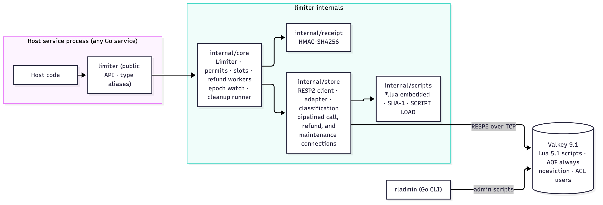

<details><summary>Diagram source (mermaid — flowchart)</summary>

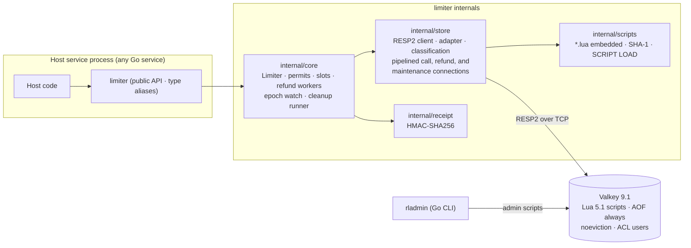

</details>

**Repository layout** (Go module `ratelimiter`; one module, so `internal/` is shared by the library, admin tool, and harness):

```
ratelimiter/
  go.mod                      # go 1.24, toolchain go1.27.1
  limiter/                    # PRODUCT: public API = type aliases of internal/core types + thin New/DefaultPolicy/DefaultInstance wrappers
  limitertest/                # PRODUCT test-only entry point; every file has //go:build rltest
  internal/
    core/                     # Limiter, acquire flow, permit state machine, slots, refund workers, epoch watch, cleanup runner, reclaimer
                              #   hooks_rltest.go (//go:build rltest): NewWithHooks — the only hook entry point
    store/resp/               # minimal RESP2 client (dial, AUTH, write, read, error replies)
    store/                    # adapter: EVALSHA calls, classification, NOSCRIPT reload; pipelined call, refund, and maintenance connections
    scripts/                  # acquire refund due_entries cleanup_entry reclaim read_epoch hold
                              # admin_start_epoch admin_restore admin_clear admin_status admin_inspect   (*.lua)
    receipt/  keys/  fingerprint/  settings/  metrics/
    testutil/                 # test helpers only (storeproc: spawn a store on a free port with a profile and rendered ACL; leak: goroutine leak check for TestMain)
                              #   storestate: store snapshots and the store audit (§C3, §C4); scriptrun: L2 stores with the audit, script runs, reply log and discipline run (§C3); golden: golden-line compare (§C5)
  cmd/
    rladmin/                  # PRODUCT admin tool (ADM-1..4)
    hitapi/ hitgen/ orchestrator/ sampler/ faultctl/   # HARNESS binaries
  harness/                    # HARNESS shared packages: config, runlog, httpapi, dbclient, fixtures, driver
  refmodel/                   # HARNESS reference model (Python)
  report/                     # HARNESS report builder (Python)
  scenarios/                  # HARNESS scenario TOML files
  deploy/                     # valkey-durable.conf, valkey-fast.conf, acl.conf.tmpl, pg-schema.sql
  tools/trace/                # traceability (IDs, plan-named tests), import-boundary, ACL, script lint, suppression, build-tag, test-global, oracle, reply-closure, API and child-process checks (§C7)
  tools/mutate/               # mutation testing: curated planted bugs and the operator sweep (§C9)
  Makefile
  conftest.py                 # pytest plugin: seeded random test order (§C1)
  AGENTS.md  CLAUDE.md        # coding rules for agents (CLAUDE.md imports AGENTS.md)
  .golangci.yml  .luacheckrc  stylua.toml  .styluaignore  pyproject.toml  requirements-dev.txt   # lint settings (AGENTS.md)
```

- **Boundary rule in code:** `limiter/`, `limitertest/`, `internal/`, and `cmd/rladmin` never import `harness/` or any `cmd/hit*` package; `tools/trace` fails the build if they do.

## A2. Store deployment profile

| Setting | Durable profile (production, benchmarks, durability tests) | Fast profile (logic tests only) | Rule |
|---|---|---|---|
| `appendonly` / `appendfsync` | `yes` / `always` | `yes` / `no` | `STA-16` |
| `no-appendfsync-on-rewrite` | `no` (keep fsync during rewrites) | `no` | `STA-16` |
| `aof-use-rdb-preamble`, `save` | `yes`, `""` (AOF is the record) | same | — |
| `maxmemory` / `maxmemory-policy` | sized per `STA-7` (harness: 512 MB) / `noeviction` | 128 MB / `noeviction` | `STA-16` |
| `maxclients` | `4096` | `4096` | §A7 connection budget |
| `auto-aof-rewrite-percentage` / `auto-aof-rewrite-min-size` | production: `100` / `1gb` (about one rewrite per 4–5 min at 10,000 allowed acquires/s, ~400 B of AOF each; limited acquires write nothing); capacity benchmarks: `0`, rewrite between runs; `TRF-S7`: production values plus forced rewrites at 3 and 7 min | `0` | §D1 |
| `bind`, `protected-mode`, `port` | `127.0.0.1`, `yes`, harness `6390` | free port | `HAR-20` |
| ACL file | rendered from `deploy/acl.conf.tmpl` with freshly generated passwords into the run or test directory (mode 0600) | same | `STA-16` |

**ACL users.** The store checks ACLs on every command a script calls, so each user lists both its client commands and its scripts' inner commands. `tools/trace` checks that the inner command names used by each user's scripts equal that user's list once all of that user's scripts exist (a subset before then).

| User | Client commands | Inner commands (called by its scripts) | Keys | Used by |
|---|---|---|---|---|
| `rl_lib` | `+evalsha +script|load +scan +ping +auth` | `+hgetall +hexists +hset +hdel +hincrby +hlen +zscore +zadd +zrem +zrange +del +unlink +get +time` | `~rl:*` | Library |
| `rl_admin` | `+evalsha +script|load +ping +auth +info +slowlog|get +bgrewriteaof` | `+hgetall +hget +hexists +hset +hdel +hincrby +hlen +zscore +zadd +zrem +zrange +zcard +del +get +time` | `~rl:*` | `rladmin` (reads the epoch through `read_epoch.lua`) |
| `rl_fixture` (test deployments only) | `+set +get +del +hset +hdel +zrem +zadd +flushall +ping +auth +type +eval` | — | `~rl:*` | Controlled clock driver, state tamper tool |
| `rl_ops` (harness and test deployments only) | `+config|get +config|set +info +bgrewriteaof +shutdown +ping +auth` | — | none | Orchestrator, `faultctl`, §C2 |

- `rl_lib` runs `acquire`, `refund`, `due_entries`, `cleanup_entry`, `reclaim`, `read_epoch`, `hold`; `rl_admin` runs the `admin_*` scripts and `read_epoch`.
- The rendered ACL file starts with `user default off`, so only these users can connect.
- Passwords reach processes through `RL_LIB_PASSWORD`, `RL_ADMIN_PASSWORD`, `RL_FIXTURE_PASSWORD`, `RL_OPS_PASSWORD`; they are never in the repo or the fingerprint.

## A3. Data model in the store

### A3.0 Verified store behavior

Measured on this laptop (Redis 8.6.2, macOS 26.6, M3 Max, 2026-10-03); reviewers re-ran rows 1, 5, 6 and the ACL behavior independently. The store conformance suite (§C2) re-checks every row on the pinned Valkey before slice 1.

| # | Behavior | Result | Design consequence |
|---|---|---|---|
| 1 | Lua version and number type | Lua 5.1, IEEE doubles; `2^53 + 1 == 2^53` | All in-script integers < 2^53 (§A3.1) |
| 2 | Number passed to `redis.call`, integer reply, `ZADD` score | Exact for < 2^53 | Safe |
| 3 | `tostring(1760000000000123)` | `1.7600000000001e+15` (digits lost) | Never `tostring` or `..` on numbers; use `string.format('%d', n)` |
| 4 | `TIME` inside a writing and inside a `no-writes` script | Allowed; real-time clock, {seconds, microseconds} | Budget time source (`CLK-3`) |
| 5 | Script errors after a write | **The earlier write stays** | Every script checks everything before its first write (`CMP-2`) |
| 6 | Out of memory, plain `#!lua` writing script | Refused **before execution** ("OOM command not allowed…"); `allow-oom` scripts run | acquire/refund `OOM` reply provably wrote nothing → `capacity_error`; maintenance scripts use `allow-oom` (§A4.8) |
| 7 | Unknown SHA | `NOSCRIPT No matching script` | Reload once, retry (`API-22`) |
| 8 | AOF content for a script | Effects wrapped in `MULTI … EXEC` | Crash recovery replays a script's writes all or none |
| 9 | `appendfsync always` cost | 50 clients: ~3,000 ops/s, p50 14 ms; 600 clients: ~29,800 ops/s, p50 19 ms, p99 33 ms; with automatic AOF rewrite on, p99 up to 760 ms; `everysec`: ~83,000 ops/s, p50 0.5 ms. Raw single-writer `F_FULLFSYNC` p50 ≈ 6.3 ms, plain `fsync` ≈ 0.02 ms | Throughput comes from group commit: keep many commands in flight (row 13); automatic rewrite off for capacity benchmarks |
| 10 | A Lua table with a `nil` converted to a reply | The array stops at the first `nil` | Reply arrays never contain `nil` (§A4.9) |
| 11 | `unpack` of a 10,000-element list | Error "too many results to unpack" | No `unpack` over store-sized lists; chunk commands to ≤ 500 elements |
| 12 | ACL with only `+evalsha` | "ACL failure in script: … no permissions to run the 'hset' command" | ACL lists include inner commands (§A2) |
| 13 | `appendfsync always`, few connections with pipelining | 8 connections × 64 pipelined: ~38,000 write scripts/s, p50 13 ms, p99 17 ms; 600 connections × 1: ~35,000/s, p50 17 ms, p99 23 ms | Batching follows commands in flight, not connections: a few pipelined connections per instance (§A5.4). Each connection contributes at most ~16 KB of commands per event-loop cycle, so a batch ≤ connections × 16 KB ÷ command size (row 13 used ~80-byte commands) |
| 14 | A `no-writes` script's reply on a durable store | Idle store: p50 0.12 ms; with concurrent writers: p50 13 ms, the same as a write | A reply waits for the batch fsync of its event-loop iteration: skipping writes on rejections saves AOF volume, not latency under load (§A4.8 rule 8) |
| 15 | `SIGKILL` of the durable store under 32 concurrent writers, then restart | 3 runs: 0 acknowledged writes lost; 15–19 unacknowledged writes kept | Durable against a process crash; a sent command without a reply may have applied (`outcome_unknown`). Re-run in §C2 |
| 16 | `LOADING` (data still loading after a restart) and `BUSY` (another script past its time limit) | Rejected in command dispatch before the command runs (Valkey `processCommand`) | `unavailable` (`API-22`); re-checked in §C2 |

- **Durability on macOS:** Valkey 9.1.2 defines `valkey_fsync(fd)` as `fcntl(fd, F_FULLFSYNC)` under `__APPLE__` (`src/config.h:132`) and calls it for `appendfsync always` (`src/aof.c:1371`). The measured cost (row 9) matches a full sync, not plain `fsync`; §C2 re-checks the timing, and `make verify-store-source` re-checks the source lines whenever the pinned version changes. Storage assumption: an internal SSD that honors `F_FULLFSYNC`.

### A3.1 Time and number domain

- **Budget time in the store** is `t_us` = microseconds since the Unix epoch: `TIME` seconds × 1,000,000 + microseconds, or the controlled time value. The library reports `decision_ns = t_us × 1000` (Go `int64`).
- **Units** follow `BUD-13`: 1 token = `rate_period_ns` units; refill adds `elapsed_us × 1000 × rate_tokens` units.
- **Narrowed validation (adds to `CFG-4`):** the instance refuses to start (`settings_invalid`) unless every row holds; together they keep every in-script value exact.

| Quantity | Bound | Default value |
|---|---|---|
| `capacity × rate_period_ns` (`cap_units`) | < 2^52 | 2 × 10^10 |
| `rate_tokens` | 1 … 2^31 − 1 | 10 |
| `rate_period_ns`, every `*_ns` time setting | multiple of 1,000 (µs granularity) | — |
| `receipt_lifetime_ns / 1000` | < 2^40 | 6 × 10^7 |
| `t_us` (clock reading, high-water mark) | < 2^53 − 2^43 (about the year 2255); a reading at or above → `clock_error`, a high-water mark at or above → `hwm_malformed` | ~1.79 × 10^15 |

- The time bound covers every derived time: `t + lifetime_us` (< 2^40), `t + quarantine_push_us` (= lifetime), and cleanup's `t + ceil_div(cap_units, rate_tokens × 1000)` (< 2^43).
- **Counters** (`gen`, `s`, `nb`, `nm`) grow by at most 1 per operation and cannot reach 2^53 in practice (285 years at 10^6 operations per second). Every read validates them with `is_uint53`, so an overflowed value would surface as quarantine or `epoch_record_malformed`, never as a silent wrap.
- **Exact refill in Lua** (no overflow, no rounding):

```lua
local TWO53 = 9007199254740992
local function refill(u, cap, elapsed_us, rate)        -- all integers < 2^53
  if elapsed_us <= 0 or u >= cap then return u end
  local missing = cap - u                               -- < 2^52
  local ns = elapsed_us * 1000                          -- exact if the true value < 2^53
  if ns >= TWO53 or ns >= missing then return cap end   -- true product >= 2^53 > missing
  local add = ns * rate
  if add >= TWO53 or add >= missing then return cap end
  return u + add
end
local function ceil_div(a, b)                           -- a >= 0, b > 0, a + b < 2^53
  local q = math.floor(a / b)
  while q * b < a do q = q + 1 end
  while q > 0 and (q - 1) * b >= a do q = q - 1 end
  return q
end
```

- **Retry delay** is computed in Go from the returned units: `retry_after_ns = ceil((rate_period_ns − units) / rate_tokens)` with `int64` (`API-6`).

### A3.2 Key layout

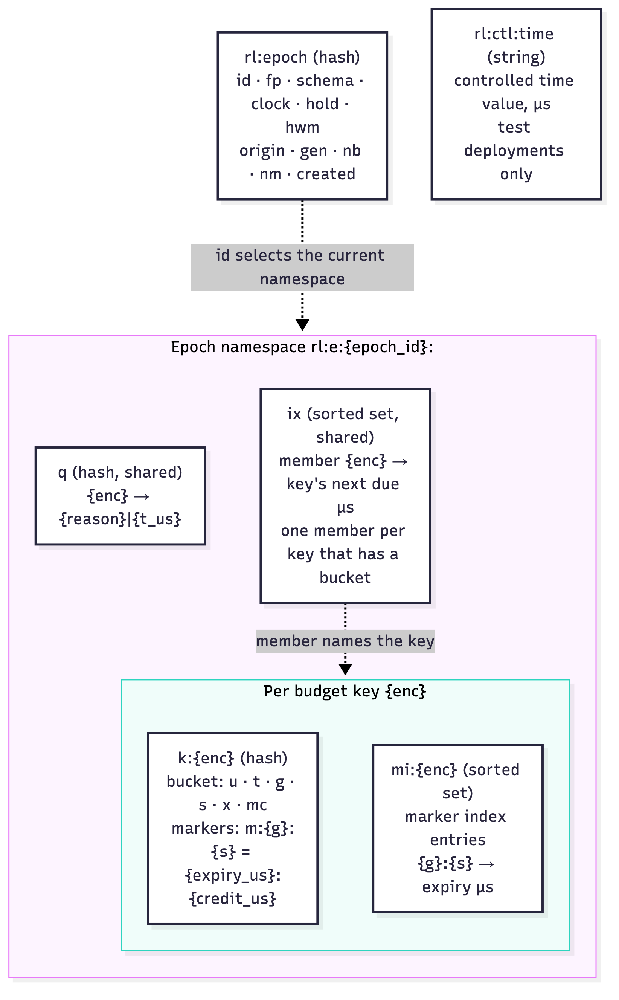

<details><summary>Diagram source (mermaid — flowchart)</summary>

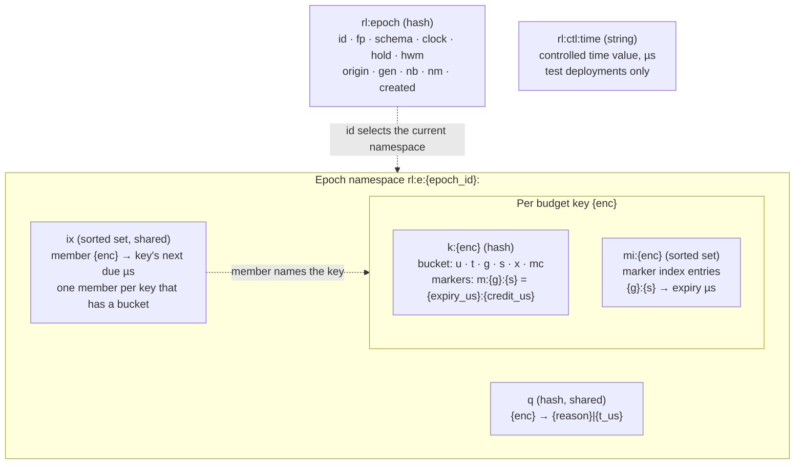

</details>

| Key | Type | Fields / members | Notes |
|---|---|---|---|
| `rl:epoch` | hash | `id` (32 hex), `fp` (32 hex), `schema` (`1`), `clock` (`store`/`controlled`), `hold` (`""` or reason), `hwm` (µs), `origin` (µs), `gen`, `nb` (tracked keys), `nm` (marker count), `created` (µs) | Epoch record + high-water mark + counters; `hwm` is written by every refund step, every acquire or cleanup step that writes anything else, and every `due_entries` page (§A4.8 rule 8) |
| `rl:ctl:time` | string | decimal µs | Written only by the controlled clock driver, before `ADM-1` (`CMP-4`) |
| `rl:e:<id>:k:<enc>` | hash | `u` units, `t` last-update µs, `g` generation, `s` sequence, `x` latest receipt expiry µs, `mc` marker count; `m:<g>:<s>` → `<expiry_us>:<credit_us>` | Bucket and its markers |
| `rl:e:<id>:mi:<enc>` | sorted set | `<g>:<s>` → marker expiry µs | The key's marker index entries (`STA-5`) |
| `rl:e:<id>:ix` | sorted set | `<enc>` → the key's next due µs | The key's bucket index entry. Invariant: for a key that is not quarantined, score ≤ max(the earliest of its bucket eligibility time and marker expiries, the time of the last `admin_restore`/`admin_clear` write); a quarantined key's score is unconstrained |
| `rl:e:<id>:q` | hash | `<enc>` → `<reason>|<t_us>` | Quarantine flags (`STA-10`) |

- `enc(key)` = base64url without padding (RFC 4648 §5) of the key's UTF-8 bytes. **Member grammar** (`is_enc`, identical in Go `internal/keys` and in Lua): 1–342 characters of `[A-Za-z0-9_-]` (decodes to 1–256 bytes, `API-1`), length mod 4 ≠ 1, and decoding then re-encoding gives the same string. Distinct keys give distinct encodings (`API-1`).
- **Every entry attributable to a key** is its `ix` member, a member of its `mi:<enc>`, a field of its `k:<enc>`, or its `q` field. So **expected absence** (`STA-8`) is exact: no `q` field, `k` and `mi` do not exist, and `ZSCORE ix enc` is nil. An `ix` member that fails `is_enc` cannot be attributed to a key and sets the integrity hold (`STA-9`).
- Store schema version `1` covers this layout and the script behavior in §A4 (`CFG-1`).

### A3.3 Key checks (`check_key`) and counters

One function, `check_key(enc)`, used by acquire, refund, cleanup, and `admin_clear`. All its reads use `redis.pcall` and run before any write: `HGETALL k`, `ZRANGE mi 0 -1 WITHSCORES`, `ZSCORE ix enc`. Rows are evaluated top to bottom; the first match decides.

| Observation | Outcome |
|---|---|
| `k` and `mi` absent, no `ix` member | `absent` (expected absence when the key is not quarantined) |
| `k` absent, `mi` exists | quarantine `marker_index_without_bucket` |
| `k` absent, `ix` member present | quarantine `index_without_bucket` |
| `k` wrong type, or some but not all bucket fields present, or a bucket field out of range (`u > cap_units`, non-integer) | quarantine `malformed_bucket` |
| `k` holds marker fields but no bucket fields | quarantine `marker_without_bucket` |
| A marker field with bad grammar, or generation ≠ `g` | quarantine `malformed_marker` |
| Number of marker fields ≠ `mc` | quarantine `marker_count` |
| `mi` wrong type, an `mi` member not `<g>:<s>`, `mi` members ≠ marker fields, or an `mi` score ≠ that marker's expiry | quarantine `marker_index_mismatch` |
| `k` present, `ix` member absent | quarantine `bucket_without_index` |
| `ZSCORE ix` or `HEXISTS q` raises an error (wrong type of a shared key) | integrity hold `shared_key_malformed` (epoch-wide; high-water mark not advanced) |
| `ix` score not `is_score` (fractional, `inf`, negative, ≥ 2^53) | quarantine `malformed_index` |
| everything consistent | `ok` (bucket fields, markers, `ix` score) |

- **Counters:** `nb` = keys holding a tracked slot (a bucket, or a quarantined key whose bucket vanished); `nm` = stored markers. Both, and each key's `mc`, also count buckets and markers that are due but not yet removed, until cleanup removes them — a conservative narrowing of `STA-6a` "live": it refuses earlier, never later. `admin_restore` adds 1 to `nb` when the key had no `ix` member (it may then count a key once too many, which also only refuses earlier). Decrements never take a counter below 0 (`dec_counter`), so a counter that drifted low after tampering cannot make the epoch record malformed.
- **Cost:** every check reads all of the key's markers, so acquire, refund, and cleanup cost O(markers of that key), at most `max_markers_per_key` (default 1,000) on one key. SPEC requires this (`API-1a` step 3, `T-INT-3`); the per-key cap bounds it (§D2 decision 3).

## A4. Scripts

### A4.1 Inventory

| Script | Header | KEYS | ARGV | Rules |
|---|---|---|---|---|
| `acquire.lua` | `#!lua` | epoch, ctl, `ix`, `q`, `k:<enc>`, `mi:<enc>` | epoch_id, fp, enc, cap_units, rate_period_ns, rate_tokens, lifetime_us, max_tracked, floor_hwm, floor_gen | `API-1a`, `BUD-*`, `RCP-3` |
| `refund.lua` | `#!lua` | epoch, ctl, `ix`, `q`, `k:<enc>`, `mi:<enc>` | epoch_id, fp, enc, receipt epoch_id, g, s, expiry_us, cap_units, rate_period_ns, rate_tokens, max_markers, max_markers_per_key, floor_hwm, floor_gen | `API-2a` steps 2–9 |
| `due_entries.lua` | `#!lua flags=allow-oom` | epoch, ctl, `ix` | epoch_id, fp, limit, cutoff (0 = none), floor_hwm, floor_gen | Writes `hwm` = T0; returns due members (§A4.5) |
| `cleanup_entry.lua` | `#!lua flags=allow-oom` | epoch, ctl, `ix`, `q`, `k:<member>`, `mi:<member>` (Go passes these only when `is_enc(member)` holds, else the placeholders `rl:e:<id>:k:!` and `rl:e:<id>:mi:!`) | epoch_id, fp, member, cap_units, rate_tokens, push_us, floor_hwm, floor_gen | `STA-3`…`STA-5`, `STA-9`, `STA-10`, `N1` |
| `reclaim.lua` | `#!lua flags=allow-oom` | epoch, then ≤ `ReclaimBatch` candidate keys | — | `ADM-1` reclamation |
| `read_epoch.lua` | `#!lua flags=no-writes` | epoch, ctl, `q` of the joined epoch (`rl:e:!:q` before joining) | — | Epoch watch (`CFG-6`), rollback check, clock lag, capacity gauges |
| `hold.lua` | `#!lua flags=allow-oom` | epoch | expected_id, reason | Sets the integrity hold when the epoch watch sees the store go back in time (§A5.7) |
| `admin_start_epoch.lua` | `#!lua flags=allow-oom` | epoch, ctl | new_id, fp, schema, clock, replace (0/1), expected_id | `ADM-1` |
| `admin_restore.lua` | `#!lua flags=allow-oom` | epoch, ctl, `ix`, `q`, `k:<enc>`, `mi:<enc>` | expected_id, fp, enc, balance_units, cap_units, lifetime_us | `ADM-2` |
| `admin_clear.lua` | `#!lua flags=allow-oom` | epoch, ctl, `ix`, `q`, `k:<enc>`, `mi:<enc>` | expected_id, fp, enc, cap_units | `ADM-3` |
| `admin_status.lua` | `#!lua flags=no-writes` | epoch, `q` | expected_id | `ADM-4` |
| `admin_inspect.lua` | `#!lua flags=no-writes` | epoch, `ix`, `q`, `k:<enc>`, `mi:<enc>` | expected_id, enc | `ADM-4` |

- Every script that takes `enc` (or `member`), right after the epoch check (`cleanup_entry`: after its `gone`/`not_due` and `is_enc` checks, so a bad member's placeholder KEYS reach the hold instead of `keys_mismatch`), asserts its per-key KEYS equal `'rl:e:' .. e.id .. ':k:' .. enc` and `':mi:' .. enc`; on mismatch it returns `{25, 0, 'keys_mismatch'}` without writing anything (a library defect, reported as `outcome_unknown`).

### A4.2 Common prelude

```lua
local TWO53  = 9007199254740992
local TBOUND = TWO53 - 8796093022208            -- 2^53 - 2^43
local function record_wellformed(e)            -- the record minus hwm and the hold's value
  return is_hex32(e.id) and is_hex32(e.fp) and e.schema == '1'
     and (e.clock == 'store' or e.clock == 'controlled')
     and is_uint53(e.gen) and is_uint53(e.nb) and is_uint53(e.nm)
     and is_uint53(e.origin) and is_uint53(e.created) and e.hold ~= nil
end
local function load_epoch()                    -- never writes
  local ok, raw = pcall(redis.call, 'HGETALL', KEYS[1])
  if not ok then return nil, 'epoch_record_malformed' end
  if #raw == 0 then return nil, 'epoch_record_missing' end
  local e = to_map(raw)
  if not record_wellformed(e) then return nil, 'epoch_record_malformed' end
  if e.hwm == nil then return nil, 'hwm_missing' end
  if not is_uint53(e.hwm) or tonumber(e.hwm) >= TBOUND then return nil, 'hwm_malformed' end
  if e.hold ~= '' then return nil, 'integrity_hold' end
  return e
end
local function read_clock(e)                   -- CLK-1, CLK-2, CLK-8; nil -> clock_error
  local v
  if e.clock == 'controlled' then
    local ok, s = pcall(redis.call, 'GET', KEYS[2])
    if not ok or not is_uint53(s) then return nil end
    v = tonumber(s)
  else
    local tm = redis.call('TIME')
    v = tonumber(tm[1]) * 1000000 + tonumber(tm[2])
  end
  if v >= TBOUND then return nil end
  return v
end
-- Prelude, in this order (API-1a step 1, then step 2):
--   e, why = load_epoch()                        not e        -> return {22, 0, why}                   (no writes)
--   e.id ~= ARGV[1] or e.fp ~= ARGV[2]                        -> return {20, 0, 'epoch_or_fingerprint'} (no writes)
--   e.hwm < floor_hwm or e.gen < floor_gen (floors in ARGV)    -> return hold('store_rollback')        (§A5.7)
--   now = read_clock(e)                          not now      -> return {21, 0, 'clock'}               (no writes)
--   t = max(now, tonumber(e.hwm))                -- budget time (CLK-4)
-- Helpers used below:
--   write_hwm(): if t > hwm then HSET epoch hwm t
--   finish(code, reason, ...): write_hwm(); return {code, t, reason, ...}
--   reply(code, reason, ...): return {code, t, reason, ...}                         (writes nothing: §A4.8 rule 8)
--   quarantine(reason): HSET q enc string.format('%s|%d', reason, t); write_hwm(); return {23, t, reason}
--   hold(reason): HSET epoch hold reason; return {22, 0, 'integrity_hold'}           (hwm not advanced)
--   dec_counter(f, n): HINCRBY epoch f -min(n, e[f]) and update e[f]               (never below 0)
```

- `is_uint53(s)`: a string of 1–16 decimal digits, no leading zero unless `"0"`, value < 2^53. `is_hex32(s)`: 32 lowercase hex characters. `is_score(s)`: `tonumber(s)` is an integer in [0, 2^53) — derived times such as `t + lifetime_us` may pass `TBOUND`, and §A3.1 keeps them below 2^53; compared as a number, so it does not depend on how the store formats scores.

### A4.3 `acquire.lua` (after the prelude; steps of `API-1a`)

```lua
local qok, qv = pcall(redis.call, 'HEXISTS', K_q, enc)
if not qok then return hold('shared_key_malformed') end
if qv == 1 then return reply(23, 'quarantined') end                           -- step 3 (writes nothing)
local st, b, ixscore = check_key(enc)                                        -- §A3.3, reads only
if st == 'shared' then return hold('shared_key_malformed') end
if st == 'bad' then return quarantine(b) end                                -- b is the reason
if st == 'absent' then                                                       -- expected absence (STA-8)
  if tonumber(e.nb) >= max_tracked then return reply(24, 'tracked_buckets') end    -- step 4 (writes nothing)
  -- ---- every check done; writes start here ----
  local g = redis.call('HINCRBY', K_epoch, 'gen', 1)
  redis.call('HINCRBY', K_epoch, 'nb', 1)
  local u, exp = cap_units - rate_period_ns, t + lifetime_us                  -- new bucket starts full (BUD-6)
  redis.call('HSET', K_k, 'u', u, 't', t, 'g', g, 's', 1, 'x', exp, 'mc', 0)
  redis.call('ZADD', K_ix, exp, enc)
  write_hwm(); return {1, t, '', u, g, 1, exp}
end
local u = refill(b.u, cap_units, t - b.t, rate_tokens)
if u < rate_period_ns then return reply(2, '', u) end                       -- limited: writes nothing (CLK-4)
-- ---- every check done; writes start here ----
u = u - rate_period_ns
local s, exp = b.s + 1, t + lifetime_us
local x = math.max(b.x, exp)
redis.call('HSET', K_k, 'u', u, 't', t, 's', s, 'x', x)
redis.call('ZADD', K_ix, 'GT', math.min(x, b.first_marker_expiry or x), enc)
write_hwm(); return {1, t, '', u, b.g, s, exp}
```

- `ZADD … GT` only moves the key's due time later; it keeps the §A3.2 invariant because eligibility only moves later after an allow and every marker expiry is ≤ `x`.

### A4.4 `refund.lua` (after the prelude; steps of `API-2a`)

```lua
-- step 1 (signature, format, canonical decimal g and s) already passed in Go
if r_epoch ~= e.id then return finish(10, 'epoch') end                        -- step 4
if t >= expiry_us then return finish(11, 'expired') end                       -- step 5
local qok, qv = pcall(redis.call, 'HEXISTS', K_q, enc)
if not qok then return hold('shared_key_malformed') end
if qv == 1 then return finish(23, 'quarantined') end                          -- step 6
local st, b = check_key(enc)
if st == 'shared' then return hold('shared_key_malformed') end
if st == 'bad' then return quarantine(b) end
if st == 'absent' then return quarantine('refund_bucket_missing') end          -- STA-9 bullet 4
if tonumber(g_str) ~= b.g or tonumber(s_str) < 1 or tonumber(s_str) > b.s then
  return finish(10, 'generation_or_sequence') end                              -- step 7
local field = 'm:' .. g_str .. ':' .. s_str                                    -- g_str, s_str: canonical decimal strings
local mval = b.markers[field]
if mval then return finish(4, '', mval.credit_us) end                         -- step 8 (check_key verified its mi entry)
if b.mc >= max_markers_per_key then return finish(24, 'key_markers') end      -- step 9, per key
if tonumber(e.nm) >= max_markers then return finish(24, 'live_markers') end   -- step 9, epoch-wide
-- ---- every check done; writes start here ----
local u = refill(b.u, cap_units, t - b.t, rate_tokens)
local credited = math.min(cap_units, u + rate_period_ns) - u                  -- may be 0
redis.call('HSET', K_k, 'u', u + credited, 't', t, field, string.format('%d:%d', expiry_us, t), 'mc', b.mc + 1)
redis.call('ZADD', K_mi, expiry_us, g_str .. ':' .. s_str)
redis.call('ZADD', K_ix, 'LT', expiry_us, enc)
redis.call('HINCRBY', K_epoch, 'nm', 1)
write_hwm(); return {3, t, '', credited}
```

### A4.5 Cleanup: `due_entries.lua` and `cleanup_entry.lua`

```lua
-- due_entries.lua, after the prelude (no writes yet); writes hwm = T0 through write_hwm() below:
local hi = t                                        -- T0 of this call
if cutoff > 0 and cutoff < hi then hi = cutoff end
local ok, m = pcall(redis.call, 'ZRANGE', K_ix, '-inf', hi, 'BYSCORE', 'LIMIT', 0, limit, 'WITHSCORES')
if not ok then return hold('shared_key_malformed') end
write_hwm()
return {0, t, '', oldest_score_or_0(m), members(m)...}    -- members only; scores dropped except the oldest (0 if it fails is_score, §A4.9 ranges)

-- cleanup_entry.lua, after the prelude: one key per atomic step; re-checks every entry of the key it handles (STA-5)
local ok, sc = pcall(redis.call, 'ZSCORE', K_ix, member)
if not ok then return hold('shared_key_malformed') end
if not sc then return reply(33, 'gone', 0) end                                -- another instance did it
if tonumber(sc) > t then return reply(33, 'not_due', 0) end
if not is_enc(member) then return hold('unattributable_entry') end            -- N1
assert_keys(member)                                                            -- else {25, 0, 'keys_mismatch'}
local qok, qv = pcall(redis.call, 'HEXISTS', K_q, member)
if not qok then return hold('shared_key_malformed') end
if qv == 1 then                                                                -- quarantined: never removed (STA-4)
  redis.call('ZADD', K_ix, 'XX', t + push_us, member); return finish(31, 'quarantined', 0)
end
local st, b = check_key(member)
if st == 'shared' then return hold('shared_key_malformed') end
if st ~= 'ok' then                                                             -- 'bad' (absent cannot occur: the ix member exists)
  redis.call('HSET', K_q, member, string.format('%s|%d', b, t))
  redis.call('ZADD', K_ix, 'XX', t + push_us, member)                          -- entry kept, moved past this pass
  return finish(32, b, 0)
end
local u = refill(b.u, cap_units, t - b.t, rate_tokens)
local due, rest = split_markers_by_expiry(b, t)                                -- lists built before any write
if u == cap_units and b.x <= t and #rest == 0 then                             -- STA-4 eligibility
  redis.call('DEL', K_k, K_mi)                                                  -- bucket, markers, marker entries
  redis.call('ZREM', K_ix, member)
  dec_counter('nb', 1); dec_counter('nm', b.mc)
  return finish(30, '', b.mc)
end
-- every value the writes need is computed before the first write
local bucket_due = math.max(t + ceil_div(cap_units - u, rate_tokens * 1000), b.x, last_expiry(rest) or 0)
local new_score = math.min(bucket_due, first_expiry(rest) or bucket_due)      -- always > t
-- ---- writes start here ----
for chunk in chunks(due, 500) do                                               -- STA-3 for markers already expired
  redis.call('HDEL', K_k, fields(chunk)...); redis.call('ZREM', K_mi, members(chunk)...)
end
if #due > 0 then
  redis.call('HINCRBY', K_k, 'mc', -#due); dec_counter('nm', #due)
end
redis.call('ZADD', K_ix, 'XX', new_score, member)
return finish(31, '', #due)
```

- **Pass procedure** (runner): call `due_entries` with `cutoff = 0`; remember its T0 as the pass **cutoff**; process the returned page; call again with `cutoff` = that T0; repeat until a page is empty.
- **Why it ends and covers everything due at the cutoff:** `due_entries` writes `hwm` = T0, so every later step has `t ≥ hwm ≥ cutoff`. Each handled key leaves the range: removed, or re-scored above its step's `t` (new due time, or quarantine push `t + push_us`). New entries score above their step's `t` (a new bucket's `x = t + lifetime`, a refund's expiry > `t`); an `admin_restore` or `admin_clear` sets score `= t` at most once per operator action, and the key's next cleanup step moves or removes it. So the pass terminates and handles every entry due at the cutoff (`STA-5`).
- `push_us` = `receipt_lifetime_us` (60 s at defaults).
- A restored bucket carries `x = restore time + receipt_lifetime` (§A4.6), so `STA-4` keeps it until every receipt issued before the restore has expired; their refunds end `receipt_invalid` (generation mismatch) before their expiry, or `receipt_expired` after it, and never find the key absent.

### A4.6 Admin scripts

| Script | Steps (all in one atomic step) | Reply |
|---|---|---|
| `admin_start_epoch` | Read `rl:epoch` raw. **Readable** = `HGETALL` succeeds, non-empty, and `record_wellformed` (the high-water mark and the hold's value are ignored). **No flag:** refuse (`epoch_exists`) iff a readable record exists — so it starts on a fresh store, after a wipe, or over a malformed record. **Replace:** require a readable record with `id == expected_id` (else `epoch_record_missing`, `epoch_record_malformed` or `epoch_changed`) — so it recovers after a lost high-water mark or under a hold. Read the clock with `read_clock` (store or controlled; nil → `{21, 0, 'clock'}`). `DEL rl:epoch`; `HSET` the new record with `hold ""`, `hwm = origin = created = t`, `gen = nb = nm = 0` | `{40, t, '', new_id}`, `{41, 0, reason}`, or `{21, 0, 'clock'}` |
| `admin_restore` | **Fence:** `load_epoch` succeeds (well-formed, high-water mark present and < `TBOUND`, hold empty), `id == expected_id`, and `fp == ARGV fp`; else `{41, 0, why}` (`why`: `load_epoch`'s reason, `epoch_changed`, or `fingerprint_mismatch`). Assert KEYS. `pcall` reads of `HEXISTS q enc` and `ZSCORE ix enc` (error → `hold('shared_key_malformed')`, §A4.8 rule 2). Key must be quarantined (else `not_quarantined`). `0 ≤ balance_units ≤ cap_units` (else `balance_out_of_range`). Clock and `t` as in the prelude. Count = max(`m:*` fields in `k`, `ZCARD mi`), 0 for what cannot be read. Writes: `DEL k mi`; `ZREM ix enc`; `dec_counter('nm', count)`; `HINCRBY nb 1` if the key had no `ix` member; `g = HINCRBY gen 1`; `HSET k u=balance t=t g=g s=0 x=t+lifetime_us mc=0` (`x`: §D2 owner decision 5); `ZADD ix t enc`; `hwm` | `{40, t, '', g}`, `{41, 0, reason}`, `{21, 0, 'clock'}`, `{22, 0, 'integrity_hold'}`, or `{25, 0, 'keys_mismatch'}` |
| `admin_clear` | Fence as for restore (incl. `fp`). Assert KEYS. `pcall` `HEXISTS q enc` (error → `hold('shared_key_malformed')`); key must be quarantined (else `not_quarantined`). `check_key`: `shared` → `hold('shared_key_malformed')`; anything else but `ok` → `{41, 0, reason}`, with reason `bucket_missing` for `absent` (`ADM-3` needs a bucket and every entry consistent). Clock and `t`. Writes: `HDEL q enc`; `ZADD ix XX t enc` (undoes the quarantine push, so the key is reconsidered at once); `hwm` | `{40, t, '', 0}`, `{41, 0, reason}`, `{21, 0, 'clock'}`, `{22, 0, 'integrity_hold'}`, or `{25, 0, 'keys_mismatch'}` |
| `admin_status` | Read the record raw: empty → `{41, 0, 'epoch_record_missing'}`; error or not well-formed → `{41, 0, 'epoch_record_malformed'}`; `id ≠ expected_id` → `{41, 0, 'epoch_changed'}`. `pcall` `HLEN q` (error → `{41, 0, 'shared_key_malformed'}`). Return record fields (`hwm` as `''` when missing) | §A4.9 |
| `admin_inspect` | Same record checks; assert KEYS; `pcall` every read: an error on `ix` or `q` → `{41, 0, 'shared_key_malformed'}`; a wrong-type `k` gives present = 2 (unreadable); a wrong-type `mi` gives n = 0; a missing or unreadable bucket field, or one that fails `is_uint53`, is returned as `''`. Return bucket fields, marker expiries (from `mi`), `ix` score, quarantine flag | §A4.9 |

- Under the layout of §A3.2, a restore removes every entry attributable to the key by construction (`ADM-2`), with no scan.
- `rladmin` gets the expected ID from `read_epoch.lua` just before a status or inspect call; on `epoch_changed` it re-reads and retries once, then exits 3 ("epoch changed during read"). For `epoch_record_missing` or `epoch_record_malformed` it prints the reason and the recovering command (`start-epoch` without `--replace`).

### A4.7 Reclaiming old-epoch data

- After every completed cleanup pass (not a stopped one), each instance continues its own `SCAN <cursor> MATCH rl:e:* COUNT 1000` for at most 10 calls, collects keys whose namespace ID differs from the joined epoch, and sends them to `reclaim.lua` in batches of `ReclaimBatch` (1,000).
- `reclaim.lua` reads `rl:epoch`; if the record is missing or not well-formed it deletes nothing. Otherwise it `UNLINK`s each candidate (one call per key) whose `rl:e:<id>:` prefix differs from the current `id`. New-epoch data is never deleted (`ADM-1`).
- **Bound:** a full `SCAN` iteration returns every key present throughout and finishes when the cursor returns to 0; the expected number of calls is about keys / 1000 (100 calls for 100,000 keys, so about 10 passes ≈ 50 s per instance). `COUNT` is a hint, so this is an expected bound; the worst case is bounded by the store's hash-table size, because each call advances the cursor by at least one bucket. §C2 measures the call count for 200,000 keys. The reclaimer runs after every completed pass, whatever epoch the instance remembers. Until reclaimed, old data counts toward store memory (`STA-7`, §A7).

### A4.8 Rules for script authors

1. **Headers:** acquire and refund use plain `#!lua` (refused before running under OOM → `capacity_error`). `due_entries`, `cleanup_entry`, `reclaim`, `hold`, `admin_start_epoch`, `admin_restore`, and `admin_clear` use `#!lua flags=allow-oom`: they free memory or write small bounded data (one `q` field per key, in-place overwrites, one new record or bucket), and an operator must be able to recover a full store. Read-only scripts use `#!lua flags=no-writes`.
2. **Checks before writes:** all reads and checks come first. Reads of per-key keys go through `check_key`; the first reads of `ix` and `q` use `redis.pcall`, and an error sets the hold `shared_key_malformed` (`STA-9`); `rl:epoch` errors stay `epoch_record_malformed` with no write. In `no-writes` scripts (`admin_status`, `admin_inspect`) these reads also use `redis.pcall`, and an error returns `{41, 0, 'shared_key_malformed'}` without writing; the next writing script that touches the key sets the hold. Writes start only after the last check and are only `HSET`, `HDEL`, `HINCRBY`, `ZADD`, `ZREM`, `DEL`, `UNLINK` on keys whose types were verified (`CMP-2`).
3. **Lists:** any list built from store data is complete before the first write; no single command gets more than 500 list elements (chunk `HDEL`/`ZREM`); never `unpack` a list whose size depends on the store.
4. **Numbers:** never `tostring(n)` or `..` with a number; use `string.format('%d', n)`. Divide only through `ceil_div`. Never compare a product to an integer without the guard in `refill`. Range queries use `ZRANGE … BYSCORE` (never `ZRANGEBYSCORE`).
5. **Validation:** every value read from the store is validated (`is_uint53`, `is_hex32`, `is_enc`, field presence) before use.
6. **Replies:** follow §A4.9 exactly; position 3 is always a string (`''` = none); never `nil`.
7. **Clock:** a script reads the clock at most once and never before the epoch check (`CLK-1`).
8. **High-water mark** (`CLK-4`): write `hwm` in every refund step, in every acquire or cleanup step that writes anything else, and in every `due_entries` page. Skip it in steps that write nothing else: a limited, capacity-refused, or already-quarantined acquire, and a skipped cleanup step. The integrity-hold path never advances it.

### A4.9 Reply layouts and result codes

Every reply is `{code, t_us, reason, v…}`; integers are Lua numbers < 2^53. The Go decoder checks the exact length per (script, code) — `due_entries` code 0 has a minimum length of 4, the rest being members, and `admin_inspect` has 13 + n; any other shape → `outcome_unknown` with the raw reply in `Diag`.

The decoder also checks every integer against its range, given the instance's limits (`cap_units`, `rate_period_ns`, `lifetime_us`, `max_markers_per_key`):

- `t_us` is 0 where the layout shows 0; otherwise 0 ≤ `t_us` < `TBOUND`.
- `E_ALLOWED`: 0 ≤ `u` ≤ `cap_units` − `rate_period_ns`, `g` ≥ 1, `s` ≥ 1, `expiry_us` = `t_us` + `lifetime_us`.
- `E_LIMITED`: 0 ≤ `u` < `rate_period_ns`.
- `E_APPLIED`: 0 ≤ `credited_units` ≤ `rate_period_ns`.
- `E_ALREADY_APPLIED`: 0 ≤ `credit_us` ≤ `t_us`, and `credit_us` < the receipt's expiry.
- Cleanup codes 30–33: 0 ≤ `markers_removed` ≤ `max_markers_per_key`.
- `due_entries`: 0 ≤ `oldest_due_or_0` ≤ T0.
- `read_epoch` and admin replies: integers in 0 … 2^53 − 1 (`admin_status` shows a stored `hwm` as it is, so an operator can see one at or above `TBOUND`).

A value out of range is treated like a wrong shape: `outcome_unknown` with the raw reply in `Diag` (a refund attempt that gets one is retried as `outcome_unknown`).

| Code | Name | Reply | Library result |
|---|---|---|---|
| 0 | `due_entries` page | `{0, T0, '', oldest_due_or_0, member…}` | runner input |
| 1 | `E_ALLOWED` | `{1, t, '', u, g, s, expiry_us}` | `allowed` + receipt |
| 2 | `E_LIMITED` | `{2, t, '', u}` | `limited`, `retry_after_ns` from `u` |
| 3 | `E_APPLIED` | `{3, t, '', credited_units}` | refund `applied`, credit time `t` |
| 4 | `E_ALREADY_APPLIED` | `{4, t, '', credit_us}` | refund `already_applied`, original credit time |
| 10 / 11 | `E_RECEIPT_INVALID` / `E_RECEIPT_EXPIRED` | `{c, t, reason}` | refund `receipt_invalid` / `receipt_expired` |
| 20 | `E_CONFIG` | `{20, 0, reason}` | `config_error` |
| 21 | `E_CLOCK` | `{21, 0, reason}` | `clock_error` |
| 22 | `E_INTEGRITY_EPOCH` | `{22, 0, reason}` | epoch-wide `state_integrity_error` (`epoch_record_missing`, `epoch_record_malformed`, `hwm_missing`, `hwm_malformed`, `integrity_hold`) |
| 23 | `E_INTEGRITY_KEY` | `{23, t, reason}` | per-key `state_integrity_error` (reason from §A3.3, `quarantined`, `refund_bucket_missing`) |
| 24 | `E_CAPACITY` | `{24, t, reason}` | `capacity_error` (`tracked_buckets`, `live_markers`, `key_markers`) |
| 25 | `E_BAD_CALL` | `{25, 0, reason}` | `outcome_unknown` (library defect, reported in `Diag`) |
| 30–33 | `E_REMOVED`, `E_MOVED`, `E_QUARANTINED`, `E_SKIPPED` | `{c, t, reason, markers_removed}` | cleanup counts |
| — | `read_epoch` | `{state, 0, reason, id, fp, hwm, gen, clock_us, nb, nm, quarantined_or_''}` (state 0 = healthy, 22 = epoch-wide problem; `id` and `fp` are returned whenever the record is well-formed, so `rladmin` can name an epoch under a hold; `''`/0 for unreadable fields; `quarantined` only when KEYS[3] belongs to the current epoch) | epoch watch, rollback check, gauges |
| 40 | `OK`: `admin_start_epoch` | `{40, t, '', new_id}` | admin result |
| 40 | `OK`: `admin_restore` / `admin_clear` | `{40, t, '', g}` / `{40, t, '', 0}` | admin result |
| 40 | `OK`: `admin_status` | `{40, 0, '', id, fp, hold, hwm_or_'', nb, nm, quarantined_count}` | admin result |
| 40 | `OK`: `admin_inspect` | `{40, 0, '', present (0/1/2), u_or_'', t_or_'', g_or_'', s_or_'', x_or_'', mc_or_'', ix_score_or_'', quarantine_or_'', n, expiry_1 … expiry_n}` | admin result |
| 40 | `OK`: `reclaim` | `{40, 0, '', unlinked_count}` (0 when the record is missing or not well-formed) | `rl_reclaim_keys_total` |
| 40 / 41 | `hold` | `{40, 0, '', 0}` (hold set, or already set and left unchanged), or `{41, 0, 'epoch_changed'}` when the record is unreadable or not the expected epoch | rollback check |
| 41 | `REFUSED` (admin) | `{41, 0, reason}` | admin refusal |

## A5. Library internals

### A5.1 Packages and goroutines

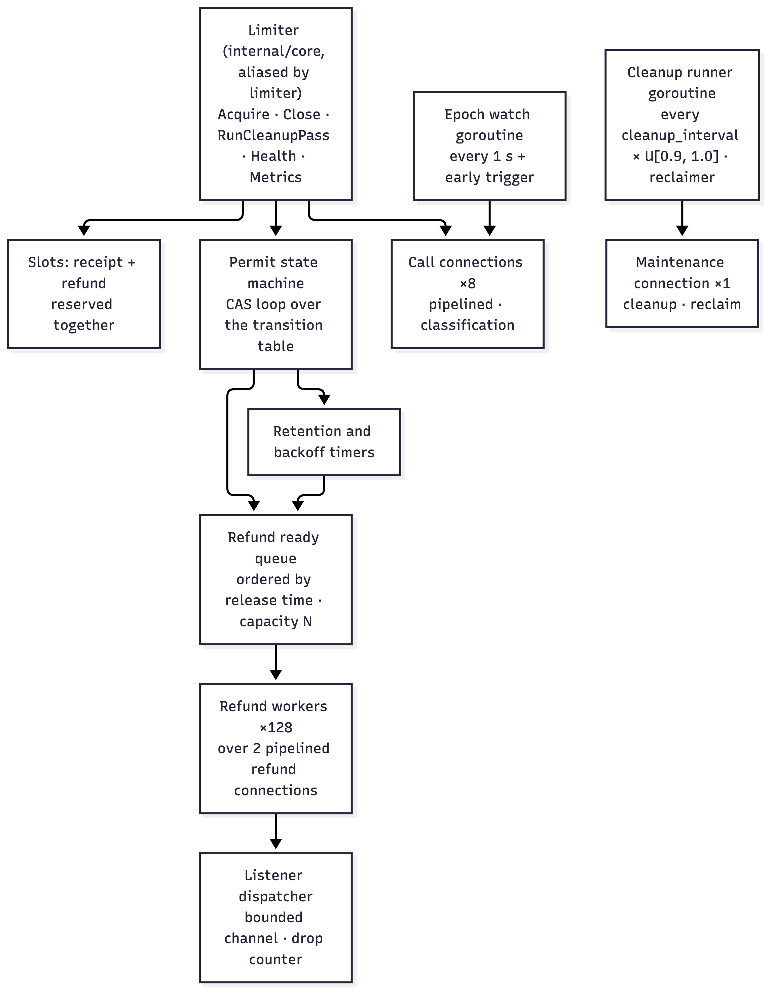

<details><summary>Diagram source (mermaid — flowchart)</summary>

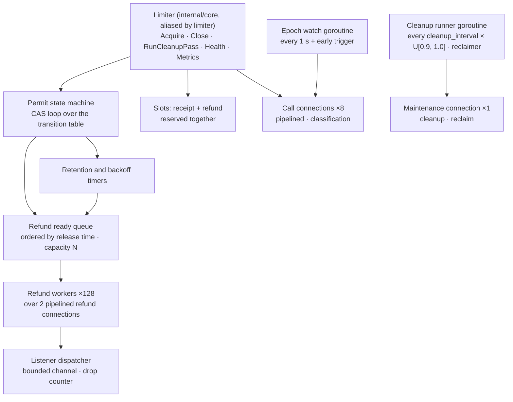

</details>

### A5.2 Public API (Go)

```go
package limiter

type Limiter = core.Limiter     // defined in internal/core

type Policy struct {            // shared, fingerprinted (CFG-1, CFG-8)
    RateTokens, RatePeriodNs, Capacity       int64
    FailureMode                              FailureMode   // Closed (default) | Open
    MaxTrackedBuckets, MaxLiveMarkers        int64         // required
    MaxMarkersPerKey                         int64         // default 1000
    ReceiptLifetimeNs, RefundDeadlineNs      int64
    OutageToleranceNs, CleanupIntervalNs     int64
    ClockSource                              ClockSource   // Store; Controlled only through limitertest
}
type Instance struct {          // per instance, validated locally (CFG-8)
    MaxReleaseDelayNs, MarginNs              int64   // required
    ClockRateBoundPPM                        int64   // default 1000
    DependencyDeadlineNs                     int64   // default 2 s
    EpochRereadIntervalNs, DrainTimeoutNs    int64   // 1 s; refund_deadline + outage_tolerance (from DefaultInstance(p))
    MaxHeldReceipts, MaxPendingRefunds       int     // required
    ListenerQueueSize, RefundWorkers         int     // 10000; 128
    RefundBackoffInitialNs, RefundBackoffMaxNs int64 // 50 ms; 1 s
    StoreConns, RefundConns, CleanupBatch, CleanupPipelines, ReclaimBatch int // 8; 2; 1000; 4; 1000
}
type StoreOptions struct{ Addr, User, Password string }

func DefaultPolicy() Policy                 // SPEC defaults; required fields left 0
func DefaultInstance(p Policy) Instance     // DESIGN defaults; DrainTimeoutNs = p.RefundDeadlineNs + p.OutageToleranceNs; required fields left 0
func New(p Policy, in Instance, st StoreOptions, opts ...Option) (*Limiter, error) // production construction
func WithRefundListener(f func(RefundEvent)) Option

func (l *Limiter) Acquire(ctx context.Context, key string) Result   // host deadline = ctx deadline; cancel = ctx
func (l *Limiter) Close(opts ...CloseOption)                         // blocks until drained; WithDrainTimeout(d) overrides the setting
func (l *Limiter) RunCleanupPass(ctx context.Context) CleanupReport
func (l *Limiter) Health() Health
func (l *Limiter) Metrics() MetricsSnapshot

type Result struct {
    Kind         ResultKind // Allowed, Degraded, Limited, ValidationError, ClockError, Busy, Cancelled,
                            // ConfigError, NotReady, StateIntegrityError, CapacityError, Unavailable,
                            // OutcomeUnknown, ReceiptError
    DecisionNs   int64      // allowed, limited
    RetryAfterNs int64      // limited
    Permit       *Permit    // allowed, degraded
    Diag         Diag       // Scope (key|epoch), Reason, StoreError
}
func (p *Permit) Done()
func (p *Permit) Release()
func (p *Permit) DeductionID() string   // "" for degraded permits

type RefundEvent struct {
    DeductionID       string
    Result            RefundResult      // Applied, AlreadyApplied, ReceiptInvalid, ReceiptExpired, Unresolved
    Reason            UnresolvedReason  // Closed, Retention, Expired (Unresolved only)
    Attempts          int               // commands actually sent (API-1d)
    CreditDecisionNs  int64             // 0 when unknown
    ReleaseMonoNs, FinalMonoNs int64    // monotonic times of release() and of the final result (REF-5 evidence)
}
```

- **Where things are declared:** every type above and every method is defined in `internal/core`, except types owned by a lower internal package, which core aliases (`Policy`, `Instance`, `StoreOptions` in `internal/settings`; `MetricsSnapshot` in `internal/metrics`); package `limiter` re-exports them as type aliases (`type Policy = core.Policy`, …) and holds only thin wrappers (`New`, `DefaultPolicy`, `DefaultInstance`, `WithRefundListener`, `WithDrainTimeout`). This avoids an import cycle with `core.NewWithHooks`; the listing shows the public surface, not where each item is declared.
- **Defaults and zero values:** hosts start from `DefaultPolicy()` / `DefaultInstance(p)` and overwrite fields. A zero field always means the literal value 0, valid only where SPEC allows it (`drain_timeout`, `clock_rate_bound`). Required settings have no default and fail "positive" validation while 0. Harness TOML decodes onto the defaults, so absent keys keep their defaults.
- **`New` (and `limitertest.New`, `core.NewWithHooks`) never return nil.** Invalid settings (`CFG-4`, §A3.1, the §A7 refund inequality) or a failed signing-key generation (`RCP-4`) give a limiter that is permanently not ready (`settings_invalid`): `Acquire` returns `not_ready`, no goroutine contacts the store, and `New` also returns the error for logging.
- One process may build several `Limiter` values; each has its own connections, slots, runners, and epoch, bound to one deployment and one dedicated store (`F32`).

### A5.3 Acquire path

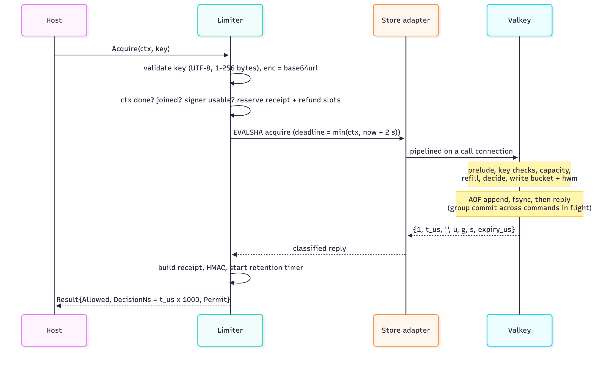

<details><summary>Diagram source (mermaid — sequence diagram)</summary>

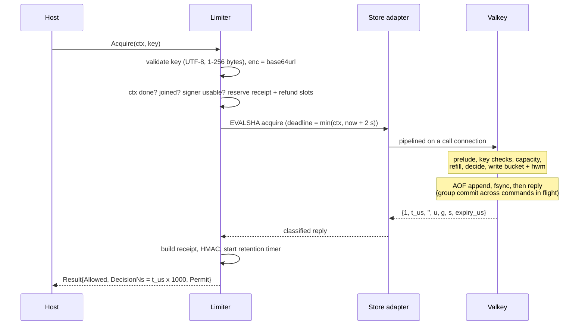

</details>

**Local checks, in order** (`API-1a`): key valid → `validation_error`; `ctx` already done → `cancelled`; epoch-watch state (`CFG-6`): `no_epoch`/`settings_invalid`/`closing` → `not_ready`, `fingerprint_mismatch` → `config_error`, `state_lost`/`integrity_hold` → epoch-wide `state_integrity_error`; signer unusable → `config_error`; slot reservation fails → `busy`. Slots are released when `Acquire` returns anything but `allowed`.

**Failure mode** (`API-20a`, `API-20b`, `API-21`): after classification, only when the acquire result is `unavailable` and `FailureMode = Open`, `Acquire` returns `Degraded` with a DEGRADED permit (no receipt, `DeductionID` "", slots released as for any non-allowed result). Every other result, and every refund result, ignores `FailureMode` (`API-21`, `API-23`).

### A5.4 Store adapter and classification

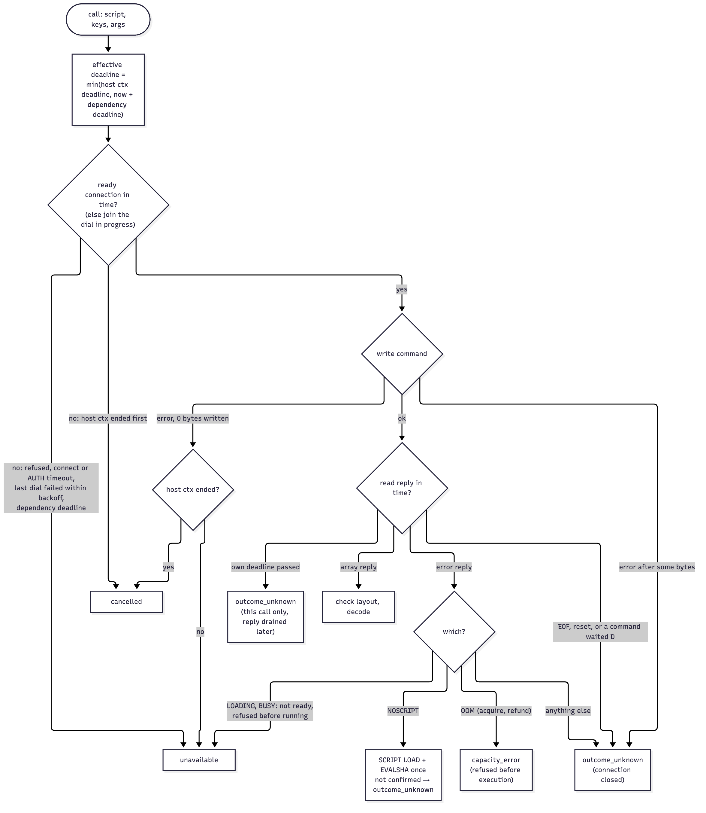

<details><summary>Diagram source (mermaid — flowchart)</summary>

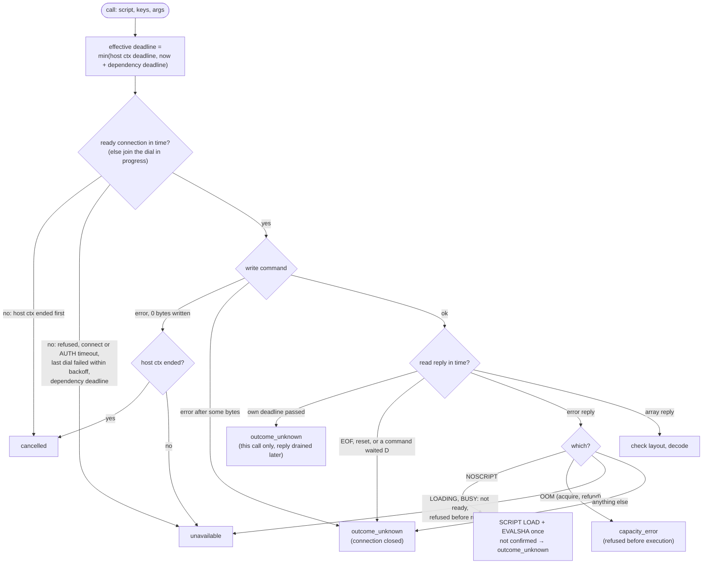

</details>

- **Sent** means at least one byte of that command was written to the socket; the writer tracks each command's byte range, so a partial batch write tells exactly which commands left. A dial whose TCP connect, `AUTH`, or any handshake step fails or times out is **not sent** → `unavailable`, because nothing that can change limiter state was sent (`API-22`).
- **Connections:** each instance keeps `StoreConns` (8) call connections for acquire, the epoch watch, and `hold`; one maintenance connection for cleanup and reclaim; and `RefundConns` (2) refund connections used only by refund workers. A command is written at once, pipelined, on the ready connection with the fewest commands in flight; one reader goroutine per connection matches replies in order. There is no pool to wait for: local concurrency is already bounded by the slots (`busy`).
- **Deadlines and failures:** each call has its own deadline, `min(host deadline, start + D)` with `D` = dependency deadline, covering the whole call: waiting for a connection, the write, the reply, and a `NOSCRIPT` reload and retry. When it passes after the command was written, only that call ends (`outcome_unknown`); the command stays on the connection and the reader drains its late reply (an allow it carried stays charged, `API-1`). A connection is closed only on an I/O error, or when its oldest written command has waited `D` since its write: then every command still in flight on it becomes `outcome_unknown`, and commands not yet written move to another ready connection within their own deadline.
- **Reconnects:** a failed connection is redialed with backoff `min(1 s, 50 ms × 2^n) × U[0.5, 1.0]`; each dial plus `AUTH` has a deadline ≤ `D`. While no connection of a kind is ready and the last dial failed within the current backoff, calls fail fast as `unavailable` (nothing sent) instead of each waiting out its deadline.
- **Not-ready replies:** `LOADING` and `BUSY` come back before the command runs (§A3.0 row 16), so they are `unavailable` (matched only when the error reply's first word is exactly `LOADING` or `BUSY`), like a refused connection (`API-22`); open mode stays open while the store restarts.
- **Reply checks:** an array reply must match its (script, code) layout and pass the §A4.9 range checks, computed from this instance's limits (and, for a refund, the receipt's expiry). Anything else is `outcome_unknown` with the raw reply in `Diag`: an acquire returns no permit, and a refund attempt is retried like any other `outcome_unknown` (§A5.6).
- **Group commit:** throughput under `appendfsync always` comes from many commands in flight, not many connections; the store batches each fsync over all commands of an event-loop iteration (§A3.0 rows 9 and 13), reading at most ~16 KB per connection per iteration.
- **Cleanup and reclaim** use the maintenance connection, at most `CleanupPipelines` × 100 commands in flight, so acquires never queue behind them. The first failed command stops the pass (`API-1f`). A `NOSCRIPT` reply proves that command did nothing: the runner loads the script and resends exactly those commands once in the same pass; a second `NOSCRIPT` or an unconfirmed reload makes them `outcome_unknown` and stops the pass.
- **Test hook:** in test builds an observer records "bytes written" per command, which proves the send stage for `FLT-2` (`T-FIX-1`).

### A5.5 Permits, slots, retention

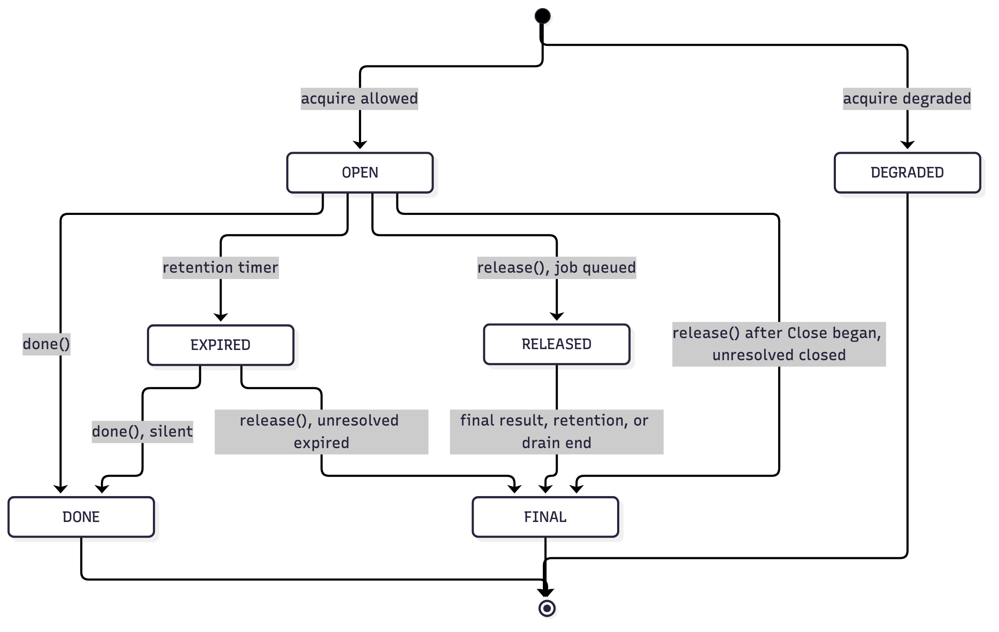

<details><summary>Diagram source (mermaid — state diagram)</summary>

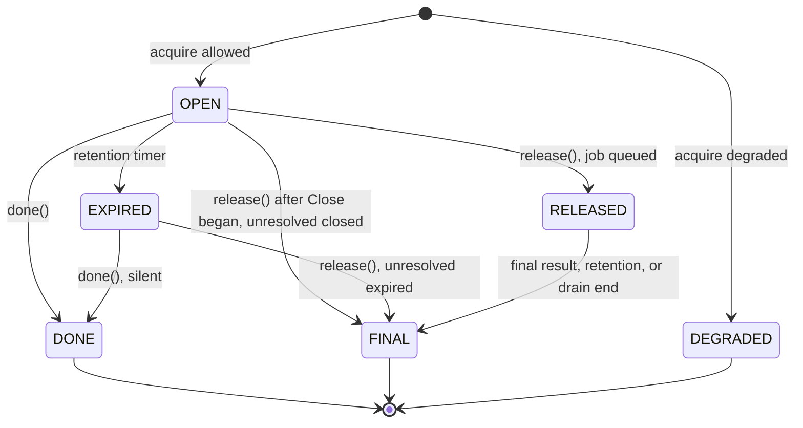

</details>

- **Slots:** two counting semaphores (`MaxHeldReceipts`, `MaxPendingRefunds`), reserved together with a non-blocking try, so effective concurrency = min of the two.
- **Transitions** are a compare-and-swap loop on the permit state: a caller re-reads the state and retries until it either wins a transition below or finds a terminal state (DONE, FINAL, DEGRADED → no-op). The winner alone performs the transition's effects, so slots are freed once and at most one event is emitted.

| Transition | Who | Frees slots | Event | Other effect |
|---|---|---|---|---|
| OPEN → DONE | `done()` | both | none | — |
| OPEN → RELEASED | `release()` | none | none | enqueue job (cannot fail: queue capacity = slots) |
| OPEN → EXPIRED | retention timer | both | none | — |
| OPEN → FINAL (closed) | `release()` after `Close` began | both | `unresolved` (`closed`) | nothing sent |
| EXPIRED → DONE | `done()` | none | none | — |
| EXPIRED → FINAL | `release()` | none | `unresolved` (`expired`) | nothing sent |
| RELEASED → FINAL | worker (final result), retention timer, drain end | both | exactly one (`API-1d`) | losers drop their result; queue and timers skip jobs already FINAL |

- **Retention timer:** started at the monotonic instant just before the acquire command is sent; fires after `receipt_lifetime` (`REF-4a`).

### A5.6 Refund workers

- **Ready queue** ordered by `release()` monotonic time, earliest first; capacity `N` = `MaxPendingRefunds`. A retry keeps its original release time, so older refunds always go first.
- **Workers:** `RefundWorkers` (128) goroutines sharing the `RefundConns` (2) pipelined refund connections, never the call connections (§A5.4).
- **Attempt:** verify HMAC (failure → final `receipt_invalid`, no store call) → `EVALSHA refund` within deadline `D` → final results end the job (RELEASED → FINAL); anything else schedules a retry.
- **Backoff** is a timer that re-enqueues the job and never holds a worker: `min(RefundBackoffMax, RefundBackoffInitial × 2^n)` × a random factor in [0.5, 1.0] (50 ms, 100 ms, … 1 s).
- **Attempts counted** only when the adapter reports a command was sent (`API-1d`).
- **Stops** on a final result, when the retention timer fires (`unresolved`, `retention`), or at the end of the drain (`unresolved`, `closed`).
- **Startup validation (`REF-5` by construction, else `settings_invalid`):** `RefundBackoffMax + ReconnectBackoffMax + (ceil(N / RefundWorkers) + 3) × D ≤ refund_deadline`, with `ReconnectBackoffMax` = 1 s (§A5.4). Proof in §A7.

### A5.7 Epoch watch

| `read_epoch` reply | State | Acquire returns | Health reason |
|---|---|---|---|
| state 0, fingerprint matches | joined (switch to a new `epoch_id` if it changed) | normal | `ready` |
| state 0, but `hwm` or `gen` lower than this instance has read in the same epoch | rollback: call `hold.lua` (`store_rollback`) | epoch-wide `state_integrity_error` | `integrity_hold` |
| an `epoch_id` this instance already left | rollback: call `hold.lua` for that ID; do not join | epoch-wide `state_integrity_error` | `integrity_hold` |
| state 22 `epoch_record_missing`, never joined | waiting | `not_ready` | `no_epoch` |
| state 22 missing after joining, `epoch_record_malformed`, `hwm_missing`, `hwm_malformed` | lost | epoch-wide `state_integrity_error` | `state_lost` |
| state 22 `integrity_hold` | held | epoch-wide `state_integrity_error` | `integrity_hold` |
| state 0, fingerprint differs | mismatch | `config_error` | `fingerprint_mismatch` |
| store unreachable or error reply | unchanged (calls report their own outcome) | — | unchanged; `Diag.StoreError` set |

- Integrity rows are evaluated before the fingerprint row (`CFG-6`). Reads happen every `EpochRereadInterval` and once early (at most once per interval) after any epoch-wide `config_error` or `state_integrity_error`.
- Each read also sets `rl_clock_lag_microseconds` = `hwm − clock_us` (0 when negative or unreadable) and the gauges `rl_tracked_buckets` (`nb`), `rl_live_markers` (`nm`), and `rl_quarantined_keys`.
- **Rollback check:** the watch keeps the highest `hwm` and `gen` read from the epoch record in the current epoch (never a reply's `t`, which may not be stored) and passes them as floors to every acquire, refund, and cleanup script. Both values only grow within an epoch, so a script that finds them below its floors knows the store went back in time and sets the hold in the same atomic step, before any write (§A4.2). The watch also compares each read as a backstop, and treats an epoch it already left as a rollback (`ADM-1` IDs never repeat). This catches a store that went back past the last values an instance read; a shorter lost tail, or one no running instance saw, stays out of scope (`STA-11`).

### A5.8 Cleanup runner and reclaimer

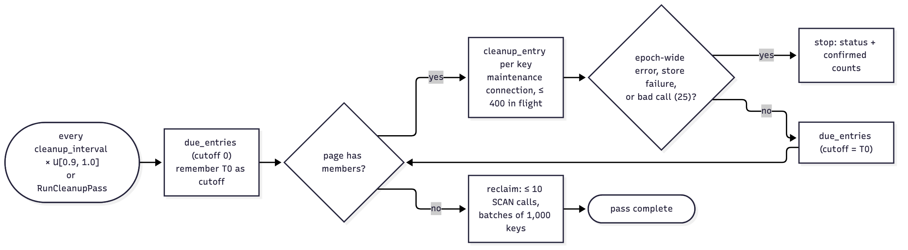

<details><summary>Diagram source (mermaid — flowchart)</summary>

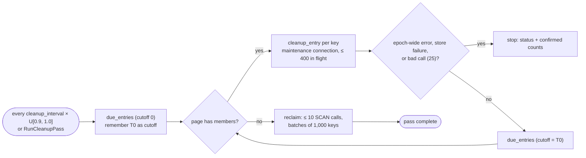

</details>

- Each page (≤ `CleanupBatch` = 1,000 keys) is processed on the maintenance connection as pipelines of ≤ 100 `cleanup_entry` calls with at most `CleanupPipelines` = 4 in flight; the next page is fetched after the current one completes.
- Several instances clean the same keys; each step re-checks atomically, so duplicates end as `E_SKIPPED` (`STA-5`).
- On an instance that is not ready, a pass returns at once without touching the store: `config_error` for `settings_invalid` or `fingerprint_mismatch`; epoch-wide `state_integrity_error` for `no_epoch`, `state_lost`, or `integrity_hold`; after `Close` begins, `unavailable` (nothing is sent).
- `rl_cleanup_lag_seconds` = (T0 − oldest due score) / 10^6 from each pass's first page; 0 when that page is empty.
- A `{25, …}` (`E_BAD_CALL`) reply stops the pass with status `outcome_unknown` and is reported as a library defect (in `Diag`; the library has no logger).

### A5.9 Receipts, keys, IDs, fingerprint

| Item | Encoding |
|---|---|
| Receipt (in memory) | `epoch_id` [16]byte, `enc` string, `g` uint64, `s` uint64, `cost` = 1, `issue_us` int64, `expiry_us` int64, MAC [32]byte |
| MAC | HMAC-SHA256 over the fixed-order bytes: `epoch_id ‖ len(enc) (2 bytes) ‖ enc ‖ g (8) ‖ s (8) ‖ cost (4) ‖ issue_us (8) ‖ expiry_us (8)`; key = 32 bytes from `crypto/rand` at construction; compared with `hmac.Equal` |
| Issue / expiry | `issue_us = t_us` of the acquire; `expiry_us = issue_us + receipt_lifetime_ns / 1000` (`RCP-1`) |
| `deduction_id` | `"d1_" + base64url(SHA-256(epoch_id ‖ enc ‖ g ‖ s))[:22]` |
| `epoch_id` | 16 bytes from `crypto/rand`, lowercase hex (generated by `rladmin`) |
| Fingerprint | SHA-256 over sorted `name=value\n` lines of every fingerprinted setting plus `store_schema_version=1` and `time_origin=unix_us`; first 32 hex characters (`CFG-1`) |

### A5.10 Settings and validation

| Setting | Product default | Harness value | Validation (beyond `CFG-4`/`CFG-8`) |
|---|---|---|---|
| `rate_tokens` / `rate_period_ns` / `capacity` | 10 / 1 s / 20 | same | §A3.1 bounds |
| `failure_mode` | `closed` | both, per scenario | — |
| `max_tracked_buckets` / `max_live_markers` | none (required) | 100,000 / 50,000 | positive |
| `max_markers_per_key` | 1,000 | same | positive, ≤ `max_live_markers` |
| `receipt_lifetime` / `refund_deadline` / `outage_tolerance` | 60 s / 30 s / 5 s | same | µs multiples |
| `cleanup_interval` | 5 s | same | µs multiple |
| `max_release_delay` | none (required) | `P` = 5 s | `RCP-8` |
| `margin` | none (required) | 1 s | ≥ lifetime × bound |
| `clock_rate_bound` | 1,000 ppm (2 × the usual 500 ppm NTP slew limit) | same | ≥ 0 |
| `dependency_deadline` (`D`) | 2 s | same | — |
| `drain_timeout` | `refund_deadline + outage_tolerance` (35 s at the default policy) | same | ≥ 0 |
| `max_held_receipts` / `max_pending_refunds` (`N`) | none (required) | 1,152 / 1,152 | positive |
| `refund_workers` / backoff | 128 / 50 ms → 1 s | same | §A5.6 inequality |
| `listener_queue_size` | 10,000 | same | positive |
| `store_conns` / `refund_conns` / cleanup batch / pipelines / reclaim batch | 8 / 2 / 1,000 / 4 / 1,000 (plus one fixed maintenance connection) | same | positive |

- Startup checks with harness values: `RCP-8`: `5 s + 30 s + 5 s + 1 s = 41 s ≤ 60 s` and `1 s ≥ 60 s × 0.001 = 60 ms`; refund inequality: `1 s + 1 s + (ceil(1,152 / 128) + 3) × 2 s = 26 s ≤ 30 s`.

### A5.11 Listener, health, metrics, diagnostics

- **Listener:** events go into a channel of `ListenerQueueSize`; one dispatcher goroutine calls the listener inside `recover()`. A full channel drops the event and increments `listener_drops` (`API-1d`, `HOST-8`).
- **Health** (struct; the harness serves it as JSON): `status`, `reason`, `epoch_id`, `clock_source`, per-instance settings, `listener_drops`, `store_error` (last), `fixtures` (true only for limiters built through `core.NewWithHooks`).
- **Metrics** (`MetricsSnapshot`; the harness renders Prometheus text):

| Metric | Type | Labels / source |
|---|---|---|
| `rl_slots_in_use` | gauge | `kind` = receipt / refund |
| `rl_pending_refunds` | gauge | — |
| `rl_refund_results_total` | counter | `result` (5 values) |
| `rl_cleanup_passes_total` | counter | `status` = complete or the stop result |
| `rl_cleanup_entries_total` | counter | `action` = removed (code 30) / moved (31, including the push of an already-quarantined key) / quarantined (32) / skipped (33) |
| `rl_cleanup_stops_total` | counter | `result` (5 values) |
| `rl_cleanup_lag_seconds` | gauge | §A5.8 |
| `rl_clock_lag_microseconds` | gauge | §A5.7 |
| `rl_listener_drops_total` | counter | — |
| `rl_integrity_hold` | gauge | 0/1 from the epoch watch |
| `rl_reclaim_keys_total` | counter | old-epoch keys unlinked |
| `rl_acquire_results_total` | counter | `result` (14 kinds) |
| `rl_store_call_seconds` | histogram | `script` (7: the scripts `rl_lib` runs, §A2); buckets 1 ms … 2 s |
| `rl_tracked_buckets`, `rl_live_markers`, `rl_quarantined_keys` | gauge | from each epoch read (§A5.7) |
| `rl_store_connections` | gauge | `kind` = call / refund / maintenance; ready connections |

- **Diagnostics** (`Diag`): `Scope` (`key`/`epoch`), `Reason` (the reason strings in §A3.3 and §A4.9), `StoreError` (raw error reply text, for operators only).

### A5.12 Test-only entry point

```go
// internal/core/hooks_rltest.go
//go:build rltest
package core
func NewWithHooks(p Policy, in Instance, st StoreOptions, h Hooks, opts ...Option) (*Limiter, error)

// limitertest/limitertest.go
//go:build rltest
package limitertest
func New(p limiter.Policy, in limiter.Instance, st limiter.StoreOptions, opts ...Option) (*limiter.Limiter, error)
func WithControlledClock() Option                    // allows ClockSource = Controlled
func WithStoreWrapper(func(Adapter) Adapter) Option  // Adapter = alias of the internal adapter interface
func WithSignerWrapper(func(Signer) Signer) Option
func WithSendObserver(func(cmd string, bytesWritten int)) Option  // cmd = script name for EVALSHA ("acquire"), else the command ("SCRIPT LOAD", "AUTH", "PING")
func WithKeyReader(r io.Reader) Option              // source of the signing key bytes, so tests can make key generation fail (T-CFG-3)
func Kill(l *limiter.Limiter)                        // stops goroutines and connections at once, no drain: pending refunds are lost, as in a process kill
```

- `limiter.New` rejects `ClockSource = Controlled` (`settings_invalid`, `CMP-9`). Without `-tags rltest`, `NewWithHooks` and `limitertest` do not exist, so production code cannot reach them.

## A6. Admin tool (`rladmin`)

| Command | Operation | Output / exit |
|---|---|---|
| `rladmin start-epoch --policy shared.toml [--replace --expect-epoch ID]` | `ADM-1` (new 128-bit ID) | prints `epoch_id`; exit 0 / 2 refused / 3 store error |
| `rladmin status` | `ADM-4` status | table or `--json` |
| `rladmin inspect --key K` | `ADM-4` per-key inspect | table or `--json` |
| `rladmin restore --policy shared.toml --key K [--balance-units U \| --balance-tokens T] --expect-epoch ID` | `ADM-2`; balance default 0 units, `0 ≤ U ≤ capacity × rate_period_ns`, `T` sent as `T × rate_period_ns`; `fp`, `cap_units`, and `lifetime_us` (`receipt_lifetime_ns / 1000`) derived from the policy file | new generation |
| `rladmin clear --policy shared.toml --key K --expect-epoch ID` | `ADM-3` | exit 0 / 2 refused |
| `rladmin store-info [--json]` | The store's `INFO` (persistence, clients, memory, stats) and `SLOWLOG GET 20` | table or JSON; monitoring runs it on a schedule |
| `rladmin store-rewrite` | `BGREWRITEAOF`, then waits for it to finish | exit 0 / 3 |

- Reads the store address and credentials from `--store` / environment (`RL_STORE_ADDR`, `RL_ADMIN_USER`, `RL_ADMIN_PASSWORD`); the expected ID comes from `read_epoch.lua`.
- `store-info` and `store-rewrite` give production operators what they need through the admin tool, so no other user reaches the store (`STA-16`).
- **Exit codes** (all commands): 0 ok; 2 refused (`{41}`, reason printed); 3 store or integrity problem (`{20}`, `{22}`, `{25}`, an error reply, a reply that fails the §A4.9 layout or range checks, or "epoch changed during read"); 4 `clock_error` (`{21}`).

## A7. Numbers and proofs

**Refund deadline (`REF-5`).** Model: within one refund's window there is at most one contiguous outage segment — store unavailability or `clock_error`, as `REF-5` counts outage time — of length `O ≤ outage_tolerance` (§D2 owner decision 2). With `N` = `max_pending_refunds`, `W` = `refund_workers`, `D` = dependency deadline:

1. Every attempt ends within `D` (one deadline over waiting for a connection, the write, the reply, and a `NOSCRIPT` reload); a sibling's connection failure can only end it earlier, and it is then retried. Attempts use the refund connections only and never wait for one another: commands are pipelined, so a write waits only for socket buffer space (up to ~1.5 KB per refund), within `D`.
2. Backoff never holds a worker, and the queue is ordered by release time, so a refund released at `r` waits only behind refunds released earlier, at most `N − 1` of them.
3. Outside the outage, attempts succeed. During it they fail; after it ends, the refund can lose: the attempt in flight when the outage started (`D`), the attempt in flight when it ends (`D`), one backoff (`≤ backoff_max`), one reconnect backoff before a refund connection is up again (`≤ 1 s`), and the queue ahead of it (`ceil(N / W)` rounds of `D`), plus one round for workers held by later jobs (`D`).
4. So confirmation comes by `r + O + backoff_max + reconnect_max + (ceil(N / W) + 3) × D`, and the startup validation guarantees `backoff_max + reconnect_max + (ceil(N / W) + 3) × D ≤ refund_deadline`. With harness values: `1 + 1 + (9 + 3) × 2 = 26 s ≤ 30 s`.
5. Each additional outage segment would add up to `backoff_max + reconnect_max + 2 × D` (a short blackhole holds an attempt for the full `D`); harness runs arm at most one store outage segment, and the report flags runs that armed more.

**Sizing (`STA-7`).**

| Quantity | Formula | Harness worst case |
|---|---|---|
| Tracked buckets (`nb`) | distinct keys active within time-to-full + receipt lifetime + cleanup interval + cleanup lag (2 + 60 + 5 + 10 s), plus quarantined keys | 10,000-user scenario → ≤ 10,000 « 100,000 |
| Markers (`nm`) | peak refund rate × (receipt lifetime + cleanup interval + cleanup lag) | 150/s × 75 s = 11,250 « 50,000 |
| Markers per key (`mc`) | peak per-key refund rate (≈ f × rate ÷ (1 − f) for refund fraction f) × (receipt lifetime + cleanup interval + cleanup lag) | f ≤ 5 % on a 10/s key → ≈ 0.5/s × 75 s ≈ 40 « 1,000 |
| Slots in use per instance | OPEN permits (≤ `max_in_flight` 512) + RELEASED backlog (refund rate per instance × (outage + backoff_max + reconnect_max + 2D)) | 512 + 50/s × 11 s = 1,062 ≤ 1,152 |
| Store memory | ≈ 300 B per bucket hash + 100 B per marker (hash field + `mi` entry) + 80 B per `ix` entry; after an `ADM-1` replace, old data until reclaimed (up to one more namespace) | ~ 50 MB, ×2 after a replace « 512 MB |
| Store connections | Per instance `store_conns` + `refund_conns` + 1 maintenance = 11 (one more during a reconnect): a store with `maxclients` 4,096 serves about 340 instances; alert at 80 % (§A8) | 3 × 11 + admin + sampler ≈ 38 |
| Per-key step cost | O(markers on the key), at most `max_markers_per_key` (1,000), for acquire, refund, and cleanup | measured in §C3 at 1,000 and 10,000 markers |

---

## A8. Operations runbook

Recovery from state problems needs a person by design (`AD-7`: instances never recreate state), so these signals page. Every signal comes from the library (§A5.11) or the store's own `INFO` through `rladmin store-info`, so production needs no other store user (`STA-16`).

| Signal | Threshold | Meaning | Action |
|---|---|---|---|
| `rl_integrity_hold` = 1, health `integrity_hold` | any | Epoch-wide refusal: unattributable corruption or a store rollback | `rladmin status` for the reason; fix the cause; `rladmin start-epoch --policy shared.toml --replace --expect-epoch ID` (budgets restart full) |
| health `state_lost` | any | Epoch record or high-water mark missing or malformed | Record missing or malformed: `rladmin start-epoch --policy shared.toml`; only the high-water mark lost: add `--replace --expect-epoch ID` |
| health `no_epoch` after a store restart | any | The store came back empty (a wipe) | `rladmin start-epoch --policy shared.toml` |
| health `fingerprint_mismatch` | any instance | Settings drift, or a policy rollout in progress | Finish or roll back the rollout (ARCH §4.4) |
| `rl_quarantined_keys` | > 0 | Per-key state loss | `rladmin inspect --key K`, then `restore` and `clear` |
| `rl_clock_lag_microseconds` | > 1 s for 1 min | Store clock stepped back: refill is paused at the high-water mark | Wait for the clock to catch up, or `rladmin start-epoch --policy shared.toml --replace --expect-epoch ID` if the step is large |
| `rl_cleanup_lag_seconds` | > 2 × `cleanup_interval` | Cleanup is behind or stopped | `rl_cleanup_stops_total` reasons; store latency |
| `rl_tracked_buckets` / `max_tracked_buckets`, `rl_live_markers` / `max_live_markers` | > 80 % | Capacity headroom shrinking | Raise the limits (a new epoch), or find the key flood (`HOST-9`) |
| `rl_acquire_results_total` `unavailable` + `outcome_unknown` | > 1 % of acquires for 1 min | Store unreachable, restarting, or slow | Store health; see "planned restart" below |
| `rl_store_call_seconds` p99 | > 100 ms for 5 min | Slow disk, AOF rewrite, or a hot key | `rladmin store-info` (persistence, slow log) |
| store `connected_clients` | > 80 % of `maxclients` | Too many instances for one store | Raise `maxclients` and the file limit, or split deployments (one store per deployment) |
| `rl_listener_drops_total` | rising | The host's refund listener is too slow | Host fix (`HOST-8`) |

**Procedures**

- **Planned store restart:** run `rladmin store-rewrite` first so the reload is short, then restart the store through the OS service manager (a clean stop fsyncs). Calls not yet sent, and calls refused while the store reloads, get `unavailable` (closed mode refuses, open mode degrades); calls in flight when it stopped get `outcome_unknown`. Instances reconnect with backoff. The reload time for the §A7-sized dataset is measured in §C2.
- **Never restore a backup or promote a replica onto a live epoch.** A rolled-back store is a stale snapshot (`STA-11`). Start a new epoch right after any restore, before traffic resumes.
- **Disk full or AOF write errors:** with `appendfsync always` the store process exits rather than acknowledge a write it cannot persist. Calls in flight get `outcome_unknown`; later calls get `unavailable`. Free space and restart the store: it reloads the AOF, dropping at most an incomplete final write that was never acknowledged. Confirm with `rladmin status`.

# Part B — Harness

## B1. Processes, ports, files

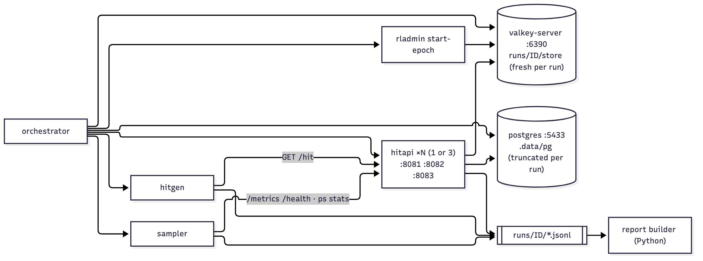

<details><summary>Diagram source (mermaid — flowchart)</summary>

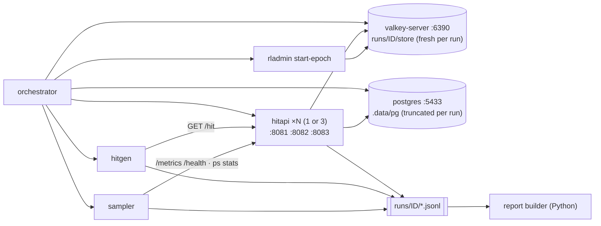

</details>

| Port / path | Use |
|---|---|
| 6390 | Limiter store (Valkey), loopback only |
| 5433 | Harness PostgreSQL cluster in `.data/pg` (created by `make setup`) |
| 8081–8083 | `hitapi` instances; `/hit`, `/health`, `/metrics`; `/_test/*` only in `rltest` builds |
| `runs/<run_id>/` | `config.toml` (`harness.toml` with the scenario's overrides merged in), `context.json`, `thresholds.json`, `schedule.jsonl`, `gen.jsonl`, `api-N.jsonl`, `samples.jsonl`, `db_rows.json`, `store/` (AOF, rendered ACL), `report.md`, `report.json` |
| `bin/bench/` | `hitapi` and `rladmin` built without tags: the system under test and the product tool |
| `bin/test/` | Every binary built with `-tags rltest`; harness tools (`orchestrator`, `hitgen`, `sampler`, `faultctl`) always run from here, in both run kinds |

- **File descriptors:** the orchestrator raises the soft `RLIMIT_NOFILE` to 8,192 for `valkey-server` and `hitapi` children (Go restores the original soft limit for children it starts). `hitapi` records its effective limit in its `start` record and refuses to start below 1,024 (12 store + 64 DB + 512 HTTP, plus spare). Valkey lowers `maxclients` by itself when its limit is too low, so the orchestrator refuses the run unless `CONFIG GET maxclients` (as `rl_ops`) returns 4,096.

## B2. Shared config file (`HAR-12`)

```toml
# harness.toml — base file; each run uses the merged runs/<id>/config.toml (§B5)
[policy]                       # fingerprinted
rate_tokens = 10
rate_period_ns = 1_000_000_000
capacity = 20
failure_mode = "closed"
max_tracked_buckets = 100_000
max_live_markers = 50_000
max_markers_per_key = 1_000
receipt_lifetime_ns = 60_000_000_000
refund_deadline_ns = 30_000_000_000
outage_tolerance_ns = 5_000_000_000
cleanup_interval_ns = 5_000_000_000
clock_source = "store"

[instance]                     # per instance, same values on every hitapi; absent keys keep DefaultInstance(policy)
max_release_delay_ns = 5_000_000_000   # P
margin_ns = 1_000_000_000
max_held_receipts = 1152
max_pending_refunds = 1152
refund_workers = 128

[store]
addr = "127.0.0.1:6390"        # user rl_lib, password from RL_LIB_PASSWORD

[api]
max_in_flight = 512            # HAR-14; no queue: full -> ERR-7
limiter_enabled = true         # HAR-17 baseline switch
refuse_after_acquire_bp = 0    # ERR-15 refusals per 10,000 requests (§B3); scenarios override
db_dsn = "postgres://rl@127.0.0.1:5433/hits?statement_timeout=2500&pool_max_conns=64"
```

## B3. `hitapi` request handling

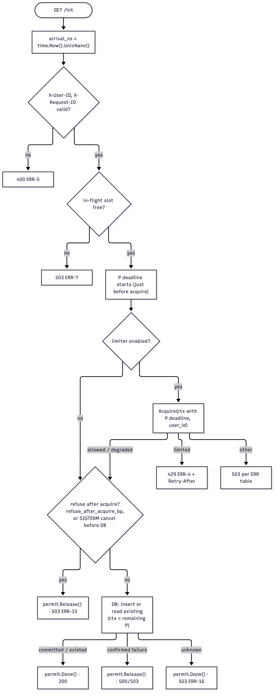

<details><summary>Diagram source (mermaid — flowchart)</summary>

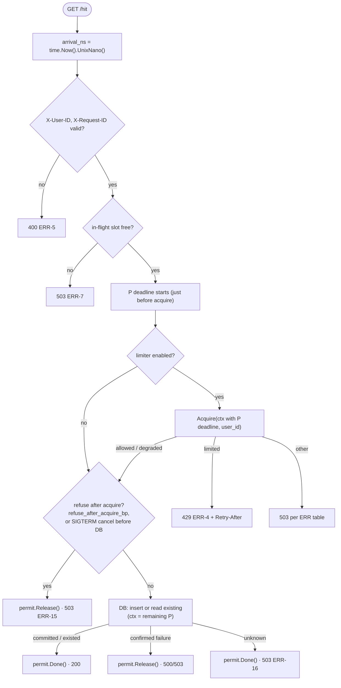

</details>

**DB outcome classification** (pgx v5):

| Observation | Class | Permit | Response |
|---|---|---|---|
| Row inserted, or existing row read | committed | `done()` | 200 (`ERR-1`/`ERR-2`) |
| `pgconn.SafeToRetry(err)` true (nothing sent: refused, dial timeout, ctx done before send) | confirmed failure, no row | `release()` | 503 `ERR-14` |
| Server error with SQLSTATE (statement failed, rolled back), including the 2.5 s `statement_timeout` | confirmed failure, no row | `release()` | 503 `ERR-14` |
| DB fixture "fail after commit" | confirmed failure, row may remain | `release()` | 500 `ERR-13` |
| Timeout or connection loss after send, or `P` passed without a confirmed rollback | unknown | `done()` | 503 `ERR-16` |

- **Refusal after acquire** (`ERR-15`, both builds): a request whose FNV-1a 64-bit hash of `user_id ‖ 0x00 ‖ request_id` mod 10,000 is below `refuse_after_acquire_bp`, or whose work `SIGTERM` cancels before its first DB statement is sent (`HAR-15`), skips the DB work, calls `permit.Release()` (a no-op for a degraded permit; no permit in baseline runs), and returns 503 `ERR-15`. Selection depends only on the IDs, so baseline and limiter runs refuse the same requests. This is the application refusing work, not a limiter fixture (`HAR-24`); it gives benchmark runs their refund population (`TRF-S7`) and `T-HTTP-9` its `ERR-15` case.
- **Two statements:** `INSERT … ON CONFLICT (user_id, request_id) DO NOTHING RETURNING arrival_ns`, then, only if nothing was returned, `SELECT arrival_ns` (sets `existed = true`). Each is its own implicit transaction; `ON CONFLICT` waits for a concurrent uncommitted inserter of the same key, so the `SELECT` sees the committed row.
- `P` deadline: a `context.WithDeadline` created just before `Acquire`; the same context bounds the DB work (`HTTP-13`).
- **Run-log writer:** a 100,000-entry channel drained by one goroutine that issues one `write(2)` per line on an `O_APPEND` file (no userspace buffer), so a line handed to the kernel survives `SIGKILL`. A full channel counts a drop; any drop invalidates the run (§B8).

## B4. Generator (`hitgen`)

| Part | Design |
|---|---|
| Schedule | Precomputed from the scenario TOML and `seed` with `math/rand/v2` PCG into `schedule.jsonl` (planned offset ns, user, request ID, target instance); its SHA-256 goes into `context.json` (`TRF-1`) |
| Arrivals and users | Each step is a Poisson process at its rate; each arrival goes to a user drawn by Zipf weight (s = 1.1) among users currently active or bursting (seeded Markov switching between quiet, active, burst); per-user streams are added on top |
| Routing | Request index mod `instances` (1 or 3); one busy user's requests spread across all instances (`TRF-4`) |
| Sending | Open loop (`TRF-3`): a dispatcher wakes every 1 ms and launches a goroutine for each request whose planned time has passed. `sent_ns` = the moment `httptrace.ClientTrace.WroteRequest` fires, so connection-pool waits count as scheduling lag, not service latency (`PRF-8`); the `GotConn` wait is logged too |
| HTTP client | One `http.Transport` with keep-alive and a 30 s timeout (limits set by the plan) |
| Retries | Only after `429`: wait = max(`retry_after_ms`, `Retry-After`) + seeded jitter 0–50 ms; ≤ 2 extra attempts; same IDs; recorded as retries (`TRF-5`) |
| Record | `gen.jsonl` via the same counted-drop writer as §B3: planned_ns, sent_ns, got_conn_wait_ns, instance, user, request_id, kind (initial / retry / duplicate), duplicate_of, attempt, hint_source (`retry_after_ms` / `Retry-After`), hint_ms, jitter_ns, status, `error`, latency (monotonic ns), `arrival_ns`, `decision_ns`. After the writer drains, one final `summary` line: planned, launched, unsent (generator drops, `PRF-1`), log_drops, stopped_after_step |

**Scenario file** (`scenarios/*.toml`):

| Field | Meaning | Used by |
|---|---|---|
| `name`, `seed`, `run_kind` (`bench` / `test`) | Identity; the seed drives every random choice | `TRF-1`, §B5 |
| `instances` (1 or 3, default 3) | `hitapi` processes started (8081…); routing uses this count | `TRF-S1`, `TRF-4` |
| `[policy]`, `[instance]`, `[api]` | Overrides merged over `harness.toml` into the run's `config.toml` (§B5): `failure_mode`, `clock_source` (test runs only), small `max_*` limits, `refuse_after_acquire_bp`. The orchestrator refuses a scenario whose `refuse_after_acquire_bp` exceeds 500 (5 %, the per-key failure load) or whose `refuse_after_acquire_bp` / 10,000 × its highest step rate exceeds 50/s × `instances` (§A7: 50/s per instance) | `TRF-S6`, `TRF-S7`, `FLT-8` |
| `[[steps]]` `rate_per_s`, `duration_s` | Aggregate arrival rate per step (S1: 100/s doubling every 30 s up to 10,000/s; S4: base, 5× for 10 s, base) | `TRF-S1`, `TRF-S4` |
| `[users]` `count`, `zipf_s`, `[users.states]` | Who receives each aggregate arrival; state rates and mean dwell times | `TRF-1` |
| `[[streams]]` `users`, `rate_per_s` | Per-user Poisson streams (S3: one user at 100/s, the others at 5/s) | `TRF-S3` |
| `[[cohorts]]` `users`, `start_s`, `stop_s`, `revisit_s` | Users active only in `[start_s, stop_s)` and again from `revisit_s` | `TRF-S2`, `TRF-S7` |
| `[duplicates]` `fraction` | Entries repeating an earlier request's IDs, marked `duplicate_of` | `TRF-6` |
| `[retries]` `max_extra` (2), `jitter_max_ms` (50) | `429` retry policy | `TRF-5` |
| `[[faults]]` `at_s`, `cmd`, optional `instance` | A `faultctl` command or a `/_test/faults` body (sent to `instance`, default all), run by the orchestrator at `at_s` (test runs only; at most one store outage segment per run) | `TRF-S6` |
| `forced_aof_rewrites_s` | Offsets at which the orchestrator runs `BGREWRITEAOF` (`TRF-S7`: `[180, 420]`); also switches the store to production rewrite settings | `TRF-S7` |
| `stop_early` | Stop after the first step that is generator-limited (`PRF-8`) or misses a threshold (baseline runs: generator-limited only) | `TRF-S1` |
| `verdict` (`capacity` / `spike` / `none`), `spike_step` | Which `T-RPT-2` verdict the report gives, and which step is the spike (0-based index, §B9) | `T-RPT-2`, `PRF-6`, `PRF-11` |

## B5. Orchestrator

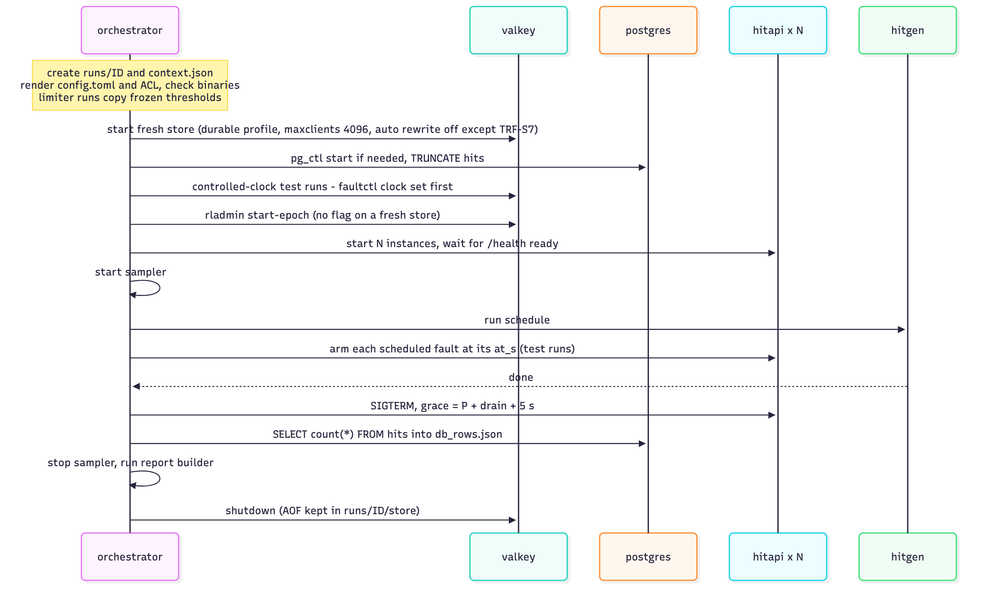

<details><summary>Diagram source (mermaid — sequence diagram)</summary>

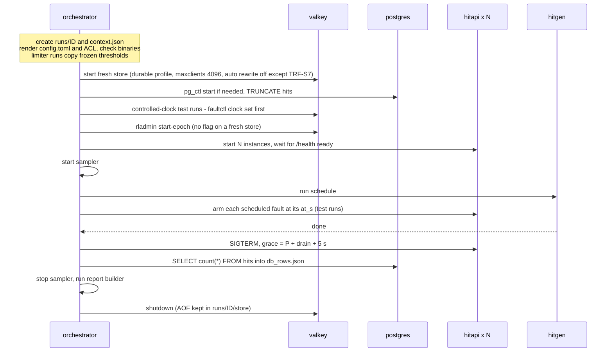

</details>

- **One config per run:** every `hitapi` (`--config`) and `rladmin start-epoch --policy` get `runs/<id>/config.toml`; only `T-HAR-1` starts an instance with a different file.
- **Two run kinds**, taken from the scenario's `run_kind`: **benchmark runs** (`bench`) start `bin/bench/hitapi` and support capacity and latency claims; **test-build runs** (`test`) use `bin/test` binaries and are labelled "test-build scenario, not a benchmark" in `report.json`. `TRF-S6` and every scenario with `[[faults]]` or a `clock_source` override must set `test`.
- **Construction:** `bin/test` hitapi always builds its limiter through `limitertest.New` (adding `WithControlledClock` when `clock_source = "controlled"`), so its `/health` reports `fixtures: true`; `bin/bench` hitapi uses `limiter.New`.
- **Faults:** at each `[[faults]].at_s` the orchestrator runs the command and appends it, with its actual start and end, to `context.json`.
- **Forced rewrites:** for a scenario with `forced_aof_rewrites_s` (`TRF-S7`), the orchestrator starts the store with production rewrite settings and runs `BGREWRITEAOF` (as `rl_ops`) at those offsets, so rewrite windows always occur under load.
- **Thresholds:** a limiter run copies the frozen `runs/thresholds/<scenario>-<seed>.json` into its run directory and records its SHA-256 in `context.json`; a **benchmark** limiter run without one is refused; test-build runs copy it when present and otherwise report no threshold verdicts (§B9).
- **Benchmark guard (`HAR-24`)**, benchmark runs only: refuses to start when the `hitapi` binary's build info (`go version -m`) lists `rltest`, when `/health` reports `fixtures: true`, when the clock source is `controlled`, or when the scenario has any `[[faults]]` or a `clock_source` override (checked before the store starts).

## B6. Fixtures and fault control

| Fault | Mechanism (test builds) | Arming |
|---|---|---|
| `FLT-1` (a) closed port | `faultctl store down <d>`: `BGREWRITEAOF`, wait for `aof_rewrite_in_progress:0`, `SHUTDOWN`, restart after `d`. The outage is measured from `SHUTDOWN` to the first successful `PING`, so AOF loading (`LOADING` replies → `unavailable`, §A5.4) counts inside it. Scenarios arm `d` = 4 s; a measured outage > 5 s marks that run's `REF-5` evidence invalid | `faultctl store down 4s` |
| `FLT-1` (b) refuse | Adapter wrapper returns `unavailable` without sending | `POST /_test/faults {target:"store", mode:"refuse", match:"acquire", duration_ms}` |
| `FLT-2` blackhole | `SIGSTOP` / `SIGCONT` on the store process; the send observer records which commands were sent. The outage is measured from `SIGSTOP` to the first successful `PING` after `SIGCONT`; scenarios arm 4.5 s so it stays within the 5 s limit | `faultctl store pause 4.5s` |
| `FLT-3` / `FLT-4` lost reply | Wrapper calls the real adapter, discards the reply, returns `outcome_unknown` | `mode:"drop_reply", match:"acquire"/"refund", count` |
| `FLT-5` | DB wrapper: fail before insert / fail after commit | `target:"db", mode:"fail_before"/"fail_after_commit"` |
| `FLT-6` | `faultctl api kill N --restart`: reads the target's `/health` (`listener_drops`, `log_drops`) just before `SIGKILL` and writes a lifecycle record; a failed read marks the refund evidence incomplete (`HAR-13`) | `faultctl api kill N --restart` |
| `FLT-7`, `FLT-11` | Tamper tool (`rl_fixture` user): delete bucket fields, delete `k`, delete `mi` or one of its members, delete the `ix` member, delete a marker field, corrupt a field, add a malformed `ix` member, change a shared key's type, delete `hwm`, corrupt the record, wipe | `faultctl tamper <op> --key K` |
| `FLT-8` | Small `max_*` limits in the scenario config | config |
| `FLT-9` | DB wrapper: commit, then return an unknown-outcome error | `target:"db", mode:"lose_commit_reply"` |
| `FLT-10` | Signer wrapper: fail / corrupt / unusable | `target:"signer", mode:…` |
| Barriers | Adapter wrapper blocks before send or after reply until released | `POST /_test/barrier {name, at}`, `POST /_test/barrier/release` |
| Controlled time | `rl:ctl:time` via `rl_fixture`; `faultctl clock` and the driver take **ns** and reject values that are not multiples of 1,000 (µs store granularity) | `faultctl clock set|advance|back` |

- `/_test/*` routes are compiled only with `-tags rltest` and bound to loopback.
- `ERR-15` needs no fixture: a test config sets `refuse_after_acquire_bp = 10000` (§B3).

## B7. Resource sampler

- Every 1 s: CPU % and RSS for `valkey-server`, the postmaster plus its backends, each `hitapi`, and `hitgen` (`github.com/shirou/gopsutil/v4`); each API's `/metrics` and `/health`; `rladmin status --json`; the store's `INFO persistence` and `INFO clients` (as `rl_ops`). Writes `samples.jsonl` (`PRF-4`).

## B8. Run log and report formats

| File / `kind` | One line per | Key fields |
|---|---|---|
| `api-N.jsonl` `decision` | `Acquire` returned allowed or degraded (written before DB work) | deduction_id, user_id, decision_ns, result |
| `api-N.jsonl` `request` | completed `/hit` call | run_id, epoch_id, instance, user_id, request_id, arrival_ns, decision_ns, deduction_id, result, existed, http_status, error, limiter_ns, db_ns, total_ns |
| `api-N.jsonl` `release` | `permit.Release()` called | deduction_id, release_mono_ns |
| `api-N.jsonl` `refund` | listener event | deduction_id, result, reason, attempts, credit_decision_ns, release_mono_ns, final_mono_ns |
| `api-N.jsonl` `lifecycle` | start, ready, pre-kill read, stop | start: max_in_flight, queue length (0), P, dependency_deadline, drain_timeout, nofile_limit (`HAR-14`, `HAR-15`); pre-kill and stop: listener_drops, log_drops |
| `gen.jsonl` | sent request or retry; one final `summary` line | §B4 |
| `samples.jsonl` | sample | process stats, metrics snapshot, `ADM-4` status |
| `db_rows.json` | run | final `SELECT count(*) FROM hits` |
| `context.json` | run | hardware, OS, versions (Go, Valkey, PostgreSQL), store and PostgreSQL settings, F_FULLFSYNC floor and durable single-client script p50 (latest §C2 result), settings, seed, schedule hash, frozen thresholds hash, faults with actual start/end, start/end (`PRF-5`) |

**Report** (`report.md` + `report.json`): run context and run kind; load (planned vs sent, lag, retries); results by outcome; timing (limiter decision time from `limiter_ns`, DB time, refund release-to-final time, end-to-end from `gen.jsonl`, p50/p95/p99 per class, and p99 inside AOF rewrite windows for `TRF-S7`); resources; correctness (`BUD-11`/`BUD-11a` window check via `refmodel` from `decision` and `refund` records); baseline comparison; capacity verdicts (`T-RPT-2`, benchmark runs only); **evidence validity** (log drops = 0, listener drops = 0 summed over every process including pre-kill reads, fixtures off for benchmarks, measured outage ≤ 5 s, store outage segments armed ≤ 1, `gen.jsonl` summary present with log_drops = 0, and for `TRF-S7` at least one AOF rewrite window observed).

- `hitapi` `/health` = the library `Health` JSON plus `log_drops`, `in_flight`, and `nofile_limit`.
- **Golden lines:** `harness/runlog/testdata/golden/` holds hand-written example lines for `api-N.jsonl`, `gen.jsonl` and `samples.jsonl` (§C5).

## B9. Baseline and thresholds (`PRF-6`, `PRF-7`)

1. Run the baseline (`limiter_enabled = false`) for a scenario and seed.
2. At the end of the baseline run, the orchestrator writes `runs/thresholds/<scenario>-<seed>.json` with these definitions and the values filled from the baseline, if that file does not exist yet and only if the baseline passes `report/validate.py` in baseline mode (§C5) (otherwise it writes nothing and the baseline is reported invalid); the file is never overwritten or edited:

| Item | Definition |
|---|---|
| Latency population | Initial attempts (attempt 1) that received an HTTP response; end-to-end latency from `gen.jsonl` |
| Error denominator | Initial attempts |
| Unexpected errors | 5xx not caused by an injected fault or by a refusal after acquire (§B3), plus transport errors |
| Observation window | Each load step minus its first 5 s |
| Allowed scheduling lag | Step p99 of `sent_ns − planned_ns` ≤ 5 ms; otherwise the step is generator-limited and excluded from capacity (`PRF-8`) |
| Latency threshold | Per load step: that step's baseline p99 over its observation window + 50 ms (a fixed allowance for the limiter's durable store call, above the 33 ms `appendfsync always` p99 in §A3.0 row 9) |
| Error threshold | Per load step: max(0.1 %, 2 × that step's baseline unexpected-error rate) |
| Missing baseline step | A limiter step whose baseline step is missing or generator-limited gets no capacity verdict (`PRF-8`, `PRF-11`) |
| Spike recovery | Deadline = spike end + 30 s; window = [deadline, deadline + 60 s], judged against the post-spike step's thresholds; the post-spike step must last ≥ 90 s (the orchestrator refuses a shorter one) |

3. Run the limiter scenario with the same seed; the run copies the frozen file (§B5) and the report compares against it.

## B10. Harness numbers

| Item | Value |
|---|---|
| `P` (`max_release_delay`) | 5 s (≤ 2 s acquire + 2.5 s statement timeout + slack) |
| In-flight cap per API | 512, no queue |
| Supported failure load | ≤ 5 % refunded requests (confirmed failures plus `ERR-15` refusals), in total and per key, at ≤ 3,000 admitted req/s, plus at most one 5 s store outage segment per run |
| Kill grace | `P + drain_timeout + 5 s` = 45 s |
| PostgreSQL | `max_connections` 300, pool 64 per API (192 total), `statement_timeout` 2.5 s, `fsync on`, `synchronous_commit on` |

---

# Part C — Verification and tooling

## C1. Test layers

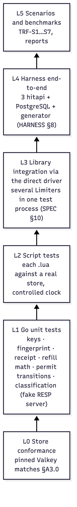

<details><summary>Diagram source (mermaid — flowchart)</summary>

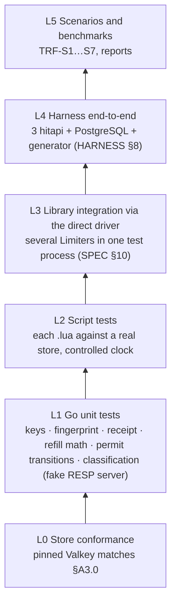

</details>

| Layer | Runs with | Command |
|---|---|---|
| L0 | store spawned per package on a free port, durable and fast profiles | `make test-store` |
| L1 | Go only, `-race`; includes a test that races every pair of permit transitions | `make test-unit` |
| L2 | fast-profile store per package; `rl:ctl:time` driven by the test | `make test-scripts` |
| L3 | `-tags rltest`, fast profile (durable for `T-INT-11`, `T-CLK-5`) | `make test-integration` |
| L4 | `bin/test` binaries, real PostgreSQL | `make test-e2e` |
| L5 | `bin/bench` binaries (benchmark runs), `bin/test` (test-build runs) | `make run SCENARIO=…` |
| Python | `pytest refmodel report -m 'not run_evidence'` | `make test-py` |

- The store binary comes from `RL_STORE_BIN`, falling back to `valkey-server`, then `redis-server`; test helpers render the ACL template with fresh passwords into the test directory.
- **Test order:** the `make` test targets run `go test` through `bin/trace gotest`, which adds `-shuffle=on` unless the arguments already contain `-shuffle`; the seed is in the saved stream, and `-shuffle=<seed>` repeats an order. pytest is shuffled too: the root `conftest.py` shuffles the collected tests with `random.Random(seed)`, takes `--shuffle-seed=N`, draws the default seed from `random.SystemRandom()`, and prints it in the report header (`pytest_report_header`).
- **CPU counts:** `make test-unit` adds a second pass, `-race -count=1 -cpu 1,4`, over the packages without timing windows: `internal/settings`, `internal/keys`, `internal/fingerprint`, `internal/receipt`, `internal/metrics`, and `TestPermitTransitionPairsRace` in `internal/core`. Never `internal/store`, whose tests have timing windows.
- **Checks in every test:** every L2 script test ends with the store audit (§C3; checker self-tests and the prelude probes use plain stores). Every L3 test that uses the driver ends with the audit, the allowed-commands check and, if it logged ops, the `BUD-11` check (§C4).

## C2. Store conformance suite

Re-runs §A3.0 rows 1–8, 10–12, 15, and 16 as assertions and records rows 9, 13, and 14 as measurements, plus:

- every script runs its success path and its integrity paths under its real ACL user, and an `rl_lib` call to `FLUSHALL` is refused;
- under `maxmemory` + `noeviction`: acquire is refused with `OOM`, while `cleanup_entry`, `reclaim`, and `admin_start_epoch` run;
- `ZRANGE … BYSCORE`, `ZADD GT/XX/LT`, `SCAN MATCH` + `UNLINK`; the `SCAN` call count for 200,000 keys is recorded;
- `INFO commandstats` counts the commands that scripts run (the command budgets of §C3 and §C4 rely on it): read as `rl_ops`, the deltas for a script doing 1 `HSET` + 2 `HGET`, run twice, are evalsha +2, hset +2, hget +4 (deltas only, no `CONFIG RESETSTAT`);
- durable profile active, read as `rl_ops` (`appendfsync always`, `no-appendfsync-on-rewrite no`, `noeviction`, `maxclients` 4096), and AOF `MULTI … EXEC` wrapping;
- `valkey-server --version` reports 9.1.x; a `redis-server` fallback (§C1) may run the other layers but is marked not conformance-eligible;
- a single-writer `F_FULLFSYNC` loop on the run disk sets the floor; the durable single-client script p50 must be ≥ 0.5 × that floor (a plain `fsync` would be about 300× below it); both are written to `.data/conformance.json`, which the orchestrator copies into each run's `context.json`;
- the durable latency/throughput curve (row 13) for 2, 4, 8, and 16 connections at pipeline depths 1, 16, and 64, with both row 13's command size and maximum-size commands (256-byte keys), is recorded; the plan sets `store_conns` from the maximum-size curve;
- **crash test:** 32 writers on the durable profile, `SIGKILL` the store mid-load, restart; every acknowledged write must be present (§A3.0 row 15), three times;
- `LOADING` while a restarted store loads a large AOF, and `BUSY` during a script past `busy-reply-threshold`, arrive before the command runs (§A3.0 row 16); the reload time for the §A7-sized dataset is recorded for the runbook (§A8).

It must pass on the pinned Valkey before any slice that runs scripts against the store. The script-level bullets (each script under its real ACL user; `OOM` refusal of acquire while maintenance scripts run) run in the script tests as each script lands.

## C3. Script tests

- Each script is exercised through its reply codes with crafted store states: one test per row of §A3.3 (including `ix` scores `inf` and `1.5`), per check of `API-1a`/`API-2a`, and the wrong-type cases for `ix` and `q`.
- Numeric edges: `u` near `cap_units`, `elapsed` around the guard thresholds, `t_us` at `TBOUND − 1` and `TBOUND`, `ceil_div` boundaries. Then a seeded sweep of 10,000 random inputs each for `refill` and `ceil_div` across their whole §A3.1 domains, every result compared with `math/big`.
- A key with 10,000 markers (`max_markers_per_key` raised to 10,000 for the test): one cleanup step removes it with no partial write; acquire and cleanup step latency on that key is recorded (§A7).
- A key with 10,000 due markers (same raised cap) whose bucket is not eligible: one step removes them all in ≤ 500-element chunks; afterwards `mc`, `nm`, and the `ix` score are correct.
- A key whose only marker is due while its bucket is not eligible: the step removes the marker and moves the `ix` score, with no error.
- Restore a full balance, clear, run a pass, then refund a receipt from before the restore that is still unexpired: `receipt_invalid`, no new quarantine; a pass after restore time + lifetime removes the bucket.
- Counter decrements stop at 0 (tampered `nb`/`nm`).
- A refund at the per-key cap → `{24, t, 'key_markers'}`, with only `hwm` written.
- Limited, capacity-refused, and already-quarantined acquires, and skipped cleanup steps, leave `hwm` and everything else unchanged (`CLK-4`).
- `hold.lua` sets the hold only for the expected epoch, and only when it is empty.
- `tools/trace` lints every `.lua` file: correct header for its script (§A4.8 rule 1), no `tostring(`, no `ZRANGEBYSCORE`, and `unpack(` only on a line marked `-- lint:chunked(500)` (the chunked writes of §A4.5).
- **Store audit after every L2 test:** each L2 script test gets its store from `scriptrun.Store(t, …)` (`internal/testutil/scriptrun`), which registers `storestate.Audit(snapshot, AuditConfig) []string` in `t.Cleanup`, with `AuditConfig{Policy, Damaged []string, Restored []string, FillerPrefixes []string, Canaries [][]byte}`. A test that crafts a malformed state names those keys with `Damaged(keys…)` on the handle `scriptrun.Store` returns. Any finding fails the test. The rules (L3 uses them too, §C4):
  - **Grammar, every key:** only `rl:epoch`, `rl:ctl:time`, `rl:e:<32 hex>:{ix,q,k:<enc>,mi:<enc>}` (`enc` per `is_enc`) and the filler prefixes (`rl:pad:` and `rl:fill:`); a key not in `Damaged` must also have its §A3.2 type.
  - **Current epoch only** (the namespace that `rl:epoch.id` names; other namespaces, such as one awaiting reclaim, get the grammar check only), for keys not in `Damaged`: every key passes §A3.3 (`ok`); 0 ≤ `u` ≤ `cap_units`; `g` ≤ `gen`; each marker expiry ≤ `x`; every stored `t` and marker credit time ≤ `hwm`; the `ix` score follows the §A3.2 rule (keys in `Restored` exempt).
  - **Counters, only when `Damaged` is empty:** `nm` = the sum of `mc` = the sum of `ZCARD mi`; `ZCARD ix` = the `k:` key count ≤ `nb` ≤ that count + the `Restored` count (§A3.3 counter rule: a restore may count a key once too many); `q` is empty. With damage, `q` may hold only `Damaged` keys.
  - **Policy:** the limits come from the policy whose fingerprint equals `rl:epoch.fp` (`T-CFG-5` replaces the settings).
  - **Canaries:** L3 only (§C4).
- **Script discipline run:** `make test-scripts` runs the L2 packages twice, plain (`.out/test-scripts.json`) and with `RL_SCRIPT_AUDIT=1` (`.out/test-scripts-audit.json`; the variable is read only in `internal/testutil`, AGENTS.md §1). With it set, `scriptrun.Run(t, adapter, req)` (`req` is S3's `store.Request`, so a refund case can carry the receipt expiry) calls an instrumented variant built with `scripts.New(name, text)`: the assembled text with `redis.call(` → `audit_call(`, `redis.pcall(` → `audit_rpcall(` and `pcall(redis.call,` → `audit_pcall_call(`, and the wrapper functions inserted after the header line. Each wrapper checks before it calls, so its `error('AUDIT …')` is never caught by the script's own `pcall`; it reaches the test as a script error, and `Run` fails the test. The checks:
  - no read (`HGETALL`, `HGET`, `HEXISTS`, `HLEN`, `ZRANGE`, `ZSCORE`, `ZCARD`, `GET`, `TIME`) after the first write (`HSET`, `HDEL`, `HINCRBY`, `ZADD`, `ZREM`, `DEL`, `UNLINK`) (§A4.8 rule 2);
  - at most one clock read (`TIME`, or `GET` of the controlled-time key), and none before the epoch record is read (§A4.8 rule 7);
  - a write goes only to a key read earlier in the same run (so its type was verified) or deleted earlier in the run; `DEL` and `UNLINK` need no prior read (they work on any type and cannot fail);
  - every key argument is in `KEYS` (AGENTS.md §3).
- **Reply-code closure** (`bin/trace replies`, run by `make slice-check` after the test targets): the reply table in `tools/trace/replies.go` (script → code → reasons, transcribed from §A3.3 and §A4.1–§A4.9) must (a) contain every reply literal in `internal/scripts/*.lua` (`reply(`, `finish(`, `quarantine('…')`, `hold('…')`, `return {N, …}`; a dynamic reason expands to the set documented for that script), (b) use only reasons that appear in those sections as a backticked token or as a quoted `'…'` string in a Lua block, and (c) be fully observed in `.out/replies-l2.jsonl`, which `scriptrun.Run` appends to after every decoded L2 reply (one `O_APPEND` write per line, no package state). Scripts not yet written are skipped.
- **Check-order pairs:** a table of breakers, one per check in the documented order (`API-1a`, `API-2a`, §A4.5), each first verified alone. Every jointly reachable ordered pair, applied together on a fresh state, returns the earlier check's code, reason and writes. Pairs that cannot coexist (for example, capacity needs an absent key; a generation mismatch needs a bucket) are listed in the table with the reason. Store checks run at L2 (`TestAcquireCheckOrderPairs`, `TestRefundCheckOrderPairs`, `TestCleanupEntryCheckOrderPairs`); acquire's local checks (§A5.3) run at L1 (`TestAcquireLocalCheckOrderPairs`). This extends `T-ORD-1`'s 6 pairs.
- **Script command bounds** (`INFO commandstats` deltas read as `rl_ops`, §C2): one `cleanup_entry` step runs at most C + 2 × ceil(n / 500) commands for n due markers (C = the fixed reads and writes of §A4.5; the per-key cap raised above 1,000 for the test); acquire and refund run the same number of commands on keys with 0, 10 and 999 markers.

## C4. Direct library driver and SPEC tests

- `harness/driver` builds N `limitertest.New(...)` instances against one store and exposes `Clock()` (ns, µs multiples only), `Tamper()`, per-instance wrappers, barriers, and an op log.
- Every SPEC test is a Go test named after its ID, for example `func TestT_COR_1(t *testing.T)`; SPEC tests marked **[D]** run only through the driver.
- **Design checks beyond SPEC IDs** (L3, named `TestDesign_…`): a pass during which the controlled clock regresses below the cutoff terminates and handles every key due at the cutoff; after a store restart (empty script cache) a cleanup pass completes through the pipeline `NOSCRIPT` reload (§A5.4); `New` with settings that fail the §A5.6 inequality is permanently `not_ready`; restoring an older AOF of the same epoch under running instances, with traffic during and after the restore, sets the hold at the first script that runs on the restored store or at the next epoch read, and a store restored from an earlier epoch is caught too (§A5.7); a host deadline on one call leaves the other calls on its connection unaffected, while a command that waits `D` closes the connection, fails exactly the commands in flight on it, and later commands succeed on a new connection.
- **Go ↔ Python bridge:** a SPEC test that needs the reference model is a Go test (it owns the ID). It writes `oplog.jsonl` into `t.TempDir()` and runs `python3 -m refmodel.replay <file>` with the working directory at the repo root. Exit 0 = pass; a non-zero exit or a missing `python3` is a failure, never a skip. The record types are defined by the plan (policy, epoch origin, clock operations, acquire, refund, cleanup, restore, `ADM-4` inspect snapshots).
- **Store audit at teardown:** after every instance is closed or killed, the driver's cleanup takes snapshots until two in a row are identical (≤ 5 tries, 100 ms apart; otherwise the test fails with "store not quiet") and audits the last one with the §C3 rules. `Tamper()` and `Fixture()` writes add the keys they touch to `Damaged` automatically, and `Restore`/`Clear` add theirs to `Restored`; the clock driver's `rl:ctl:time` writes are normal.
- **Canaries:** the driver gives each instance a distinct 32-byte `WithKeyReader` canary, derived from the test name and the instance index. The audit fails if any key, field, value or AOF file in the store's directory contains a canary raw, in hex (either case) or in base64 (standard or URL alphabet, padded or not). This covers `RCP-4`'s "never stored" without a separate test.
- **`BUD-11` at teardown:** for every L3 test that logged ops, sequential or concurrent, the driver's cleanup runs `python3 -m refmodel.check_bud11 <oplog>` (the check sorts by budget time): segmented by epoch, `ADM-2` restores counted as credit (SPEC `BUD-11`), unknown-time credits per HARNESS `T-HFLT-4`, degraded bypasses excluded. Tests that used `Tamper()` or `Fixture()` writes are exempt: they assert their refusals directly.
- **Allowed commands** (every L3 test that uses the driver, at teardown): each instance's send-observer records hold only script calls (`EVALSHA`, recorded by script name), `SCRIPT LOAD` (no more than the responses with `NoScript` that instance got), `SCAN`, `PING` and `AUTH`. The ACL cannot enforce this: `rl_lib` must be allowed the scripts' inner commands, so Go code could send `HGETALL` directly.
- **Command budgets** (`TestDesign_CommandBudget`; epoch re-read every 1 h, timed cleanup off, scripts warmed by one call per instance): N acquires, allowed or limited → exactly N `acquire` sends in `Sent(i)`, 0 `SCRIPT LOAD`, and an `INFO commandstats` evalsha delta of N; local refusals (validation, busy, cancelled) → 0 sends; on a fresh store, a call sends at most 2 `acquire` and 1 `SCRIPT LOAD`, and the second `acquire` only when the response had `NoScript`; a `Done()` window and an idle window have no `acquire` or `refund` sends. Refunds (checked at every L3 teardown): the sum of `RefundEvent.Attempts` ≤ the refund sends observed; equal when the driver received a final event for every release, none `unresolved`, and no refund reply was `LOADING` or `BUSY` (sent, but not an attempt under `API-1d`).
- **Failure-mode table** (L1, `TestFailureModeTable` in `internal/core`, `rltest`, fake adapter through `NewWithHooks`; extends `TestAcquireDegradedOpen`): every adapter outcome (OK with each §A4.9 acquire code 1, 2, 20–25 and with an out-of-range reply; `Unavailable`; `Cancelled`; `OutcomeUnknown`; `CapacityError`) and every local refusal (validation, busy, cancelled before send, not ready), each in a Closed and an Open limiter. The normalized results (kind, `Diag` scope and reason, `RetryAfterNs`, `DecisionNs`, permit presence, slot counts after return, metric label) are identical, except `Unavailable` (Closed) ↔ `Degraded` (Open: permit non-nil, `DeductionID() == ""`, slots 0, `Done()` a no-op; `API-5`). The fake adapter is called exactly once per acquire that reaches send and never for a local refusal (`API-12`: no retry). Refund rows: refund results and events are identical in both modes.
- **Separate deployments** (`TestDesign_SeparateDeployments`, §A5.2, `F32`): two drivers in one test process, each with its own store and policy (default; capacity 40 at 3 tokens per 7 s), sharing key names. Interleaved sequential traffic matches each driver's own reference model. Closing all of A's instances leaves B's results unchanged; after A's close, the goroutine count returns to its value before A was built (a relative count, sampled until stable, ≤ 2 s), and B's count is unchanged. As those features land: `ReplaceEpoch` on A leaves B's epoch and results unchanged, and A's store going down leaves B with no errors.
- **`T-COR-1` workload** also includes clock steps backwards below `hwm` (1 µs to 2 s), steps landing exactly on a token boundary (`u` = `rate_period_ns` after refill), and refunds at exactly expiry and 1 µs before. Each seed's op log is saved to `.out/tcor1-<policy>-<seed>.jsonl` for the model mutants (§C6).
- **Metamorphic tests** (L3; every run uses a fresh store and an epoch started with that run's settings):
  - `TestDesign_MetamorphicTimeShift`: `T-COR-1`'s generator (one seed per policy) runs twice; the second run shifts every controlled time and the epoch origin by Δ = 4 × 10^15 µs (all values stay below `TBOUND`). Op results (kind, units, credited, retry_after) are equal; decision, credit and expiry times differ by exactly Δ; zero placeholders (unknown credit time) stay 0; `epoch_id` and `deduction_id` are ignored (`crypto/rand`).
  - `TestDesign_MetamorphicScale`: both `T-COR-1` policies with `rate_tokens` and `rate_period_ns` × 7, a fresh epoch per policy (the §A3.1 bounds hold: 7 × `rate_tokens` ≤ 2^31 − 1, 7 × `cap_units` < 2^52) → the same kinds and retry_after; units and credits × 7.
  - `TestDesign_MetamorphicCleanup`: monotone clock, far below every limit, timed passes off, wall time well under the receipt lifetime (a policy with a 60 s lifetime; the run takes ≤ 10 s): the same history with and without `RunCleanupPass` on random instances after random ops gives identical op results except `g`, `s` and deduction IDs. Inspect output is not compared.

## C5. End-to-end and scenarios

- HARNESS tests (`T-HTTP-*`, `T-HFLT-*`, `T-HAR-1`, `T-FIX-*`, `T-TRF-1`) run in `make test-e2e` against `bin/test` binaries; `T-RPT-*` run in `make test-report` (below).
- **Golden run-log lines** (`harness/runlog/testdata/golden/`): hand-written example lines, written from §B8 and the plan and never captured from the code's output: one per record kind and `event` of `api-N.jsonl`, one per attempt outcome plus the `summary` of `gen.jsonl`, and one per tick shape of `samples.jsonl`. Each Go writer's test checks its lines with `golden.Match` (`internal/testutil/golden`): a written line pairs with the golden line that has the same values for the test's exact keys (by position when it names none); paired lines must have the same keys at every level and the same JSON type for each value (arrays element by element, of equal length); other values may differ. Each line is added by the slice that builds its writer. The Python readers (`report`, `refmodel.check_bud11`) are tested on the same files, so a writer and its reader cannot drift apart. A golden line changes only together with the doc text it follows, or to correct a departure from that text.
- `TRF-S6` and every fault run are test-build runs (`bin/test`); `TRF-S1`…`S5` and `S7` are benchmark runs (`bin/bench`).
- `report/validate.py` checks a finished run: the `T-RPT-1` fields for every benchmark report, and for capacity and spike **limiter** runs the `T-RPT-2` checks (frozen thresholds hash matches, generator-limited steps excluded, `PRF-11` choice). A baseline run (`limiter_enabled = false`) is checked in **baseline mode**: §B8 evidence validity and the `T-RPT-1` fields except the baseline comparison. It runs at the end of every `make run`; a failure marks the report invalid. `test_t_rpt_1` and `test_t_rpt_2` (pytest, marker `run_evidence`, excluded from `make test-py`) run it against two short benchmark runs with their baselines, produced by `make test-report`: `scenarios/smoke-ramp.toml` (`verdict = "capacity"`, three 20 s steps) and `scenarios/smoke-spike.toml` (`verdict = "spike"`: base 30 s, 5× for 10 s, base 90 s).

## C6. Reference model

- Package `refmodel/` (Python): `model.py` implements `BUD-*`, `CLK-4`, the `API-1a`/`API-2a` decisions, `STA-4` eligibility, and `ADM-2` restores with Python integers, from SPEC.md plus the DESIGN narrowings that the authorship rule (below) allows.
- **Independence rules:** no shared code or generated tables with the Go implementation; **authorship:** `refmodel/` and its vectors are written in a separate session, preferably by a different model, that reads only SPEC, HARNESS `T-HFLT-4` (and HARNESS §7, §B8, the §B2 `config.toml` keys (the repo's `harness.toml`) and the golden run-log lines of §C5 for the run-log entry point), AGENTS.md (§4 for Python), `pyproject.toml`, DESIGN §A3.1, the §A3.3 counter rule, the §A4.9 reply table, this section, and the plan's op-log record types, refmodel steps and refmodel test bullets, never the Go or Lua code; hand-computed vectors (`refmodel/vectors/*.json`: EX-1…EX-5 plus boundary cases) checked by `pytest`; seeded randomized cross-checks against the op log.
- `refmodel/check_bud11.py`: sliding-window check of `BUD-11`/`BUD-11a` over decision and credit times, with the unknown-time rule of HARNESS `T-HFLT-4`.
- **Replay sensitivity** (`refmodel/tests/test_replay.py::test_detects_each_field`): ±1 (1 unit, 1 µs, 1 ns, or the neighboring result kind) in each field that replay compares, for each record type, excluding `instance` → exit 1 naming the line. Dropping a state-changing record (an allowed acquire, an applied refund, or a clock step a later op depends on), or swapping two same-key records with different outcomes → exit 1. Dropping a `limited` record, or swapping two records of different existing keys at one instant while below every shared limit → exit 0: a correct replay must accept these. `TestBridgeFailsOnMismatch` stays.
- **Model mutants:** `refmodel/mutants.py` holds 8 rule mutants: refill uncapped; allow needs `u > rp`; credit uncapped; `hwm` stored on limited; expired iff `t > expiry`; retry delay floored; new bucket one token short; credit computed before refill. `python3 -m refmodel.replay --mutant NAME <oplog>` replays with one mutant. `T-COR-1` requires exit 1 for each of the 8 on every seed's op log (§C4), which proves its workload exercises each rule. One exception: under the default policy every unit value is a multiple of 10^4 (refill adds `elapsed_us` × 10^4 units, and `rate_period_ns` = 10^9), so `rate_tokens` = 10 divides `rate_period_ns` − `u` and "retry delay floored" cannot change a result there; it must fail on every op log of the second policy.

## C7. Traceability

- `tools/trace` (Go): parses SPEC.md and HARNESS.md for rule and test IDs; fails on a test function that maps to no defined ID, or on two functions for one ID (`TestT_…` in Go, `test_t_…` in Python); completeness, every ID having its function, is checked per slice and at the end of the build; enforces the import boundary of §A1; checks the ACL lists against the scripts' inner commands (§A2); lints `.lua` files (§C3) and runs luacheck on each script as the store receives it; fails on inline lint suppressions (`suppress`) and on rltest-only files without their build line (`tags`). Runs in `make check`.
- **Plan-named tests** (`slices --upto <id>`, run by `make slice-check`): besides the 83 IDs, every test named in backticks in a slice's **Tests** section, for slices up to `<id>` on its dependency path (S2 and S3 don't depend on S1, so their checks skip it), is checked: Go `Test…`, `Fuzz…` and `Example…`; Python `path::name` and `test_…`. A brace list `Name_{A,B}` means `Name_A` or the subtest `Name/A`; `Name_*` needs at least one match; names in other sections (Goal, Watch out) are ignored. Each test must exist in source (Go: under any build tag; Python: a `def` in that file). If any `.out/*.json` stream (or JUnit `.out/*.xml`) has results for the test's package, the test must have a pass result; tests that a target excludes with `-skip`, and tests in packages that no slice-check target runs, only need to exist. (`go test -run X` exits 0 when nothing matches `X`, so Verify commands alone miss a skipped or renamed test.)
- **`testglobals`** (in `make check`): in `_test.go` files and in test-helper packages (`internal/testutil/**`, `harness/{driver,fixtures,spectest,e2e,pgtest}/**`), an assignment, `++`/`--`, map or slice element write, or `&v` of a package-level variable outside its declaration fails. Read-only tables, constants and `//go:embed` variables pass. The only allowed hooks: the conformance collector `measurements` (`internal/testutil/conformance`) and `maxInFlight` (`cmd/hitgen`). This enforces AGENTS.md §5, which `.golangci.yml` cannot (gochecknoglobals is off for tests and the harness).
- **`oracle`** (in `make check`): in `_test.go` files under `harness/spectest/` and `internal/scripts/`, a selector on the `ratelimiter/internal/core` import (whatever its local name) naming `RetryAfterNs` or `DecisionNs` fails: expected values come from literals, `math/big` or the reference model. Field reads such as `res.RetryAfterNs` and keys in composite literals are not selectors on the package, so they pass. (forbidigo cannot do this: with `analyze-types` it also flags the field key in `Result{RetryAfterNs: …}`.)
- **`replies`** (run by `make slice-check` after the test targets): the reply-code closure of §C3.
- **`api`** (in `make check`; passes while `limiter/` does not exist): loads `ratelimiter/limiter` (untagged) and `ratelimiter/limitertest` (`rltest`) with `go/types` and the standard-library source importer, resolving aliases to their core types and method sets. It fails on any exported name that appears in none of: the §A5.2 Go listing and its comments, §A5.11, §A5.12, or a plan Build item (for example `limitertest.ListenerQueueLen`). Names compare case- and underscore-insensitively (`ListenerDrops` matches §A5.11's `listener_drops`). For every struct and function that the §A5.2 listing declares, the (name, type) set of its fields and its signature must match exactly once they exist (order ignored: grouping is listing style). `--complete`, run at the end of the build, also fails when a §A5.2 item is missing. Staging is expected: `Close()` starts without options, and `RunCleanupPass` arrives with cleanup.
- **`procs`** (run by `make slice-check` after each test target): helpers that start child processes (`storeproc`, and the `harness/e2e` helpers that start `bin/test/*`) record each child as `<repo>/.out/procs/<pid>` (content: the command) and delete the record once the child has exited. `procs` fails, listing every recorded PID that is still alive (and kills it), and deletes the records of dead PIDs. It never matches process names: Valkey rewrites its process title, and the owner's own stores must not match.
- **`gotest`** adds `-shuffle=on` unless the arguments set `-shuffle` (§C1).
- **`tools/mutate`** (`bin/mutate`; Go, standard library only): mutation testing (§C9).

## C8. Commands

| Target | Does |
|---|---|
| `make setup` | Installs the pinned lint tools (AGENTS.md); checks Go 1.24+, Python 3.13+, a store binary (offers `brew unlink redis && brew install valkey`; the two Homebrew formulas conflict), PostgreSQL 14+. Initializes `.data/pg`: `postgresql.conf` with `max_connections = 300`, `port = 5433`, `listen_addresses = '127.0.0.1'`, `fsync = on`, `synchronous_commit = on`; creates role `rl` and database `hits`; applies `deploy/pg-schema.sql` (`CREATE TABLE hits (user_id text, request_id text, arrival_ns bigint NOT NULL, PRIMARY KEY (user_id, request_id))`) |
| `make build` | `bin/bench/*` (no tags) and `bin/test/*` (`-tags rltest`) |
| `make check` | golangci-lint (untagged, then once per tag: `rltest`, `conformance`, `scripttest`), `stylua --check`, `ruff check --ignore-noqa`, `ruff format --check`, `mypy`, `tools/trace` (AGENTS.md) |
| `make fmt` | `golangci-lint fmt`, `stylua .`, `ruff format` |
| `make test-store test-unit test-scripts test-integration test-e2e test-py` | Layers L0–L4 and Python |
| `make run SCENARIO=scenarios/s1-ramp.toml [BASELINE=1]` | One orchestrated run → `runs/<id>/report.md` (a baseline run also freezes the thresholds) |
| `make test-report` | `smoke-ramp` and `smoke-spike` benchmark runs with their baselines, then `test_t_rpt_1`, `test_t_rpt_2` |
| `make verify-store-source` | Fetches the pinned version's `src/config.h` and `src/aof.c` from github.com/valkey-io/valkey and checks the §A3.0 durability lines; run when the pin changes |
| `make slice-check S=<id>` | `bin/trace procs` (leftovers of an earlier run), then deletes `.out/`; `make check`; each test target of the slices up to `<id>` (`bin/trace targets`), each followed by `bin/trace procs`; once the scripts and `tools/mutate` exist, `bin/trace replies`, `bin/mutate --curated` for every §C9 row whose file exists, and `bin/trace procs`; then `bin/trace slices --upto <id>`. Stops at the first failure |
| `make mutate` | Mutation testing with `bin/mutate` (§C9): the curated planted bugs and the operator sweep (`--sweep <files>`, `--budget 30m` by default), running L1 and L2 tests only; sweep survivors go to `.out/mutants.txt`. Its arguments are left to the plan |

- **Makefile:** `SHELL := /bin/bash -eu -o pipefail` and `.SHELLFLAGS := -eu -o pipefail -c`, so a failing command anywhere in a pipeline or loop fails its recipe (macOS ships GNU Make 3.81, which ignores `.SHELLFLAGS`; the flags in `SHELL` cover it). Every tool is a variable (`GO ?= go`, `GOLANGCI ?= bin/tools/golangci-lint`, `STYLUA ?= stylua`, `PYTHON ?= python3`, `TRACE ?= bin/trace`, and `MUTATE ?= bin/mutate` once `tools/mutate` exists), so a test can swap in stub tools (§C9).
- Left to the plan: the orchestrator's preflight and teardown (refuse bound ports or stale PIDs, process groups, PID files), the report builder's streaming design and its budget on a synthetic 12-million-line log, pruning AOFs of passing runs, and the interface shapes of the fixture APIs.

## C9. Test strength

The tests and checkers are tested too: every checker has fixtures it must catch, and planted bugs must make named tests fail.

**Checker self-tests**

| Checker | Self-test | Must catch |
|---|---|---|
| `storestate.Snapshot` | `TestSnapshotDetectsEachChange` | With more than 1,000 keys (so `SCAN` pages): a hash field added, changed or deleted; a zset member added, re-scored or removed; a string changed; a key added, deleted or changed to another type. A read error fails the snapshot instead of returning partial data |
| `storestate.Audit` | `TestAuditDetectsEachViolation` | One fixture per rule: a stray key, a wrong type, an `mc` mismatch, a marker without its `mi` member, `t` > `hwm`, `u` > `cap_units`, a marker expiry > `x`, an `nb` mismatch, an undeclared `q` entry, a canary in a value. A clean state and a declared-damaged key pass |
| Discipline run | `TestScriptAudit` | Fixture scripts with a read after a write, two clock reads, a write to an unread key, a key not in `KEYS`: each an `AUDIT` failure. DESIGN's acquire passes, and its instrumented and plain variants give identical replies and store diffs on a fixed case |
| Replay bridge | `refmodel/tests/test_replay.py::test_detects_each_field`, `TestBridgeFailsOnMismatch` | The edits listed in §C6 |
| `report/validate.py` | `report/test_validate.py::test_each_value_check_fails` | One fixture per value check (thresholds hash mismatch, a verdict on a generator-limited step, a wrong `sustainable_capacity`, non-zero log drops, a baseline with a different `schedule_sha256`, …), besides the missing-field cases |
| `tools/trace` | `TestSlices_NamedTests`, `TestGotest_Shuffle`, `TestTestGlobals`, `TestOracle`, `TestReplies`, `TestAPI`, `TestProcs` | One fixture per rule of §C3 and §C7, including the existence-only cases of `slices` and a live `sleep` child for `procs` |
| `golden.Match` | `TestMatch` | A renamed, missing or extra key (nested too); a value of another JSON type; an array of another length; a changed exact-key value (no pair) or two golden lines that pair. A changed number or other string passes |
| Makefile | `TestMakefile_FailurePropagates` | Each tool stub in turn exiting 42 fails every target that runs it (all stubs exiting 0 pass); `slice-check` runs `check`, the targets and `slices` in order and stops at the first failure. It runs in a temp copy holding only the Makefile and stub tools, never in the live tree, because `slice-check` deletes `.out/` |
| `tools/mutate` | `TestCurated_MatchesDesign`, `TestMutate_Kill`, `TestMutate_Overlay` | A curated entry that differs from the table below or changes more than one line; a "kill" by a panic, a build error or a timeout, or one without a passing baseline; an overlay that touches the tree |

**Curated planted bugs.** Each row plants one bug that SPEC or DESIGN rules out, and names the tests that must catch it.

- `tools/mutate/curated.go` holds each row's exact one-line edit (from → to). `TestCurated_MatchesDesign` checks that every row whose file exists has one entry with the same ID, file and tests, and that each edit changes exactly one line or deletes one line.
- A run first passes the named tests on unmutated code. The mutant counts as killed only when a named test fails with an assertion (`--- FAIL`, with no `panic:`, build error or timeout).
- Mutants are applied with `go test -overlay` (Go files and embedded Lua; the tree is never touched) or in a patched temp copy of the Python package (pytest runs from the copy's root). Only L1 and L2 tests run, with `-failfast`; never L3.
- `make slice-check` runs `bin/mutate --curated` for every row whose file exists, so a later slice that weakens an earlier test fails.

| ID | File | Planted bug | Rule | Must fail |
|---|---|---|---|---|
| PB1 | `internal/scripts/acquire.lua` | `if u < rate_period_ns` → `<=` (refuses at exactly one token) | `BUD-13` | `TestAcquireDecisions` (EX-2 step: +100 ms → allowed) |
| PB2 | `internal/scripts/acquire.lua` | Limited path `reply(2, '', u)` → `finish(2, '', u)` (a limited acquire stores `hwm`) | `CLK-4` | `TestAcquireDecisions` (a limited acquire at a later instant than `hwm` leaves `hwm` unchanged) |
| PB3 | `internal/scripts/prelude.lua` | In `read_clock`, `if v >= TBOUND then return nil end` deleted | `CLK-8`, §A3.1 | `TestAcquirePrelude` (controlled time = `TBOUND` → `{21,0,'clock'}`) |
| PB4 | `internal/scripts/prelude.lua` | `is_uint53` accepts a leading zero | §A4.2 | `TestPreludeValidators` (`"01"` rejected) |
| PB5 | `internal/scripts/refund.lua` | `if t >= expiry_us` → `>` | `RCP-6`, `API-16` | `TestRefundScript_*` (refund at exactly expiry → `{11, t, 'expired'}`) |
| PB6 | `internal/scripts/refund.lua` | `local credited = math.min(cap_units, u + rate_period_ns) - u` → `local credited = rate_period_ns` (uncapped credit) | `BUD-13` | `TestRefundScript_*` (a refund on a full bucket credits 0) |
| PB7 | `internal/scripts/refund.lua` | `if mval then return finish(4, '', mval.credit_us) end` deleted (double credit) | `REF-3`, EX-5 | `TestRefundScript_*` (repeat → `already_applied` with the original credit time) |
| PB8 | `internal/scripts/refund.lua` | `redis.call('ZADD', K_ix, 'LT', expiry_us, enc)` → `'GT'` | `STA-5` | `TestRefundScript_*` (`ix` score lowered to the marker expiry) |
| PB9 | `internal/scripts/cleanup_entry.lua` | `if u == cap_units and b.x <= t and #rest == 0 then` → drop `u == cap_units and ` (removes a bucket that is not full) | `STA-4` | `TestCleanupEntry_*` (a not-full due bucket is kept and re-scored) |
| PB10 | `internal/scripts/due_entries.lua` | `write_hwm()` deleted | §A4.5 cutoff, `CLK-4` | `TestDueEntries_*` (`hwm` = T0 after a page) |
| PB11 | `internal/store/classify.go` | Classification: `LOADING`/`BUSY` → `OutcomeUnknown` instead of `Unavailable` | `API-22` | `TestClassifyErrorReplies` |
| PB12 | `internal/store/reply.go` | Decoder: the `E_ALLOWED` check `expiry_us` = `t_us` + `lifetime_us` removed | §A4.9 range checks | `TestDecodeRanges` |
| PB13 | `internal/core/budget.go` | `RetryAfterNs` rounds down (ceil → floor) | `BUD-13`, `API-6` | `TestRetryAfterNs` |
| PB14 | `internal/receipt/receipt.go` | The MAC input omits `s` | `RCP-1` | `TestVerifyRejectsEachFieldChange` |
| PB15 | `internal/core/acquire.go` | Acquire sends again after `OutcomeUnknown` | `API-12` | `TestFailureModeTable` |
| PB16 | `refmodel/check_bud11.py` | Window comparison loosened by one (one allow over the bound passes) | `BUD-11` | `refmodel/tests/test_check_bud11.py` (one allow over fails) |
| PB17 | `refmodel/replay.py` | Replay stops comparing units | `BUD-12` | `refmodel/tests/test_replay.py::test_detects_each_field` |
| PB18 | `report/validate.py` | Skips the thresholds hash check | `PRF-6`, `T-RPT-2` | `report/test_validate.py::test_each_value_check_fails` |

**Operator sweep** (`bin/mutate --sweep <files>`): run at the end of every script or core slice on that slice's product files (the first sweep also covers the files written before `tools/mutate` existed); never part of `slice-check`.

- Lua operators: delete one write-call line; delete one `write_hwm()`; `finish(` ↔ `reply(`; `'GT'` ↔ `'LT'`; delete `'XX'`; swap two reply-code names.
- Go operators, on `internal/core`, `internal/store`, `internal/receipt`, `internal/keys` and `internal/settings`: flip `<`/`<=`/`>`/`>=` and `==`/`!=`; negate an `if` condition; return `nil` instead of an error.
- Runtime budget: `--budget 30m` (the default).
- Survivors go to `.out/mutants.txt`; each needs a killing test, or a one-line "equivalent because …" in the slice report. Survivors don't fail the build, because some are equivalent: for example, deleting a `write_hwm()` that never fires because `t ≤ hwm` there.

---

# Part D — Risks, owner decisions, and spec map

## D1. Risks

| Risk | Effect | Mitigation |
|---|---|---|
| Strict fsync on macOS (§A3.0 row 9) | ~15–20 ms per limiter decision on this laptop | Group commit; reported; owner decision 1 |
| Automatic AOF rewrite | p99 spikes to hundreds of ms during a rewrite | Production `min-size 1gb` keeps rewrites to about one per 4–5 min at 10,000 allows/s; capacity runs turn it off; `TRF-S7` runs production settings plus forced rewrites at 3 and 7 min and reports p99 inside rewrite windows |
| Lua number and reply pitfalls | Silent rounding, truncated replies | §A3.1 bounds, §A4.8 rules, §A4.9 layouts, conformance and numeric edge tests, script lint |
| Clock steps backwards (NTP) | Budget time held at the high-water mark: no refill until the clock catches up | `rl_clock_lag_microseconds` metric and health; operator alert |
| Keys with many markers | Acquire, refund, and cleanup cost grows with the key's markers | Bounded per key by `max_markers_per_key` (1,000); measured (§C3) |
| One store | Single point of failure and throughput ceiling (one script at a time, one fsync stream) | v1 scope (`CMP-10`); failure modes and runbook (§A8); sharding needs per-shard high-water marks, a `CLK-4` redesign |
| A stalled pipelined connection | Every command in flight on it becomes `outcome_unknown`, including ones written less than `D` earlier | Only when a command has waited `D` (2 s) with no reply; a host's short deadline ends only its own call (§A5.4) |
| Store rolled back (backup restore, lost AOF tail) | Stale state, possible double credit | Scripts compare the stored `hwm`/`gen` with floors the instance read and set the hold atomically (§A5.7, best effort, `STA-11`); the runbook forbids restores onto a live epoch (§A8); crash test (§C2) |
| Generator precision at 10,000 req/s | Scheduling lag | 1 ms dispatch tick; `WroteRequest` timestamps; lag reported (`PRF-1`, `PRF-8`) |
| PostgreSQL becomes the bottleneck | Lower admitted throughput | Expected: it is the protected work; reported separately (`PRF-10`) |
| Reclaim scan cost | Extra store load | ≤ 10 `SCAN` calls per pass per instance |

## D2. Decisions for the owner

**Open**

1. **Durability versus latency (`STA-16`).** SPEC requires a reply only after the write survives a power loss. On this Mac that costs about 15–20 ms per limiter decision (throughput is fine through group commit); on Linux servers with NVMe and `fdatasync` it is typically well under 1 ms.

| Option | Limiter decision latency here | Guarantee after a power loss | Spec change |
|---|---|---|---|
| **A. Keep `appendfsync always` (this design)** | ~15–20 ms p50 | Nothing acknowledged is lost | None |
| B. `appendfsync everysec` | ~0.5 ms p50 | About 1 s of acknowledged decisions can be lost (up to about 2 s when fsync is slow); treated like a stale snapshot (`STA-11`) | Reword `STA-16` to "durable against a store-process crash; host power loss is out of scope like `STA-11`" |

This design keeps option A. The §C2 curve measured on the production OS and disk decides whether to revisit it.

**Settled** (applied to SPEC.md on 2026-10-03, at the recommended defaults)

| # | Topic | Resolution | SPEC change |
|---|---|---|---|
| 2 | Outage segments | One contiguous outage segment per refund window (§A7) | `REF-5` |
| 3 | Acquire's full marker check | Kept; its cost is now bounded by a per-key marker cap of 1,000 | `STA-6a`, `STA-7`, `STA-12`, `CFG-8` (`max_markers_per_key`), `API-2a` step 9, `T-FLT-5` |
| 4 | Cleanup wording | All of one key's entries may be re-checked in one atomic step; an index time is no later than its eligibility | `STA-5`, Glossary |
| 5 | Restored bucket's latest receipt expiry | Restore time + `receipt_lifetime`, so old receipts end `receipt_invalid` (or `receipt_expired` once expired) instead of re-quarantining the key | `ADM-2`, `T-INT-7` |
| 6 | Store not ready (design review) | `LOADING` and `BUSY` replies are `unavailable`, so open mode stays open while the store restarts | `API-11`, `API-22`, `T-API-2`; HARNESS `ERR-9`, `FLT-1` note |
| 7 | High-water writes (design review) | Steps that write nothing else skip the `hwm` write | `CLK-4`, Glossary |
| 8 | Library metrics (design review) | Acquire results, store-call latency, and capacity gauges come from the library | `API-1g` |
| 9 | Rollback check (design review) | Scripts and the epoch watch set the hold when the stored `hwm`/`gen` fall below what an instance read, or an old epoch returns | `STA-9`, Glossary |

## D3. Where each delegated decision is answered

| Delegated item (source) | Section |
|---|---|
| Store product, persistence setting (SPEC §11, ARCH §8) | §0, §A2, §A3.0 |
| Exact 64-bit arithmetic proof (SPEC §11) | §A3.1, §A4.8 |
| All-or-nothing scripts proof (SPEC §11, `CMP-2`) | §A3.0 rows 5–8, 10–11, §A4.8 |
| Schema version and script naming (SPEC §11, `STA-16`) | §A3.2 (`schema` field), §A4.2 (`record_wellformed`), §A5.9 (`store_schema_version` in the fingerprint), §A4.1 / §A5.4 (SHA-1 names, `SCRIPT LOAD`). An instance with another schema version has a different fingerprint, so it gets `config_error` while the running ones keep serving (`T-CFG-1`) |
| `epoch_id` and generation sources (SPEC §11) | §A5.9, §A3.2 (`gen`) |
| Old-epoch reclamation and its bound (SPEC §11, `ADM-1`) | §A4.7, §A7 |
| Store key layout and key encoding (SPEC §11, `API-1`) | §A3.2 |
| Atomic scripts incl. epoch check, hold, high-water mark, index, quarantine, `STA-4` markers (SPEC §11) | §A3.3, §A4.2–§A4.5 |
| Receipt encoding and signing (SPEC §11) | §A5.9 |
| "No command sent" proof and error replies (SPEC §11, `API-22`) | §A5.4 |
| Test-only entry point and controlled clock wiring (SPEC §11, `CMP-9`) | §A5.12, §A1 |
| `clock_rate_bound` default, backoff with `REF-5` proof, listener queue size, resource limits, failure load (SPEC §11) | §A5.6, §A5.10, §A7 (`REF-5` proof under the one-segment model, §D2 decision 2), §B10 |
| Admin tool interface, replace procedure, malformed-record replacement (SPEC §11) | §A4.6, §A6 |
| Diagnostics (SPEC §11) | §A4.9, §A5.11 |
| Several limiters per process (SPEC §11) | §A5.2 |
| Reference model and independence (SPEC §11) | §C6, §C4 |
| Formats: listener event, metrics (ARCH §8) | §A5.2, §A5.11 |
| HTTP framework, harness DB (HARNESS §10) | §0, §B3 |
| Ports, `P`, margin (HARNESS §10) | §B1, §B10, §A5.10 |
| Run log and report formats (HARNESS §10) | §B8 |
| Orchestrator (HARNESS §10) | §B5 |
| Fixture wiring, benchmark guard (HARNESS §10) | §B6, §B5, §A5.12 |
| Controlled clock driver (HARNESS §10) | §B6 |
| Baseline procedure and thresholds (HARNESS §10) | §B9 |
| Harness per-instance limits and failure load (HARNESS §10) | §B2, §B10 |
