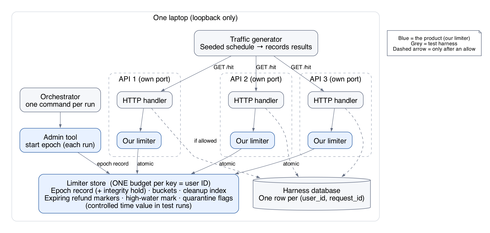
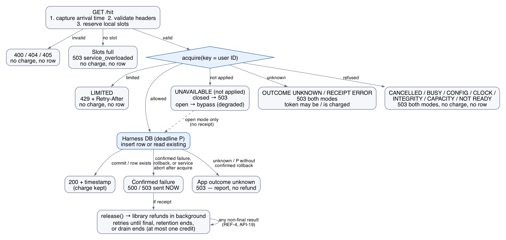
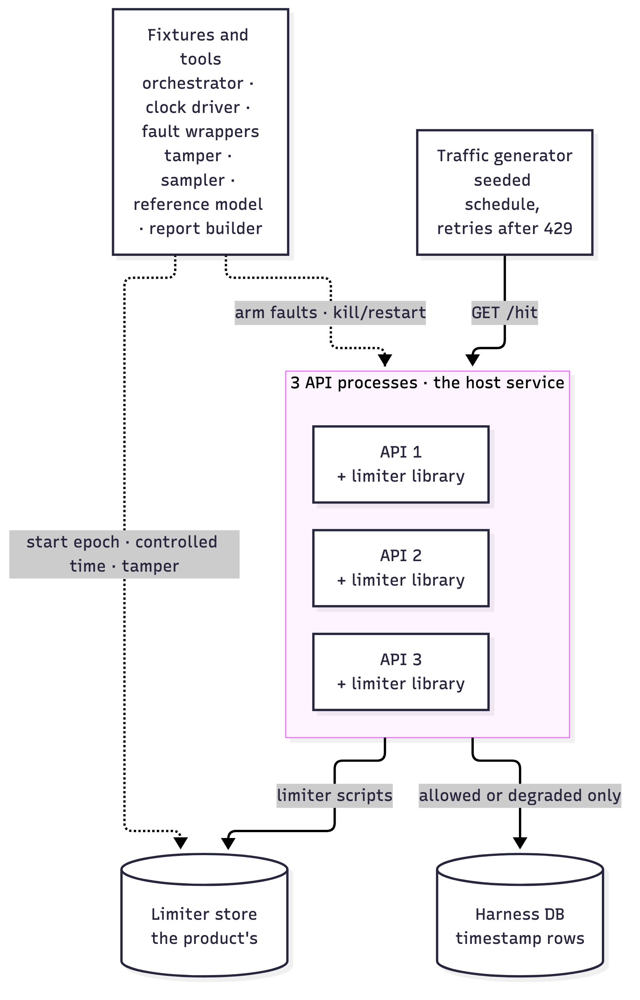
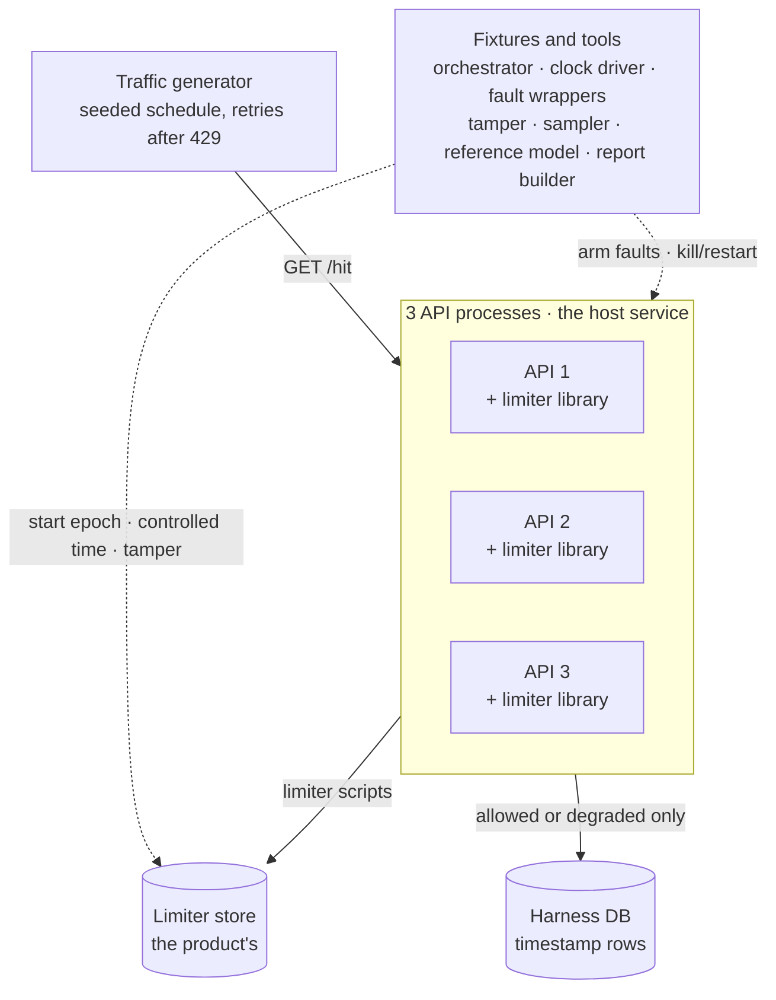
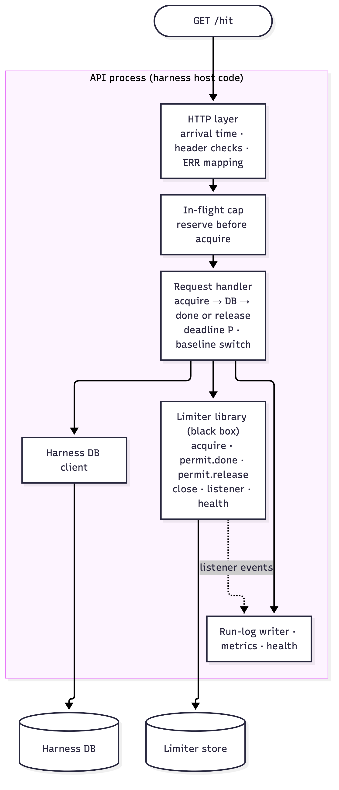
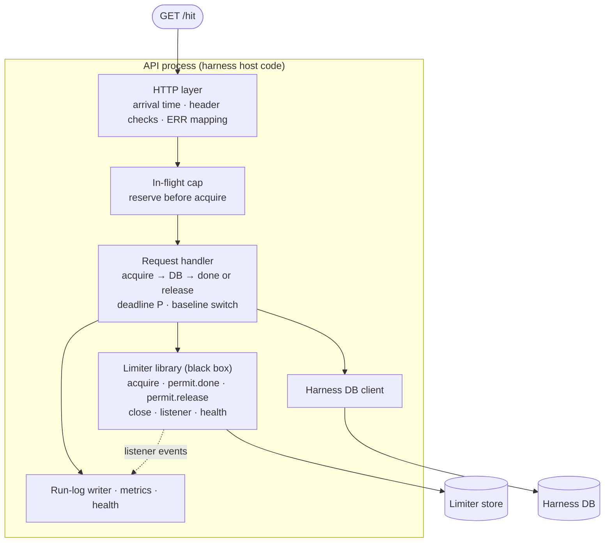
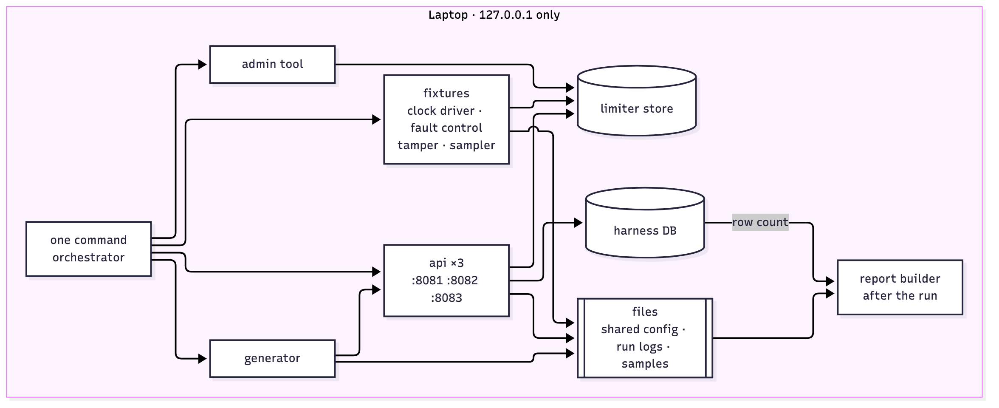
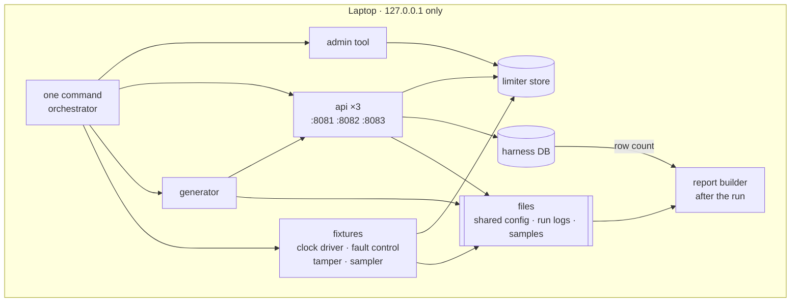
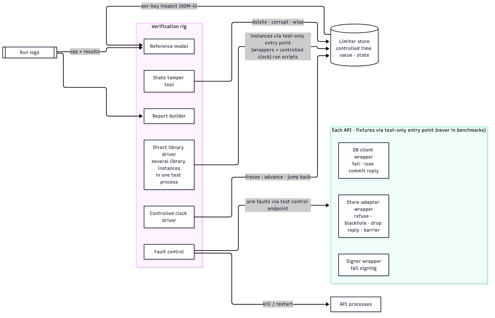
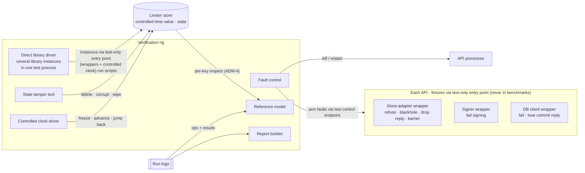

# Test harness: specification and architecture

**What this is:** the rig that verifies the rate limiter: three HTTP API processes on one laptop, a harness database, a seeded traffic generator, fault tools, a reference model, and reports.

**What this is not:** a requirement on the rate limiter. The limiter is specified only in [SPEC.md](SPEC.md) and designed in [ARCHITECTURE.md](ARCHITECTURE.md).

**Two roles, kept apart**

- **The harness is one host service.** Its API processes import the limiter library and follow the host integration contract (`HOST-1`…`HOST-8`) like any other service would.
- **The harness is the verification rig.** It drives traffic, injects faults through the limiter's test-only entry point (`CMP-9`), controls time, and judges results against SPEC rules.

**Boundary rule:** the harness never adds limiter requirements. If the harness needs something from the limiter, SPEC.md changes first, explicitly.

- Rule IDs here: `HAR` (harness components and host role), `HTTP`, `ERR`, `TRF`, `FLT`, `PRF`. Limiter IDs (`BUD`, `API`, `HOST`, …) point to SPEC.md.
- Each section starts with a picture where one helps; bullets carry the details.

## Contents

| § | Section | ID prefix |
|---|---|---|
| 0 | [Glossary](#0-glossary) | — |
| 1 | [Components](#1-components) | `HAR` |
| 2 | [The harness as a host](#2-the-harness-as-a-host) | `HAR` |
| 3 | [HTTP contract](#3-http-contract) | `HTTP`, `ERR` |
| 4 | [Runs](#4-runs) | `TRF` |
| 5 | [Traffic](#5-traffic) | `TRF` |
| 6 | [Fault injection](#6-fault-injection) | `FLT` |
| 7 | [Performance reporting](#7-performance-reporting) | `PRF` |
| 8 | [Harness tests and completion](#8-harness-tests-and-completion) | `T-*` |
| 9 | [Harness architecture](#9-harness-architecture) | — |
| 10 | [Decisions for the design doc](#10-decisions-for-the-design-doc) | — |

## 0. Glossary

| Term | Meaning |
|---|---|
| Run | One experiment: a fresh limiter epoch, an empty harness DB, one seeded schedule, one report. Has its own run ID, recorded next to the epoch ID. |
| Run log | Harness files written by the generator and API instances: per-request events, refund events, and the summary report (`TRF-10`). Never limiter state. |
| `P` | The harness's value for the limiter setting `max_release_delay` (`RCP-8`): the longest time from just before acquire to a confirmed failure. Enforced by the API as a deadline (`HTTP-13`). |
| Harness DB | The protected work: one arrival timestamp per `(user_id, request_id)`. |
| Baseline run | Same schedule with the limiter calls switched off (`TRF-8`). |
| Fixtures | Test-only implementations wired through the limiter's test-only entry point (`CMP-9`): fault wrappers, the controlled clock driver, barriers. |
| Direct library driver | A test process that builds several library instances against the real store through the test-only entry point, with the store-adapter and signer wrappers and the controlled clock, and calls the public API directly (§9.4). |
| Test control endpoint | Loopback-only endpoint on each API process that arms fault wrappers; exists only in test runs and is refused in benchmarks (`HAR-24`). |
| State tamper tool | Fixture that deletes, corrupts, or wipes limiter store data directly (`FLT-7`, `FLT-11`). |

## 1. Components

| ID | Component | What it does |
|---|---|---|
| HAR-1 | Traffic generator | Creates users and a seeded request schedule, sends requests to all three instances, records results. |
| HAR-2 | API instances (×3) | The host service. Validate requests, capture arrival time, call the limiter, do the database work. Separate processes on separate ports. |
| HAR-3 | Harness database | One arrival timestamp per `(user_id, request_id)`. Stores no API outcomes and no limiter data. Separate from the limiter store (`CMP-7`). |
| HAR-4 | Limiter store and admin tool | The product's, used exactly as SPEC.md says. One local store process. |
| HAR-5 | Orchestrator | One command runs a whole run (`TRF-7`). |
| HAR-6 | Verification fixtures | Controlled clock driver, fault wrappers (store adapter, signer, DB client), barrier control, state tamper tool, process kill/restart, and the direct library driver. |
| HAR-7 | Resource sampler | CPU and memory for every process, plus limiter status counts (`ADM-4`) and library health. |
| HAR-8 | Reference model | An independent implementation of the budget arithmetic that replays the same operations (`BUD-13`, `T-COR-1`). |
| HAR-9 | Report builder | Builds the report from saved evidence only (`PRF-*`). |

- HAR-20 Bind all services to loopback. User IDs are simulated identities, not authentication.
- HAR-21 The generator calls instances directly; no load balancer in the first build.
- HAR-22 Keep HTTP handling and database work behind small interfaces in the API.
- HAR-23 A laptop run proves behavior across processes and measures local capacity only.
- HAR-24 Benchmarks run with production construction only (`CMP-9`): store clock source, no fault wrappers, no barrier control, no test control endpoint. The orchestrator refuses to launch a benchmark otherwise.

## 2. The harness as a host

How the API processes meet the host integration contract in SPEC §9.

| ID | Harness choice | Meets |
|---|---|---|
| HAR-10 | Budget key = the validated `X-User-ID` header (`HTTP-2`). | `HOST-1`, `API-1` |
| HAR-11 | `max_release_delay` = `P`, a per-instance deadline measured from just before acquire, enforced by cancellation (`HTTP-13`). | `HOST-3`, `RCP-8` |
| HAR-12 | One shared config file, read by all three APIs at startup: policy settings, per-instance settings, and store address. No receipt keys: each library instance generates its own (`RCP-4`). | `HOST-5`, `CFG-7` |
| HAR-13 | The refund listener hands events to the run-log writer through a queue; refund events land in the run log (`TRF-10`). The listener drop count is read from every API process at the end of the run and just before each kill, and the counts are added up; if the total is not 0, or a killed process's count was not read, the run's refund evidence is incomplete and its `BUD-11a` verdicts are invalid (rerun). | `HOST-8`, `API-1d` |
| HAR-14 | Per-instance limits on in-flight work, queue length, and dependency waits, reserved before acquire. Full → `ERR-7`, no acquire. Recorded in the run log. | `HOST-7` |
| HAR-15 | On `SIGTERM`: stop accepting `/hit`, finish or cancel in-flight work within `P`, then `close(drain_timeout)` with the default drain (`CFG-8`). The orchestrator's kill grace period exceeds `P + drain_timeout` plus shutdown overhead (`HOST-6`). Drain timeout recorded in the run log. | `HOST-6` |
| HAR-16 | Health and metrics endpoints are separate from `/hit`, spend no allowance, write no rows. Health reports the library's `health()`. | `STA-13`, `STA-14`, `API-1g` |
| HAR-17 | A config switch skips only the limiter calls, for the baseline run (`TRF-8`). | — |
| HAR-18 | Limiter results map to HTTP only through the error catalog (§3). `limited` alone becomes `429`. | `HOST-4` |

## 3. HTTP contract

### Request contract

| ID | Element | Contract |
|---|---|---|
| HTTP-1 | Endpoint | `GET /hit`, no body. GET is kept as the agreed experiment endpoint. |
| HTTP-2 | `X-User-ID` | Required. 1–64 of `[A-Za-z0-9_-]`. Missing, duplicate, or invalid → `400`. Becomes the budget key (`HAR-10`). |
| HTTP-3 | `X-Request-ID` | Required, same rules. New ID per new operation; reused for its retries. |
| HTTP-4 | Database key | `(user_id, request_id)` is unique in storage. Different users may share a request ID. The limiter only sees the key. |
| HTTP-5 | Arrival time | Wall-clock integer nanoseconds since the UTC epoch, captured first, before limiter or database work. Real resolution depends on the machine. |
| HTTP-6 | Success JSON | `user_id`, `request_id`, `arrival_ns` (decimal string), `existed` (row already existed), `degraded` (open-mode bypass), `decision_ns` (the acquire's `decision_ns` as a decimal string; absent for degraded). `429` JSON also carries `decision_ns`. |
| HTTP-7 | Error JSON | Stable `error` code (`ERR` table) plus a short message; include valid IDs when available. |
| HTTP-8 | Caching | `Cache-Control: no-store` on every response. |
| HTTP-9 | `429` hints | `Retry-After` in whole seconds rounded up, and JSON `retry_after_ms` rounded up, from `retry_after_ns`. [HTTP 429](https://www.rfc-editor.org/rfc/rfc6585.html#section-4) |
| HTTP-10 | `200` | Only after a timestamp commit or finding an existing row. An existing row returns its original timestamp. |
| HTTP-11 | Database safety | Validate input, use parameterized queries, enforce key uniqueness in storage. Uniqueness blocks a second row even for concurrent retries; it does not replay errors or give exactly-once HTTP. [Retry background](https://www.rfc-editor.org/rfc/rfc9110.html#section-9.2.2) |

### Error catalog (single source for HTTP outcomes)

| ID | Outcome | HTTP | `error` | Tokens | DB row | Generator auto-retry |
|---|---|---|---|---|---|---|
| ERR-1 | Allowed, row created | 200 | — | 1 charged | new row | — |
| ERR-2 | Allowed, row already existed | 200 | — | 1 charged | none (original kept) | — |
| ERR-3 | `degraded`, database work succeeded | 200 | — (`degraded=true`) | none | as ERR-1/2 | — |
| ERR-4 | `limited` | 429 | `rate_limited` | none | none | yes (`TRF-5`) |
| ERR-5 | Bad or missing headers | 400 | `invalid_request` | none | none | no |
| ERR-6 | Unknown route / wrong method | 404 / 405 | `not_found` / `method_not_allowed` | none | none | no |
| ERR-7 | Harness in-flight cap full (`HAR-14`), or limiter `busy` | 503 | `service_overloaded` | none | none | no |
| ERR-8 | `unavailable`, closed mode | 503 | `limiter_unavailable` | none | none | no |
| ERR-9 | `outcome_unknown` (including store error replies other than not-ready replies, `API-22`) | 503 | `limiter_outcome_unknown` | maybe 1 | none | no |
| ERR-9a | `cancelled` (the end of `P` passed before the acquire command was sent) | 503 | `limiter_deadline_exceeded` | none | none | no |
| ERR-10 | `capacity_error` | 503 | `limiter_capacity_exceeded` | none | none | no |
| ERR-11 | `state_integrity_error` | 503 | `limiter_state_integrity_error` | none | none | no |
| ERR-12 | `config_error` | 503 | `limiter_config_error` | none | none | no |
| ERR-12a | `not_ready` | 503 | `limiter_not_ready` | none | none | no |
| ERR-12b | `clock_error` | 503 | `limiter_clock_error` | none | none | no |
| ERR-12c | `receipt_error` | 503 | `limiter_receipt_error` | 1 charged, reported | none | no |
| ERR-12d | `validation_error` (cannot happen after `HTTP-2` passes; mapped for completeness) | 400 | `invalid_request` | none | none | no |
| ERR-13 | Confirmed processing failure | 500 | `internal_error` | `release()` if receipt; none if degraded (`REF-2`) | may remain | no |
| ERR-14 | Database unavailable or rolled back (confirmed) | 503 | `database_unavailable` | `release()` if receipt; none if degraded (`REF-2`) | none | no |
| ERR-15 | Service refusal after acquire | 503 | `service_aborted_after_acquire` | `release()` if receipt; none if degraded (`REF-2`) | none | no |
| ERR-16 | Application outcome unknown (e.g., lost commit reply, `P` deadline without confirmed rollback) | 503 | `application_outcome_unknown` | `done()`: 1 charged (none if degraded), unresolved, no refund | maybe | no |

- HTTP-12 Every attempt passes through the limiter, so an existing row does not guarantee an immediate `200`.
- HTTP-13 The API enforces `P` as a deadline measured on a monotonic clock from just before acquire is sent, and passes the end of `P` to `acquire` as its deadline (the library caps it at `dependency_deadline`, `API-1`). If the effective (capped) deadline passes while acquire is in flight, acquire returns per `API-1`: `cancelled` (`ERR-9a`) or `outcome_unknown` (`ERR-9`), with no permit and no database work; or, if the dependency deadline ended it before send, `unavailable`: closed mode → `ERR-8` (no permit, no database work), open mode → `degraded`, and database work proceeds in the time left in `P` (`ERR-3`, `ERR-14`, `ERR-16`). If `P` passes during database work, the API cancels it: a confirmed rollback becomes `ERR-14` (`release()`); anything else becomes `ERR-16` (`done()`). A slow acquire reply therefore shortens the time left for database work, never the refund window.
- HTTP-14 The error response is sent right after `release()` returns; it never waits for the refund (`REF-4`).

## 4. Runs

- TRF-7 Baseline and limiter runs get an identical **initial** schedule, isolated data, and a fresh epoch (`ADM-1`: replace with the expected current `epoch_id` when an epoch exists, otherwise without the flag). `429` retries exist only in limiter runs and are reported separately. Restarting an API mid-run does not start a new epoch.
- TRF-8 The baseline skips only the limiter calls (`HAR-17`). Validation, timestamp capture, insert, and response handling stay identical.

One run, in order (`HAR-5`):

1. Empty the harness DB.
2. If the run uses the controlled clock, the clock driver writes the time value first (`CMP-4`). Start a fresh epoch with the run's settings (`ADM-1`: replace with the expected current `epoch_id` when an epoch exists, otherwise without the flag). Record the run ID with the epoch ID.
3. Start the three APIs; wait until all report ready.
4. Start the resource sampler and the generator.
5. Stop the generator, then stop the APIs gracefully (`HAR-15`).
6. Build the report from saved evidence (`HAR-9`).

## 5. Traffic

| ID | Rule |
|---|---|
| TRF-1 | Seeded, repeatable traffic with irregular gaps and unequal user activity. The run log keeps schedule, user IDs, request IDs, retry settings, and instance routing. |
| TRF-2 | A seed reproduces inputs, not thread scheduling. Correctness tests use the controlled clock, barriers, or fault wrappers to prove the tested stage was reached. |
| TRF-3 | Open arrival model: initial arrivals follow the schedule, not response completion. Retries are extra traffic, counted separately. [Open vs closed](https://grafana.com/docs/k6/latest/using-k6/scenarios/concepts/open-vs-closed/) |
| TRF-4 | Spread requests across all three instances, and route one busy user across all three. |
| TRF-5 | Automatic retries only after `429`: at most 2 extra attempts, same user and request IDs, wait ≥ chosen hint (`retry_after_ms` or `Retry-After`) plus seeded nonnegative jitter. Record hint choice and jitter. Any other response, timeout, or transport error ends retries. |
| TRF-6 | Deliberate duplicate requests (for uniqueness tests) are scheduled explicitly and recorded separately from retries. |
| TRF-9 | These workloads resemble real usage; production realism needs production traces. |
| TRF-10 | The run log records per-request events (planned time, sent time, instance, IDs, `deduction_id`, attempt number, outcome, `error`, `decision_ns`, latencies) and refund events from the listener (`deduction_id`, attempts, result, the credit's original `decision_ns`), plus the listener drop count. Its size grows with the run's request count, which is fixed by the schedule. |

### Scenarios

| ID | Workload | Must expose |
|---|---|---|
| TRF-S1 Capacity ramp | 100 req/s, doubling every 30 s, exploratory ceiling 10,000/s. Stop early if generator or service limits make a step invalid. Run with 1 and 3 API instances. | Sustainable capacity and first bottleneck. Report the 1→3 change as measured; do not assume 3×. |
| TRF-S2 Many users + cleanup | 100, 1,000, 10,000 distinct users. Stop a cohort, wait for refill and expiry, then revisit. | State growth, isolation, reclamation within the interval. Returning users get no extra allowance; old receipts fail on recreated buckets. |
| TRF-S3 One busy user | One user at 100 req/s; others at regular 5 req/s. | Shared enforcement; effect on well-behaved users. |
| TRF-S4 Spike | Sustainable rate, then 5× for 10 s, then back. | Bounded overload and recovery by a pre-declared deadline (`PRF-6`). |
| TRF-S5 Retry pressure | `429`-only retries per `TRF-5`. | Extra offered load, preserved IDs, correct timing and limits. |
| TRF-S6 Faults under load | All `FLT` injections below, in each failure mode. | Timely refunds, preserved budgets, bypass only when definitely not applied, unknowns separated. |
| TRF-S7 Long run | 10 min at 70% of sustainable capacity, new and returning users, controlled refund population. | State follows recent users and live refunds, not total admissions; gradual performance drift. |

- The listed loads are attempts, not promises. Record achieved load; never label unsent traffic as handled.

## 6. Fault injection

Faults go through the limiter's test-only entry point (`CMP-9`) or act on processes and the store from outside. Nothing here is a limiter feature.

| ID | Fault | How | Expected limiter result → HTTP |
|---|---|---|---|
| FLT-1 | Refused-connection outage, 5 s | (a) Close the store's port, no wrapper, so the production adapter classifies it; (b) store-adapter wrapper refuses before any command is sent | `unavailable` → closed `503` / open bypass |
| FLT-2 | Blackhole outage, 5 s | Pause the store process; wrapper or store-side evidence records which commands were sent | Sent: `outcome_unknown` → `503` both modes. Never sent: may be `unavailable` |
| FLT-3 | Lost acquire reply | Store-adapter wrapper drops the reply after the store executed the deduction | `outcome_unknown` |
| FLT-4 | Lost refund reply | Store-adapter wrapper drops the reply after the store applied the refund | Retry → `already_applied` |
| FLT-5 | Confirmed failure before insert / after commit | DB client wrapper | `release()` → refund (`REF-2`) |
| FLT-6 | API restart mid-run | Kill and restart one instance | Shared state and other instances' receipts survive; the killed instance's pending refunds are lost (`STA-2`, `REF-8`) |
| FLT-7 | State loss | Tamper tool: delete an indexed bucket early; write malformed data; wipe state | `state_integrity_error` (`STA-9`) |
| FLT-8 | Capacity exhaustion | Exceed declared shared-state limits | `capacity_error`, nothing evicted |
| FLT-9 | Lost database commit reply | DB client wrapper drops the commit acknowledgement | `ERR-16`, `done()`, no refund |
| FLT-10 | Signing failure | Signer wrapper fails after a confirmed deduction | `receipt_error` (`API-12a`) |
| FLT-11 | High-water mark loss | Tamper tool deletes or corrupts it mid-epoch | Epoch-wide `state_integrity_error` (`CLK-7`) |

- Requests already in flight when FLT-1 starts may be `outcome_unknown`; only requests that never sent a command, or got a not-ready reply (loading, busy; `API-22`), are `unavailable`.
- Crash outcomes without evidence are reported as unresolved.

## 7. Performance reporting

| ID | Measure | Required separation |
|---|---|---|
| PRF-1 | Load | Planned arrivals, requests actually sent, retries, generator drops, scheduling lag. |
| PRF-2 | Results | New rows, duplicate rows avoided, quota rejections, degraded admissions, capacity refusals, integrity failures, `unavailable`, unknown acquires, unknown application outcomes, server failures, transport errors, expired or unresolved refunds. Final harness DB row count included. |
| PRF-3 | Timing | **Primary: limiter decision time** (store access + signing). p50/p95/p99 separately for allows, rejects, degraded, and errors. Database time, refund time, and end-to-end latency measured separately. |
| PRF-4 | Resources | CPU and memory for generator, each API, limiter store, harness DB. Tracked keys, live markers, pending refunds, cleanup counts and lag, clock lag, listener drops (from the limiter's metrics, `API-1g`, and `ADM-4`). |
| PRF-5 | Run context | Hardware, software versions, run ID, epoch ID, policy, limits, `P`, seed, workload, start/end times, injected faults. |

- PRF-6 Before a spike run, record the recovery deadline and observation window. Pass only if spike backlog clears and latency/error rates stay within thresholds for the whole window by that deadline.
- PRF-7 The first baseline sets latency and error thresholds. Record latency populations, error denominators, observation time, and allowed scheduling lag before comparing. Never relax thresholds after a failing run.
- PRF-8 A generator-limited step cannot establish service capacity. Saturation must be visible, never hidden by silently sending fewer requests.
- PRF-9 Overload respects resource bounds and returns explicit failures where possible. Connection-level failures are reported separately.
- PRF-10 Report admitted throughput and `429` throughput separately. Cheap `429`s do not prove insert capacity.
- PRF-11 Sustainable capacity = highest **achieved** load meeting thresholds, with no generator drops and no unknown outcomes in a healthy run. Report offered, allowed, rejected, and unique-row throughput separately.

## 8. Harness tests and completion

Limiter correctness tests are in SPEC §10. These tests check the harness's own contract and its role as a host.

| ID | Setup | Expected | Covers |
|---|---|---|---|
| T-HTTP-1 | Missing/duplicate headers, invalid characters, 0 or 65 characters, wrong method, unknown route | `ERR-5`, `ERR-6`; no acquire, no row | HTTP-1, HTTP-2, HTTP-3, ERR-5, ERR-6, HAR-10 |
| T-HTTP-2 | Same request ID for different users | Separate rows | HTTP-4 |
| T-HTTP-3 | Concurrent duplicate requests | One row; each allowed attempt charged; every `200` returns the original `arrival_ns` | HTTP-10, HTTP-11, BUD-9, ERR-2, HTTP-12 |
| T-HTTP-4 | Healthy new operations | Exactly one row each; quota rejections and invalid requests write none | ERR-1, ERR-4, REF-1, HOST-1 |
| T-HTTP-5 | Confirmed failure after commit; database unavailable | Row may remain / no row; refund applied; error response sent before the refund completes; unique rows match recorded events | ERR-13, ERR-14, REF-2, FLT-5, HTTP-14 |
| T-HTTP-6 | `429` with limiter delays of 1 ns, 999,999 ns, 1 ms, 1 s + 1 ns | `Retry-After` and `retry_after_ms` both rounded up, never 0 | HTTP-9 |
| T-HTTP-7 | Response contract | Success/error JSON fields and types (`arrival_ns`, `decision_ns` as strings), stable `error` codes, `Cache-Control: no-store` on every response | HTTP-5, HTTP-6, HTTP-7, HTTP-8 |
| T-HTTP-8 | Call health and metrics endpoints under load | No allowance spent, no rows; health shows library readiness and clock source | HAR-16 |
| T-HTTP-9 | Force every limiter result and post-acquire outcome through `/hit` | Each maps to exactly its `ERR` row (status, `error`, tokens, row); only `limited` gives `429` | ERR-3, ERR-7, ERR-8, ERR-9, ERR-9a, ERR-10, ERR-11, ERR-12, ERR-12a, ERR-12b, ERR-12c, ERR-12d, ERR-15, HAR-18, HOST-4 |
| T-HFLT-1 | In-flight cap full | `503 service_overloaded`; no acquire sent | HAR-14, ERR-7, HOST-7 |
| T-HFLT-2 | (a) Database work exceeds `P`; (b) the acquire reply is delayed by most of min(`P`, `dependency_deadline`); (c) min(`P`, `dependency_deadline`) passes while acquire is in flight | (a, b) Cancelled at `P` measured from before acquire: confirmed rollback → `ERR-14` + refund confirmed before expiry; otherwise `ERR-16`. (c) `ERR-9a` or `ERR-9` per `API-1`, or `ERR-8` in closed mode: no permit, no database work, no `release()`. In open mode a dependency-deadline `unavailable` becomes `degraded` and proceeds without a receipt | HTTP-13, HAR-11, HOST-3 |
| T-HFLT-3 | Lose the database commit reply (`FLT-9`) | `503 application_outcome_unknown`; `done()`, no refund, no auto-retry; row may exist; reported unresolved | ERR-16, FLT-9, HOST-2 |
| T-HFLT-4 | Refunds during faulted traffic (`TRF-S6`) | Admissions per key stay within `BUD-11a`, using each credit's logged `decision_ns`. A released receipt whose credit time is unknown (`receipt_expired`, `unresolved` after at least one sent attempt, or `release()` called with no final event because its instance was killed, `FLT-6`/`REF-8`) counts as possibly applied at any budget time in [acquire `decision_ns`, acquire `decision_ns` + receipt lifetime); host release time is never used. A non-zero listener drop count invalidates the verdict (`HAR-13`) | BUD-11a, TRF-10, HAR-13, HOST-8 |
| T-HFLT-5 | `SIGTERM` one API with refunds pending | Stops accepting, drains, exits; refund events in the run log; other APIs keep serving | HAR-15, HOST-6 |
| T-HAR-1 | Start one API with a config file whose shared settings differ from the others | That API refuses (`limiter_config_error`) and reports not ready (`fingerprint_mismatch`); the others serve | HAR-12, HOST-5 |
| T-FIX-1 | Fixture self-check for each `FLT` | Each fault reaches the intended stage (barrier, wrapper, or store-side evidence, including which commands were sent under `FLT-2`) and yields its expected result | FLT-1, FLT-2, FLT-3, FLT-4, FLT-6, FLT-7, FLT-8, FLT-10, FLT-11, TRF-2 |
| T-FIX-2 | Launch a benchmark with the controlled clock, a fault wrapper, or the control endpoint enabled | Orchestrator refuses to launch | HAR-24 |
| T-TRF-1 | Generator retry policy | Retries only after `429`, same IDs, wait ≥ hint, ≤ 2 extra attempts; no retry after any other result | TRF-5 |
| T-RPT-1 | Every benchmark report | Contains all `PRF-1`…`PRF-5` fields: planned vs sent arrivals, scheduling lag, arrival vs decision vs monotonic durations kept separate, run-log schedule and routing, baseline comparison | TRF-1, TRF-3, TRF-4, TRF-6, TRF-7, TRF-8, TRF-10, HAR-17, PRF-1, PRF-2, PRF-3, PRF-4, PRF-5 |
| T-RPT-2 | Every capacity and spike report | Thresholds and the spike recovery deadline were recorded before the run and left unchanged; spike recovery was met by its deadline; generator-limited steps are flagged and excluded from capacity; overload returned explicit failures within resource bounds; admitted and `429` throughput reported separately; sustainable capacity chosen per `PRF-11` | PRF-6, PRF-7, PRF-8, PRF-9, PRF-10, PRF-11 |

- Review-only: `HAR-1`…`HAR-9`, `HAR-20`…`HAR-23`, `TRF-9`, scenario rows `TRF-S*` (exercised by `T-RPT-1` and SPEC tests).

### Completion (project)

Done = all SPEC and HARNESS tests pass, both failure modes behave as specified with unknown outcomes separated, known-receipt refunds are timely, and a reproducible benchmark report exists (§7). Throughput targets stay unmeasured until the baseline; the 10,000/s ceiling is not a pass claim.

## 9. Harness architecture

### 9.1 The harness at a glance

Diagram source (mermaid — flowchart)

- The limiter library and store are used unchanged; in test runs the harness wires fixtures through the limiter's test-only entry point (`CMP-9`).

### 9.2 Inside one API process

Diagram source (mermaid — flowchart)

| Block | Job | Rules |
|---|---|---|
| HTTP layer | Capture arrival time first, validate headers, map results through the `ERR` table | `HTTP-*`, `ERR-*`, `HAR-18` |
| In-flight cap | Refuse before acquire when the API is full | `HAR-14` |
| Request handler | Acquire → DB work → `done()` or `release()` → response; classify the DB outcome; cancel at `P`; baseline switch | `HTTP-10`, `HTTP-13`, `HAR-11`, `HAR-17` |
| Run-log writer | Per-request events and listener refund events to files | `TRF-10`, `HAR-13` |
| Limiter library | Used only through its public API | SPEC §4 |

### 9.3 Deployment on the laptop

Diagram source (mermaid — flowchart)

- **One command** runs a whole run (§4).
- The **report builder** reads only saved evidence: run logs from the generator and all three APIs, resource samples, and a final row count from the harness DB. Logs alone can't tell whether a lost commit reply left a row (`ERR-16`, `PRF-2`).
- Ports are examples; the design doc fixes them.

### 9.4 Verification fixtures

Diagram source (mermaid — flowchart)

| Need | How the harness provides it | Rules |
|---|---|---|
| Same controlled time in 3 processes | Limiter clock source `controlled` (test-only entry point); the clock driver writes the time value in the store before `ADM-1` | `CLK-2`, `CMP-4`, `T-CLK-1` |
| Exact expected results | A separately written reference model replays the same operations | `BUD-13`, `T-COR-1` |
| Faults at precise points | Wrappers around the limiter's store adapter and signer (through the test-only entry point), and around the harness DB client; armed through a test-only control endpoint on each API | `CMP-9`, `FLT-*` |
| Calls the HTTP host cannot make | The direct library driver, whose instances use the store-adapter and signer wrappers and the controlled clock through the test-only entry point: arbitrary UTF-8 keys, unfinished or repeated permit finishes, blocking listeners, cancellation, chosen-instance cleanup, per-attempt refund capture. Used by SPEC tests marked [D] | SPEC §10 |
| Per-key state for checks | `ADM-4` per-key inspect | `ADM-4` |
| Proving which stage was reached | Barriers in the store-adapter wrapper (e.g., pause between a cleanup scan and its removal step) | `TRF-2`, `T-CLN-6` |
| Explicit cleanup passes | The limiter's ordinary `run_cleanup_pass()` | `API-1f` |
| Benchmarks stay clean | Orchestrator refuses fixtures in benchmark runs | `HAR-24` |

## 10. Decisions for the design doc

- HTTP framework and harness DB product.
- Ports, `P`, and the timing margin, checked against `RCP-8`.
- Run log and report formats: file layout and schema for `TRF-10`, and the report layout for §7.
- Orchestrator: how one command starts, sequences, and stops a run.
- Fixture wiring: how wrappers are plugged in and armed, and how the benchmark guard (`HAR-24`) checks for them.
- Controlled clock driver interface.
- Baseline procedure, thresholds, and spike recovery criteria, set before the runs they judge.
- Harness per-instance limits (`HAR-14`) and supported failure load for the scenarios.
