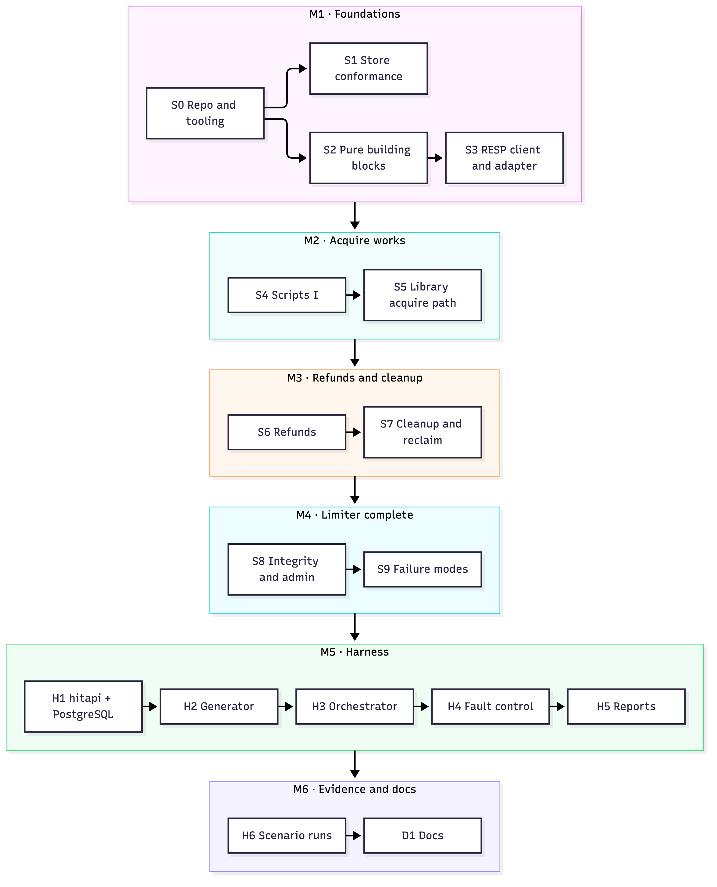
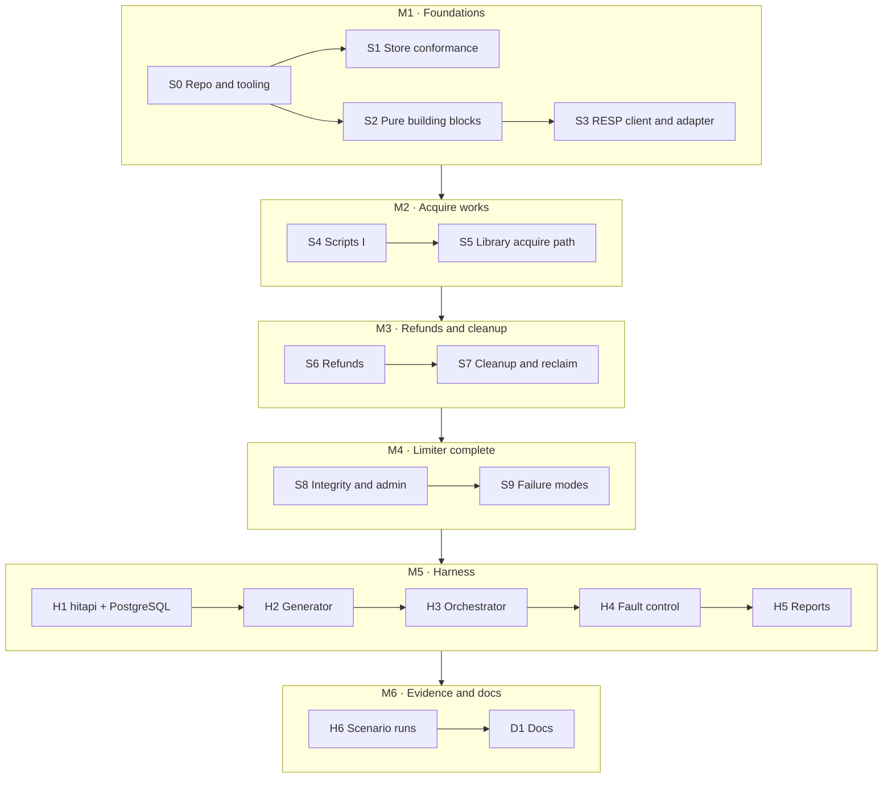

# Implementation plan

**What this is:** the build order for the rate limiter and its test harness, as small vertical slices. Each slice ends with commands that prove it works. A person or a coding agent follows it top to bottom.

**Inputs (they win over this plan):** [SPEC.md](SPEC.md) says what must hold, [ARCHITECTURE.md](ARCHITECTURE.md) gives the shape, [DESIGN.md](DESIGN.md) says how to build it, and [HARNESS.md](HARNESS.md) covers the test harness. This plan adds no requirements. Where it picks a detail that DESIGN leaves open, it says "(plan choice)".

## 1. How to work through it

1. **One slice at a time, in order** (S0, S1, S2, …). S2 and S3 don't depend on S1, but two slices' checks never run at the same time (§7).
2. **Before coding,** read the sections listed under **Read first**.
3. **Build** the listed files, and write the listed tests with them. A SPEC or HARNESS test ID becomes exactly one test, named after the ID: `TestT_COR_1` for `T-COR-1` in Go, `test_t_rpt_1` for `T-RPT-1` in Python. Name every other test exactly as its slice's **Tests** list does: `make slice-check` fails on a missing or renamed one (S0 `slices`).
4. **Verify:** run the commands under **Verify**. A slice is done only when every **Pass when** item holds and `make slice-check S=<id>` passes. With an orchestrator, the orchestrator runs these, not the builders (§7). That command re-runs every earlier slice's tests too, so nothing that passed may break.
5. **Never weaken a test or a rule to make it pass.** If a SPEC or DESIGN rule cannot be met, stop and report (§5).
6. **Coding rules:** follow `AGENTS.md`; `make check` enforces most of it. Never add an inline lint suppression or change a lint config. If a rule blocks code DESIGN requires, stop and report (§5).
7. **Reference model:** `refmodel/` and its vectors are written in a separate session, preferably by a different model, that reads only SPEC, HARNESS `T-HFLT-4` (and HARNESS §7, DESIGN §B8, the §B2 `config.toml` keys (the repo's `harness.toml`) and the golden run-log lines in `harness/runlog/testdata/golden/` for H5's run-log entry point), AGENTS.md (§4 for Python), `pyproject.toml`, DESIGN §A3.1, the §A3.3 counter rule, the §A4.9 reply table, §C6, the op-log record types (S5 step 11, extended in S6–S8) and this plan's refmodel Build steps and refmodel test bullets (S5–S8, H5), never the Go or Lua code. The refmodel steps of S5–S8 and H5 point here.
8. **Mutation runs** (DESIGN §C9): from S4 on, `slice-check` also runs every curated planted bug whose file exists (`bin/mutate --curated`), and each must be killed by an assertion in its named test. Script and core slices (S4–S8) end with the operator sweep on that slice's product files (`make mutate SWEEP='<files>'`, which runs `bin/mutate --sweep`); S4's first sweep also covers the S2 and S3 files, since `bin/mutate` arrives in S4. Each survivor in `.out/mutants.txt` gets a killing test or a one-line "equivalent because …" in the slice report, or one of the two verdicts AGENTS.md §5 allows within its limits ("not killed (panic): crash-only", "not killed, by orchestrator decision"); survivors don't fail the build.
9. **Commit at the end of each slice** (the repository uses git), with a message like `S5: library acquire path`. The message body is the slice report: doc conflicts, plan choices made, sweep survivors and their verdicts, and any §5 stop with its outcome.

**Machine and tools** (this laptop): macOS on Apple Silicon, Go 1.24 as the language version (installed: go1.24.0; `go.mod` pins `toolchain go1.27.1`, which `go` downloads on first use, S0 step 1), Python 3.13, Valkey 9.1.2 (installed on 2026-10-04 with `brew unlink redis && brew install valkey`, because the two formulas conflict; Valkey also provides `redis-server`), PostgreSQL ≥ 14 (installed: 14.19). Fixed ports: 6390 (harness store), 5433 (harness PostgreSQL), 8081–8083 (`hitapi`). Tests pick free ports. Lint tools, installed by `make setup`: golangci-lint 2.14.0 (pinned release binary in `bin/tools/`, SHA-256 checked; not a `go.mod` dependency), luacheck 1.2 and stylua 2.5 (Homebrew), and pytest, ruff and mypy pinned in `requirements-dev.txt`.

**Test layers** (DESIGN §C1):

| Layer | What | Command |
|---|---|---|
| L0 | The pinned store behaves as DESIGN §A3.0 says | `make test-store` |
| L1 | Go unit tests, race detector on | `make test-unit` |
| L2 | Each Lua script against a real store | `make test-scripts` |
| L3 | Library through the direct driver: SPEC tests | `make test-integration` |
| L4 | Harness end to end: HARNESS tests | `make test-e2e`, `make test-report` |
| Python | Reference model and report builder | `make test-py` |

## 2. Slice map



<details><summary>Diagram source (mermaid — flowchart)</summary>



</details>

- S2 and S3 don't depend on S1. Slices still run one at a time, in order: two slices' checks must never run at once (§7).

**Slice overview**

| Slice | Name | Depends on | Tests that first pass here |
|---|---|---|---|
| S0 | Repo skeleton and tooling | — | — |
| S1 | Store conformance | S0 | — |
| S2 | Pure building blocks | S0 | — |
| S3 | RESP client and store adapter | S2 | — |
| S4 | Scripts I: prelude, epoch, acquire | S1, S3 | — |
| S5 | Library acquire path, test entry point, driver, reference model v1 | S4 | T-COR-2, T-COR-5, T-COR-8, T-KEY-1, T-CLK-1, T-RCP-6, T-CFG-1, T-CFG-2, T-CFG-3 |
| S6 | Refunds | S5 | T-COR-1, T-COR-3, T-COR-4, T-COR-7, T-RCP-1, T-RCP-7, T-REF-1, T-REF-2, T-REF-3, T-REF-4, T-REF-5, T-REF-6, T-REF-7, T-REF-8, T-FLT-6 |
| S7 | Cleanup and reclaim | S6 | T-COR-6, T-CLK-2, T-RCP-3, T-RCP-4, T-CLN-1, T-CLN-2, T-CLN-3, T-CLN-4, T-CLN-5, T-CLN-6, T-CLN-7, T-CLN-8, T-INT-1 |
| S8 | Integrity, epochs, admin tool | S7 | T-CLK-3, T-CLK-4, T-CLK-5, T-RCP-5, T-INT-2, T-INT-3, T-INT-4, T-INT-5, T-INT-6, T-INT-7, T-INT-8, T-INT-9, T-INT-10, T-INT-11, T-CFG-5, T-CFG-6, T-ADM-1 |
| S9 | Failure modes and observability | S8 | T-API-1, T-API-2, T-FLT-1, T-FLT-2, T-FLT-3, T-FLT-4, T-FLT-5, T-ORD-1, T-OBS-1 |
| H1 | `hitapi` and PostgreSQL | S9 | T-HTTP-1, T-HTTP-2, T-HTTP-3, T-HTTP-4, T-HTTP-5, T-HTTP-6, T-HTTP-7, T-HTTP-8, T-HFLT-1 |
| H2 | Generator | H1 | T-TRF-1 |
| H3 | Orchestrator and sampler | H2 | T-HAR-1, T-FIX-2 |
| H4 | Fault control | H3 | T-HTTP-9, T-HFLT-2, T-HFLT-3, T-HFLT-5, T-FIX-1 |
| H5 | Report builder and thresholds | H4 | T-HFLT-4, T-RPT-1, T-RPT-2 |
| H6 | Scenario runs | H5 | — |
| D1 | Code and operator docs | H6 | — |

| Milestone | Slices | What is true afterwards |
|---|---|---|
| M1 Foundations | S0–S3 | The repo builds and lints; the pinned store passes conformance; keys, settings, receipts, and the store client work |
| M2 Acquire works | S4–S5 | Several instances share one budget per key against a real store; first SPEC tests pass |
| M3 Refunds and cleanup | S6–S7 | Exactly-once refunds within the deadline; state shrinks back by itself |
| M4 Limiter complete | S8–S9 | State loss is detected and repaired; outages are classified correctly; all 63 SPEC tests pass |
| M5 Harness | H1–H5 | The HTTP harness, generator, orchestrator, faults, and reports work; all 20 HARNESS tests pass |
| M6 Evidence and docs | H6, D1 | Scenario reports exist and are valid; code and operator docs are written |

## 3. Slices

Every slice uses the same headings: **Goal**, **Depends on**, **Read first**, **Build**, **Tests**, **Verify**, **Pass when**, **Watch out**. "(plan choice)" marks a detail DESIGN leaves open.

### S0 — Repo skeleton and tooling
- **Goal:** A buildable Go module with the deploy files, the `make` targets, and the `tools/trace` checks that every later slice uses.
- **Depends on:** —
- **Read first:** DESIGN §A1 (layout, boundary rule), §A2 (profiles, ACL users), §A4.1 and §A4.8 rule 1 (script names and headers), §C1, §C3 (the `tools/trace` lint bullet), §C7, §C8; the test tables in SPEC §10 and HARNESS §8; §1, the **Tests** sections of §3 (`slices` checks the tests they name) and §4 (Test → slice table) of this plan; `AGENTS.md` and the lint configs at the repo root (`.golangci.yml`, `.luacheckrc`, `stylua.toml`, `.styluaignore`, `pyproject.toml`, `requirements-dev.txt`), which already exist: don't change them.
- **Build:**
  1. `go.mod`: `module ratelimiter`, `go 1.24`, `toolchain go1.27.1` (a supported Go release; golangci-lint 2.14.0 is built with go1.27.0), no dependencies (§0, §A1). `.gitignore` (written when the repo was initialized, §7; keep it): `.data/`, `.out/`, `bin/`, `__pycache__/`, `.pytest_cache/`, `.mypy_cache/`, `.ruff_cache/`, `.DS_Store`, and `runs/*/*` except `runs/thresholds/*` and each run's `report.md`, `report.json` and `context.json`, so a run's `store/` (AOF files and an `acl.conf` holding that run's passwords) and its logs never reach git, while `runs/index.jsonl` and `runs/h6-manifest.json` stay tracked (plan choice). Modules added later (S8 `toml`, H1 `pgx`, H3 `gopsutil`) come at the newest version whose own `go` line is at most 1.24, so this `go 1.24` line never moves (AGENTS.md §1).
  2. `deploy/valkey-durable.conf` (§A2): `appendonly yes`, `appendfsync always`, `no-appendfsync-on-rewrite no`, `aof-use-rdb-preamble yes`, `save ""`, `maxmemory 512mb`, `maxmemory-policy noeviction`, `maxclients 4096`, `auto-aof-rewrite-percentage 100`, `auto-aof-rewrite-min-size 1gb`, `bind 127.0.0.1`, `protected-mode yes`. `deploy/valkey-fast.conf`: the same except `appendfsync no`, `maxmemory 128mb`, `auto-aof-rewrite-percentage 0`. Neither sets `port`, `dir`, or `aclfile`; the process that starts the store passes them (plan choice).
  3. `deploy/acl.conf.tmpl` (§A2), Go `text/template`, fields `LibPassword`, `AdminPassword`, `FixturePassword`, `OpsPassword` (plan choice). Line 1: `user default off`. Then one line per user, `user <name> on >{{.LibPassword}} resetkeys ~rl:* -@all +…`, with the client and inner commands exactly as the §A2 table lists them; `rl_ops` has no key pattern.
  4. `deploy/pg-schema.sql`: the §C8 `hits` table as `CREATE TABLE IF NOT EXISTS`, so setup can rerun (plan choice).
  5. `tools/setup.sh`, run by `make setup` (§C8):
     - Check Go ≥ 1.24, Python ≥ 3.13, PostgreSQL ≥ 14 (`pg_ctl --version`).
     - Find the store binary in the §C1 order. If it is not Valkey 9.1.x, install with `brew unlink redis && brew install valkey` (the two Homebrew formulas conflict; Valkey then also provides `redis-server`): ask first on a TTY, otherwise print the command and continue with a warning (§C8).
     - If `.data/pg/PG_VERSION` is missing: `initdb -D .data/pg -U postgres --auth=trust -E UTF8` (plan choice: trust auth, loopback only), then append the six §C8 settings to `.data/pg/postgresql.conf` (only after `initdb`, so reruns add nothing; every run checks all six). The sixth, `unix_socket_directories = ''`, turns off the Unix socket: PostgreSQL writes nothing to `/tmp`, and every client connects over TCP to `127.0.0.1:5433`.
     - `pg_ctl -D .data/pg -l .data/pg.log -w start`; create role `rl` (LOGIN) and database `hits` (owner `rl`) if missing; apply the schema as `rl`; `pg_ctl -D .data/pg -w stop` (plan choice: the orchestrator starts PostgreSQL later, §B5).
     - Lint tools (AGENTS.md): golangci-lint v2.14.0 `darwin-arm64` from the GitHub release into `bin/tools/golangci-lint`, checked against SHA-256 `5ef5f36a7147e91dc58ef9ef4d11bb7bad5ead0c76eb6c01327a73c641d1dcc3` (skipped when that binary already reports 2.14.0); `luacheck --version` 1.2.x and `stylua --version` 2.5.x, else `brew install luacheck stylua`; `python3 -m pytest|ruff|mypy --version` equal to `requirements-dev.txt`, else `python3 -m pip install -r requirements-dev.txt`, then fail if any still differs. The golangci-lint download and the pip install run without asking (owner-approved network use, §7); Homebrew installs ask first on a TTY, otherwise print the command and continue with a warning (as for Valkey).
  6. `tools/trace/` (Go, standard library only), built to `bin/trace` (plan choice). Repo root = nearest directory with `go.mod`; walk the tree (never `git ls-files`), skipping `testdata/`, `.data/`, `.out/`, `bin/`, `runs/`. Subcommands:
     - `boundary` (§A1): parse the imports of every non-`_test.go` file with `go/parser` (`ImportsOnly`), ignoring build constraints; build the in-module import graph; fail when a package under `limiter/`, `limitertest/`, `internal/`, or `cmd/rladmin/` reaches `ratelimiter/harness/...` or `ratelimiter/cmd/hit*`, directly or transitively, printing the chain.
     - `ids [--list] [--complete]` (§C7): defined IDs are first-column cells matching `^\| (T-[A-Z]+-\d+)( \[D\])? \|` under SPEC.md `## 10.` and HARNESS.md `## 8.`. Test functions are Go `func TestT_X_N(` in any `.go` file (any build tag) and Python `def test_t_x_n(` under `refmodel/` and `report/`; mapping `T-HFLT-1` ↔ `TestT_HFLT_1` ↔ `test_t_hflt_1`. Fail on a function with no defined ID, two functions for one ID, or any other-shaped `TestT_`/`test_t_` name. `--complete` also fails on an ID with no function (plan choice; run at D1).
     - `acl` (§A2): line 1 is `user default off`; each user's `+` tokens equal its client plus inner commands of §A2 (constants in `tools/trace/acl.go`); key patterns exactly `~rl:*` for `rl_lib`, `rl_admin`, `rl_fixture` and none for `rl_ops`; no `+@…`, `allcommands`, or `~*`. Inner commands of each `internal/scripts/*.lua` come from `redis.call('X'`, `redis.pcall('X'`, `pcall(redis.call, 'X'`; any other call form fails as dynamic. Scripts map to users per §A2: `rl_lib` runs `acquire`, `refund`, `due_entries`, `cleanup_entry`, `reclaim`, `read_epoch`, `hold` (7); `rl_admin` runs the five `admin_*` scripts (`admin_start_epoch`, `admin_status`, `admin_inspect`, `admin_restore`, `admin_clear`) and `read_epoch` (6). A script's commands must be in its user's inner list (subset); once all of a user's §A4.1 scripts exist, their union must equal that list (§A2). `prelude.lua` (added in S4) is a fragment assembled into every script (plan choice): its commands must be in every user's inner list and count toward each union; any other `.lua` name outside §A4.1 fails.
     - `lua` (§A4.8 rule 1, §C3): for the 12 §A4.1 names, line 1 equals the §A4.1 header exactly (`prelude.lua` has no header); no `.lua` file contains `tostring(` or `ZRANGEBYSCORE` (any case); `unpack(` only on a line ending `-- lint:chunked(500)` (§C3). Then the luacheck pass (AGENTS.md §3): when `internal/scripts/prelude.lua` exists, assemble each existing §A4.1 script exactly as the loader will (its line 1 + `"\n"` + `prelude.lua` + the rest of its file) into `.out/lua/<name>.lua` and run `luacheck --config .luacheckrc --codes --no-color --formatter plain` on them; every other `.lua` outside `testdata/` except `prelude.lua` is checked as is. Map each finding back to its source: line 1 → the script; lines 2…P+1 → `prelude.lua`; later lines → the script line − P, where P is the prelude's line count. Drop a W211, W231 or W311 only when it sits on a top-level declaration line of `prelude.lua` (a line starting `local`), since each script uses part of the prelude; warnings inside prelude helpers still count, and each prelude finding is reported once. `prelude.lua` is never linted on its own. Missing `luacheck` → fail with "run make setup".
     - `suppress` (AGENTS.md §0): fail on inline lint suppressions in `.go`, `.py` and `.lua` files outside `testdata/`. Go: a comment whose text starts with `nolint`, `lint:ignore`, `lint:file-ignore` or `exhaustive:ignore`, or contains `#nosec` (comments come from `go/parser`, so string literals don't count). Python, case-insensitive: `#\s*noqa`, `flake8:\s*noqa`, `#\s*type:\s*ignore`, `#\s*(ruff|mypy|pyright):`. Lua, case-insensitive: `--+\s*(luacheck|stylua):`.
     - `tags` (AGENTS.md §2): every `.go` file whose name contains `_rltest` (`*_rltest*.go`, which covers `*_rltest.go` and `*_rltest_test.go`) except a `*_stub.go` file, and every `.go` file under `limitertest/`, `harness/fixtures/`, `harness/driver/`, `harness/spectest/`, `harness/pgtest/` and `harness/e2e/`, has a `//go:build` line that requires `rltest`; every `*_stub.go` file has one that excludes it (`!rltest`). A file name alone never tags a file.
     - `testglobals` (§C7, AGENTS.md §5): in every `_test.go` file and every file of the test-helper packages (`internal/testutil/**`, `harness/{driver,fixtures,spectest,e2e,pgtest}/**`), any build tag, fail on a write to a package-level variable (of its own or an imported package) outside its declaration, in any of the forms DESIGN §C7 lists: an assignment to it or to a field, map/slice element or pointee of it, `++`/`--`, `&v`, a send, `delete`/`clear`/`copy`/`close`, an in-place standard-library call (`sort.Strings`, `slices.Sort`, …), or a pointer-receiver method call or method value. Also fail on a package-level variable declared there that holds a value that exists to be mutated (a `sync` or `sync/atomic` value, a channel, `strings.Builder`, `bytes.Buffer` or a `math/rand/v2` generator; DESIGN §C7). Read-only tables, constants and `//go:embed` vars pass. Allowed by name, whatever their type (plan choices): `measurements` in `internal/testutil/conformance` (S1's collector) and `maxInFlight` in `cmd/hitgen` (H2's in-flight cap). Syntax only, with its own scope tracking: type-checking breaks on tagged and stub files that declare the same names, and staticcheck rejects the deprecated `ast.Object`.
     - `oracle` (§C7, AGENTS.md §5): in `_test.go` files under `harness/spectest/` and `internal/scripts/`, a selector on the `ratelimiter/internal/core` import (any local name; a dot import of it fails too) naming `RetryAfterNs` or `DecisionNs` fails: expected values come from literals, `math/big` or the reference model. Field reads (`res.RetryAfterNs`) and composite-literal keys (`Result{RetryAfterNs: …}`) are not selectors on the package and pass.
     - `procs` (§C7): S1's `storeproc` and H1's `harness/e2e` helpers record each child they start as `<repo>/.out/procs/<pid>` (content: the command) and delete the record once the child has exited. `procs` kills (SIGKILL) every recorded PID still alive and fails, listing them; it deletes the records of dead PIDs. A PID whose process started after its record was written (`ps -o lstart=` against the file's mtime) was reused: drop the record, kill nothing. No `.out/procs/` passes. PIDs only, never names: Valkey rewrites its process title, and the owner's own stores must never match.
     - `check`: runs `boundary`, `ids`, `acl`, `lua`, `suppress`, `tags`, `testglobals`, `oracle` (S5 adds `api`). It never checks completeness (§C7).
     - `targets --upto <id>` (plan choice; table in `tools/trace/slices.go`): prints the `make` targets of every slice up to `<id>`: S0 `test-unit`; S4 `test-store-quick`, `test-scripts`; S5 `test-integration`, `test-py`; H1 `test-e2e`; H5 `test-report`. `test-store-quick` hangs off S4 (not S1), so S2/S3 slice-checks don't need S1's targets. Slice order: S0…S9, H1…H6, D1.
     - `slices --upto <id> [--plan IMPLEMENTATION_PLAN.md] [--results .out]`: read the first table whose header row is `| Test | Slice | Where it lives |` (not by section number); fail unless every defined ID appears exactly once with a known slice. For each ID in slices up to `<id>`, require that the function exists, lives under the first path token of "Where it lives", and has a pass result (Go: top-level `Test` events in `.out/*.json`; Python: JUnit `testcase` in `.out/*.xml`). Missing, `fail`, `skip`, or no result → exit 1, listing each problem. **Named tests:** the same run checks every test named in backticks in the **Tests** section (from a line that starts with `- **Tests:**` to the next line that starts with `- **Verify:**`; the same words inside a sentence, as here, don't count) of each slice up to `<id>` on its dependency path (`--upto S2` and `--upto S3` skip S1, which is not on their dependency path); other sections are ignored. A name is a whole backticked token: Go `Test`, `Fuzz` or `Example` followed by `[A-Za-z0-9_]*`, optionally ending in `_{A,B}` or `_*`; Python `<path>.py::test_<name>` or `test_<name>` (a token with `…` or spaces is prose, not a name); `TestT_…` and `test_t_…` names are left to the ID check (S0's own Tests mention fixtures like `TestT_COR_99`). `Name_{A,B}` means `Name_A` and `Name_B`, each met by that function or by the subtest `Name/A` (function `Name` must exist); `Name_*` needs at least one matching function, and each match is checked. Each named test must exist (Go: a `func` in a `_test.go` file, any build tag; Python: a `def` in that file, or under `refmodel/` or `report/` for a bare `test_…`). If any `.out/*.json` stream (or JUnit `.out/*.xml`) has test events for its package (Python: its file), it must also have a pass result and no `fail` in any stream. Existence is enough for a test a target excludes with `-skip` (read from `make -n <target>`), a test in a package no slice-check target runs, and an `Example…` without an `// Output:` comment (never run). `.out/*.json` files that are not `go test -json` streams (S7's `marker-latency.json`) are ignored. Problems are listed and exit 1, as for IDs. On success, print `slices: <n> of <n> IDs up to <id> passed, 0 failed, 0 skipped`, then `slices: <m> named tests up to <id>: <p> passed, <e> existence only` (plan choice), and exit 0.
     - `gotest -o <file> -- <args>`: runs `os.MkdirAll(filepath.Dir(file))` first, then `go test -json -shuffle=on <args>` (no `-shuffle=on` when the args already set `-shuffle`), saves the stream to `<file>` (it keeps each package's `-test.shuffle <seed>` line; rerun with `-shuffle=<seed>` to reproduce an order), prints failed and skipped tests plus totals, exits with `go test`'s code.
  7. `Makefile` (§C8; recipes are plan choices):
     - Shell and tools (§C8): bash with `-eu -o pipefail` on every recipe line, so a failure anywhere in a line (a pipeline, a `;` list, a loop) fails the target: `.SHELLFLAGS := -eu -o pipefail -c`, and the same flags in `SHELL := /bin/bash -eu -o pipefail`, because macOS's make 3.81 ignores `.SHELLFLAGS` (see Watch out). Every tool is a variable: `GO ?= go`, `GOLANGCI ?= bin/tools/golangci-lint`, `STYLUA ?= stylua`, `PYTHON ?= python3`, `TRACE ?= bin/trace`. Recipes here and in later slices call tools only through these variables; the recipes below show their default values. The `bin/trace` rule always builds `bin/trace` (with `$(GO)`), whatever `TRACE` names.
     - `bin/trace`: `.PHONY`, so it always rebuilds: `go build -o bin/trace ./tools/trace`. It is a prerequisite of `check`, `slice-check`, and every `test-*` target, including the ones later slices add.
     - `setup`: `bash tools/setup.sh` (§C8).
     - `check`: `bin/tools/golangci-lint config verify`; `bin/tools/golangci-lint run ./...`, then again with `--build-tags rltest`, `--build-tags conformance` and `--build-tags scripttest` (one run per build, as `go vet` ran before; this covers `go vet`'s analyzers, gofmt and goimports); `stylua --check .`; for the Python packages that exist (`$(wildcard refmodel report)`), `python3 -m ruff check --ignore-noqa`, `python3 -m ruff format --check` and `python3 -m mypy`, each given those paths; then `bin/trace check`.
     - `fmt` (plan choice): `bin/tools/golangci-lint fmt`, `stylua .`, and `python3 -m ruff format` on the Python packages that exist.
     - `test-unit`: `bin/trace gotest -o .out/test-unit.json -- -race -count=1 ./...`.
     - `build` (§B1): `go build -o bin/bench/` for `./cmd/hitapi` and `./cmd/rladmin` only (the system under test and the product tool), and `go build -tags rltest -o bin/test/ ./cmd/...` for everything; build only the packages that exist so far, and while `cmd/` is empty print "no binaries yet" and exit 0. `bin/bench` holds only `hitapi` and `rladmin`; harness tools (`orchestrator`, `hitgen`, `sampler`, `faultctl`) always run from `bin/test`, in both run kinds (§B1).
     - `slice-check`: require `S`; `bin/trace procs` (catches a record an earlier run left, before `.out/` goes); `rm -rf .out && mkdir .out`; `make check`; for each target from `bin/trace targets --upto $(S)` (the list goes into a shell variable first; see Watch out), fail if `make -n <t>` fails, else run `make <t>`, then `bin/trace procs`; then `bin/trace slices --upto $(S)`. S4 adds `bin/trace replies` (after the targets) and the curated mutants (`bin/mutate --curated`).
     - Later slices add their own targets; add no stub targets now (plan choice).
- **Tests:**
  - (a) `tools/trace` unit tests (run by `make test-unit`; fixtures in `tools/trace/testdata/`):
    - `TestBoundary_Direct`, `TestBoundary_Transitive`: violations caught, chain printed. `TestBoundary_TaggedFile`: a `//go:build rltest` file importing `ratelimiter/harness/driver` is caught. `TestBoundary_IgnoresTests`: `_test.go` imports not flagged.
    - `TestIDs_RealDocs`: 63 SPEC + 20 HARNESS = 83 IDs; includes `T-KEY-1` (the `[D]` form); no `T-RCP-2`. `TestIDs_Mapping`: both directions, Go and Python. `TestIDs_DuplicateOrphanMalformed`: two `TestT_COR_1`, a `TestT_COR_99`, and a `TestT_COR_1x` each fail. `TestIDs_SkipsTestdata`.
    - `TestACL_RealTemplate`: `deploy/acl.conf.tmpl` passes. `TestACL_MissingExtraCommand`: `+hget` removed from `rl_admin`, or `+flushall` added to `rl_lib`, fails. `TestACL_ScriptNotAllowed`: an `rl_lib` script calling `HGET` fails. `TestACL_DynamicCommand`: `redis.call(cmd, …)` fails. `TestACL_SubsetThenEqual`: a partial `rl_lib` script set using a subset passes; the full set missing one listed command fails. `TestACL_Fragment`: a `prelude.lua` calling a command outside `rl_admin`'s list fails; an unknown `foo.lua` fails.
    - `TestLua_Header`: `acquire.lua` starting `#!lua flags=allow-oom` fails. `TestLua_Banned`: `tostring(`, `zrangebyscore`, and a bare `unpack(` fail; an annotated `unpack(` passes.
    - `TestSlices_RealPlanTable`: 83 rows, each defined ID exactly once. `TestSlices_Results`: a synthetic `.out/` reports missing, failed, skipped, and wrongly located tests; a fully passing synthetic `.out/` prints `slices: <n> of <n> IDs up to <id> passed, 0 failed, 0 skipped` and exits 0.
    - `TestTargets`: `--upto S0` → 1 target, `--upto S1` → 1 (`test-unit` only), `--upto S5` → 5, `--upto D1` → 7.
    - `TestGotest_ExitCode`: a failing testdata module (own `go.mod`) gives a non-zero exit.
    - `TestSuppress_Markers`: each marker form in a `.go`, `.py` or `.lua` comment fails, including `#noqa`, `# NOQA`, `# flake8: noqa`, `#type:ignore` and `--luacheck:`; `"//nolint"` inside a Go string literal, and prose that mentions nolint mid-comment, pass; `testdata/` is skipped.
    - `TestLua_Luacheck`: on an assembled fixture, a global assignment in the body is reported at the body file's line; an unused top-level prelude helper is not reported; an unused local inside a prelude helper is, at its `prelude.lua` line; an unused body local is; a `prelude.lua` on disk with unused helpers gives no finding; `luacheck` absent from `PATH` → an error naming `make setup`.
    - `TestTags`: a `clock_rltest.go` without `//go:build rltest`, a `harness/driver` file without it, and a `main_stub.go` without `!rltest` each fail; correct files pass.
    - `TestSlices_NamedTests` (synthetic module: plan, Makefile, sources, `.out/`): a missing test, a renamed test, a `Name_*` with no match, and a named test whose package ran but has no pass are reported; a brace name met by a subtest passes; a test in a package no target runs, a `-skip`-excluded test and an `Example…` without `// Output:` need only exist; a `TestT_…` fixture name, a name outside **Tests** and a non-stream `.out/*.json` file are ignored; a Python `path::name` passes with a JUnit pass, is reported when the JUnit has its file but no pass for it, and need only exist when no JUnit has its file.
    - `TestGotest_Shuffle`: the saved stream of a testdata module contains `-test.shuffle`; `-shuffle=7` in the args is passed through (the stream shows `-test.shuffle 7`).
    - `TestTestGlobals`: each write form (assignment, field or element write, `++`, `&v`, and a write to an imported package's variable) fails in a `_test.go` file and in a `harness/driver` file; so do, in `_test.go` files, a send, `close`, an in-place `sort`, `slices` or `maps` call, a pointer-receiver method call or method value, and a package-level variable that holds a `sync` or `sync/atomic` value, a channel or a `math/rand/v2` generator; a read-only table, a constant, an `//go:embed` var, a local that shadows a package-level name, and the two named hooks pass.
    - `TestOracle`: in a `harness/spectest` `_test.go` file, `core.RetryAfterNs(…)`, `c.DecisionNs(…)` under a renamed import, and a dot import of `internal/core` fail; `res.RetryAfterNs` and `core.Result{RetryAfterNs: 5}` pass; the same call in a file outside the two directories passes.
    - `TestProcs`: a live `sleep` child with a record is reported and killed; a dead PID's record is removed and `procs` passes; a record written before its live PID's process started is removed and nothing is killed.
    - `TestMakefile_FailurePropagates` (never in the live tree: `slice-check` deletes `.out/`, which the outer `make test-unit` is writing): copy only the Makefile into `t.TempDir()`, with stub tools that log each call, passed as `GO=… GOLANGCI=… STYLUA=… PYTHON=… TRACE=…`, and an empty `refmodel/` so `check` runs the Python tools. All stubs exit 0 → `make check` and `make test-unit` exit 0; each stub in turn exits 42 → every target that ran it in the all-pass log fails. With a `TRACE` stub that prints two real targets for `targets --upto`, `slice-check S=S0` runs `procs`, `check`, each target followed by `procs`, then `slices`, in that order, and stops at the first failing step (a failing `targets`, first target or `procs`).
  - (b) SPEC/HARNESS IDs: none.
- **Verify:**
```bash
cd "$(git rev-parse --show-toplevel)"
make setup && make setup                       # second run must also exit 0
valkey-server --version | grep -q 'v=9\.1\.'   # installed before S0 (§7)
valkey-server --version                        # v=9.1.x
pg_ctl -D .data/pg -l .data/pg.log -w start
psql -h 127.0.0.1 -p 5433 -U rl -d hits -c '\d hits'
pg_ctl -D .data/pg -w stop
bin/tools/golangci-lint version                # 2.14.0
luacheck --version && stylua --version         # 1.2.x, 2.5.x
python3 -m ruff --version && python3 -m mypy --version   # as requirements-dev.txt
make check
make test-unit
bin/trace ids --list | wc -l                   # 83
grep -q -- '-test.shuffle' .out/test-unit.json # the run was shuffled
bin/trace testglobals && bin/trace oracle && bin/trace procs
bin/trace targets --upto S5                    # test-unit test-store-quick test-scripts test-integration test-py
make slice-check S=S0
```
- **Pass when:**
  - `make setup` exits 0 twice in a row; `valkey-server --version` reports `v=9.1.`.
  - `\d hits` shows `user_id`, `request_id`, `arrival_ns` (NOT NULL), primary key (`user_id`, `request_id`); `.data/pg/postgresql.conf` has `port = 5433` and `max_connections = 300`.
  - `make check` exits 0 and `gofmt -l .` prints nothing; every `tools/trace` test passes under `-race`.
  - golangci-lint reports 2.14.0, luacheck 1.2.x, stylua 2.5.x, and pytest, ruff and mypy match `requirements-dev.txt`; all four golangci-lint runs report 0 issues; `bin/trace suppress` and `bin/trace tags` pass.
  - `bin/trace ids --list` prints 83 lines.
  - `make slice-check S=S0` exits 0.
  - `bin/trace testglobals`, `oracle` and `procs` exit 0, and `.out/test-unit.json` has a `-test.shuffle` line.
  - Inside `slice-check`, `slices --upto S0` reports every test named in S0's **Tests** as passed, 0 existence only.
- **Watch out:**
  - Parse Go files ignoring build tags, so `rltest`- and `conformance`-only files are checked too. Skip every `testdata/` directory, or trace's own fixtures become orphan IDs.
  - `make check` must pass with zero tests and zero scripts yet still fail on orphan or duplicate IDs; completeness belongs to `slices` and `ids --complete` (§C7).
  - Untagged `go vet ./...` and `go build ./...` must always compile. Tools that need `rltest` code keep an untagged stub: `cmd/orchestrator` puts the controlled-clock call in `clock_rltest.go` (`//go:build rltest`) beside `clock_stub.go` (`//go:build !rltest`); `cmd/faultctl` has `main_rltest.go` and a `main_stub.go` that prints "faultctl needs -tags rltest" and exits 2 (H3, H4).
  - §A4.5's chunked `HDEL`/`ZREM` needs `unpack` of at most 500 elements (§A3.0 row 11). Annotate only those lines, never a list that is not chunked.
  - `slice-check` deletes `.out/` first and every run uses `-count=1`, so stale or cached results never count.
  - golangci-lint runs once per build because each build sees different files (`//go:build !rltest` stubs versus tagged code), and code used only by tagged files must carry the same constraint or the other runs report it unused (AGENTS.md §2). Exceptions live only in `.golangci.yml`; `bin/trace suppress` rejects inline ones.
  - macOS's `/usr/bin/make` is GNU Make 3.81, which ignores `.SHELLFLAGS` (added in 3.82): with only `SHELL := /bin/bash` and `.SHELLFLAGS`, a failing target inside the `slice-check` loop is passed over and `make` exits 0. Hence the flags in `SHELL` too. Bash also ignores a failing `$(…)` in a `for` word list, even under `-e`, hence the shell variable. `TestMakefile_FailurePropagates` catches both.
  - Never add a placeholder or empty test to satisfy `slices`. If a slice's **Tests** names a test that only a later slice can build, stop and report (§5).

### S1 — Store conformance
- **Goal:** Prove the pinned Valkey 9.1.x behaves as DESIGN §A3.0 says (the §C2 suite) with probe scripts, a reusable store-spawning helper, and the durability source check; S4 and every later slice that runs scripts against the store wait for it (§C2).
- **Depends on:** S0.
- **Read first:** DESIGN §A2, §A3.0 (every row and the macOS durability bullet), §A4.7, §A4.8 rules 1 and 3, §A7 (sizing, connections), §B1 (file-descriptor bullet), the §B8 `context.json` row, §C1 (store binary), §C2, §C8 (`verify-store-source`); SPEC `STA-16`; §5 of this plan.
- **Build:**
  1. `internal/testutil/storeproc/bin.go` (§C1): `Bin() (string, error)`: `RL_STORE_BIN`, then `valkey-server`, then `redis-server`. `Version(ctx, bin) (product, version string, err error)` (ctx first because it runs a process; AGENTS.md §2): parses `<Product> server v=X.Y.Z` from `--version`.
  2. `storeproc/acl.go` (§A2): `Passwords{Lib, Admin, Fixture, Ops string}`, each 32 `crypto/rand` bytes in hex (plan choice); `NewPasswords()`; `RenderACL(tmplPath, outPath string, pw Passwords) error` (output mode 0600); `(*Store).Env()` returns `RL_LIB_PASSWORD=…`, `RL_ADMIN_PASSWORD=…`, `RL_FIXTURE_PASSWORD=…`, `RL_OPS_PASSWORD=…`.
  3. `storeproc/client.go`: a test-only RESP2 client (plan choice: S3's `internal/store/resp` does not exist yet). `Dial(addr, user, pw)` connects and sends `AUTH`; `Do(args ...string) (Reply, error)`, `Pipeline(cmds [][]string) ([]Reply, error)`, `Close()`; `Reply{Kind byte; Str string; Int int64; Arr []Reply; Nil bool}`, where an error reply is `Kind '-'`, not a Go error; 30 s I/O deadline.
  4. `storeproc/store.go`: `Profile` (`Durable`, `Fast`), `Options{Profile; Dir}` (`Dir` defaults to `t.TempDir()`); `deploy/` paths resolve from the module root (the nearest directory with `go.mod`).
     - `Start(t testing.TB, o Options) *Store`: pick a free loopback port; render the ACL into `Dir`; spawn `/bin/sh -c 'ulimit -n 8192 && exec "$0" "$@"' <bin> deploy/valkey-<profile>.conf --port P --dir D --aclfile D/acl.conf --logfile D/store.log` (file limit from §B1); `WaitReady(10s)`; register `t.Cleanup(Stop)`.
     - `Store` fields: `Addr`, `Port`, `Dir`, `Bin`, `Product`, `Version`, `PW`, `PID`, and `Args` (the exact command line, so H4's `StoreTarget` can restart it); the store also writes `Dir/store.pid` (`--pidfile`). Methods: `WaitListening(d)` (TCP connect succeeds); `WaitReady(d)` (`INFO persistence` as `rl_ops` shows `loading:0`); `Conn(user)`; `Kill()` (SIGKILL, wait); `Stop()` (SIGTERM, 10 s, then SIGKILL; on test failure log the last 50 lines of `store.log`); `Restart(waitReady bool)` (same port, directory, ACL file).
     - PID records (for S0's `bin/trace procs`): for each child process it starts, storeproc writes `<module root>/.out/procs/<pid>` holding the command line, and deletes the record when `Wait` on that child returns, on every path (`Stop`, `Kill`, `Restart`, a store that exited by itself). Records, never process-name matching: Valkey rewrites its process title, and the owner's own stores must not match.
  5. `internal/testutil/conformance/`, every file `//go:build conformance` (plan choice: keeps the long suite out of `./...`). Probe scripts live in `conformance/testdata/*.lua`, never in `internal/scripts/`; S1 uses probes only, no real scripts. Probes run as `rl_lib` via `SCRIPT LOAD` + `EVALSHA` on `rl:conf:*` keys unless a test says otherwise. Headers follow §A4.8 rule 1:
     - `probe_write.lua` (`#!lua`; `HSET`, `HINCRBY`); `probe_write_oom.lua` (`#!lua flags=allow-oom`; same body); `probe_read.lua` (`#!lua flags=no-writes`; `HEXISTS`); `probe_acquire_shape.lua` (`#!lua`; 6 KEYS and 10 ARGV like §A4.1 `acquire`; `HSET`, `ZADD`, `HINCRBY`); `probe_unlink.lua` (`#!lua flags=allow-oom`; one `UNLINK` per KEYS entry, like §A4.7); one small probe per row test below.
  6. `conformance/main_test.go`: `TestMain` collects measurements via `record(key, value)` into the package-level variable `measurements` (plan choice: the one mutable test global S0's `trace testglobals` allows here) and, only on an unfiltered run (both `-test.run` and `-test.skip` empty, so `test-store-quick` never writes it), writes `<module root>/.data/conformance.json` atomically (temp file + rename), with the module root found as the nearest `go.mod`, the same as for `deploy/`. Keys (plan choice): `generated_at`, `store_bin`, `product`, `store_version`, `os`, `go`, `eligible` (Valkey 9.1.x), `passed` (`m.Run() == 0`), `fsync{f_fullfsync_floor_p50_us, plain_fsync_p50_us, durable_script_p50_us}`, `row9`, `row13[]`, `recommended_store_conns`, `row14`, `scan_calls_200k`, `crash[]`, `reload_ms_a7`. The orchestrator copies it into `context.json` (§B8).
  7. `tools/verify-store-source.sh`, run by `make verify-store-source` (§A3.0 bullet, §C8): take the version from the installed binary (plan choice: the pin is the installed version); `curl -fsSL https://raw.githubusercontent.com/valkey-io/valkey/<version>/src/config.h` and `…/src/aof.c` into `.out/`; require `#define valkey_fsync(fd) fcntl(fd, F_FULLFSYNC)` in the `__APPLE__` branch of `config.h` and a `valkey_fsync(server.aof_fd)` call on the `AOF_FSYNC_ALWAYS` path of `aof.c`; print the matched line numbers (DESIGN cites 132 and 1371; information only). Not part of `slice-check` (needs the network; plan choice).
  8. `Makefile` (both targets have the `bin/trace` prerequisite, S0): `test-store` = `bin/trace gotest -o .out/test-store.json -- -tags conformance -count=1 -p 1 -timeout 45m ./internal/testutil/...`; no `-race`, which distorts timings (plan choice). `test-store-quick` = the same with `-o .out/test-store-quick.json` (so it never overwrites the full run's results), `-skip 'TestC2_Row09_Throughput|TestC2_Row13_Curve|TestC2_Row14_NoWrites|TestC2_FsyncFloor|TestC2_ScanUnlink200k'` and `-timeout 10m`: the functional assertions only, which `make slice-check` re-runs in every slice from S4 on (S0's `targets` table attaches it to S4, so S2/S3 slice-checks do not depend on S1); the full suite runs here and whenever the store version changes (plan choice).
- **Tests:**
  - (a) Unit tests (no tag; `make test-unit`): `TestRenderACL` (mode 0600; 4 distinct 64-hex passwords; no `{{` left; line 1 `user default off`); `TestBinOrder` (fake binaries on a temp PATH: `RL_STORE_BIN`, then valkey, then redis); `TestParseVersion` (Valkey 9.1.2 and Redis 8.6.2 strings); `TestReplyParse` (every RESP2 type, nil bulk, nil array, nested arrays, error reply).
  - (a) §C2 suite (tag `conformance`; no `t.Parallel`; a fresh store per test, fast profile unless marked durable):
    - `TestC2_StoreVersion`: product Valkey, version 9.1.x; a `redis-server` fallback fails here and gets `eligible: false`.
    - `TestC2_DurableProfile` (durable), `TestC2_FastProfile`: `CONFIG GET` as `rl_ops` returns `appendonly yes`, `appendfsync always`/`no`, `no-appendfsync-on-rewrite no`, `noeviction`, `maxclients 4096`. `TestC2_DurableProfile` then proves the file limit of 8,192 that the spawn wrapper sets (see Watch out): as `rl_ops`, `CONFIG SET maxclients 8000` succeeds, `CONFIG SET maxclients 8161` is refused with "try with 8160", and 4096 is restored.
    - `TestC2_DefaultUserOff`: unauthenticated `PING` gets `NOAUTH`.
    - `TestC2_Row01_LuaDoubles`: `_VERSION == "Lua 5.1"`; `2^53+1 == 2^53` is true.
    - `TestC2_Row02_ExactIntegers`: `2^53−1` survives as an argument, an integer reply, and a `ZADD`/`ZSCORE` score.
    - `TestC2_Row03_Tostring`: `tostring(1760000000000123)` is `1.7600000000001e+15`; `string.format('%d', …)` is exact.
    - `TestC2_Row04_Time`: `TIME` works in a writing and a `no-writes` probe; both within 1 s of Go's clock.
    - `TestC2_Row05_ErrorAfterWrite`: `HSET` then `error()` → error reply, and the field remains.
    - `TestC2_Row06_OOM`: fill about 2 MB as `rl_fixture`, `CONFIG SET maxmemory` (as `rl_ops`) to half of `used_memory`; the `#!lua` probe gets `OOM…` and its write is absent after maxmemory is restored; the `allow-oom` probe runs and writes; the `no-writes` probe runs.
    - `TestC2_Row07_NoScript`: unknown SHA → `NOSCRIPT`.
    - `TestC2_Row08_AOFMultiExec` (durable): after one earlier write (a fresh AOF writes `SELECT 0` inside its first `MULTI`), a 2-write probe appears in `appendonlydir/*.incr.aof` as exactly `MULTI`, `HSET`, `HSET`, `EXEC`.
    - `TestC2_Row10_NilArray`: `{1, nil, 3}` returns a 1-element array.
    - `TestC2_Row11_Unpack`: `unpack` of 10,000 elements → "too many results to unpack"; `HDEL` of 500 via `unpack` succeeds.
    - `TestC2_Row12_ACLInner`: an `rl_lib` probe calling `HGET` → "no permissions to run the 'hget' command"; `FLUSHALL` from `rl_lib` → `NOPERM`.
    - `TestC2_Row15_Crash` (durable, 3 rounds): 32 writers run `probe_write` with increasing sequence numbers; `Kill()` after 2 s, `Restart(true)`; every acknowledged write is present; record acknowledged, lost, and kept-but-unacknowledged counts. After each `Kill()` the killed PID has no `.out/procs/` record, and after each `Restart` the new PID has one.
    - `TestC2_Row16_Loading` (durable): load the §A7-sized dataset as `rl_fixture` (100,000 bucket hashes, 50,000 marker fields with `mi` members, 100,000 `ix` members); `SHUTDOWN` as `rl_ops`; `Restart(false)`; poll `EVALSHA probe_write` every 1 ms: at least one `LOADING`, the first other reply is `NOSCRIPT`, and the probe's key is absent; record `reload_ms_a7`. If no `LOADING` is seen, retry once with a 4× dataset (plan choice).
    - `TestC2_Row16_Busy`: `CONFIG SET busy-reply-threshold 100` as `rl_ops`; `rl_fixture` `EVAL`s a no-write loop running ≥ 1.5 s; meanwhile `rl_lib`'s probe gets `BUSY…`, and its write is absent afterwards.
    - `TestC2_SortedSets`: `ZADD GT` only raises, `XX` only updates existing members, `LT` only lowers; `ZRANGE … BYSCORE LIMIT … WITHSCORES` returns the expected members.
    - `TestC2_ScanUnlink200k`: create 200,000 `rl:e:<id>:k:<n>` keys as `rl_fixture`; `SCAN … MATCH rl:e:* COUNT 1000` as `rl_lib` until the cursor returns to 0 finds all 200,000 (record `scan_calls_200k`); `probe_unlink` with 1,000 keys per call deletes them (§A4.7); a new `SCAN` finds 0.
    - `TestC2_FsyncFloor` (durable; store directory under `.data/tmp/`, the run disk; plan choice): floor = p50 of 200 × (write 128 B + `fcntl(F_FULLFSYNC)`); record plain-`fsync` p50; assert single-client `probe_write` p50 over 500 calls ≥ 0.5 × floor.
    - `TestC2_Row09_Throughput` (durable, 3 s per case): 50 and 600 clients with `always`, 50 with `everysec`; record ops/s, p50, p99.
    - `TestC2_Row13_Curve` (durable): connections {2, 4, 8, 16} × pipeline depth {1, 16, 64} × command size {small ≈ 80 B; maximum = `probe_acquire_shape` with a 342-character `enc`} = 24 cells; each 0.5 s warm-up + 3 s measured; record ops/s, p50, p99. `recommended_store_conns` = the smallest connection count whose maximum-size, depth-64 throughput is ≥ 90 % of the best (plan choice).
    - `TestC2_Row14_NoWrites` (durable): `probe_read` p50 on an idle store and with 16 writers running.
    - `TestC2_CommandstatsCountsScriptCommands`: run a probe doing 1 `HSET` + 2 `HGET` on an `rl:conf:*` key twice by `EVALSHA`, as `rl_admin` (`rl_lib` has no `HGET`, Row 12); the `INFO commandstats` deltas, read as `rl_ops` before and after, are `evalsha` +2, `hset` +2, `hget` +4. Deltas only: no `CONFIG RESETSTAT` (not in `rl_ops`'s §A2 list). S5's and S7's command budgets rest on this row; a failure is a §5 stop.
    - Not in S1 (§C2, last paragraph): the script-level bullets (each real script's success and integrity paths under its ACL user; `OOM` refusal of acquire/refund while maintenance scripts run) live in the script slices' L2 suites: S4 (`acquire`, `read_epoch`, `hold`, `admin_start_epoch`, `admin_status`, `admin_inspect`), S6 (`refund`), S7 (`due_entries`, `cleanup_entry`, `reclaim`), S8 (`admin_restore`, `admin_clear`).
  - (b) SPEC/HARNESS IDs: none.
- **Verify:**
```bash
cd "$(git rev-parse --show-toplevel)"
valkey-server --version                        # v=9.1.x (installed before S0, §7)
make test-unit
make test-store
! grep -q '"Action":"skip"' .out/test-store.json
test -z "$(ls -A .out/procs 2>/dev/null)"      # storeproc removed every PID record
bin/trace procs                                # no recorded child is still alive
python3 - <<'EOF'
import json; d = json.load(open('.data/conformance.json')); f = d['fsync']
assert d['eligible'] and d['passed'] and d['store_version'].startswith('9.1.')
assert f['durable_script_p50_us'] >= 0.5 * f['f_fullfsync_floor_p50_us']
assert len(d['crash']) == 3 and all(r['lost'] == 0 for r in d['crash'])
assert len(d['row13']) == 24
print('recommended_store_conns =', d['recommended_store_conns'], '(recorded; store_conns stays 8)')
assert d['scan_calls_200k'] > 0 and d['reload_ms_a7'] > 0
print('conformance.json OK')
EOF
make verify-store-source
make slice-check S=S1
```
- **Pass when:**
  - `make test-store` exits 0 on Valkey 9.1.x; every `TestC2_*` passes, none skipped.
  - The Python check prints `conformance.json OK`: eligible; floor ratio ≥ 0.5; 3 crash rounds with 0 lost; 24 curve cells. It also prints `recommended_store_conns`, which is recorded, not checked: `store_conns` stays 8 (owner decision).
  - `make verify-store-source` exits 0 and prints both matched lines.
  - `make slice-check S=S1` exits 0.
  - Right after `make test-store`, `.out/procs/` is empty and `bin/trace procs` exits 0: every store the suite started has exited and its record is gone.
- **Watch out:**
  - Go gives child processes the original soft `RLIMIT_NOFILE` (256 on macOS), so without a wrapper the store's file limit depends on the caller. Valkey needs `maxclients` + 32 descriptors: from a lower soft limit it sets its own soft and hard limit to that (4,128) when the hard limit allows, and lowers `maxclients` when it does not, which can break the 600-client case. Always spawn under `ulimit -n 8192`, which in macOS's `/bin/sh` (bash) sets the hard limit as well as the soft one. `TestC2_DurableProfile` proves the wrapper: `CONFIG SET maxclients 8000` succeeds and `8161` is refused with "try with 8160" (8,192 less the 32). A store spawned without it fails one of the two: from a soft limit of 256 its hard limit stops at 4,128, so 8000 is refused; from a high inherited limit, 8161 is accepted.
  - Valkey accepts connections while still loading: use `WaitReady` (`loading:0`) everywhere except `TestC2_Row16_Loading`.
  - Every key must match `~rl:*` (`rl:conf:*`, `rl:e:<id>:*`), or ACL refusals hide the behavior under test.
  - Timings are noisy: no `t.Parallel`, no `-race`, close heavy apps. If the floor ratio or the crash test fails, stop and report (§5); never relax a threshold. `recommended_store_conns` is only recorded: `store_conns` stays 8 whatever the curve recommends (owner decision).
  - Valkey 9.1.2 was installed before S0 with `brew unlink redis && brew install valkey` (`brew install valkey` alone fails because the two formulas conflict), so `redis-server` is now Valkey too; `Bin()` must still pick `valkey-server` first, and `TestC2_StoreVersion` fails on a Redis fallback.
  - `.data/conformance.json` is written only by an unfiltered `make test-store`; `test-store-quick` (which uses `-skip`) and any `-run` filter leave the last full-suite file in place.

### S2 — Pure building blocks
- **Goal:** Build the store-free Go packages (settings, keys, fingerprint, receipts, budget math, permit transition table, metrics registry) and prove them with L1 tests under `-race`.
- **Depends on:** S0.
- **Read first:** DESIGN §A1, §A3.1, §A3.2 (key table, `is_enc` grammar), §A5.2 (incl. "Where things are declared"), §A5.5, §A5.6 (startup inequality), §A5.9, §A5.10, §A5.11, §A5.12 (`WithKeyReader`), §B2, §C1; SPEC `CFG-1`, `CFG-4`, `CFG-8` table, `RCP-1`, `RCP-4`, `RCP-8`, `API-1`, `API-1f`, `API-1h`, `STA-14`.
- **Build:**
  1. `internal/settings/settings.go` (§A5.2): declare `Policy`, `Instance`, `StoreOptions` with the exact §A5.2 fields, plus `FailureMode` (`Closed`=0, `Open`) and `ClockSource` (`Store`=0, `Controlled`), which live here because `Policy` uses them; `String()` returns `closed`/`open` and `store`/`controlled`. `DefaultPolicy()` and `DefaultInstance(p)` set the §A5.2/§A5.10 defaults (`MaxMarkersPerKey` 1,000; required fields left 0; `DrainTimeoutNs = p.RefundDeadlineNs + p.OutageToleranceNs`). Add `const ReconnectBackoffMaxNs = 1_000_000_000` (§A5.4, §A5.6); S3's reconnect backoff uses it (plan choice). `internal/core/types.go` aliases them (`type Policy = settings.Policy`, …); `limiter` aliases core in S5.
  2. `internal/settings/validate.go`: `ValidatePolicy(p Policy, allowControlled bool) error` checks the policy-only rules (S8's `rladmin` calls it with `true`). `Validate(p Policy, in Instance, allowControlled bool) error` calls `ValidatePolicy` first, then checks the instance rules. Both return the first failing rule as `*settings.Error{Field, Rule string}`, checked in this order (plan choice). Every multiply and add is overflow-checked (`math/bits`); nothing panics.
     - Policy rules (`ValidatePolicy`):
       - `RateTokens` in 1 … 2^31−1; `RatePeriodNs` > 0; `Capacity` ≥ 1; `cap_units = Capacity × RatePeriodNs` < 2^52, and an int64 overflow fails (§A3.1, `CFG-4`).
       - Every `*Ns` field of `Policy` (`RatePeriodNs`, `ReceiptLifetimeNs`, `RefundDeadlineNs`, `OutageToleranceNs`, `CleanupIntervalNs`) is a multiple of 1,000 (§A3.1 "every `*_ns` time setting").
       - `FailureMode` is Closed or Open; `ClockSource` is Store, or Controlled only when `allowControlled` (`CMP-9`).
       - `MaxTrackedBuckets`, `MaxLiveMarkers`, `MaxMarkersPerKey` in 1 … 2^31−1 and `MaxMarkersPerKey` ≤ `MaxLiveMarkers` (§A5.10); `CleanupIntervalNs` > 0; `ReceiptLifetimeNs` > 0 and `ReceiptLifetimeNs/1000` < 2^40; `RefundDeadlineNs`, `OutageToleranceNs` ≥ 0.
     - Instance rules (`Validate`, after `ValidatePolicy` passes):
       - Every `*Ns` field of `Instance` is a multiple of 1,000 (§A3.1 "every `*_ns` time setting", applied to both structs).
       - > 0: `MaxReleaseDelayNs`, `MarginNs`, `DependencyDeadlineNs`, `EpochRereadIntervalNs`, `MaxHeldReceipts`, `MaxPendingRefunds`, `ListenerQueueSize`, `RefundWorkers`, `RefundBackoffInitialNs`, `RefundBackoffMaxNs` (backoff positivity: plan choice), `StoreConns`, `RefundConns`, `CleanupBatch`, `CleanupPipelines`, `ReclaimBatch`; the counts among them (`MaxHeldReceipts`, `MaxPendingRefunds`, `ListenerQueueSize`, `RefundWorkers`, `StoreConns`, `RefundConns`, `CleanupBatch`, `CleanupPipelines`, `ReclaimBatch`) also ≤ 2^31−1, each checked right after its > 0 (§A5.10). ≥ 0: `DrainTimeoutNs`, `ClockRateBoundPPM`.
       - `RCP-8`: `MaxReleaseDelayNs + RefundDeadlineNs + OutageToleranceNs + MarginNs ≤ ReceiptLifetimeNs`, and `MarginNs × 1,000,000 ≥ ReceiptLifetimeNs × ClockRateBoundPPM` as exact 128-bit integers (plan choice).
       - §A5.6: `RefundBackoffMaxNs + ReconnectBackoffMaxNs + (ceil(MaxPendingRefunds / RefundWorkers) + 3) × DependencyDeadlineNs ≤ RefundDeadlineNs`.
  3. `internal/keys/keys.go` (§A3.2, §A4.1): `Encode(key string) (string, error)` requires valid UTF-8 of 1–256 bytes and returns `base64.RawURLEncoding` (`API-1`). `IsEnc(s string) bool`: 1–342 chars of `[A-Za-z0-9_-]`, `len%4 != 1`, and decode-then-encode returns `s`. Name builders `EpochKey` = `rl:epoch`, `CtlTimeKey` = `rl:ctl:time`, `BucketKey(id, enc)`, `MarkerIndexKey(id, enc)`, `IndexKey(id)`, `QuarantineKey(id)`, and the placeholders `rl:e:<id>:k:!`, `rl:e:<id>:mi:!`, `rl:e:!:q`. `internal/keys/testdata/is_enc_vectors.json`: ≥ 12 valid and ≥ 12 invalid strings; S4 loads the same file for the Lua `is_enc` (plan choice).
  4. `internal/fingerprint/fingerprint.go` (§A5.9, `CFG-1`): `Lines(p settings.Policy) string` emits one `name=value\n` line per fingerprinted setting — `rate_tokens`, `rate_period_ns`, `capacity`, `failure_mode`, `max_tracked_buckets`, `max_live_markers`, `max_markers_per_key`, `receipt_lifetime_ns`, `refund_deadline_ns`, `outage_tolerance_ns`, `cleanup_interval_ns`, `clock_source` (the §B2 TOML names, plan choice) — plus `store_schema_version=1` and `time_origin=unix_us`; values are plain decimal or the `String()` value; lines byte-sorted. `Of(p) string` = first 32 lowercase hex chars of SHA-256(`Lines`).
  5. `internal/receipt/receipt.go` (§A5.9): `Receipt` {`EpochID [16]byte`, `Enc string`, `G`, `S uint64`, `Cost uint32` (=1), `IssueUs`, `ExpiryUs int64`, `MAC [32]byte`}. Integers big-endian (plan choice):
     - `New(epochID, enc, g, s, issueUs, lifetimeUs)` sets `ExpiryUs = IssueUs + lifetimeUs` (`RCP-1`).
     - `MACInput(r) []byte` = `epoch ‖ uint16 len(enc) ‖ enc ‖ g(8) ‖ s(8) ‖ cost(4) ‖ issue(8) ‖ expiry(8)`.
     - `DeductionID(r)` = `"d1_" + RawURLEncoding(SHA-256(epoch ‖ enc ‖ g(8) ‖ s(8)))[:22]` (injective: fixed-length fields around `enc`).
     - `ParseEpochID(hex32)` accepts lowercase only.
  6. `internal/receipt/signer.go`: `type Signer interface { Usable() bool; Sign(Receipt) (Receipt, error); Verify(Receipt) bool }` (shape: plan choice; S5's `WithSignerWrapper` wraps it). `NewHMACSigner(rnd io.Reader) (*HMACSigner, error)` reads 32 bytes with `io.ReadFull`; production passes `crypto/rand.Reader`, `WithKeyReader` (§A5.12, S5) passes the test reader; a short or failing read returns an error (`T-CFG-3`(d)). HMAC-SHA256, verified with `hmac.Equal` (`RCP-4`). `String()`/`GoString()` on the value receiver print `HMACSigner{key:redacted}`.
  7. `internal/core/budget.go` (§A3.1, `API-6`): `DecisionNs(tUs int64) int64 { return tUs * 1000 }` (no overflow: t_us < 2^53−2^43). `RetryAfterNs(u, ratePeriodNs, rateTokens int64) int64` = ceil((ratePeriodNs − u) / rateTokens) in int64.
  8. `internal/core/types.go` (§A5.2): `ResultKind` with the 14 names in §A5.2 order, `RefundResult` (5 values), `UnresolvedReason` (Go names `UnresolvedClosed`, `UnresolvedRetention`, `UnresolvedExpired`, plan choice: `limiter` re-exports both enums and `Closed` is `FailureMode`'s; values `closed`, `retention`, `expired`); `String()` returns SPEC snake_case.
  9. `internal/core/permit.go` (§A5.5):
     - States `OPEN`, `RELEASED`, `EXPIRED`, `DONE`, `FINAL`, `DEGRADED` in an `atomic.Int32`.
     - Events `evDone`, `evRelease`, `evReleaseClosing` (`release()` after `Close` began), `evRetention`, `evFinalResult`, `evDrainEnd`.
     - `transitions`: the 7 table rows expanded to 10 (state, event) entries, each {to, freeSlots, emit, enqueue}: EXPIRED + `evRelease`/`evReleaseClosing` → FINAL (`expired`); RELEASED + `evFinalResult`/`evRetention`/`evDrainEnd` → FINAL. Every other pair is a no-op.
     - `fire(ev) (transition, bool)`: CAS loop that re-reads the state; only the caller that gets `true` applies the effects, except S6's retention hand-off: a timer that wins during a refund attempt leaves the slot release and the event to that attempt's worker (S6 step 3).
  10. `internal/metrics/metrics.go` (§A5.11): a `Registry` with one fixed family per §A5.11 row — 17 families, 55 series. Label tables:
      - `kind` (slots): receipt, refund. Refund `result`: applied, already_applied, receipt_invalid, receipt_expired, unresolved.
      - cleanup pass `status`: complete + the 5 stop results. Cleanup `action`: removed (30), moved (31, incl. the push of an already-quarantined key), quarantined (32), skipped (33).
      - stop `result`: state_integrity_error, config_error, clock_error, unavailable, outcome_unknown (`API-1f`). Acquire `result`: the 14 kinds.
      - `script`: acquire, refund, due_entries, cleanup_entry, reclaim, read_epoch, hold (the 7 `rl_lib` scripts, §A2). Connection `kind`: call, refund, maintenance.

      Values are atomics; label arguments are indexes, and an out-of-range index is ignored (no new series). Histogram buckets 0.001, 0.002, 0.005, 0.01, 0.02, 0.05, 0.1, 0.2, 0.5, 1, 2 s (plan choice within "1 ms … 2 s"). `Snapshot()` returns `metrics.MetricsSnapshot` {Families: Name, Type, LabelName, Series: LabelValue, Value, Buckets, Sum, Count} (field shape: plan choice); `internal/core` aliases it (§A5.2).
  11. `Makefile` (plan choice): `test-unit` (S0) gains a second pass, `-cpu 1,4`, over the packages without timing windows, in two runs because `-run` applies to every package of one `go test`: `bin/trace gotest -o .out/test-unit-cpu.json -- -race -count=1 -cpu 1,4 ./internal/settings/... ./internal/keys/... ./internal/fingerprint/... ./internal/receipt/... ./internal/metrics/...`, then `bin/trace gotest -o .out/test-unit-cpu-core.json -- -race -count=1 -cpu 1,4 -run 'TestPermitTransitionPairsRace$' ./internal/core/` (the `$` is written `$$` in the recipe). `internal/store` stays out (S3's timing windows).
- **Tests:**
  - (a) Unit tests (`make test-unit`, `-race`):
    - `TestEncode`: `"a"`→`"YQ"`; a 256-byte key → 342 chars; `""`, 257 bytes, `"\xff"` → error. `FuzzEncodeInjective`: decode(Encode(k)) == k and `IsEnc(Encode(k))`.
    - `TestIsEncVectors`: every JSON vector matches; rejected include `"Y"` (len%4=1), `"YR"` (non-canonical), `"YQ=="`, `"Y+Q"`, a 343-char string. `TestKeyNames`: exact strings for every builder and placeholder.
    - `TestDefaults`: every §A5.2/§A5.10 default; `DefaultInstance(DefaultPolicy()).DrainTimeoutNs` = 35,000,000,000.
    - `TestValidateHarnessValuesPass`: the §B2 values pass (`RCP-8` 41 s ≤ 60 s; margin 60 ms ≤ 1 s; §A5.6 `1 + 1 + (9 + 3) × 2 = 26 s ≤ 30 s` with N = 1,152, W = 128).
    - `TestValidateRules` (pass/fail at each boundary, other fields at §B2 values):
      - `RateTokens` 2,147,483,647 passes; 2,147,483,648 and 0 fail. `RatePeriodNs` 1,000 passes; 1,500 and 0 fail.
      - `Capacity` 4,503,599 at a 1 s period passes; 4,503,600 fails (≥ 2^52); 2^60 at a 1,000 ns period fails without a panic.
      - Lifetime (2^40−1)×1,000 ns passes; 2^40×1,000 ns fails (both with `ClockRateBoundPPM` 0).
      - `MaxMarkersPerKey` 50,000 passes, 50,001 fails (`MaxLiveMarkers` 50,000).
      - `RCP-8`: lifetime 41 s passes; 40,999,999,000 ns fails. Margin 60,000,000 ns at 60 s and 1,000 ppm passes; 59,999,000 and 0 fail.
      - §A5.6: `RefundDeadlineNs` 26 s passes; 25,999,999,000 ns fails.
      - `ClockSource` Controlled fails with `allowControlled` false, passes with true.
      - Each required/positive field at 0 fails; each count at 2^31−1 passes and at 2^31 fails; `DrainTimeoutNs` and `ClockRateBoundPPM` 0 pass, −1 fail; every `*Ns` field 1 ns off a µs multiple fails.
    - `TestValidatePolicy`: the §B2 policy passes with `allowControlled` false; every policy-field case of `TestValidateRules` (`RateTokens`, `RatePeriodNs`, `Capacity`, lifetime, `MaxMarkersPerKey`, `ClockSource` with both flag values, each required policy field at 0, `RefundDeadlineNs`/`OutageToleranceNs` −1, each `Policy` `*Ns` field 1 ns off a µs multiple) gives the same pass/fail and the same `Field`/`Rule` from `ValidatePolicy` as from `Validate`; with one policy rule and one instance rule failing, `Validate` returns the policy error.
    - `FuzzValidate`: arbitrary int64 fields never panic. `TestDerivedBounds`: at the largest valid settings, `TBOUND−1 + lifetime_us` < 2^53 and `ceil(cap_units/(rate_tokens×1000))` < 2^43 (§A3.1).
    - `TestFingerprintGolden`: the §B2 policy → `7533fc8b745c12286d07d96adc14adf6`; with `failure_mode=open` → `2e07f09652c01898dcf63e812aef5053`; `Lines` equals the 14 sorted lines exactly. `TestFingerprintCoversEveryShared`: changing any one of the 12 policy fields changes `Of`.
    - `TestMACInputLayout`: length = 54 + len(enc), big-endian fields at fixed offsets. `TestSignVerify`. `TestVerifyRejectsEachFieldChange`: 8 cases (7 fields + one MAC bit) → `Verify` false. `TestSignersDoNotCrossVerify`.
    - `TestNewHMACSignerKeyFailure`: an error reader and a 31-byte reader → error and nil signer. `TestSignerNotPrinted`: `%v`, `%+v`, `%#v` do not contain the key hex.
    - `TestDeductionID`: matches `^d1_[A-Za-z0-9_-]{22}$`; epoch 16 zero bytes, enc `YQ`, g=1, s=1 → `d1_P-u-urcOo2n1wNN1mumE6H`; changing epoch, enc, g, or s changes it.
    - `TestRetryAfterNs`: (0, 1e9, 10) → 100,000,000; (999,999,999, 1e9, 10) → 1; (0, 7e9, 3) → 2,333,333,334; (1, 7e9, 3) → 2,333,333,333. `TestDecisionNs`: TBOUND−1 → 8,998,403,161,718,783,000.
    - `TestPermitTransitionTable`: the 10 entries give the expected effects; the other 8 pairs from OPEN/RELEASED/EXPIRED and all 18 from DONE/FINAL/DEGRADED are no-ops.
    - `TestPermitSequencesInvariants`: all 6^4 sequences from OPEN: slots freed ≤ 1 time, exactly once iff final state ∈ {DONE, FINAL, EXPIRED}; events ≤ 1, exactly 1 iff FINAL; enqueues ≤ 1.
    - `TestPermitTransitionPairsRace` (§C1): every ordered pair of the 6 events (36) from OPEN, RELEASED, EXPIRED; 2 goroutines fire concurrently, 1,000 iterations each; effects equal one of the two serial orders.
    - `TestRegistryFamilies`: 17 families with the §A5.11 names, types, labels. `TestSeriesBounded`: after hitting every index, including −1 and len, exactly 55 series. `TestHistogramBuckets`: 1.5 ms lands in the 0.002 bucket. `TestResultKindLabels`: `ResultKind` names equal the acquire label table, in order.
  - (b) SPEC/HARNESS IDs: none. Exercised later by `T-KEY-1`, `T-CFG-3` (S5) and `T-RCP-1` (S6).
- **Verify:**
```bash
cd "$(git rev-parse --show-toplevel)"
make check
go test -race -count=1 ./internal/settings/... ./internal/keys/... ./internal/fingerprint/... ./internal/receipt/... ./internal/metrics/... ./internal/core/...
go test -race -count=5 -run 'TestPermitTransitionPairsRace' ./internal/core/
go test -run '^$' -fuzz FuzzValidate -fuzztime 20s ./internal/settings/
go test -run '^$' -fuzz FuzzEncodeInjective -fuzztime 20s ./internal/keys/
printf 'capacity=20\ncleanup_interval_ns=5000000000\nclock_source=store\nfailure_mode=closed\nmax_live_markers=50000\nmax_markers_per_key=1000\nmax_tracked_buckets=100000\noutage_tolerance_ns=5000000000\nrate_period_ns=1000000000\nrate_tokens=10\nreceipt_lifetime_ns=60000000000\nrefund_deadline_ns=30000000000\nstore_schema_version=1\ntime_origin=unix_us\n' | shasum -a 256 | cut -c1-32   # must print 7533fc8b745c12286d07d96adc14adf6
test -z "$(go list -deps -f '{{if not .Standard}}{{.ImportPath}}{{end}}' ./internal/settings ./internal/keys ./internal/fingerprint ./internal/receipt ./internal/metrics | grep -v '^ratelimiter/internal/')"
make test-unit
test -s .out/test-unit-cpu.json && grep -q '"Test":"TestPermitTransitionPairsRace"' .out/test-unit-cpu-core.json   # the -cpu 1,4 pass ran
make slice-check S=S2
```
- **Pass when:**
  - Every command above exits 0; the `shasum` line prints `7533fc8b745c12286d07d96adc14adf6`.
  - All (a) tests pass under `-race`; `TestPermitTransitionPairsRace` passes 5 of 5 runs; each fuzz target finds 0 failures in 20 s.
  - The five leaf packages import only the standard library and `ratelimiter/internal/...`.
  - `make slice-check S=S2` exits 0.
  - `make test-unit` includes step 11's `-cpu 1,4` pass, and it passes.
- **Watch out:**
  - Overflow: `Capacity × RatePeriodNs`, the `RCP-8` sum, and `(ceil(N/W)+3) × D` can overflow int64; check with `bits.Mul64`/`bits.Add64` before using, never let a wrap look valid.
  - `IsEnc` must reject non-canonical strings like `"YR"` (Go's decoder accepts them), so compare after re-encoding; the vectors file is the single source shared with S4's Lua `is_enc`.
  - Permit effects run only in the goroutine whose CAS won: never free slots or emit before the CAS succeeds, never re-read the state after winning. The one exception is S6's retention hand-off: a timer that wins during a refund attempt leaves the slot release and the event to that attempt's worker (S6 step 3).
  - The signing key comes only from the injected reader; it is never logged, formatted, or fingerprinted (`RCP-4`).
  - Metric labels are fixed tables; never build a label value from a key, error string, or reason (`STA-14`).

### S3 — RESP client and store adapter
- **Goal:** Build the RESP2 client, the multiplexed pipelined call, refund, and maintenance connections, and the store adapter with `API-22` classification and per-(script, code) reply decoding with range checks, proven with L1 tests against a fake RESP server.
- **Depends on:** S2.
- **Read first:** DESIGN §0 (store client row), §A3.0 rows 6, 7, 13, 16, §A3.1 (`t_us` bound), §A4.1, §A4.9 (layouts and range checks), §A5.4 (diagram and every bullet), §A5.11 (`rl_store_connections`, `rl_store_call_seconds`), §A5.12 (`WithStoreWrapper`, `WithSendObserver`), §A7 `REF-5` step 1; SPEC `API-1`, `API-1d` (attempt counting), `API-22`.
- **Build:**
  1. `internal/scripts/scripts.go` (§0, §A4.1): `type Script struct{ Name, SHA, Text string }` and `New(name, text string) Script` (SHA = lowercase hex SHA-1 of the text). No `.lua` files or `go:embed` yet: S4 adds them, and an embed pattern with no matching files does not compile (plan choice).
  2. `internal/store/resp/proto.go`: `Value` {Kind: Simple, Error, Int, Bulk, Array; Str; Int; Null; Elems}. `AppendCommand(buf []byte, args ...string) []byte` encodes an array of bulk strings. `Reader.ReadValue()` limits (plan choice): bulk ≤ 1 MiB, array ≤ 100,000 elements, nesting depth ≤ 4; a breach or bad framing returns `ProtocolError`.
  3. `internal/store/resp/conn.go`: `Handshake(c net.Conn, user, pass string, deadline time.Time, obs func(cmd string, n int)) error` sends `AUTH user pass`, reports `("AUTH", n)` to `obs`, and expects `+OK`. Any failure or timeout is a failed dial with nothing sent (§A5.4). RESP2 only, no `HELLO` (§0).
  4. `internal/store/pipe.go` (`pipeConn`, §A5.4):
     - One `net.Conn`, written directly (no `bufio.Writer`) so byte counts are exact; a mutex-protected FIFO of in-flight calls, each with write time, byte range, observer label, and a result channel (buffer 1); one reader goroutine matching replies in order.
     - `write(cmds)`: under the mutex, append the calls to the FIFO, then write the concatenated bytes with write deadline = the earliest call deadline in the batch (plan choice). From `n`, each command's sent = (range start < n); call the observer once per command with the bytes of that command written. Observer label (§A5.12): the script name for `EVALSHA` (`"acquire"`), else the command (`"SCRIPT LOAD"`, `"PING"`, `"SCAN"`). An error with `n` > 0 closes the connection.
     - Stall rule: whenever the FIFO head changes, `SetReadDeadline(head.writtenAt + D)` (no deadline when empty). A read timeout, EOF, reset, or protocol error closes the connection and every call still in the FIFO gets `outcome_unknown`.
     - A call whose own deadline passes returns `outcome_unknown` and is marked abandoned; the reader still consumes and discards its reply (`API-1`).
  5. `internal/store/pool.go` (`connSet` per kind, §A5.4): `Call` = `StoreConns` (8), `Refund` = `RefundConns` (2), `Maintenance` = 1; 11 per instance.
     - Each slot has its own dial loop: `Dial` (injectable `Options.Dial`, default `net.Dialer`) then `Handshake`, deadline ≤ D; dialing starts at `New` (plan choice).
     - Redial backoff `reconnectBackoff(n int, r float64) time.Duration` = `min(settings.ReconnectBackoffMaxNs, 50 ms × 2^n) × (0.5 + 0.5r)`.
     - `pick(ctx, n)`: the ready connection with the fewest commands in flight, reserving on it the `n` commands the exchange is about to write (1 for `Call`, for each step of its `NOSCRIPT` reload and for `Do`; the batch size for `CallBatch`), so concurrent picks spread out. The call's deadline, `min(ctx deadline, start + D)`, travels in `ctx` (`context.WithDeadlineCause`). None ready: fail fast with `unavailable` if the kind's last dial failed within the current backoff, else wait on the kind's broadcast, at most until the deadline. The broadcast fires when a connection becomes ready or a dial fails, and `pick` decides again at each wake, so a call that joined the dial in progress fails fast once that dial fails (§A5.4).
     - Calls waiting for a connection's write mutex when it closes re-pick; a call that started writing never moves.
     - Gauge `rl_store_connections{kind}` = ready connections for call, refund, and maintenance (§A5.11).
  6. `internal/store/classify.go` (§A5.4, `API-22`): `classifyErrorReply(script, text)` matches the first space-delimited word exactly:
     - `NOSCRIPT` → reload. `OOM` → `CapacityError` for `acquire`/`refund` only, else `OutcomeUnknown`.
     - `LOADING`, `BUSY` → `Unavailable`, `Sent=false`.
     - Anything else (`BUSYKEY`, `READONLY`, `ERR`, `WRONGTYPE`, …) → `OutcomeUnknown`. `StoreError` keeps the raw text.
  7. `internal/store/reply.go` (§A4.9): a layout table keyed by (script, code) with exact length and element kinds (I integer, S bulk, IE integer or empty bulk; kind checks: plan choice). `Decode(script, reply, limits) (Reply, error)` (shape: plan choice; `limits` is a `Limits`, last bullet); failure → `OutcomeUnknown`, raw reply kept for `Diag`. `Reply{Code, TUs int64; Reason string; Elems []resp.Value}`.
     - acquire: 1:7, 2:4, 20–25:3. refund: 3:4, 4:4, 10/11:3, 20–25:3.
     - due_entries: 0:≥4 (positions 4+ S), 20/21/22:3. cleanup_entry: 30–33:4, 20/21/22/25:3. reclaim: 40:4.
     - read_epoch: 0/22:11 [I,I,S,S,S,I,I,I,I,I,IE] (`{state, 0, reason, id, fp, hwm, gen, clock_us, nb, nm, quarantined_or_''}`). hold: 40:4, 41:3.
     - admin_start_epoch: 40:4 (S id), 41/21:3. admin_restore, admin_clear: 40:4, 41/21/22/25:3.
     - admin_status: 40:10 [I,I,S,S,S,S,IE,I,I,I], 41:3. admin_inspect: 40:13+n (n = I at index 12; IE for `u` … `ix_score`; S for quarantine; expiries IE), 41:3, 25:3.
     - Range checks (§A4.9), after the layout check; a value out of range fails like a wrong shape. `Limits{CapUnits, RatePeriodNs, LifetimeUs, MaxMarkersPerKey, ReceiptExpiryUs int64}` (plan choice); TBOUND = 2^53 − 2^43 (§A3.1). `t_us`: 0 where the layout shows 0, else 0 ≤ `t_us` < TBOUND. E_ALLOWED: 0 ≤ `u` ≤ `CapUnits` − `RatePeriodNs`, `g` ≥ 1, `s` ≥ 1, `expiry_us` = `t_us` + `LifetimeUs`. E_LIMITED: 0 ≤ `u` < `RatePeriodNs`. E_APPLIED: 0 ≤ `credited_units` ≤ `RatePeriodNs`. E_ALREADY_APPLIED: 0 ≤ `credit_us` ≤ `t_us` and `credit_us` < `ReceiptExpiryUs`. Cleanup codes 30–33: 0 ≤ `markers_removed` ≤ `MaxMarkersPerKey`. `due_entries`: 0 ≤ `oldest_due` ≤ T0. Every integer is also in 0 … 2^53 − 1; that is the whole rule for one with no listed range, such as `reclaim`'s count (plan choice) and the `read_epoch` and admin fields (`admin_status` shows a stored `hwm` as it is).
  8. `internal/store/adapter.go` (§A5.4):
     - `type Kind`; `type Outcome` (OK, Unavailable, Cancelled, OutcomeUnknown, CapacityError); `Request{Kind; Script scripts.Script; Keys, Args []string; ReceiptExpiryUs int64}` (refund calls set `ReceiptExpiryUs` for step 7's range check); `Response{Outcome; Reply; Sent bool; SentCommands int; NoScript bool; StoreError, Raw string}`.
     - `SentCommands` = the number of script commands (`EVALSHA`) written, at least one byte each, in this call: 0 or 1 normally, 2 after a `NOSCRIPT` reload and retry; `SCRIPT LOAD` is not counted. `Sent` = `SentCommands > 0`. Callers count `API-1d` attempts from `SentCommands`.
     - `type Adapter interface { Call(ctx, Request) Response; CallBatch(ctx, []Request) []Response; Do(ctx, Kind, ...string) (resp.Value, Response); ReadyConns(Kind) int; Close() }` (aliased by `limitertest` in S5, §A5.12).
     - `New(ctx, Options{Addr, User, Password, StoreConns, RefundConns, DependencyDeadline, Limits, Dial, SendObserver, Metrics, Rand}) *StoreAdapter`; `Call` and `CallBatch` decode with `Options.Limits` (the instance's values) plus the request's `ReceiptExpiryUs`. `ctx` is the owner's lifetime context (core's, or `t.Context()` in tests); connection goroutines and redials run on it (AGENTS.md §2).
     - `Call`: deadline = `min(ctx deadline, start + D)`; sends `EVALSHA sha nkeys keys… args…`. On `NOSCRIPT`: `SCRIPT LOAD` (returned SHA must equal the expected one), then `EVALSHA` once more, inside the same deadline; any unconfirmed retry → `OutcomeUnknown`, never `Unavailable`. `Response.NoScript` is set whenever a `NOSCRIPT` reply came back, whatever the retry's outcome (S5's allowed-commands check counts loads against it).
     - Failure before any byte sent → `Cancelled` if the host ctx ended first, else `Unavailable`; after a byte → `OutcomeUnknown`. `rl_store_call_seconds{script}` observed once per `Call`.
     - `CallBatch`: one pipeline on one connection with per-command sent ranges and no reload (each `Response.SentCommands` is 0 or 1); sets `NoScript` so the S7 runner resends. `Do`: non-script commands (`SCAN`, `PING`) with the same classification. After `Close`, calls return `Unavailable` and send nothing.
  9. `internal/testutil/fakeresp/server.go` (test helper under `internal/testutil/`, §A1; name: plan choice): TCP server on `127.0.0.1:0` with `AUTH` (user/password check, `-WRONGPASS`), `PING`, `SCRIPT LOAD` (stores the SHA-1), `EVALSHA` (`NOSCRIPT` when unknown, else a per-SHA handler); per-command delay, scripted error replies, `Stall()` (read, never reply), hold mode `HoldReplies(n)` (name: plan choice; after `AUTH`, withhold every reply on a connection until n commands have arrived on it, then answer them in order and later ones at once; if fewer than n have arrived 2 s after the first, each held command gets an error reply), `HangAuth()`, `DropConns()`, `Stop()`, `Restart()` on the same port; counters for accepted connections and received commands in order.
  10. `internal/testutil/leak.go` (AGENTS.md §2): `VerifyNoLeaks(m *testing.M) int` runs the tests; when they pass, it waits up to 5 s for every other goroutine whose stack has a frame in `ratelimiter/internal/core` or `ratelimiter/internal/store` to end, else prints their stacks to stderr and returns 1. `leaked(prefixes)` skips the calling goroutine (the first stack `runtime.Stack(buf, true)` returns), since `TestMain` may live in a checked package. `internal/store/main_test.go`: `func TestMain(m *testing.M) { os.Exit(testutil.VerifyNoLeaks(m)) }`.
- **Tests:**
  - (a) Unit tests (`make test-unit`, `-race`, D = 300 ms):
    - `TestAppendCommand`: exact `EVALSHA` bytes. `TestReaderTypes`: `+OK`, `-ERR x`, `:123`, `$-1`, `$0`, `*-1`, nested arrays. `TestReaderRejects`: bad prefix, missing CRLF, `$-2`, bulk over 1 MiB, depth 5. `FuzzReader`: never panics.
    - `TestHandshake`: server sees `AUTH rl_lib <pw>`; `-WRONGPASS` → dial error.
    - `TestPipelinedRepliesMatchInOrder`: 8 conns, 64 goroutines × 100 calls, server echoes an argument; 6,400 of 6,400 match.
    - `TestFewestInFlight`: 16 concurrent delayed calls over 8 conns → in-flight max − min ≤ 1.
    - `TestUnavailableWhenRefused`: closed port → `Unavailable`, `Sent=false`, 0 bytes observed.
    - `TestConnectHangs`: `HangAuth`, 5 s ctx → `Unavailable` after 300–450 ms; 100 ms ctx → `Cancelled`.
    - `TestFailFastDuringBackoff`: after one failed dial, 100 calls all return `Unavailable` within 20 ms total; the dial count does not grow until the backoff elapses.
    - `TestReconnectBackoff`: n = 0…6 → [25,50], [50,100], [100,200], [200,400], [400,800], [500,1000], [500,1000] ms.
    - `TestOwnDeadlineAfterSend` (L1 form of the §C4 pipelined-timeout check): A delayed 200 ms (must stay below `D` = 300 ms) with a 100 ms ctx → `OutcomeUnknown` at ≈ 100 ms; B, sent after A on the same connection, succeeds with its own reply; dial count unchanged.
    - `TestStallClosesConnection`: `Stall()`; call 1 is written, and calls 2 and 3 start 100 ms later. Call 1's own deadline (its start + `D`) comes microseconds before the stall rule's (its write + `D`), so the stall rule shows only on calls 2 and 3, whose own deadlines fall at 400 ms or after → all 3 `OutcomeUnknown` at 300–450 ms, timed from just before the oldest write, with calls 2 and 3 ending at least 50 ms before their own deadlines; the connection is redialed and the next call succeeds.
    - `TestPartialWrite` (injected conn): 0 bytes → `Unavailable`, `SentCommands` 0; 0 bytes with ctx done → `Cancelled`, `SentCommands` 0; 5 bytes → `OutcomeUnknown`, `Sent=true`, `SentCommands` 1, connection closed.
    - `TestBatchByteRanges`: a 3-command batch written `len1+3` bytes → sent = [true, true, false], `SentCommands` = [1, 1, 0], observer bytes = [len1, 3, 0].
    - `TestEOFFailsAllInFlight`: `DropConns` with 5 in flight → 5 × `OutcomeUnknown`, then a reconnect.
    - `TestClassifyErrorReplies`, one case per row: `NOSCRIPT` once → success with exactly 1 `SCRIPT LOAD`, `SentCommands` 2 and `NoScript` true; twice → `OutcomeUnknown`, `SentCommands` 2; reload delayed past the deadline → `OutcomeUnknown`; `OOM` on acquire/refund → `CapacityError`, on cleanup_entry → `OutcomeUnknown`; `LOADING`/`BUSY` → `Unavailable`, `Sent=false`; `BUSYKEY`, `READONLY`, `ERR unknown command`, `ERR Error running script`, lowercase `loading` → `OutcomeUnknown` with `StoreError` = raw text.
    - `TestReloadThenLostReply`: the first `EVALSHA` gets `NOSCRIPT`, `SCRIPT LOAD` succeeds, and the retried `EVALSHA` is written but its reply never comes (`Stall()` after the load) → `OutcomeUnknown`, `Sent=true`, `SentCommands` 2, and the server received exactly 2 `EVALSHA` and 1 `SCRIPT LOAD`.
    - `TestDecodeLayouts`: every (script, code) row decodes; length ±1, wrong element kind, unknown code, non-array reply, due_entries length 3, admin_inspect n=2 with 14 elements → error; due_entries lengths 4 and 1,004 → ok.
    - `TestSendObserver`: (`acquire`, len) per `EVALSHA`; (`SCRIPT LOAD`, len) on reload; (`AUTH`, len) per dial; (`PING`, len) via `Do`.
    - `TestReadyGauge`: `rl_store_connections` call/refund/maintenance = 8/2/1 after warm-up (11 accepted connections); all 0 within 1 s of `Stop()`; 8/2/1 again within 2 s of `Restart()`.
    - `TestCallSecondsObserved`: count of `rl_store_call_seconds{script="acquire"}` rises by exactly N after N calls. `TestCloseFailsInFlight`.
    - `TestLeakDetector` (`internal/testutil`): a goroutine blocked in a `testutil` function is reported by `leaked`; the calling goroutine never is; after the blocked one is released, nothing is.
    - `FuzzDecode`: any `resp.Value` decoded as any script's reply gives a typed reply or `OutcomeUnknown`, never a panic (seed corpus: one valid reply per §A4.9 row, plus wrong lengths and kinds, and out-of-range replies: one past each `TestDecodeRanges` bound); the seed corpus runs in `make test-unit`.
    - `TestDecodeRanges`: for every (script, code) and every integer field, each bound decodes and one past each bound → error (e.g. `expiry_us` = `t_us` + `LifetimeUs` ± 1, `credit_us` = `ReceiptExpiryUs`, `t_us` = TBOUND); an out-of-range acquire reply through the adapter → `OutcomeUnknown` with `Raw` set.
    - `TestPipelineDepth`: hold mode with n = 64 and `StoreConns = 1`: 64 concurrent calls all succeed, so all 64 were written to the one call connection before any reply. Deterministic, no latency threshold: `D` = 5 s here (plan choice), above the hold's 2 s limit.
  - (b) SPEC/HARNESS IDs: none. Exercised end to end by `T-API-1`, `T-API-2` (raw error replies through `harness/fixtures/respproxy`), `T-FLT-1`, `T-FLT-3` (S9) and, for the send observer, `T-FIX-1` (H4).
- **Verify:**
```bash
cd "$(git rev-parse --show-toplevel)"
make check
go test -race -count=1 ./internal/scripts/... ./internal/store/... ./internal/testutil/fakeresp/...
go test -race -count=3 -run 'TestPipelinedRepliesMatchInOrder|TestOwnDeadlineAfterSend|TestStallClosesConnection|TestFailFastDuringBackoff' ./internal/store/
go test -run '^$' -fuzz FuzzReader -fuzztime 20s ./internal/store/resp/
test -z "$(go list -deps -f '{{if not .Standard}}{{.ImportPath}}{{end}}' ./internal/store/... | grep -v '^ratelimiter/internal/')"
test -z "$(go list -deps ./internal/store/... | grep -E '^ratelimiter/(internal/core|harness)')"
make test-unit
make slice-check S=S3
```
- **Pass when:**
  - Every command above exits 0.
  - All (a) tests pass under `-race`; the 4 timing tests pass 3 of 3 runs; `TestPipelinedRepliesMatchInOrder` matches 6,400 of 6,400; `FuzzReader` finds 0 failures in 20 s.
  - `internal/store/...` imports only the standard library and `ratelimiter/internal/...`, never `internal/core` or `harness`.
  - `make slice-check S=S3` exits 0.
- **Watch out:**
  - Append each call to the FIFO before writing its bytes, under the same mutex, or a fast reply has nothing to match. An abandoned call must still consume its reply, or every later reply on that connection is misattributed.
  - Match the first word exactly: `BUSYKEY` is not `BUSY`; `OOM` → `CapacityError` only for acquire and refund; a failed `NOSCRIPT` retry is `OutcomeUnknown`, never `Unavailable` (`API-22`).
  - Never resend a command that had any byte written; only never-written commands move connections. The single re-send is the `NOSCRIPT` path, proven to have had no effect.
  - The per-call host deadline is a caller timer; the connection read deadline tracks only FIFO head + D. Mixing them closes connections on a short host deadline and breaks `TestOwnDeadlineAfterSend`.
  - Fail fast only while no connection of that kind is ready and the last dial failed within the backoff, never while a healthy connection exists.
  - Zero `Options.Limits` make valid replies fail the range checks (a limited acquire's 0 ≤ `u` < 0 can never hold): the library, the fake-server tests and every L2 test build the adapter with real policy values.
  - No mutation sweep here: `tools/mutate` arrives in S4, whose first `bin/mutate --sweep` also covers S3's product files (the non-test files under `internal/store/`); their survivors go in S4's slice report.

### S4 — Scripts I: prelude, epoch, acquire

- **Goal:** the shared prelude and the scripts `read_epoch`, `hold`, `admin_start_epoch`, `admin_status`, `admin_inspect`, and `acquire` behave exactly as DESIGN §A3.3, §A4.2, §A4.3, §A4.6, and §A4.9 say, tested against a real store under their real ACL users. The slice also builds the checks later slices reuse: the store audit, the script discipline run, reply-code closure, and `tools/mutate`.
- **Depends on:** S1, S3.
- **Read first:** DESIGN §A2 (ACL users), §A3.0 rows 3, 5, 6, 10, 11, §A3.1, §A3.2, §A3.3, §A4.1, §A4.2, §A4.3, §A4.6 (`admin_start_epoch`, `admin_status`, `admin_inspect` rows and the `rladmin` bullet), §A4.8, §A4.9, §C2 (last paragraph), §C3, §C7, §C9 (curated mutants PB1–PB4 and PB11–PB14, the sweep rule); SPEC `API-1a`, `CLK-4`, `CLK-8`, `STA-8`, `STA-9`, `ADM-1`, `ADM-4`.
- **Build:**
  1. `internal/scripts/prelude.lua`: a fragment with no header line (§A4.2). It holds `TWO53`, `TBOUND`, `is_uint53`, `is_hex32`, `is_score`, `is_enc` (§A3.2 grammar), `to_map`, `record_wellformed`, `load_epoch`, `read_clock`, `refill`, `ceil_div` (§A3.1), and the helpers `write_hwm`, `finish`, `reply`, `quarantine`, `hold`, `dec_counter`, `assert_keys`, `check_key(enc, cap_units)` (§A3.3). The prelude declares `local E, T, ENC, K = nil, nil, nil, {}`, and helpers read only these upvalues (and their own arguments). Each script body first sets the `K` fields it has (`K.epoch`, `K.ctl`, `K.ix`, `K.q`, `K.k`, `K.mi`) from its §A4.1 KEYS order, and `ENC` when it takes `enc` (plan choice). It also holds `enter(floor_hwm, floor_gen, enc)` (plan choice: the name and the optional `enc`), which runs, in order: `load_epoch` → id/fp check against `ARGV[1]` and `ARGV[2]`, as in §A4.2 (every script that calls `enter` takes epoch_id and fp first, §A4.1) → `assert_keys(enc)` when `enc` is given (right after the epoch check, §A4.1) → floors → clock → `t`; it sets `E` and `T` and returns `true`, or `false, reply` (a finished reply). It also names every §A4.9 reply code (`E_ALLOWED`, …) and `CHUNK = 500`; script bodies use those names, never bare codes (AGENTS.md §3).
  2. `check_key` (§A3.3): do the three `redis.pcall` reads first (`HGETALL k`, `ZRANGE mi 0 -1 WITHSCORES`, `ZSCORE ix enc`), then check the rows top to bottom; the first match decides. If `ZSCORE` raised an error, rows that need the `ix` observation cannot match, and the `shared_key_malformed` row matches when reached. A `k` field that is neither a bucket field (`u t g s x mc`) nor `m:`-prefixed counts as `malformed_bucket` (plan choice). On `ok`, return the bucket fields as numbers, the markers, `first_marker_expiry`, and the `ix` score.
  3. `internal/scripts/scripts.go` (extends S3's `Script{Name, SHA, Text}` and `New`): `//go:embed *.lua`. Assemble each script as its own first line (the `#!lua …` header) + `"\n"` + `prelude.lua` + the rest of its file; every script gets the whole prelude (plan choice: unused local helpers are harmless). `SHA` = lowercase hex SHA-1 of the assembled text (§A4.1). Export the vars `ReadEpoch`, `Hold`, `AdminStartEpoch`, `AdminStatus`, `AdminInspect`, `Acquire`, and `ByName(name) (Script, bool)`. `prelude.lua` is never a script itself.
  4. `internal/scripts/read_epoch.lua` (`#!lua flags=no-writes`; KEYS epoch, ctl, `q`). Never writes. Reply `{state, 0, reason, id, fp, hwm, gen, clock_us, nb, nm, quarantined_or_''}` (§A4.9): `state`/`reason` follow `load_epoch`'s order (0 `''`, or 22 with that reason). `id` and `fp` are returned whenever the record is well-formed (also under a hold or with `hwm` missing/malformed). Plan choice for the rest: every field that validates is returned even in state 22, `''` for `id`/`fp` that fail `is_hex32`, 0 for numbers that fail `is_uint53` (and for `hwm ≥ TBOUND`), `clock_us` = `read_clock(e)` or 0. `quarantined` = `HLEN q` (pcall; `''` on error) only when `KEYS[3] == 'rl:e:' .. id .. ':q'`, else `''`. Element kinds follow S3's layout `[I,I,S,S,S,I,I,I,I,I,IE]`.
  5. `internal/scripts/hold.lua` (`#!lua flags=allow-oom`; KEYS epoch; ARGV `expected_id`, `reason`). Read the record raw with pcall. Unreadable, empty, not `record_wellformed`, or `id ≠ expected_id` → `{41, 0, 'epoch_changed'}`. If `hold == ''`, `HSET hold reason`. Return `{40, 0, '', 0}`. Never touches `hwm` (§A4.9, §C3).
  6. `internal/scripts/admin_start_epoch.lua` (`#!lua flags=allow-oom`; KEYS epoch, ctl; ARGV `new_id, fp, schema, clock, replace, expected_id`). Follow §A4.6 row 1. Read the clock with `read_clock({clock = ARGV[4]})`, the **new** clock setting. Refusal reasons (§A4.6): `epoch_exists` (no flag, readable record), `epoch_record_missing` / `epoch_record_malformed` / `epoch_changed` (replace). Write `DEL rl:epoch`, then one `HSET` with `id fp schema clock hold='' hwm origin created = t, gen nb nm = 0`. Return `{40, t, '', new_id}`.
  7. `internal/scripts/admin_status.lua` (`#!lua flags=no-writes`; KEYS epoch, `q`; ARGV `expected_id`). §A4.6 row: raw read; empty → `{41, 0, 'epoch_record_missing'}`; error or not well-formed → `epoch_record_malformed`; `id ≠ expected_id` → `epoch_changed`; pcall `HLEN q` (error → `{41, 0, 'shared_key_malformed'}`). Reply `{40, 0, '', id, fp, hold, hwm_or_'', nb, nm, quarantined_count}`; `hwm` is `''` when missing or not `is_uint53` (plan choice for malformed). Works under a hold.
  8. `internal/scripts/admin_inspect.lua` (`#!lua flags=no-writes`; KEYS epoch, `ix`, `q`, `k:<enc>`, `mi:<enc>`; ARGV `expected_id`, `enc`). The same record checks as `admin_status`, then `assert_keys(enc)` (`{25, 0, 'keys_mismatch'}`), then pcall every read: `ZSCORE ix enc` or `HGET q enc` error → `{41, 0, 'shared_key_malformed'}`; wrong-type `k` → present 2; wrong-type `mi` → n = 0; a missing or unreadable bucket field, or one that fails `is_uint53` (e.g. `-5`), → `''` (so the reply passes the §A4.9 range checks). Reply `{40, 0, '', present, u, t, g, s, x, mc, ix_score_or_'', quarantine_or_'', n, expiry_1 … expiry_n}` (13 + n; expiries ascending from `mi`; a score that fails `is_score` → `''`, plan choice).
  9. `internal/scripts/acquire.lua` (`#!lua`; KEYS and ARGV exactly as §A4.1). `enter(floor_hwm, floor_gen, enc)`; `assert_keys` checks `k:` and `mi:`, and also `KEYS[3]`/`KEYS[4]` against `rl:e:<id>:ix` / `:q` (plan choice). Then the body of §A4.3: the same steps in the same order, with names changed only where luacheck asks (AGENTS.md §3). Reply elements and `redis.call` numeric arguments stay Lua numbers; use `string.format('%d', n)` only where a number becomes part of a string (q values, marker field values, concatenated names).
  10. `internal/testutil/storestate/storestate.go` (plan choice, test helper): `Snapshot(conn)` on an `rl_lib` `storeproc` connection runs `SCAN 0 MATCH rl:* COUNT 1000` until the cursor is 0 and reads each key by `HGETALL`, then `ZRANGE … WITHSCORES`, then `GET`, keeping the first that does not return `WRONGTYPE`; the result compares with `reflect.DeepEqual`. Production code never uses it.
      - `Snapshot` returns `(State, error)` (plan choice). Any other error reply, or an I/O error, fails it: never a partial `State`. `conn` is a small interface holding the client's `Do` (plan choice), so a test can fail the Nth read. `Snapshot` takes no ctx, an exception to AGENTS.md §2's rule for test helpers: each `Do` has the `storeproc` client's own 30 s I/O deadline (S1 step 3), and the teardown audits call `Snapshot` in `t.Cleanup`, where `t.Context()` has already ended. A key that `SCAN` returns twice is read once.
  11. `tools/trace` (§A2, §C3) needs no new code: S0 step 6 builds these rules into `acl` and `lua`, and they take effect once `prelude.lua` exists. The ACL check adds `prelude.lua`'s inner commands to every script (each script embeds it); the lint applies the content rules to `prelude.lua` and the header rule only to the §A4.1 names. The ACL check stays a subset check for `rl_lib` (3 of 7 scripts) and `rl_admin` (4 of 6).
  12. `Makefile` (plan choice): `test-scripts` runs the L2 packages `./internal/scripts/... ./internal/testutil/storestate/... ./internal/testutil/scriptrun/...` twice, each with `-tags scripttest -count=1 -timeout 20m`: plain (`$(TRACE) gotest -o .out/test-scripts.json -- …`), then with `RL_SCRIPT_AUDIT=1` (`-o .out/test-scripts-audit.json`; step 14). S0's `check` already lints the `scripttest` build. Every L2 test file carries `//go:build scripttest`, so `make test-unit` stays store-free.
  13. `internal/testutil/storestate/audit.go`: `Audit(snap State, c AuditConfig) []string` (plan choice) returns one line per violation; `AuditConfig{Policy settings.Policy; Damaged, Restored, FillerPrefixes []string; Canaries [][]byte}`. `Damaged` and `Restored` hold store key names. Rules (DESIGN §A3.1–§A3.3):
      - **Grammar, every key:** `rl:epoch` (hash), `rl:ctl:time` (string), or `rl:e:<32 hex>:` followed by `ix` (zset), `q` (hash), `k:<enc>` (hash) or `mi:<enc>` (zset), with `enc` per `keys.IsEnc`; or any key under a `FillerPrefixes` entry. `rl:epoch` must also be well-formed (`record_wellformed`; `hwm` present and < `TBOUND`). A key in `Damaged` is checked by name only.
      - **Current epoch only:** the namespace named by `rl:epoch.id` (none when `rl:epoch` is missing or damaged); other namespaces, e.g. awaiting reclaim, get the grammar check only. `c.Policy` must be the policy whose fingerprint equals `rl:epoch.fp` (T-CFG-5 replaces settings). A damaged `ix` or `q` leaves the namespace at the grammar check. Naming `k:<enc>` or `mi:<enc>` in `Damaged` exempts that budget key, with its `ix` member and `q` field, even when the key does not exist. Every other budget key passes the §A3.3 rows (`ok`, or expected absence), restated in Go (plan choice), and: `0 ≤ u ≤ cap_units`; `1 ≤ g ≤ gen`; each marker expiry ≤ `x`; every stored `t` and marker credit time ≤ `hwm`; its `ix` score ≤ min(eligibility, earliest marker expiry), with eligibility = max(`t` + ⌈(`cap_units` − `u`) / (`rate_tokens` × 1000)⌉, `x`) (§A3.2 rule; keys in `Restored` exempt).
      - **Counters, only when `Damaged` is empty:** `nm` = Σ`mc` = Σ ZCARD `mi`; ZCARD `ix` = `#k` ≤ `nb` ≤ `#k` + the number of distinct budget keys of the current namespace that `Restored` names (§A3.3 counter rule: a restore may count a key once too many; a key listed twice, or by both its `k:` and `mi:` names, counts once, and a key of another namespace counts none); `q` is empty. With damage, `q` may hold only budget keys named in `Damaged`.
      - **Canaries:** no key name, field, member or value holds a canary raw, in hex (either case) or in base64 (std or url, padded or not).
      - Callers: `scriptrun` (step 14) after every L2 test, with filler prefix `rl:fill:` (`TestOOMRefusal`, plan choice); S5's driver passes `rl:pad:` (S9's `LoadPadding`).
  14. `internal/testutil/scriptrun/` (plan choice; no package state, AGENTS.md §5):
      - `Store(t, policies…)` returns a `*Handle` (plan choice) that embeds the fast-profile `*storeproc.Store`. It registers the audit in `t.Cleanup` after the store's own cleanup, so the audit runs first, while the store is up: one `Snapshot` as `rl_lib`, then `Audit` with the registered policy whose fingerprint equals `rl:epoch.fp` (so an L2 epoch record carries `fingerprint.Of(p)` of a registered policy), filler prefix `rl:fill:`, and the keys given to `h.Damaged(keys…)`. `Damaged` is a method, safe for concurrent use, because the package keeps no state. Each violation is a `t.Errorf`.
      - `Run(t, adapter, req store.Request) store.Response` calls the script through S3's adapter (`req` carries the script, keys and args, and for refund cases `ReceiptExpiryUs`). After each decoded reply it appends one JSON line `{script, code, reason}` to `<module root>/.out/replies-l2.jsonl` (opened per call with `O_APPEND|O_CREATE`, creating `.out/` if needed; one `write` per line). An error reply containing `AUDIT` fails the test with `t.Errorf`, which is safe from goroutines.
      - With `RL_SCRIPT_AUDIT=1` (read only here, AGENTS.md §1), `Run` uses `Instrument(script)` (plan choice): `scripts.New(name, text)` over the assembled text with `redis.call(` → `audit_call(`, `redis.pcall(` → `audit_rpcall(`, `pcall(redis.call,` → `audit_pcall_call(`, and the wrapper functions inserted after the header line. The wrappers are a Go string constant, so `tools/trace` never lints their dynamic `redis.call(cmd, …)`; an instrumented script comes back unchanged. Each wrapper checks before it calls, so its `error('AUDIT …')` is never caught by the script's own `pcall`. A run fails on:
        - a read (`HGETALL`, `HGET`, `HEXISTS`, `HLEN`, `ZRANGE`, `ZSCORE`, `ZCARD`, `GET`, `TIME`) after the first write (`HSET`, `HDEL`, `HINCRBY`, `ZADD`, `ZREM`, `DEL`, `UNLINK`) (§A4.8 rule 2);
        - a second clock read (`TIME`, or `GET` of `rl:ctl:time`), or one before the epoch record is read (§A4.8 rule 7);
        - a write to a key that was neither read earlier in the run without an error reply (so its type was verified) nor deleted earlier in the run; `DEL` and `UNLINK` need no prior read (they work on any type and cannot fail);
        - a key argument that is not in `KEYS` (AGENTS.md §3).
  15. `tools/trace replies [--upto <id>]` (§A4.9, §C3; plan choice; not part of `check`): a table in `tools/trace/replies.go`, script → code → reasons, transcribed from DESIGN §A3.3 and §A4.2–§A4.9 for the 6 scripts here; S6–S8 add the rows of the scripts they write. Scripts not yet written are skipped; `slice-check` runs it after the targets (step 17). It fails unless:
      - (a) every reply literal in `internal/scripts/*.lua` is in the table: `reply(`, `finish(`, `quarantine('…')` (code 23), `hold('…')` (code 22, `integrity_hold`) and `return {N, …}`. Code names resolve through the prelude's constants. A literal in a script's own file must be in that script's rows; a literal in `prelude.lua` must be in the rows of at least one script (no call-graph expansion: the table, transcribed from DESIGN, says which replies each script can give). A non-literal code or reason (`quarantine(b)` from `check_key`, `why` from `load_epoch`, `read_epoch`'s `state`) expands to the set the table declares for that source and script (`cleanup_entry` 32 excludes `bucket_without_index`: its `ix` member exists, §A4.5);
      - (b) every non-empty reason appears in DESIGN §A3.3 or §A4.1–§A4.9 as a backticked token or as a quoted `'…'` string in a backtick span or Lua block (`epoch_or_fingerprint` occurs only in §A4.2's block);
      - (c) when `test-scripts` is among `targets --upto <id>` (S4 on), every (script, code, reason) of an existing script appears in `.out/replies-l2.jsonl` (step 14).
  16. `tools/mutate/` (Go, standard library only) → `bin/mutate` (DESIGN §C9). It applies a mutant with `go test -overlay` (`.go` files and embedded `.lua`; the mutated copy and the overlay JSON live in a temp dir, never in the tree) or, for Python, in a patched temp copy of the package, with pytest run from the copy's root. Only L1 and L2 tests run, with `-count=1 -failfast`; never L3 (`harness/...`) or `-tags conformance`. Test output goes to `.out/mutate/` (plan choice), never `.out/*.json`, so `bin/trace slices` never reads it. A mutant that does not parse (luacheck syntax error on the assembled script) or does not build is invalid, never killed.
      - `--curated` runs every `tools/mutate/curated.go` entry whose file exists. An entry is {ID, File, Tests, From, To} (plan choice): `From` is one whole line of `File` (indentation ignored), and `To` replaces it (`""` deletes it). The named tests first run on unmutated code, and each must report a pass (a name that matches nothing is an error, not a pass). The mutant counts as killed only when a named test fails with an assertion: `--- FAIL`, no `panic:`, no build error, no timeout (pytest: the test's call phase raised `AssertionError`, rewritten `assert`s included, or pytest's `Failed` from `pytest.fail`; any other exception, or an `error` in setup, is not a kill. JUnit messages don't carry the type (a rewritten `assert` reports only `assert 1 == 2`), so `bin/mutate` runs pytest with `-p` and a small stdlib plugin it writes to a temp dir, which records `call.excinfo.type.__name__` per test into a JSON file, plan choice). A test's package and build tag come from its source file; `Name_*` selects every test with that prefix. Exit 1 when a baseline fails or a mutant survives.
      - Entries added now: the §C9 rows whose files exist by S4, PB1–PB4 (`acquire.lua`, `prelude.lua`) and PB11–PB14 (S2 and S3 Go files). Later slices add theirs as their files land (S5: PB15, PB17; S6: PB5–PB8, PB16; S7: PB9, PB10; H5: PB18).
      - `--sweep <files> [--budget 30m]` (default budget) applies the §C9 operators. Lua: delete one write-call line, delete one `write_hwm()`, `finish(` ↔ `reply(`, `'GT'` ↔ `'LT'`, delete `'XX'`, swap two reply-code names. Go, in `internal/core`, `internal/store`, `internal/receipt`, `internal/keys` and `internal/settings`: flip `<`/`<=`/`>`/`>=`, flip `==`/`!=`, negate an `if` condition, return `nil` instead of an error. Each mutant runs the L2 packages (`.lua`, `-tags scripttest`) or its own package's tests (Go; also with `-tags rltest` where that package has `rltest` tests) until the budget is spent. Survivors, and mutants left untried, go to `.out/mutants.txt`. They never fail the run, since some are equivalent (e.g. deleting a `write_hwm()` that never fires because `t ≤ hwm` there).
  17. `Makefile`: tool variable `MUTATE ?= bin/mutate` (like S0's); `bin/mutate` is `.PHONY` and always rebuilds (`$(GO) build -o bin/mutate ./tools/mutate`), a prerequisite of `mutate` and `slice-check`. `mutate` (plan choice) runs `$(MUTATE) --curated`, or `$(MUTATE) --sweep $(SWEEP)` when `SWEEP` lists files. `slice-check` gains three steps after the targets, before `$(TRACE) slices`: `$(TRACE) replies --upto $(S)`; `$(MUTATE) --curated`, so a later slice that weakens an earlier test fails; `$(TRACE) procs`.
- **Tests:**
  - (a) L2 in `internal/scripts/*_test.go`, `package scripts_test`. Each test gets a fast-profile store from `scriptrun.Store` (step 14), whose teardown audit must pass (`TestPreludeValidators`, `TestPreludeRefillCeilDiv` and the checker self-tests use a plain `storeproc` store). It builds states as `rl_fixture`, declaring every key it breaks with `Damaged`, and runs each script as its §A2 user (`acquire`/`hold`/`read_epoch` as `rl_lib`; `admin_*`/`read_epoch` as `rl_admin`) through `scriptrun.Run` over S3's adapter (`store.New` with that user's credentials and the test policy's limits, which S3's range checks need), so **every** reply passes S3's `Decode`; a layout error, `NOPERM`, "ACL failure", or an `AUDIT` error (in the `RL_SCRIPT_AUDIT=1` run) fails the test. The exceptions are `TestPreludeValidators` and `TestPreludeRefillCeilDiv`, whose ad-hoc scripts run through the `storeproc` client (`SCRIPT LOAD` + `EVALSHA` as `rl_lib`), not the adapter, so they need no reply layout. This covers the §C2 "success and integrity paths under the real ACL user" bullet for these 6 scripts.
    - `TestScriptSHA1`: for all 6 scripts, `SCRIPT LOAD` returns `Script.SHA`; the header line matches §A4.8 rule 1.
    - `TestPreludeValidators`: `is_uint53` (`"0"`, `"9007199254740991"` yes; `"01"`, `""`, `"-1"`, `"1e3"`, `"9007199254740992"`, 17 digits no), `is_hex32`, `is_score` (`TBOUND` yes; `inf`, `1.5`, `-1`, `9007199254740992` = 2^53 no). `is_enc` agrees with Go `keys.IsEnc` on `internal/keys/testdata/is_enc_vectors.json` plus 1,000 seeded random strings. Runs a Go-string test script (header + `prelude.lua` from a `//go:embed prelude.lua` var in the test file (plan choice: `go test -overlay` mutants such as PB4 reach embedded files, not files read from disk), + `return …`) through the `storeproc` client as `rl_lib` (`SCRIPT LOAD` + `EVALSHA`).
    - `TestPreludeRefillCeilDiv`: `refill` and `ceil_div` equal `math/big` at the guard edges: `elapsed_us ≤ 0`; `u = cap`; `u = cap − 1`; `ns` = `missing − 1000` / `missing` / `≥ 2^53`; `add` = `missing − 1` / `missing` / `≥ 2^53`; `ceil_div` with `a = 0`, `a = b`, `a = b ± 1`, `a + b` just below 2^53. Then a seeded sweep (`rand.New(rand.NewPCG(1, 1))`; a failure prints its inputs) of 10,000 cases per function. Each input is a uniform bit length, then a uniform value of that many bits, redrawn until it is in its domain: `refill`: `cap` in [1, 2^52), `u` in [0, `cap`], `elapsed_us` a random sign times a magnitude below `TBOUND`, `rate` in [1, 2^31 − 1]; `ceil_div`: `b` ≥ 1, `a` ≥ 0, `a + b` < 2^53. Expected, with `math/big`: `refill` = `u` when `elapsed_us` ≤ 0, else min(`cap`, `u` + `elapsed_us` × 1000 × `rate`); `ceil_div` = ⌈`a` / `b`⌉. 100 cases per `EVALSHA` call, results as `%d` strings. Same ad-hoc `storeproc` path as `TestPreludeValidators`.
    - `TestAcquirePrelude`: missing → `{22,0,'epoch_record_missing'}`; each malformed field (`id`, `fp`, `schema='2'`, `clock`, `gen`, `nb`, `nm`, `origin`, `created`, `hold` absent, `rl:epoch` a string) → `epoch_record_malformed`; `hwm` absent → `hwm_missing`; `hwm='x'`, `hwm=TBOUND` → `hwm_malformed`; hold set → `integrity_hold`; wrong `id`/`fp` → `{20,0,'epoch_or_fingerprint'}`; wrong `k:` KEYS → `{25,0,'keys_mismatch'}` even with floors above the record (no hold); `hwm < floor_hwm` or `gen < floor_gen` → hold `store_rollback`, reply `{22,0,'integrity_hold'}`; controlled time missing, `"-5"`, `"1.5"`, `= TBOUND` → `{21,0,'clock'}`; `TBOUND − 1` allowed. Every refused subtest except the rollback hold leaves the snapshot unchanged.
    - `TestAcquireCheckKey`: one subtest per §A3.3 row, plus `ix` scores `inf`, `1.5`, `-1`, 2^53, and `q`/`ix` stored as strings. Per-key rows → `{23,t,reason}` with `q[enc] = reason|t` and `hwm = t`; shared rows → hold `shared_key_malformed`, `hwm` unchanged; an already-quarantined key → `{23,t,'quarantined'}`, snapshot unchanged.
    - `TestAcquireDecisions`: new key → `{1,t,'',cap−rp,g,1,t+lifetime}` with exact `gen`, `nb`, `k`, `ix = expiry`, `hwm = t`. 20 acquires at one frozen time → code 1 with `s` = 1…20, then `{2,t,'',0}`, snapshot unchanged. At t + 1 ms (still under one token) → `{2,t+1000,'',10^7}`, snapshot unchanged: a limited acquire later than `hwm` leaves `hwm` as it was (CLK-4; kills mutant PB2). At t + 100 ms → `u = rp` exactly → allowed (EX-2; kills mutant PB1). `nb = max_tracked` with a new key → `{24,t,'tracked_buckets'}`, snapshot unchanged. `ix` score only rises (`ZADD GT`). Capacity 4,503,599 × `rate_period_ns` 10^9 (`cap_units` < 2^52) gives exact `u` (run on its own `scriptrun.Store` whose epoch `fp` is that policy's, so the audit uses its limits).
    - `TestReadEpoch`: healthy; each state-22 reason; `id`/`fp` present under a hold and with `hwm` missing; `quarantined` only for the matching `KEYS[3]`; controlled and store `clock_us`; snapshot never changes.
    - `TestHold`: sets the hold for the expected id when empty; leaves an existing hold; wrong id / missing / malformed → `{41,0,'epoch_changed'}`; `hwm` never changes (§C3).
    - `TestAdminStartEpoch`: fresh store → exact record. Readable record, no flag → `epoch_exists`, untouched. Malformed record, no flag → replaced. Replace under a hold or with `hwm` missing → new record, hold `''`. Replace with a stale id, on an empty store, or over a malformed record → refused with `epoch_changed`, `epoch_record_missing`, `epoch_record_malformed`. Controlled clock with `rl:ctl:time` missing → `{21,0,'clock'}`, nothing written. `hwm = origin = created =` the controlled value.
    - `TestAdminStatus`: healthy → exact 10-element reply; under a hold → hold reason returned; `hwm` missing → `''`; empty → `epoch_record_missing`; malformed or a string → `epoch_record_malformed`; stale id → `epoch_changed`; `q` a string → `shared_key_malformed`; snapshot never changes.
    - `TestAdminInspect`: absent key → present 0, `''` fields, n 0; after an `acquire` → present 1 with fields equal to the acquire reply and `rl:e:<id>:k` contents; 3 crafted markers → n 3, expiries ascending; `k` a string → present 2; `mi` a string → n 0; field `u='x'` → `''`; `ix` or `q` wrong type → `{41,0,'shared_key_malformed'}`; quarantined key → `reason|t`; wrong KEYS → `{25,0,'keys_mismatch'}`; an empty, malformed or stale-id record → `epoch_record_missing`, `epoch_record_malformed`, `epoch_changed` (as `admin_status`); snapshot never changes.
    - `TestOOMRefusal` (§A3.0 row 6, §C2 bullet 2): fill about 2 MB as `rl_fixture` under `rl:fill:` (plan choice: the OOM filler prefix `scriptrun` passes to the audit), `rl_ops` sets `maxmemory` to half of `used_memory` → `acquire` gets `CapacityError` with `StoreError` starting `OOM` and the snapshot unchanged, while `hold` and `admin_start_epoch` run and write, and `read_epoch`, `admin_status`, `admin_inspect` run. Restore `maxmemory` afterwards.
    - `TestAcquireCheckOrderPairs`: a table of breakers, one per acquire check in its §A4.2/§A4.3 order (each `load_epoch` reason, id/fp, KEYS, floors, clock, `q` wrong type, quarantined, a §A3.3 per-key row that reads no `ix` (rows 2, 4–8), `ix` wrong type, tracked capacity, limited; rows 3, 9 and 11 need a readable `ix`, so they cannot pair with a wrong-type `ix`), each first verified alone. Every jointly reachable ordered pair, applied together on a fresh state, returns the earlier check's code, reason and writes (snapshot diff). Pairs that cannot coexist (tracked capacity needs an absent key; limited needs a bucket) are listed in the table with the reason. Extends T-ORD-1's 6 pairs.
  - (a) Checkers and tools (L1, in `make test-unit`, unless marked L2: `scripttest`, a real store, in `make test-scripts`):
    - `TestSnapshotDetectsEachChange` (L2, `storestate`): with more than 1,000 keys (so `SCAN` pages), each change is detected: a hash field added, changed or deleted; a zset member added, re-scored or removed; a string changed; a key added or deleted; a key's type changed. An unchanged store compares equal. A read error (a wrapper conn failing the Nth `Do`) fails the snapshot instead of returning partial data.
    - `TestAuditDetectsEachViolation` (`storestate`, states built in memory): one fixture per rule is reported, at least a stray key, a wrong type, an `mc` mismatch, a marker without its `mi` member, `t` > `hwm`, `u` > `cap_units`, a marker expiry > `x`, an `nb` mismatch, an undeclared `q` entry, and a canary in a value (raw, hex in either case, base64 std or url, padded or not). These pass: a clean state, a declared-damaged key, a malformed key in an old namespace, `nb` = `#k` + 1 with one `Restored` key, and an `rl:fill:` key.
    - `TestScriptAudit` (L2, `scriptrun`, through a fake `testing.TB`): fixture scripts with a read after a write, two clock reads, a clock read before the epoch read, a write to an unread key, and a key not in `KEYS` (one of them inside `pcall(redis.call, …)`) each fail with `AUDIT`. A `DEL` of an unread key followed by an `HSET` to it passes, and the instrumented `acquire` passes. On a fixed case, `acquire` and `Instrument(acquire)`, called straight through the adapter, give identical replies and store diffs.
    - `TestReplies` (`tools/trace`, fixtures in `testdata/replies/`): a script literal missing from the table (a), a reason not in those DESIGN sections (b), and a table entry never observed (c) each fail; a complete fixture passes; rows of a script with no `.lua` are skipped.
    - `TestCurated_MatchesDesign` (`tools/mutate`): every DESIGN §C9 row whose file exists has exactly one `curated.go` entry with the same ID, file and tests, and every entry has a row; each entry's `From` matches exactly one line of its file and `To` is one line, so the edit changes or deletes exactly one line.
    - `TestMutate_Kill` (`tools/mutate`, a fixture module with its own `go.mod` in `testdata/`): an assertion failure counts as a kill; a panic, a build error and a timeout don't, nor does a pytest test that raises `TypeError`, while a rewritten `assert` and a `pytest.fail` do (Python fixtures); with a failing unmutated baseline the run is an error and counts no mutant.
    - `TestMutate_Overlay`: after a mutant run, every file of the fixture tree is byte-identical, and the overlay's replacement files lie outside it.
    - `TestMakefile_FailurePropagates` (S0) also stubs `MUTATE`: a `replies` or `--curated` stub that exits 42 fails `slice-check` before `slices`.
  - (b) SPEC/HARNESS test IDs: none are assigned to S4.
- **Verify:**
  ```bash
  make check
  go test -tags scripttest -count=1 -v ./internal/scripts/... ./internal/testutil/storestate/... ./internal/testutil/scriptrun/...
  go test -race -count=1 ./tools/trace/... ./tools/mutate/... ./internal/testutil/storestate/...
  make test-scripts                    # plain, then RL_SCRIPT_AUDIT=1; fills .out/replies-l2.jsonl
  bin/trace replies --upto S4
  make mutate                          # mutants PB1–PB4 and PB11–PB14 killed
  make slice-check S=S4
  # end-of-slice sweep over the S2–S4 product files (bin/mutate is new here); after slice-check, which deletes .out/
  bin/mutate --sweep $(ls internal/scripts/*.lua internal/store/*.go internal/store/resp/*.go internal/core/*.go internal/receipt/*.go internal/keys/*.go internal/settings/*.go | grep -v '_test.go$')
  ```
- **Pass when:**
  - `make check` exits 0: the Lua lint reports 0 findings over 7 files (6 scripts + `prelude.lua`), and the ACL subset check passes for `rl_lib` and `rl_admin`.
  - All 13 `internal/scripts` tests above pass with `-count=1` in both `test-scripts` runs, including every §A3.3 row subtest.
  - `make test-unit` starts no store; `make test-scripts` and `make slice-check S=S4` exit 0.
  - The 8 checker and tool tests above pass. Every L2 teardown audit is clean, and the `RL_SCRIPT_AUDIT=1` run reports no `AUDIT` error.
  - `bin/trace replies --upto S4` exits 0: the table holds every reply literal of the 7 Lua files, every reason is in DESIGN, and every (script, code, reason) of the 6 scripts is in `.out/replies-l2.jsonl`.
  - `make mutate` (curated mode) kills mutants PB1–PB4 and PB11–PB14, each by an assertion in its named test.
  - The sweep has run; every survivor in `.out/mutants.txt` has a killing test, a one-line "equivalent because …" or another verdict AGENTS.md §5 allows in the slice report.
- **Watch out:**
  - Numbers: never `tostring` or `..` on a number (§A3.0 row 3); use `string.format('%d', n)`. Reply arrays never hold `nil` (§A3.0 row 10).
  - Writes: no write before the last check (§A3.0 row 5). The hold path never writes `hwm`. Limited, capacity-refused, and quarantined acquires write nothing (§A4.8 rule 8).
  - `no-writes` scripts (`read_epoch`, `admin_status`, `admin_inspect`) pcall every read; a wrong-type `ix`/`q` returns `{41, 0, 'shared_key_malformed'}`, never a hold (§A4.8 rule 2).
  - `admin_start_epoch` reads the clock with the clock setting from ARGV, not the old record's.
  - `ZRANGE … WITHSCORES` returns scores as strings: compare with `tonumber`, never as strings (§A4.2 `is_score`).
  - `Damaged` names only keys a test breaks on purpose; declaring any other key to quiet the audit weakens a test (§1 rule 5). Fix the state or the script instead.
  - Mutant runs never write `.out/*.json`, and `slice-check` runs `replies` before `--curated`, so mutant results never count for `slices` or reply closure.

### S5 — Library acquire path, test entry point, driver, reference model v1

- **Goal:** several `Limiter` instances share one budget per key against a real store through the public API; tests build them through `limitertest`, `harness/fixtures`, and `harness/driver`, and check them against an independent Python reference model.
- **Depends on:** S4.
- **Read first:** DESIGN §A4.9 (range checks), §A5.1, §A5.2, §A5.3 (incl. failure mode), §A5.5 (slots, OPEN → DONE, DEGRADED), §A5.7, §A5.9, §A5.10, §A5.11, §A5.12, §B6, §C1 (Python test order, checks in every test), §C4, §C6, §C7 (`api`), §C9 (rows PB15, PB17); SPEC `API-1`, `API-1a`, `API-1g`, `API-1h`, `API-4`, `API-5`, `API-6`, `API-12a`, `API-20a`, `API-20b`, `CFG-1`…`CFG-8`, `RCP-1`…`RCP-4`, `RCP-8`, `RCP-9`, `ADM-4`, §10 rows below; HARNESS §9.4.
- **Build:**
  1. Types (§A5.2): `Policy`, `Instance`, `StoreOptions` stay in `internal/settings` and `MetricsSnapshot` in `internal/metrics` (S2), aliased by `internal/core/types.go`. Add to `types.go`: `Result`, `Diag`, `RefundEvent`, `Health`, `CleanupReport`, `Option`, `CloseOption`. `limiter/limiter.go`: aliases of the core types plus `New`, `DefaultPolicy`, `DefaultInstance` (§A5.10); `WithRefundListener`, `WithDrainTimeout` come in S6. `limiter.New` with `ClockSource = Controlled` → `settings_invalid` (§A5.12).
  2. `internal/core/hooks.go` (no tag): unexported `hookSet`, zero value = production. `internal/core/limiter.go`: `newLimiter(p, in, st, hookSet, opts)`, shared by `New` and `NewWithHooks`: `settings.Validate` (S2: `CFG-4`, §A3.1, `RCP-8`, §A5.6 inequality); `receipt.NewHMACSigner` over `crypto/rand.Reader` or the hook reader (`RCP-4`); `fingerprint.Of` (§A5.9); S3's adapter; the epoch watch. Any failure → a non-nil, permanently `settings_invalid` limiter that opens no connection, plus the error (§A5.2).
  3. `internal/core/hooks_rltest.go` (`//go:build rltest`, §A5.12): `type Hooks struct{ ControlledClock bool; StoreWrapper func(store.Adapter) store.Adapter; SignerWrapper func(receipt.Signer) receipt.Signer; SendObserver func(cmd string, bytesWritten int); KeyReader io.Reader }` (shape: plan choice), `NewWithHooks`, and `Kill(l)`: stop the goroutines and close every connection at once, no drain (pending refunds are lost, as in a process kill); afterwards `Acquire` → `NotReady`, health `closing` (plan choice). `Health.Fixtures = true` (§A5.11).
  4. `limitertest/limitertest.go` (`//go:build rltest` on every file): `New`, `WithControlledClock`, `WithStoreWrapper`, `WithSignerWrapper`, `WithSendObserver` (`cmd` = script name for `EVALSHA`, e.g. `"acquire"`, else `"SCRIPT LOAD"`, `"AUTH"`, `"PING"`), `WithKeyReader(io.Reader)`, `Kill(l)` (§A5.12); plan choices: `With(opts ...limiter.Option)`, `type Adapter = store.Adapter`, `type Signer = receipt.Signer`, `PermitEpoch(p *limiter.Permit) string` (the receipt's `epoch_id`, for the op log).
  5. `internal/core/epochwatch.go` (§A5.7): one goroutine reading `read_epoch` on a call connection at startup, every `EpochRereadIntervalNs`, and early (at most once per interval) after a code-20 or code-22 acquire reply. Map each reply row to state and health reason, integrity rows before the fingerprint row. Keep the highest `hwm` and `gen` read in the current epoch as floors (record values only, never a reply's `t`) and the set of epoch ids left. On a rollback call `hold.lua(expected_id, 'store_rollback')` and do not join. `KEYS[3]` = `rl:e:<joined id>:q`, or `rl:e:!:q` before joining. Each read sets `rl_clock_lag_microseconds`, `rl_tracked_buckets`, `rl_live_markers`, `rl_quarantined_keys`, `rl_integrity_hold`. Until the first successful read the state is `no_epoch` (plan choice: `New` never waits for the store).
  6. `internal/core/slots.go`: two counting semaphores with a non-blocking paired try (§A5.5). `internal/core/permit.go`: the `Permit` type over S2's `fire()`: `Done()` (OPEN → DONE frees both slots; terminal states no-op) and `DeductionID()` (`""` for DEGRADED, whose events are all no-ops). Record the monotonic instant just before send for S6's retention timer. `Release` and retention come in S6.
  7. `internal/core/acquire.go` (§A5.3):
     - Local checks, in order: key → `ValidationError`; `ctx` done → `Cancelled`; watch state → `NotReady` / `ConfigError` / epoch `StateIntegrityError`; `signer.Usable()` false → `ConfigError`; slot try → `Busy`.
     - One `EVALSHA acquire` with the §A4.1 KEYS/ARGV (held `epoch_id`, fp, enc, `cap_units`, `rate_period_ns`, `rate_tokens`, `lifetime_us`, `max_tracked`, `floor_hwm`, `floor_gen`).
     - Codes (§A4.9): 1 → `Allowed` (receipt per §A5.9, `DecisionNs(t)`, permit); 2 → `Limited` (S2's `RetryAfterNs(u, rp, rt)`); 20 → `ConfigError`; 21 → `ClockError`; 22 → `StateIntegrityError` (`Scope` epoch); 23 → same (`Scope` key); 24 → `CapacityError`; 25 → `OutcomeUnknown` (logged as a defect). Adapter outcomes pass through.
     - Failure mode (`API-20a`/`API-20b`): only an `Unavailable` acquire outcome with `FailureMode = Open` becomes `Degraded` with a DEGRADED permit (no receipt); every other result ignores `FailureMode`.
     - A signing error after code 1 → `ReceiptError`: no permit, slots freed, the charge stays (`API-12a`). Every non-`Allowed` return, `Degraded` included, frees both slots.
  8. `internal/core/health.go`, `metrics.go` (§A5.11): `Health()` returns `status`, `reason`, `epoch_id`, `clock_source`, per-instance settings, `listener_drops` (0), `store_error`, `fixtures`. Wire `rl_slots_in_use`, `rl_acquire_results_total`, `rl_store_call_seconds` (`acquire`, `read_epoch`, `hold`), `rl_store_connections`, and the watch gauges; S9 completes the set. `Close()` (plan choice for S5): mark closing (acquire → `NotReady`, health `closing`), stop the watch, close connections; S6 adds the drain.
  9. `harness/fixtures/` (`//go:build rltest`, §B6; shapes are plan choices, §C8):
     - `clock.go`: `Clock` with `Set(ns)`, `Advance(ns)`, `Back(ns)`, `NowNs()`; writes `rl:ctl:time` (µs) as `rl_fixture`; rejects negative values and values not a multiple of 1,000.
     - `storewrap.go`: `StoreWrapper.Wrap(store.Adapter) store.Adapter`, `Arm(Fault{Mode, Match, Count, Duration, Delay, At, Name})`, `Reached(name) <-chan struct{}`, `Release(name)`. Modes: `refuse` (`unavailable`, sends nothing), `drop_reply` (real call, reply discarded, `outcome_unknown`), `delay` (sleep before send), `barrier` (`before_send` / `after_reply`).
     - `signerwrap.go`: modes `fail` (Sign errors) and `unusable`; `corrupt` comes in S6.
  10. `harness/driver/driver.go` (`//go:build rltest`, §C4):
      - `New(t, Options{Instances: 3, Policy, Instance, NoEpoch, StartNs, PerInstance})` spawns a fast-profile store (`storeproc`), writes the controlled time (default `1_760_000_000_000_000_000` ns, plan choice), then `StartEpoch` runs `admin_start_epoch.lua` as `rl_admin` (new 16-byte hex id, `fingerprint.Of(policy)`); `rladmin` replaces it in S8. Then N `limitertest.New` instances with per-instance store/signer wrappers and send observers. Every instance uses the controlled clock unless the test sets `ClockSource = Store`.
      - Defaults: harness values from §A5.10 (`max_tracked_buckets` 100,000, `max_live_markers` 50,000, `max_held_receipts` = `max_pending_refunds` = 1,152, `P` = 5 s, margin 1 s).
      - Methods: `Acquire(i, key)` (logs the op), `AddInstance`, `WaitReady(i, within)`, `Sent(i)`, `Kill(i)` (`limitertest.Kill`), `Restart(i)` (a new instance with the same settings and fresh wrappers), `ReadEpoch()`, `Status()` and `Inspect(key)` (`admin_status` / `admin_inspect` as `rl_admin`, expected id from `read_epoch`, one retry on `epoch_changed`; SPEC per-key reads use `Inspect`, SPEC §10), `Dump()` (`storestate`), `Fixture()` (an `rl_fixture` connection), `Store()` (the `storeproc.Store`, e.g. for `INFO commandstats` as `rl_ops`), `Close(i)` (a graceful `Close` of instance `i`), `Clock()`, `CheckRefModel(t)`. `t.Cleanup` closes everything.
  11. `harness/driver/oplog.go` (§C4): JSONL, one object per line, field `type` (plan choice): `policy` {rate_tokens, rate_period_ns, capacity, max_tracked_buckets, receipt_lifetime_ns}; `epoch` {epoch_id, origin_ns}, preceded by a `policy` record with that epoch's settings; `clock` {value_ns}; `acquire` {instance, key_b64url, result, decision_ns, retry_after_ns, u, g, s, expiry_us, deduction_id, epoch_id} (`instance` is the instance index as a decimal string; an op the test tags with a host request id, which the library does not take (`AcquireTagged`, `T-COR-8`), logs `"<i> request_id=<id>"` there instead, since replay rejects extra fields and never compares `instance` with the model; `u`…`expiry_us` from the reply; for an allowed result `deduction_id` = `Permit.DeductionID()` and `epoch_id` = `limitertest.PermitEpoch(p)`, else `''`). Ops are logged in completion order; only tests that issue ops one at a time use the bridge. `CheckRefModel` writes `oplog.jsonl` to `t.TempDir()` and runs `python3 -m refmodel.replay <file>` from the repo root (the directory holding `go.mod`); a non-zero exit or missing `python3` → `t.Fatal`, never a skip.
  12. `refmodel/` (Python, written per §1's reference-model authorship rule, §C6): `__init__.py`; `model.py`: `Model(policy).acquire(key_bytes, clock_ns)` with integer units (`BUD-13`), new bucket full (`BUD-6`), budget time `max(clock, hwm)` with `hwm` stored only by an allow (`CLK-4`), `validation_error` per `API-1`, `capacity_error` at `max_tracked_buckets`. `replay.py`: accepts acquire records whose result is `not_ready`, `config_error`, `busy`, `cancelled`, `unavailable`, `degraded`, `outcome_unknown`, or `state_integrity_error`, with empty `deduction_id` and `epoch_id`, as changing no state (no budget or `hwm` update). For `outcome_unknown` that holds only when its command never ran, since one may have deducted (`API-1`) and the log cannot show which; so the bridge is used only by tests that lose no acquire reply and never pause the store, and a test that does (`T-FLT-4`'s lost reply, `T-FLT-3`'s pause) is judged by its own assertions and the teardown `check_bud11` (S6 step 13), which counts only the charged acquires the log shows, so a deduction it cannot see only lowers the allows it bounds. For `state_integrity_error` it holds except on a key's first quarantine (code 23), which also stores the budget time as `hwm` when that is later (`CLK-4`), a change replay does not model; per-key 23s come only from damage written through `Tamper()` or `Fixture()`, and a test that writes such damage never replays its op log (`CheckRefModel`) and is exempt from the teardown `check_bud11` (AGENTS.md §5). Exit 0 on a match, 1 on the first mismatch (prints line, expected, actual), 2 on a malformed log or unsupported record (plan choice). Hand-computed `vectors/ex1.json`, `ex2.json`, `ex3.json`, `boundary.json`. Written under the reference-model authorship rule in §1: a separate session that never reads the Go or Lua code.
  13. `Makefile` and `pytest.ini` (plan choices): `test-integration` = `bin/trace gotest -o .out/test-integration.json -- -tags rltest -race -count=1 -timeout 30m ./limiter/... ./limitertest/... ./internal/core/... ./harness/fixtures/... ./harness/driver/... ./harness/spectest/...`; `test-py` = `python3 -m pytest $(wildcard refmodel report) -m 'not run_evidence' --junitxml=.out/test-py.xml`; root `pytest.ini` registers the `run_evidence` marker.
  14. `internal/core/main_test.go` and `harness/spectest/main_test.go` (`//go:build rltest`): `TestMain` = `os.Exit(testutil.VerifyNoLeaks(m))` (AGENTS.md §2).
  15. `tools/trace api` (DESIGN §A5.2, §A5.11, §A5.12, §C7; added to `bin/trace check`; passes while `limiter/` does not exist): load `ratelimiter/limiter` (untagged) and `ratelimiter/limitertest` (`rltest`) with `go/types` and the standard-library source importer, resolving aliases to their core types and method sets.
      - Fail on any exported name that appears in none of: the §A5.2 Go listing and its comments, §A5.11, §A5.12, or a Build item of this plan (e.g. `limitertest.ListenerQueueLen`, H1). Names compare case- and underscore-insensitively (`ListenerDrops` matches §A5.11's `listener_drops`).
      - For every struct and function the §A5.2 listing declares, the (name, type) set of its fields and its signature must match exactly once it exists (order ignored: grouping is listing style).
      - Staging: a §A5.2 item that does not exist yet passes (`WithRefundListener` until S6, `RunCleanupPass` until S7); S5's `Close()` without options passes through a one-entry interim list in `tools/trace/api.go` (plan choice) that S6 step 7 empties. `--complete` (S9 Pass when, D1) also fails when a §A5.2 item is missing.
  16. `harness/driver` teardown checks (DESIGN §C4; shapes are plan choices). In every L3 test the driver's `t.Cleanup` (step 10) runs them after every instance is closed or killed and before the store stops (cleanups run last-in, first-out):
      - Allowed commands: each instance's send-observer records with bytes > 0 name only an `rl_lib` script (an `EVALSHA`), `SCRIPT LOAD`, `SCAN` (S7's reclaimer), `PING` or `AUTH`, and the instance sent no more `SCRIPT LOAD` than the responses with `NoScript` its store wrapper saw. The ACL cannot enforce this: `rl_lib` must be allowed the scripts' inner commands, so Go code could send `HGETALL` directly.
      - Store audit: take `storestate` snapshots until two in a row are identical (≤ 5 tries, 100 ms apart; else the test fails "store not quiet"), then fail the test on each message of `storestate.Audit(snapshot, AuditConfig{…})` (S4). `Policy` = the epoch policy whose `fingerprint.Of` equals `rl:epoch.fp` (the driver keeps every policy it starts an epoch with); `Damaged` = every key a write through `Fixture()` names (step 10's `Fixture()` now returns a recording wrapper; writes to `rl:ctl:time` are normal: the clock driver's, and `T-CLK-1`'s pipelined `SET`); `FillerPrefixes` = `rl:pad:` (S9). S6 adds canaries; S8 adds `Tamper()` writes to `Damaged` and `Restore`/`Clear` keys to `Restored`.
  17. Repo-root `conftest.py` (plan choice; AGENTS.md §4): `pytest_addoption` adds `--shuffle-seed=N`; `pytest_collection_modifyitems` shuffles the collected items with `random.Random(seed)`, the default seed drawn from `random.SystemRandom()`; `pytest_report_header` returns `shuffle-seed: <N>` (plan choice), so `--shuffle-seed=<N>` repeats a failing order. The Makefile's Python lint and format paths (S0 `check`, `fmt`) become `$(wildcard refmodel report conftest.py)`.
  18. `tools/mutate/curated.go` (S4): add the exact one-line edits for this slice's DESIGN §C9 rows, PB15 (`internal/core` acquire sends again after `OutcomeUnknown`) and PB17 (`refmodel/replay.py` stops comparing units); `TestCurated_MatchesDesign` checks them against §C9.
- **Tests:**
  - (a) Unit, design, and fixture checks:
    - `internal/core/acquire_rltest_test.go` (fake adapter via `NewWithHooks`): `TestAcquireLocalCheckOrder` (each local check's result, 0 adapter calls); `TestAcquireCodeMapping` (every §A4.9 code; `RetryAfterNs` vs `math/big` for 1,000 seeded `(u, rp, rt)`); `TestAcquireDegradedOpen` (`Unavailable` + Open → `Degraded`, permit non-nil, `DeductionID() == ""`, slots 0, `Done()` no-op; Closed → `Unavailable`, nil permit; `OutcomeUnknown` and `NotReady` unchanged in Open); `TestEpochWatchRows` (each §A5.7 row: state, health reason, floors in ARGV, `hold` called with the expected id); `TestNewNeverNil` (invalid settings → non-nil limiter + error, `NotReady`, 0 TCP accepts on a counting listener for 3 re-read intervals).
    - `TestPermitDoneOnce` (L1): 100 concurrent `Done()` calls free each slot exactly once. `limiter/limiter_test.go` `TestNewRejectsControlled`.
    - Build boundary: `go build ./...` without tags passes; `go list ./limitertest` reports that build constraints exclude all files.
    - `harness/fixtures`: `TestClockRejectsNonMicro`; `TestRefuseSendsNothing` (0 bytes observed); `TestDropReplySends` (bytes > 0, `OutcomeUnknown`); `TestBarrierBlocks`.
    - `harness/driver`: `TestBridgeFailsOnMismatch` (an edited oplog fails a fake `testing.TB`); `TestDriverTeardownChecks` (fake `testing.TB`, plan choice: an observer record `HGETALL`, or a `SCRIPT LOAD` with no `NoScript` response, fails the allowed-commands check; an undeclared stray key fails the audit; a clean run passes; S6 adds two cases); `TestBridgeNoPython` (`PATH` without `python3` → failure, not skip); `TestDriverInspectStatus` (after one allow, `Inspect` fields equal the acquire reply and `Status` shows `nb` 1); `TestDriverKillRestart` (`connected_clients` from `INFO clients` as `rl_ops` rises by 11 per instance: 8 call + 2 refund + 1 maintenance; `Kill(1)` returns within 100 ms and the count drops by 11 within 1 s; `Restart(1)` is ready within one re-read interval + 100 ms and gets `Allowed`); `TestDriverOpenModeRefuse` (Open policy, `refuse` on acquire → `Degraded`, 0 bytes sent, `rl_acquire_results_total{result="degraded"}` = 1).
    - `TestNoPasswordInDiagnostics` (`harness/spectest`, plain name): limiters built with a wrong store password (`WRONGPASS`) and with the right one: the `New` error text, `Health()`, `Metrics()` and the `Diag` of a failed `Acquire` never contain the password (AGENTS.md §1 Secrets).
    - pytest: `refmodel/tests/test_model.py::test_vectors` (EX-1, EX-2, EX-3, boundaries), `refmodel/tests/test_replay.py` (exit codes 0, 1, 2) and `refmodel/tests/test_exact.py::test_model_uses_integers_only` (AST scan of `refmodel/model.py`: no float literal, `float(`, `/`, `/=` or `math.` attribute; S6 adds `check_bud11.py` to its list; AGENTS.md §4).
    - `TestFailureModeTable` (`internal/core/acquire_rltest_test.go`, fake adapter via `NewWithHooks`; extends `TestAcquireDegradedOpen`): every adapter outcome (OK with each §A4.9 acquire code 1, 2, 20–25 and an out-of-range reply; `Unavailable`; `Cancelled`; `OutcomeUnknown`; `CapacityError`) and every local refusal (validation, busy, cancelled before send, not ready), each run in a Closed and an Open limiter (the fake answers `read_epoch` with each limiter's own fingerprint: the mode is fingerprinted). The out-of-range row (`E_ALLOWED` with `u` = `cap_units − rate_period_ns + 1`) runs through the real adapter against S3's `fakeresp`, which answers `acquire` with that raw reply, so it also proves core gives the decoder this instance's limits → `OutcomeUnknown`, nil permit, raw reply in `Diag`. Normalized results (Kind, `Diag` scope and reason, `RetryAfterNs`, `DecisionNs`, permit presence, slot counts after return, metric label) are identical except `Unavailable` (Closed) ↔ `Degraded` (Open: permit non-nil, `DeductionID() == ""`, slots 0, `Done()` a no-op, `API-5`). The adapter is called exactly once per acquire that reaches send (`fakeresp` receives one `acquire` for its row) and never for a local refusal (`API-12`: no retry).
    - `TestAcquireLocalCheckOrderPairs` (same file): one breaker per local check in §A5.3 order (invalid key; ctx done; each watch state: `no_epoch`, `settings_invalid`, `closing`, `fingerprint_mismatch`, `state_lost`, `integrity_hold`; signer `unusable`; slots full), each first verified alone; every ordered pair that can coexist, applied together, returns the earlier check's Kind and `Diag` reason with 0 adapter calls and slots unchanged; pairs that cannot coexist (e.g. two watch states) are listed in the table with the reason. Extends `T-ORD-1`'s 6 pairs.
    - `tools/trace`: `TestAPI` (fixture module in `tools/trace/testdata/`): an extra export, a wrong field type and an alias with a different method set each fail; a missing §A5.2 item fails only under `--complete`.
    - L3 `TestDesign_CommandBudget` (driver; epoch re-read 1 h and cleanup interval 1 h, so nothing timed sends): on the fresh store, calls one at a time each send at most 2 `acquire` and 1 `SCRIPT LOAD`, and a second `acquire` only when the store wrapper saw `NoScript` on that response; after one call per instance (scripts warm), N acquires (allowed or limited) → exactly N `acquire` sends in `Sent(i)`, 0 `SCRIPT LOAD`, and an `INFO commandstats` `evalsha` delta of N (as `rl_ops`, deltas only); local refusals (validation, busy, cancelled) → 0 sends; a `Done()` window and an idle window (1 s each, plan choice) have no `acquire` or `refund` sends.
    - L3 `TestDesign_SeparateDeployments`: two drivers in one test, each with its own store and policy (A default; B capacity 40 at 3 tokens per 7 s), using the same key names. Interleaved sequential traffic matches each driver's own reference model (`CheckRefModel` on each); closing all of A's instances leaves B's results unchanged; after they close, the goroutine count returns to its value just before they were built (relative count, sampled until stable, ≤ 2 s; A's driver starts with 0 instances and adds 3, plan choice), so B's count is unchanged. S8 and S9 extend it.
    - pytest `refmodel/tests/test_replay.py::test_detects_each_field`: on a valid op log, ±1 (1 unit, 1 µs, 1 ns, or the neighbouring result kind) in each field replay compares, for each record type (`instance` excluded) → exit 1 naming the line; dropping a state-changing record (an allowed acquire, or a clock step a later op depends on) or swapping two same-key records with different outcomes → exit 1; dropping a `limited` record or swapping records of two different existing keys at one instant, below every shared limit, → exit 0 (a correct replay must accept these). S6 adds the refund records. `TestBridgeFailsOnMismatch` stays.
  - (b) SPEC tests in `harness/spectest/*_test.go` (`//go:build rltest`, controlled clock):
    - `TestT_COR_2`: 3 instances, frozen clock, 100 concurrent acquires of one key across the instances → exactly 20 `Allowed`, 80 `Limited`; 20 distinct non-empty `DeductionID`s.
    - `TestT_COR_5`: default policy and {capacity 40, 3 tokens per 7 s}; empty a key, then acquire one at a time at chosen instants (+1 µs, +333 µs, +99,999 µs, +100 ms, +2,333,334 µs, …) → `RetryAfterNs` equals the model to the ns (`CheckRefModel` exits 0); at least one instant has `(rp − u) mod rt ≠ 0`.
    - `TestT_COR_8`: 20 acquires of one key over 2 instances, each tagged in the op log with the same host request id (the library takes none) → 20 `Allowed` with 20 distinct `DeductionID`s; the 21st → `Limited`.
    - `TestT_KEY_1` [D]: valid keys (1-byte and 256-byte ASCII and multi-byte, `a:b`, `*`, `a b`, `ключ`, a pair differing in one byte) each get 20 allows then `Limited`, unaffected by exhausting the others, with distinct encodings and their own `Inspect` record (present 1, `s` 20). Invalid keys (`""`, 257 bytes, `"\xff\xfe"`) → `ValidationError`, 0 commands sent, `Status()` and `Dump()` unchanged.
    - `TestT_CLK_1`: clock at T1. `rl_fixture` scripts cannot call `SET` (no inner commands), so on one `rl_fixture` connection, pipeline in a single write: `EVAL "<busy-wait 300 ms with os.clock; no redis.call>" 0` followed by a plain `SET rl:ctl:time <T2 µs>`. The buffered `SET` runs right after the `EVAL`, before the acquire sent 50 ms later. That `Acquire` → the send observer shows `acquire` written before the `EVAL` replied, and `DecisionNs = T2` (the in-step reading). `Health().ClockSource` is `controlled`, and `store` for an added store-clock instance.
    - `TestT_CFG_1`: while instances 0–1 serve, add one instance with `FailureMode = Open` and one with `ClockSource = Store` → `ConfigError` on acquire and health `not_ready`/`fingerprint_mismatch` within one re-read interval; instances 0–1 keep matching the model (`CheckRefModel` exits 0) and observe no `"SCRIPT LOAD"` after the new instances start.
    - `TestT_CFG_2`: `NoEpoch` → health `no_epoch`, `NotReady`; after 3 intervals `Status()` still reports `epoch_record_missing`. After `StartEpoch` → ready within one re-read interval + 100 ms (plan choice), then `Allowed`.
    - `TestT_CFG_3`: (a) `MaxReleaseDelayNs` 25 s (61 s > 60 s), and margin 59 ms < 60 ms; (b) `Capacity × RatePeriodNs ≥ 2^52`, int64 overflow, `RateTokens = 2^31`; (c) `limiter.New` with `Controlled`; (d) `WithKeyReader` returning an error → each: non-nil limiter + error, health `settings_invalid`, `NotReady` after 3 intervals, 0 commands sent (send observer for a, b, d; for c, `StoreOptions` points at a counting listener with 0 accepts); instance 0 still `Allowed`.
    - `TestT_RCP_6`: signer wrapper `fail` once, frozen clock → `ReceiptError`, nil `Permit`, `rl_slots_in_use{kind="receipt"}` back to 0; the next 19 acquires of the key are `Allowed` and the 20th `Limited` (the charge stayed).
- **Verify:**
  ```bash
  make check
  go build ./... && { go list ./limitertest 2>&1 || true; } | grep -q 'build constraints exclude all Go files'   # go list exits 1 here by design
  go test -tags rltest -race -count=1 ./limiter/... ./internal/core/... ./limitertest/... ./harness/fixtures/... ./harness/driver/...
  go test -tags rltest -count=1 -v -run 'TestT_(COR_2|COR_5|COR_8|KEY_1|CLK_1|CFG_1|CFG_2|CFG_3|RCP_6)$' ./harness/spectest/
  go test -tags rltest -count=1 -run 'TestDesign_(CommandBudget|SeparateDeployments)$' ./harness/spectest/
  go test -race -count=1 -run 'TestAPI$' ./tools/trace/ && bin/trace api
  python3 -m pytest refmodel -m 'not run_evidence'
  python3 -m pytest refmodel -m 'not run_evidence' --shuffle-seed=7 | grep 'shuffle-seed: 7'   # no -q: grep reads all of pytest's output
  make test-integration test-py
  make slice-check S=S5
  bin/mutate --sweep internal/core/{limiter,epochwatch,slots,permit,acquire,health}.go   # after slice-check (it clears .out/); survivors → .out/mutants.txt
  ```
- **Pass when:**
  - All 9 SPEC tests above pass, none skipped; `tools/trace slices --upto S5` reports 9 of 9 assigned IDs.
  - The `-race` run exits 0, and every listed unit, fixture, driver, and pytest test passes.
  - `go list ./limitertest` without tags lists no files.
  - `make slice-check S=S5` exits 0.
  - `bin/trace api` passes; `TestAPI`, `TestFailureModeTable`, `TestAcquireLocalCheckOrderPairs`, `TestDesign_CommandBudget`, `TestDesign_SeparateDeployments` and `test_detects_each_field` pass, none skipped; the pytest header shows `shuffle-seed: <N>`.
  - Every L3 test passes the driver's teardown checks (allowed commands; store audit on a quiet store).
  - `bin/mutate --curated` (run by `slice-check`) kills PB15 through `TestFailureModeTable` and PB17 through `test_detects_each_field`, each by an assertion failure, and every earlier row stays killed.
  - Each survivor of the S5 sweep in `.out/mutants.txt` has a killing test, a one-line "equivalent because …" or another verdict AGENTS.md §5 allows in the slice report (survivors don't fail the build).
- **Watch out:**
  - Floors come from the epoch record's `hwm`/`gen` only; a reply's `t` can exceed anything stored (limited acquires write nothing).
  - Free the slots on every non-`Allowed` return, including `Degraded`, `ReceiptError`, `Cancelled`, and a late reply after the deadline. Only `Done()` frees an allowed permit's slots in S5.
  - Only an `Unavailable` acquire outcome degrades in Open mode; `OutcomeUnknown`, `CapacityError`, and local refusals never do (`API-21`).
  - Fixtures must be unreachable without `-tags rltest`: keep `hookSet` unexported and tag every file in `limitertest/`, `harness/fixtures/`, `harness/driver/`, `harness/spectest/` (not `harness/config` etc., which bench builds use).
  - `refmodel` must not read Go code or reuse its tables (§C6); compute vectors by hand from SPEC `BUD-13`. `DecisionNs` is the reply's `t` × 1000, never a host clock reading (`CLK-1`). No `Release` or retention here (S6).
  - Every L3 test ends with the driver's teardown checks: stop any traffic the test started before it returns (the audit waits for a quiet store), and write through `Fixture()` only when a test needs damaged state, because its keys become `Damaged` and turn off the audit's counter checks (and, from S6, the BUD-11 check).

### S6 — Refunds

- **Goal:** a `release()` on a permit with a receipt is refunded exactly once in the background, within `REF-5`, with exactly one final listener event, and `Close` drains pending refunds.
- **Depends on:** S5.
- **Read first:**
  - DESIGN §A4.1 (refund row, KEYS assertion), §A4.4, §A4.8, §A4.9 (codes 3, 4, 10, 11, 20–25 and their range checks), §A5.2 (`RefundEvent`, `Close`, `WithRefundListener`), §A5.4 (refund connections, "sent"), §A5.5, §A5.6, §A5.10, §A5.11, §A5.12 (`Kill`, send observer), §A7 (`REF-5` proof), §C2 (script-level bullets), §C3, §C4, §C6, §C9 (rows PB5–PB8, PB16).
  - SPEC `API-1b`…`API-1e`, `API-1h`, `API-2`/`API-2a`/`API-2b`, `API-13`…`API-19`, `BUD-6`, `BUD-7`, `BUD-11`/`BUD-11a`, `REF-1`…`REF-10`, `RCP-5`, `RCP-6`, `RCP-9`, `STA-6b`, `STA-15`, and the §10 rows under Tests (b); HARNESS `T-HFLT-4` (unknown-time rule).
- **Build:**
  1. `internal/scripts/refund.lua`: header `#!lua` (§A4.8 rule 1); the S4 prelude; KEYS and ARGV in the §A4.1 order (ARGV ends `floor_hwm`, `floor_gen`); KEYS assertion right after the epoch check → `{25, 0, 'keys_mismatch'}`, nothing written (§A4.1); body exactly §A4.4 (steps 4–9, then refill, credit, `HSET` of `u`, `t`, `m:<g>:<s>` = `<expiry_us>:<t>`, `mc`; `ZADD mi`; `ZADD ix LT`; `HINCRBY nm 1`; `hwm`). Register it in the S4 embed + SHA-1 table and export `scripts.Refund`.
  2. Refunds go through the S3 adapter (§A5.4): `Adapter.Call(ctx, Request{Kind: Refund, Script: scripts.Refund, Keys, Args})` on S3's refund connections, used only by refunds; whether bytes were sent comes from the `Response` (`SentCommands`, `Sent`; S3a). Layouts per §A4.9 (codes 3, 4 → 4 elements; 10, 11, 20–25 → 3) are in S3's table; `OOM` → `capacity_error`; observe `rl_store_call_seconds{script="refund"}` and `rl_store_connections{kind="refund"}`.
     - §A4.9 range checks (S3's `Decode`): refund replies are checked against this instance's limits and, for `E_ALREADY_APPLIED` (`credit_us` < expiry), the receipt's `expiry_us`, which the refund `Request` carries in `ReceiptExpiryUs` (S3); an out-of-range reply is `outcome_unknown` with the raw reply kept, so step 5 retries it.
  3. `internal/core/permit.go`: `Release()` and the effects of all seven §A5.5 transitions (slots freed, event, enqueue) behind the S2 CAS loop; only the winner performs effects, except the retention hand-off below. Retention timer (§A5.5, `REF-4a`): starts at the send instant S5 records, fires after `receipt_lifetime`: OPEN → EXPIRED (frees both slots), RELEASED → FINAL `unresolved` (`retention`). When it wins RELEASED → FINAL while a refund attempt for the permit is in flight (from the worker taking the job off the queue until it has counted the commands the attempt sent), it cancels that attempt and leaves the slot release and the event to the attempt's worker, which adds the commands the attempt sent, frees the slots, then emits the event (`API-1d`, `API-1h`).
  4. `internal/core/refund.go`: `readyQueue` = min-heap on `releaseMonoNs` (`container/heap` + mutex + `sync.Cond`), capacity `MaxPendingRefunds`; `RefundWorkers` goroutines. One attempt (§A5.6): `receipt.Verify` fails → final `receipt_invalid`, no store call; else `Adapter.Call` (step 2) with deadline `D`; ARGV = joined `epoch_id`, `fp`, `enc`, receipt `epoch_id` (hex), `g` and `s` via `strconv.FormatUint`, `expiry_us`, `cap_units`, `rate_period_ns`, `rate_tokens`, `max_live_markers`, `max_markers_per_key`, `floor_hwm`, `floor_gen` (§A4.1, §A5.7).
  5. Same file: codes 3, 4, 10, 11 are final (RELEASED → FINAL); every other outcome (20–25, `capacity_error`, `unavailable`, `outcome_unknown`, `cancelled`) retries via `time.AfterFunc(min(RefundBackoffMax, RefundBackoffInitial × 2^n) × U[0.5, 1.0])`, which re-enqueues the job with its original release time and never holds a worker; `Attempts += Response.SentCommands` (S3a: 0 when nothing was sent, 2 after a `NOSCRIPT` reload and retry) (`API-1d`); dequeue skips jobs already FINAL.
  6. `internal/core/listener.go`: channel of `ListenerQueueSize`; one dispatcher goroutine calls the listener inside `recover()`; full channel → drop, `listener_drops++`; after `Close` stops the dispatcher, emits are dropped under a `closed` flag checked under the listener mutex (step 7); `core.WithRefundListener` + `limiter.WithRefundListener` wrapper (§A5.2, §A5.11). Event: `CreditDecisionNs` = `t × 1000` (applied) or `credit_us × 1000` (already applied), else 0; `ReleaseMonoNs`/`FinalMonoNs` = ns since limiter construction via `time.Since` (plan choice).
  7. `internal/core/close.go`: replace S5's `Close()` with `Close(opts ...CloseOption)`, `WithDrainTimeout(d)` (`API-1e`): set `closing` (Acquire → `not_ready`, nothing sent; health reason `closing`); a later `release()` on an OPEN permit → FINAL `unresolved` (`closed`); wait until nothing is pending or the drain timeout passes; stop workers and the retention and backoff timers, cancelling the attempts in flight and waiting for them, so each counts the commands it sent (`API-1d`); finish the rest as `unresolved` (`closed`); never close the listener channel: wait for the dispatcher to empty the queue until the drain deadline, or `listenerGrace` (100 ms, DESIGN §A5.11) past the drain's end when that is later, going on as soon as it is empty and no callback is running; then stop the dispatcher through a separate `done` channel, never waiting for a callback that is blocked; the events still queued then are dropped and counted, and later emits are dropped under the `closed` flag (plan choice); stop the epoch watch; close connections. A second `Close` returns at once (plan choice).
     - `tools/trace/api.go`: empty S5's interim list, so `bin/trace api` requires §A5.2's `Close(opts ...CloseOption)`; `WithRefundListener` (step 6) now exists and is checked too.
  8. `limitertest.Kill` (§A5.12, built in S5): also stop, at once and without draining, the listener dispatcher first (no callback starts after it, and one already running finishes; the events still queued are dropped and counted), then the backoff and retention timers and the refund workers, cancelling their attempts in flight and waiting for them. The refunds still pending once the workers stop are lost: none reaches the listener. Every event emitted once the dispatcher has stopped is counted in `rl_refund_results_total` and as a listener drop: a worker's final result (a MAC failure included) or retention hand-off (step 3) while `Kill` waits for it, the `unresolved` (`retention`) event of a timer that fired just before `Kill` stopped the timers (not waited for), a `release()` during or after `Kill`, or the `unresolved` (`closed`) events of a `Close` already draining when `Kill` began.
  9. Metrics and health (§A5.11): `rl_pending_refunds`, `rl_refund_results_total{result}` (applied, already_applied, receipt_invalid, receipt_expired, unresolved), `rl_listener_drops_total`, `rl_slots_in_use{kind}` now also freed by refunds; `Health` `listener_drops`.
  10. `harness/fixtures`: store-wrapper modes `refuse`, `drop_reply`, `delay`, `barrier` accept `match:"refund"`; signer wrapper `CorruptField(name)` for each of the 7 MAC'd fields of §A5.9 (§B6 `FLT-10` corrupt). `harness/driver`: per-attempt refund capture (code, `t`, credited; HARNESS §9.4) and `FastPolicy()` (plan choice): lifetime 6 s, refund deadline 3 s, outage tolerance 0.5 s, cleanup interval 3,600 s, `max_tracked_buckets` 100,000, `max_live_markers` 50,000; max release delay 0.5 s, margin 0.1 s, `D` 200 ms, backoff 20 ms → 200 ms, `N` = held = workers = 128 (§A5.6: 0.2 + 1 + (1 + 3) × 0.2 = 2.0 s ≤ 3 s; `RCP-8`: 4.1 s ≤ 6 s). `harness/driver/oplog.go` records (DESIGN §C4 leaves them to the plan): acquire `{u, g, s, expiry_us}` (S5c); `release {instance, deduction_id}`; `done {deduction_id}`; `refund {deduction_id, key_b64url, g, s, expiry_us, attempts:[{code, t_us, credited}], result}`. `CheckRefModel` also runs `python3 -m refmodel.check_bud11 <oplog>`.
  11. `refmodel/model.py`: `refund()` per `API-2a` steps 4–9 and the `BUD-13` credit; `refmodel/replay.py`: `release`, `done`, and `refund` records (step 10); `refmodel/check_bud11.py` (§C6): `BUD-11`/`BUD-11a` check as an O(n) sweep per key, not pairwise windows: sort allows and credits by budget time; with `h(j) = j − C(t_j) − rate·t_j` and `g(i) = (i − 1) − C(t_i−) − rate·t_i`, keep the running minimum of `g`; the window bound holds iff `h(j) − min_{i ≤ j} g(i) ≤ capacity`; exact integers in units (`rate` in units per ns); exposed as `check_window(allows, credits, unknown, policy)` (plan choice); an unknown-time credit counts over its interval [acquire `decision_ns`, + `receipt_lifetime_ns`) per HARNESS `T-HFLT-4`, through the `S(t)`/`E(t)` terms of H5 step 8 (zero when there are none); `python3 -m refmodel.check_bud11 <oplog-file>` runs it on an op log; H5 reuses it on run logs. Vectors `refmodel/vectors/ex4.json`, `ex5.json`. Add `check_bud11.py` to `refmodel/tests/test_exact.py`'s module list (integers only, AGENTS.md §4). Written under the reference-model authorship rule in §1, as is step 12.
  12. `refmodel/` (same authorship rule):
      - `mutants.py`: 8 rule mutants of `model.py`, named (plan choice) `refill_uncapped`, `allow_strict` (allow needs `u > rp`), `credit_uncapped`, `hwm_on_limited` (a limited acquire stores `hwm`), `expiry_strict` (expired iff `t > expiry`), `retry_floor` (retry delay floored), `new_bucket_short` (a new bucket one token short), `credit_before_refill`. `python3 -m refmodel.replay --mutant NAME <oplog>` replays with that one mutant; an unknown name exits 2.
      - `check_bud11.py`'s CLI (step 11) reads concurrent op logs too (it sorts by budget time), judges each epoch on its own (allows, credits and restores grouped by `epoch_id`; each epoch's policy is the `policy` record before its `epoch` record), joins each `release` to its acquire by `deduction_id`, excludes `degraded` acquires, and counts a `release` with no `refund` record (no final event reached the driver: `Kill`, a dropped event, or the end of `Close`) as an unknown-time credit, as HARNESS `T-HFLT-4` counts a killed instance's releases; a `release` with an empty `deduction_id` (a degraded permit, no receipt) adds nothing. S8 adds restore records as credits.
  13. `harness/driver` teardown (S5 step 16) adds, in every L3 test:
      - BUD-11: for every test that logged ops, sequential or concurrent, write the op log and run `python3 -m refmodel.check_bud11 <oplog>`; a non-zero exit or a missing `python3` fails the test, as in `CheckRefModel`. A test that wrote through `Fixture()` or, from S8, `Tamper()` (`Wipe` included) is exempt: it asserts its refusals directly.
      - Refund sends: per instance, Σ `RefundEvent.Attempts` over the events the driver's listener received ≤ that instance's `refund` sends (send-observer records with bytes > 0); equal when the driver received a final event for every release, none of them `unresolved`, its `listener_drops` is 0, and the store wrapper saw no refund reply `LOADING` or `BUSY` (sent, but not an attempt under `API-1d`).
      - Canaries: each instance gets a distinct 32-byte `WithKeyReader` canary (SHA-256 of the test name and instance index, plan choice) unless the test passes its own (`T-CFG-3` (d)); they go to the audit as `Canaries`, and the driver also searches every file in the store's `appendonlydir/`. No key, field, value or AOF file may contain a canary raw, in hex (either case) or in base64 (std or URL, padded or not). This replaces a separate `RCP-4` test.
  14. `tools/mutate/curated.go`: add the one-line edits for this slice's DESIGN §C9 rows, PB5–PB8 (`refund.lua`: expiry `>=` → `>`; uncapped credit; the `already_applied` line deleted; `ZADD ix` `'LT'` → `'GT'`) and PB16 (`refmodel/check_bud11.py`: window comparison loosened by one).
- **Tests:**
  - (a) Unit / script / design checks:
    - L1 `internal/core` (`-race`): `TestReadyQueueOrder` (1,000 random jobs pop earliest release first; a retry keeps its time); `TestRefundBackoffBounds` (10,000 samples per n = 0…6 in [0.5, 1.0] × min(1 s, 50 ms × 2^n)); `TestBackoffDoesNotHoldWorker` (1 worker: job B finishes during job A's backoff); `TestRefundAttemptsCountOnlySent` (3 × not-sent `unavailable` then applied → 1; 2 × sent `outcome_unknown` then applied → 3; a `NOSCRIPT` reload + retry that applies → 2); `TestRefundResultClassification` (every §A4.9 code and transport class → final or retry); `TestPermitEffects_Race` (every transition pair raced 1,000×: slots freed once, ≤ 1 event); `TestListenerPanicAndDrops`; `TestListenerCloseBlocked` (a blocked listener holds `Close` no longer than step 7's listener window, here the drain deadline; a `release()` after `Close` sends nothing and does not panic, and its `unresolved` (`closed`) event is dropped and counted, never delivered).
    - L2 `internal/scripts/refund_test.go`, `TestRefundScript_*`, run as `rl_lib` (§C2): one case per `API-2a` step 2–9 and per §A3.3 row reached through refund; floors above the stored `hwm`/`gen` → hold `store_rollback`, `{22, 0, 'integrity_hold'}`, nothing else written; absent bucket → `{23, t, 'refund_bucket_missing'}` + `q` field; `ix`/`q` wrong type → hold, `hwm` unchanged; per-key cap → `{24, t, 'key_markers'}` with only `hwm` written; `live_markers` cap; full bucket → credited 0; applied writes exactly the §A4.4 set (`ix` score lowered by `LT`, `nm` + 1); repeat → `{4, t, '', credit_us}` writing only `hwm`; 16 concurrent identical calls → one code 3, fifteen code 4, `nm` + 1; under `maxmemory` + `noeviction` (filler under `rl:fill:`, as in `TestOOMRefusal`) → `OOM` reply, nothing written; KEYS mismatch → 25, nothing written.
    - Python: `refmodel/tests/test_refund.py` (EX-4, EX-5, `t == expiry` → expired, capped credit 0, repeat returns the original credit time); `refmodel/tests/test_check_bud11.py` (window at the bound passes, one allow over fails, credit inside vs outside the window, an unknown interval overlapping the window counts while one ending before it does not; the sweep agrees with a brute-force pairwise check on random small histories).
    - L3 `TestDesign_RefundInequality` (§A5.6, §C4): harness instance values (`N` 1,152, 128 workers, `D` 2 s, backoff max 1 s → 26 s) with `refund_deadline` 25 s → `not_ready` (`settings_invalid`), `New` returns an error, 0 commands sent; a driver whose policy has `refund_deadline` 26 s → joins and serves.
    - `TestFailureModeTable` (S5) gains refund rows: each refund adapter outcome (OK with each §A4.9 refund code 3, 4, 10, 11, 20–25 and an out-of-range reply; `Unavailable`; `Cancelled`; `OutcomeUnknown`; `CapacityError`), in a Closed and an Open limiter → identical refund results and events (`Result`, `Reason`, `Attempts`, `CreditDecisionNs`) and the same final-or-retry choice (a retried row answers code 3 next). The out-of-range row (`E_APPLIED` with `credited_units` = `rate_period_ns` + 1, through the real adapter against `fakeresp` as in S5) is retried as `outcome_unknown`, never final.
    - L2 `TestRefundCheckOrderPairs` (`internal/scripts/refund_test.go`): one breaker per refund check in DESIGN order (the §A4.2 prelude: epoch record, id/fp, KEYS, floors, clock; then §A4.4: receipt epoch, expiry, quarantine flag, `check_key`, bucket missing, generation/sequence, marker exists, per-key cap, epoch-wide cap), each first verified alone; every jointly reachable ordered pair, applied together on a fresh state, returns the earlier check's code, reason and writes (snapshot diff); pairs that cannot coexist (e.g. a generation mismatch needs a bucket) are listed in the table with the reason. Extends `T-ORD-1`'s 6 pairs.
    - `TestRefundScript_*` holds the assertions that kill this slice's curated mutants (DESIGN §C9): a refund at exactly `expiry_us` → `{11, t, 'expired'}` (PB5); a full bucket credits 0 (PB6); a repeat → `{4, t, '', credit_us}` with the first credit's `t` (PB7); an applied refund lowers a higher `ix` score to the marker's `expiry_us` (PB8).
    - L3 `TestDesign_MetamorphicTimeShift`: T-COR-1's generator (a shared `harness/spectest` helper taking a seed, a policy and a time offset; plan choice), one seed per policy, runs twice, each run with a fresh store and epoch; the second shifts every controlled time and the epoch origin by Δ = 4 × 10^15 µs (every value stays below TBOUND). Op results (kind, units, credited, `retry_after_ns`) are equal; decision, credit and expiry times differ by exactly Δ; zero placeholders (unknown credit time) stay 0; `epoch_id` and `deduction_id` are ignored (`crypto/rand`).
    - L3 `TestDesign_MetamorphicScale`: both T-COR-1 policies with `rate_tokens` and `rate_period_ns` × 7, each with a fresh store and epoch (its fingerprint differs), and the §A3.1 bounds holding (7 · `rate_tokens` ≤ 2^31 − 1, 7 · `cap_units` < 2^52): same kinds and `retry_after_ns`; units and credits × 7.
    - pytest `refmodel/tests/test_replay.py::test_detects_each_field` (S5) also covers the `refund` record: ±1 in each field replay compares → exit 1; dropping an applied refund → exit 1.
    - `TestDriverTeardownChecks` (S5) also: Σ`Attempts` > refund sends fails the refund-sends check, and an op log one allow over `BUD-11` fails the teardown `check_bud11`.
  - (b) SPEC tests first passing here (`harness/spectest`, driver, controlled clock, `FastPolicy()` unless stated):
    - `T-COR-1` — 3 seeds × 2 policies (default; capacity 40, 3 tokens per 7 s), 3 instances, 4 keys, 1,500 sequential ops (acquire, `done`, `release` + wait for final event, µs clock steps incl. jumps ≥ time-to-full, refunds on full buckets) → `python3 -m refmodel.replay` exits 0: identical decisions, units, `retry_after_ns`, credits; `check_bud11` passes. The workload also has clock steps back below `hwm` (1 µs to 2 s), steps landing exactly on a token boundary (`u` = `rate_period_ns` after refill), and refunds at exactly `expiry_us` and 1 µs before. Each seed's op log is copied to `.out/tcor1-<policy>-<seed>.jsonl` at the repo root (`<policy>` = `default` or `c40`, plan choice), and on each of them `python3 -m refmodel.replay --mutant NAME` exits 1 for all 8 mutants (the workload exercises every rule), except `retry_floor` on the `default` logs: every units value there is a multiple of 10^4, so floor = ceil (DESIGN §C6).
    - `T-COR-3` — EX-2: empty bucket, +100 ms → 1 allowed, then `limited`; EX-3: empty, +2 s → 20 allowed; EX-4: empty, release one permit, wait for `applied` → exactly 1 allowed.
    - `T-COR-4` — frozen clock, 120 concurrent acquires on K over 3 instances; each of the 20 permits released from 5 goroutines at once, first refund reply dropped → 20 allowed, 20 events all `already_applied`, inspect `mc` = 20 and `u` = 20 tokens; 40 more acquires → exactly 20 allowed; all 40 `deduction_id`s distinct.
    - `T-COR-7` — new key: 20 allowed at one frozen instant (full start); 21st → `limited` within 50 ms wall time, `RetryAfterNs` = 100,000,000 (no queuing); an idle, never-acquired key has no `k`/`mi`/`ix`/`q` entry after other traffic and 3 watch reads; a valid receipt whose key's `k`, `mi`, and `ix` member were deleted (`driver.Fixture()`) → refund `{23, t, 'refund_bucket_missing'}` (captured), inspect `present` = 0: no bucket created (`API-2b`).
    - `T-RCP-1` — `CorruptField` for each of the 7 fields → `receipt_invalid`, `Attempts` = 0, no `refund` bytes sent, inspect `u` and `mc` unchanged.
    - `T-RCP-7` — (a) `done()` → slots 0 at once, charge kept; (b) never finished → slots 0 at 6 s ± 0.2 s; (c) driver with `FailureMode = Open`, acquire under `refuse` → `Degraded`, `release()` → no event, 0 `refund` bytes; (d) release→done, done→release → first wins, ≤ 1 event; (e) after 6 s, `release()` → `unresolved` (`expired`), nothing sent; `done()` instead → no event; (f) `release()` after `Close()` began → `unresolved` (`closed`), nothing sent; (g) non-allowed results → slots 0 on return.
    - `T-REF-1` — drop the first refund reply → retry `already_applied` with `CreditDecisionNs` = captured first `t` × 1000; one credit (inspect); one event with the permit's `DeductionID` and `Attempts` = 2.
    - `T-REF-2` — `release()` at `max_release_delay`; (a) the first attempt is held at a before-send barrier until late in the window (1.5 s after release, FastPolicy), then released, and a 0.5 s `refuse` outage is armed at that instant; a drop-reply variant (first refund reply dropped, same outage) may end `already_applied`; (b) 0.5 s `refuse` outage starting at `release()`; plus a full-bucket case → confirmed (`applied` or `already_applied`; credit may be 0), `FinalMonoNs − ReleaseMonoNs` ≤ 3.5 s.
    - `T-REF-3` — `refuse` refunds for 8 s → `unresolved` (`retention`), `Attempts` 0; separately, barrier before send, clock past `expiry_us`, release barrier → `receipt_expired`; `rl_refund_results_total{result="applied"}` = 0.
    - `T-REF-4` — `max_live_markers` = `max_markers_per_key` = 2, three keys: R1 (K1) applied; R2 (K2) applied with reply dropped (pool full) → R2 retry `already_applied`; R3 (K3) captured reply `{24, t, 'live_markers'}`.
    - `T-REF-5` — `delay` 500 ms on refunds; 100 `release()` calls each return in < 5 ms; 100 `applied` events arrive afterwards.
    - `T-REF-6` — (a) `delay` 300 ms, 20 released, `Close()` → 20 `applied` before it returns; meanwhile `Acquire` → `not_ready`, 0 `acquire` bytes sent, health `closing`; (b) `refuse` 10 s, `Close(WithDrainTimeout(500 ms))` returns in 500–800 ms, rest `unresolved` (`closed`); (c) default drain (3.5 s) with the `T-REF-2` (a) outage → all confirmed within 3.5 s of release; instance 2 keeps serving; allows = 20 + credits.
    - `T-REF-7` — listener blocking 5 s, then panicking, on every event → results, credits, slot release identical to a no-listener run; `ListenerQueueSize` 4 + blocked listener + 10 events → `listener_drops` ≥ 5, drops + delivered = 10.
    - `T-REF-8` — instance 1 acquires 5 permits on K, releases them under `refuse`, then `driver.Kill(1)` → inspect K as after the 5 acquires (`u`, `g`, `s`; `mc` = 0); instance 2 acquires and refunds on K normally; no refund event reached instance 1's listener.
    - `T-FLT-6` — held 2 / pending 4: third acquire `busy`, 0 `acquire` bytes sent, `done()` → next allowed; held 4 / pending 2: two releases held at a refund barrier → `busy`; release barrier, wait for events → allowed.
- **Verify:**

```bash
make check
go test -tags rltest -race -count=1 -run 'TestReadyQueue|TestRefund|TestBackoff|TestPermitEffects|TestListener' ./internal/core/
go test -tags scripttest -count=1 -run 'TestRefundScript' ./internal/scripts/
go test -tags rltest -count=1 -timeout 15m -run 'TestT_(COR_1|COR_3|COR_4|COR_7|RCP_1|RCP_7|REF_[1-8]|FLT_6)$|TestDesign_RefundInequality$' ./harness/spectest/
python3 -m pytest refmodel -q -m 'not run_evidence'
go test -tags rltest -race -count=1 -run 'TestFailureModeTable$' ./internal/core/
go test -tags scripttest -count=1 -run 'TestRefundCheckOrderPairs$' ./internal/scripts/
go test -tags rltest -count=1 -timeout 15m -run 'TestDesign_Metamorphic(TimeShift|Scale)$' ./harness/spectest/
make test-unit test-scripts test-integration test-py
make slice-check S=S6
ls .out/tcor1-*.jsonl | wc -l                  # 6: 3 seeds × 2 policies
bad=0; for f in .out/tcor1-*.jsonl; do for m in refill_uncapped allow_strict credit_uncapped hwm_on_limited expiry_strict retry_floor new_bucket_short credit_before_refill; do case "$m:$f" in retry_floor:*default*) continue;; esac; rc=0; python3 -m refmodel.replay --mutant $m $f > /dev/null || rc=$?; [ $rc -eq 1 ] || { echo "$m survives $f"; bad=1; }; done; done; [ $bad -eq 0 ]   # prints nothing
bin/mutate --sweep internal/scripts/refund.lua internal/core/{permit,refund,listener,close}.go   # survivors → .out/mutants.txt
```

- **Pass when:**
  - `make check` exits 0 (`refund.lua` header and lint pass; ACL subset check for `rl_lib` passes).
  - All listed L1, L2, Python, and `TestDesign_RefundInequality` tests pass; L1 under `-race`.
  - The 15 SPEC tests pass, none skipped: `T-COR-1`, `T-COR-3`, `T-COR-4`, `T-COR-7`, `T-RCP-1`, `T-RCP-7`, `T-REF-1`…`T-REF-8`, `T-FLT-6`; `tools/trace slices --upto S6` reports all 24 IDs assigned up to S6.
  - `T-REF-2` and `T-REF-6` (c): every `FinalMonoNs − ReleaseMonoNs` ≤ 3.5 s; `T-REF-5`: max `release()` time < 5 ms.
  - `make slice-check S=S6` exits 0.
  - `TestFailureModeTable` (with refund rows), `TestRefundCheckOrderPairs`, `TestDesign_MetamorphicTimeShift` and `TestDesign_MetamorphicScale` pass; the six `.out/tcor1-*.jsonl` logs exist and every model mutant makes `replay` exit 1 on each (`retry_floor` only on the `c40` logs).
  - Every L3 test passes the S6 teardown checks: `check_bud11` (tests without `Fixture()`/`Tamper()` writes), refund `Attempts` ≤ sends (equal when every release got a final store result and no refund reply was `LOADING`/`BUSY`), and no canary in the store or its AOF.
  - `bin/mutate --curated` kills PB5–PB8 through `TestRefundScript_*` and PB16 through `refmodel/tests/test_check_bud11.py`, each by an assertion failure; every earlier row stays killed.
  - Each survivor of the S6 sweep in `.out/mutants.txt` has a killing test, a one-line "equivalent because …" or another verdict AGENTS.md §5 allows in the slice report.
- **Watch out:**
  - `g` and `s` reach Lua as canonical decimal strings and the marker field is built from them; never `tostring` (§A3.0 row 3, §A4.8 rule 4).
  - Step 5 (expiry) runs before step 8 (marker): a repeat at expiry is `receipt_expired` (`API-16`).
  - Refunds use only the refund connections; a backoff is a timer, never a sleeping worker (§A5.6, §A7 steps 1–2). Count an attempt only when bytes were sent; `refuse` attempts count 0 (`API-1d`).
  - One goroutine frees the slots and emits: the CAS winner, or, when the retention timer wins during a refund attempt, that attempt's worker (step 3); the queue and timers must drop jobs already FINAL, or events double (§A5.5).
  - `FailureMode`, `refund_deadline`, and the marker limits are fingerprinted: tests that change them need their own driver and epoch, or the instance gets `fingerprint_mismatch`.
  - Every T-COR-1 seed must break all 8 model mutants: build backward steps below `hwm`, exact token boundaries and refunds at and 1 µs before expiry into every seed's schedule on purpose, not by chance.
  - `refund.lua` now falls under S4's script checks: its L2 tests run through `scriptrun`, `tools/trace replies` (in `slice-check`) needs every refund reply (code, reason) observed, and `make test-scripts` reruns them with `RL_SCRIPT_AUDIT=1`.

### S7 — Cleanup and reclaim

- **Goal:** every instance runs bounded cleanup passes (timed and `RunCleanupPass`) that remove eligible buckets and expired markers within the `STA-5` bound, and reclaims old-epoch keys after each completed pass.
- **Depends on:** S6.
- **Read first:**
  - DESIGN §A3.2 (`ix` invariant), §A3.3, §A4.1 (rows `due_entries`, `cleanup_entry`, `reclaim`), §A4.5, §A4.7, §A4.8, §A4.9 (codes 0, 30–33, `reclaim`), §A5.4 (cleanup bullet), §A5.8, §A5.11, §A5.12 (`Kill`, send observer), §A7 (per-key cost, connections), §C2 (`SCAN`, script-level bullets), §C3, §C4, §C7, §C9 (rows PB9, PB10; sweep rule).
  - SPEC `STA-3`, `STA-4`, `STA-5`, `STA-8`, `API-1f`, `CLK-4`, `CLK-5`, `RCP-2`, `RCP-7`, `ADM-1` (reclamation), and the §10 rows under Tests (b).
- **Build:**
  1. `internal/scripts/due_entries.lua` (`#!lua flags=allow-oom`): prelude; body §A4.5 (`ZRANGE ix -inf hi BYSCORE LIMIT 0 limit WITHSCORES` via `pcall`, error → hold `shared_key_malformed`; `write_hwm()`); KEYS epoch, ctl, `ix`; ARGV epoch_id, fp, limit, cutoff, floor_hwm, floor_gen; reply `{0, T0, '', oldest_or_0, member…}`, where `oldest_or_0` is 0 when the oldest score fails `is_score` (§A4.5), so a tampered `ix` score can't fail the §A4.9 range check and stall the pass.
  2. `internal/scripts/cleanup_entry.lua` (`#!lua flags=allow-oom`): prelude; KEYS epoch, ctl, `ix`, `q`, `k:<member>`, `mi:<member>`; ARGV epoch_id, fp, member, cap_units, rate_tokens, push_us, floor_hwm, floor_gen; body §A4.5 in its order (`assert_keys` after the `is_enc` check) with helpers `split_markers_by_expiry` (due = expiry ≤ `t`), `first_expiry`, `last_expiry`, `chunks(…, 500)`, `dec_counter`, `ceil_div`; codes 30–33 per §A4.9; every list built before the first write (§A4.8 rule 3); each chunked `HDEL`/`ZREM` line using `unpack(` ends `-- lint:chunked(500)` (§C3). The chunked `HDEL`/`ZREM` go through two prelude helpers added now, `hdel_chunked(key, list)` and `zrem_chunked(key, list)`: one `redis.call` per `CHUNK` elements, and their two `unpack(` lines are the only ones marked `-- lint:chunked(500)` (AGENTS.md §3).
  3. `internal/scripts/reclaim.lua` (`#!lua flags=allow-oom`): §A4.7 — `HGETALL rl:epoch`; missing or not `record_wellformed` → `{40, 0, '', 0}`; else `UNLINK` (one call per key) each KEYS[2..] whose `rl:e:<id>:` prefix differs from the current `id`; reply `{40, 0, '', unlinked}`.
  4. `internal/store/maint.go` (plan choice name): `DueEntries`, `CleanupEntries`, `Scan`, and `Reclaim` are package functions over `store.Adapter` (`Call`, `CallBatch`, `Do` with `Kind` `Maintenance`) on S3's maintenance connection; `DueEntries(ctx, a, limit, cutoff)` via `Call` (a `NOSCRIPT` reply → reload and retry once within the call); `CleanupEntries(ctx, a, members)` sends `CallBatch` pipelines of ≤ 100 `cleanup_entry` calls with ≤ `CleanupPipelines` (4) in flight and returns per-member results in order; KEYS per §A4.1, placeholders `rl:e:<id>:k:!` and `rl:e:<id>:mi:!` when `keys.IsEnc(member)` is false; NOSCRIPT (§A5.4): `SCRIPT LOAD` once, resend exactly the NOSCRIPT commands once, a second NOSCRIPT or failed load → `outcome_unknown`; `Scan(ctx, a, cursor)` = `Do` `SCAN <cursor> MATCH rl:e:* COUNT 1000`; `Reclaim(ctx, a, keys)` via `Call`; observe `rl_store_call_seconds` for the three scripts and `rl_store_connections{kind="maintenance"}`.
  5. `internal/core/cleanup.go`: runner goroutine, period `cleanup_interval × U[0.9, 1.0]` (`math/rand/v2`); `RunCleanupPass(ctx) CleanupReport` runs the same pass (`API-1f`); passes in one instance are serialized by a one-slot channel (plan choice), so a ready instance's `RunCleanupPass` waits for a pass in progress and returns `unavailable`, with nothing sent, when its ctx ends first. Pass (§A4.5): `due_entries(cutoff 0)` → remember T0 as cutoff → process the page (≤ `CleanupBatch`) → next `due_entries(cutoff = T0)` only after the page completes → stop on an empty page.
  6. Same file, results (§A5.8, §A5.11): 30 → removed, 31 → moved (incl. reason `quarantined`), 32 → quarantined, 33 → skipped; count only confirmed replies; stop at the first failed command with status `config_error` (20), `clock_error` (21), `state_integrity_error` (22), `outcome_unknown` (25, reported as a library defect in `Diag`, or transport), or `unavailable`. `CleanupReport{Status, Removed, Moved, Quarantined, Skipped, Diag}`. Not ready → return at once, nothing sent: `config_error` for `settings_invalid` or `fingerprint_mismatch`; epoch-wide `state_integrity_error` for `no_epoch`, `state_lost`, `integrity_hold`; `closing` → `unavailable`, nothing sent (§A5.8).
  7. `internal/core/reclaim.go` (§A4.7): after every completed pass only, continue this instance's cursor for ≤ 10 `Scan` calls; keep keys whose namespace ID (between `rl:e:` and the next `:`) ≠ the joined epoch ID; send them to `Reclaim` in batches of ≤ `ReclaimBatch` (1,000); add `unlinked` to `rl_reclaim_keys_total`; a reclaim error ends reclaim for this pass and does not change the pass status (plan choice).
  8. `Close` (S6 step 7): stop the cleanup runner after the drain, before closing connections (`API-1e`). `limitertest.Kill` also stops the runner at once (§A5.12).
  9. Metrics (§A5.8, §A5.11): `rl_cleanup_passes_total{status}` (complete or the stop result), `rl_cleanup_entries_total{action}` (removed 30 / moved 31 / quarantined 32 / skipped 33), `rl_cleanup_stops_total{result}` (5 values), `rl_cleanup_lag_seconds` = (T0 − oldest)/10^6 from each pass's first page, 0 when empty.
  10. `refmodel/model.py`: `cleanup_step(key, t)` = `STA-4` eligibility (full, `x ≤ t`, every marker expired, not quarantined) and expired-marker removal (`STA-3`); `refmodel/replay.py`: `cleanup {key_b64url, t_us, code}` records (one per step result; `t_us` is the step's budget time, a gone or not-due skip included) and `cleanup_scan {t_us}` records (one per `due_entries` page read; `t_us` is its T0, which the page stores as the high-water mark, `CLK-4`), which `check_bud11.py` accepts without changing any `BUD-11` window; vectors `refmodel/vectors/cleanup.json`. Written per §1's reference-model authorship rule (a separate session that never reads the Go or Lua code).
  11. `harness/driver` (plan choice): `StoreKeys(pattern)` via `SCAN` as `rl_lib`; `SetHold(reason)` via `hold.lua`; a `cleanup_entry` barrier with a key: the S5 store wrapper matches on `Request.Script.Name` and applies faults per request inside `CallBatch`, and a held request is sent alone after release; `internal/testutil/storeproc` `Restart()` keeping data, if S1's helper lacks one; `harness/driver/oplog.go`: `cleanup {key_b64url, t_us, code}` and `cleanup_scan {t_us}` records.
  12. Checks that grow with the scripts (S4): every L2 call of the three scripts goes through `scriptrun.Run` on a `scriptrun.Store`, so the teardown audit (`storestate.Audit`), the `RL_SCRIPT_AUDIT=1` discipline run and `bin/trace replies` cover them; tests that craft malformed states call `Damaged` on their `scriptrun.Store` handle. `reclaim` `UNLINK`s candidates it never reads; the discipline run allows that only because `DEL` and `UNLINK` need no prior read. The audit's marker and `ix` rules come from S4 and now see real cleanup states; S7 adds no audit rule. `TestAcquire_10kMarkersLatency` writes `.out/marker-latency.json` only from the plain run, since instrumented scripts are slower (plan choice: `scriptrun` reports which variant runs).
  13. `tools/mutate/curated.go`: add PB9 (`internal/scripts/cleanup_entry.lua`) and PB10 (`internal/scripts/due_entries.lua`) with their §C9 id, file and tests, and each from → to line copied from the file as written (`TestCurated_MatchesDesign`); `slice-check` then runs them (`bin/mutate --curated`).
- **Tests:**
  - (a) Unit / script / design checks:
    - L2 `internal/scripts/cleanup_test.go`, run as `rl_lib` (§C2): `TestDueEntries_*` (limit, cutoff, `hwm` = T0 written, oldest score, empty page oldest 0, an oldest `ix` score `1.5` (key declared `Damaged`) → oldest 0, `ix` wrong type → hold, floors above stored → hold `store_rollback`); `TestCleanupEntry_*` (gone and not-due → 33 with nothing written incl. `hwm`; non-`is_enc` member → hold `unattributable_entry`; KEYS mismatch → 25, nothing written; floors above stored → hold; quarantined → `{31, t, 'quarantined', 0}`, score `t + push_us`; each §A3.3 row reachable with the `ix` member present (not `bucket_without_index`) → 32 + `q` field + score `t + push_us`; eligible → 30, `k`/`mi`/`ix` member gone, `nb` − 1, `nm` − `mc`; not eligible → 31, due markers gone, `mc`/`nm` reduced, score = §A4.5 formula > `t`; tampered `nb`/`nm` stop at 0; only marker due on a non-eligible bucket → marker removed, score moved, no error); `TestCeilDiv_Boundaries`.
    - L2 `TestMaintenanceScriptsUnderOOM` (§C2): store at `maxmemory` + `noeviction` (filler under `rl:fill:`) → `acquire` and `refund` get `OOM`; `due_entries`, `cleanup_entry`, `reclaim` run and free memory.
    - L2 10,000-marker cases (§C3; `max_markers_per_key` 10,000; state crafted as `rl_fixture` in `HSET`/`ZADD` chunks of 500): `TestCleanupEntry_10kMarkersEligible` (one step → `{30, t, '', 10000}`, no `k`/`mi` left); `TestCleanupEntry_10kDueMarkersNotEligible` (one step removes all, then `mc` = 0, `nm` reduced by 10,000, `ix` score correct); `TestAcquire_10kMarkersLatency`: acquire and cleanup step latency at 1,000 and 10,000 markers written to `.out/marker-latency.json` (§A7; file name plan choice).
    - L2 `internal/scripts/reclaim_test.go`: old-namespace keys unlinked, current-namespace keys kept, missing or malformed record → 0 unlinked.
    - L1 (`-race`), `internal/core`: `TestCleanupPassProcedure` (fake adapter: cutoff reuse, empty-page stop, each stop status, unknown steps uncounted, each not-ready state, incl. `closing` → `unavailable`, → its status with 0 adapter calls); `TestCleanupJitter` (10,000 periods in [0.9, 1.0] × interval); `TestReclaimFilter` (namespace parse, 2,500 candidates → 3 batches, ≤ 10 `SCAN` per pass, cursor kept, no reclaim after a stopped pass); `internal/store`: `TestCleanupPipelineLimits` (fake RESP: ≤ 100 per pipeline, ≤ 400 outstanding); `TestCleanupNoscriptResendOnce`; `TestCleanupNoscriptTwiceUnknown`.
    - L3 `TestDesign_CleanupAfterStoreRestart` (§C4): 500 eligible keys, store restarted with data kept, health `ready`; up to 3 `RunCleanupPass` calls while the status is `unavailable`/`outcome_unknown` (plan choice) → last `complete`, `Removed` summed = 500; send observer shows ≥ 1 `SCRIPT LOAD` after the restart and ≤ 1,000 `cleanup_entry` sends (each step at most twice).
    - L3 `TestDesign_CleanupClockRegression` (§C4): 300 keys due at the cutoff, `CleanupBatch` 100, barrier after page 1, clock moved below the cutoff → pass `complete` within 10 s, `Removed` = 300.
    - L3 `TestDesign_ConnectionBudget` (§A5.4, §A7; plan choice): a ready instance reports `rl_store_connections` call 8, refund 2, maintenance 1, and `INFO clients` (as `rl_ops`) rises by 11 per instance.
    - Python `refmodel/tests/test_cleanup.py`: `STA-4` eligibility edges (`x == t`, one marker unexpired, refill 1 unit short).
    - L2 `TestScriptCommandBounds` (plan choice): `INFO commandstats` deltas read as `rl_ops` (counting pinned by S1's `TestC2_CommandstatsCountsScriptCommands`; `info` itself excluded). One `cleanup_entry` step with n due markers runs ≤ C + 2⌈n/500⌉ commands, C = the fixed reads and writes of §A4.5 counted from DESIGN (a literal in the test), for n = 0, 1, 500, 501 and 1,001 (plan choice) on the eligible and the not-eligible path (states crafted as `rl_fixture`, per-key cap raised above 1,000); `acquire` and `refund` run the same number of commands on existing buckets holding 0, 10 and 999 markers.
    - L1 `internal/store` `TestCleanupPipelineDepth` (plan choice): S3's `fakeresp` hold mode with N = 400, the §A5.8 depth (`CleanupPipelines` × 100), withholds every reply until 400 commands have arrived on the maintenance connection (fails after 2 s); `CleanupEntries` with 400 members → all 400 succeed. With `TestCleanupPipelineLimits` (≤ 400 outstanding) this pins the depth at 400. Deterministic; no latency threshold.
    - L2 `TestCleanupEntryCheckOrderPairs` (extends `T-ORD-1`'s 6 pairs): a table of breakers, one per §A4.5 check in order (epoch record, id/fp, floors, clock, `ix` wrong type, `gone`, `not_due`, non-`is_enc` member, KEYS mismatch, `q` wrong type, quarantined, a §A3.3 row), each first verified alone; every jointly reachable ordered pair applied together on a fresh state → the earlier check's code, reason and writes; pairs that cannot coexist (e.g. `gone` with `not_due`, a wrong-type `ix` with either) are listed in the table with the reason.
    - L2 `TestCleanupEntry_NotFullDueKept` (plan choice; kills PB9): a crafted due bucket with `x` ≤ `t` and every marker expired but `u` < `cap_units` after refill → `{31, t, '', n}`, bucket kept, `ix` score = the §A4.5 formula (> `t`). With a lifetime longer than time-to-full, `x` ≤ `t` already implies a full bucket, so only a crafted state can kill PB9.
    - L3 `TestDesign_MetamorphicCleanup`: one seeded sequential history (T-COR-1's op mix with forward clock steps only, some longer than the receipt lifetime) run twice, each in a fresh store and epoch with the same policy and start time: lifetime 60 s, cleanup interval 3,600 s (timed passes off), far below every limit, each run ≤ 10 s of wall time so no retention timer fires. The second run calls `RunCleanupPass` on random instances after random ops (seeded) → identical op results except `g`, `s` and deduction IDs, and its passes report `Removed` > 0. Inspect output is not compared.
    - Reply closure: together the S7 L2 tests produce every row `tools/trace/replies.go` lists for `due_entries`, `cleanup_entry` and `reclaim` (add a case for any row the tests above miss, such as a prelude refusal), so `bin/trace replies` passes.
  - (b) SPEC tests first passing here (driver, controlled clock, `FastPolicy()`, lifetime 6 s, deterministic passes unless stated):
    - `T-CLN-1` — 200 keys (3 acquires + 1 release at t0, then idle) → pass at t0 + 6 s − 1 µs removes 0; first pass started at ≥ t0 + 6 s → `Removed` = 200, `StoreKeys("rl:e:<id>:*")` empty, gauges `rl_tracked_buckets` = `rl_live_markers` = 0 after the next epoch read; with `cleanup_interval` 1 s and timed passes only → empty within 2 s.
    - `T-CLN-2` — 50 keys, 30 acquire + `done()` each over 10 budget-seconds → `rl_live_markers` = 0, every inspect `mc` = 0, `StoreKeys("rl:*")` = 50 `k:` keys + `ix` + `rl:epoch` + `rl:ctl:time` (no `mi:`, no `q`).
    - `T-CLN-3` — fixed 50 keys, 120 budget-second steps (2 acquires per key, 5 % released, pass every 5 steps) → `nb` and `nm` (`driver.Status()`) over steps 81–120 never exceed their maxima over steps 41–80; `nb` ≤ 50.
    - `T-CLN-4` — instances 1 and 2 acquire K; instance 2 keeps P2 and P3 OPEN; `driver.Kill(1)`, `driver.Restart(1)`; `release(P2)` → `applied`; clock past eligibility, pass removes K; acquire K → exactly 20 allowed, new `g`; `release(P3)` → `receipt_expired`; allows match refmodel.
    - `T-CLN-5` — K acquires once per budget-second for 20 s; 2 permits released at t0 → the first pass started at ≥ t0 + 6 s removes those 2 markers, keeps the bucket, moves the `ix` score above its `t`; each later marker likewise removed by the first pass after its expiry.
    - `T-CLN-6` — eligible K, barrier before K's `cleanup_entry`; instance 2 acquires K meanwhile → after release, K's step is `{33, …, 'not_due'}`, bucket present with `s` + 1, allows match refmodel, releasing instance 2's permit → `applied`.
    - `T-CLN-7` — 2,000 eligible keys, instances 1 and 2 run `RunCleanupPass` at once → both `complete`, `Removed₁ + Removed₂` = 2,000, `Quarantined` = 0 and status quarantined count 0; then `SetHold` and a pass → status `state_integrity_error`, counts 0.
    - `T-CLN-8` — at t0, 20 acquires + 5 releases on K (marker expiry = `x`); clock t0 + 6 s; (i) acquire K while the pass is held before K's step → step 31 removes the 5 markers, bucket kept; (ii) acquire after K's removal → new bucket, new `g`; both: quarantine count 0, no marker or `mi` entry with expiry ≤ pass `t`, balance = refmodel.
    - `T-INT-1` — new key → 20 allowed at one instant, generation g₁; after eligible cleanup, acquire → 20 allowed, g₂ > g₁, `s` = 1 after the first allow, not quarantined.
    - `T-RCP-3` — R1, R2, R3 issued at t0 (expiry E); clock E − 1 µs: R1 → `applied` once; R2 and R3 applied with replies dropped, retries held at barriers; clock E: R2 retry → `receipt_expired` (marker exists); clock E + 1 s, pass removes markers: R3 retry → `receipt_expired`.
    - `T-RCP-4` — permit P on K (g₁) kept OPEN; clock past eligibility, pass removes K; acquire K (g₂ ≠ g₁); `release(P)` → `receipt_expired`; all `deduction_id`s across both generations distinct.
    - `T-COR-6` — (a) frozen t0: exhaust A over 3 instances, refund 5; t0 + 3 s: exhaust B → B exactly 20; after B is exhausted, 5 more refunds of A's earlier receipts leave B's inspect unchanged; there are no new A acquires after B. (b) clock t0 + L + 1 s, where L = the test policy's `receipt_lifetime` (A's receipts expired, B's not, because B's were issued 3 s later); run a pass → A absent; B equals refmodel with refill only.
    - `T-CLK-2` — R1 applied with reply dropped, retry held; clock E + 1 s, pass removes R1's marker; clock back to E − 1 s; release retry → `receipt_expired`; R2 (same E) → `receipt_expired`; later acquires ≤ refmodel at budget time `hwm`; `rl_clock_lag_microseconds` ≥ 1,900,000 after the next epoch read.
- **Verify:**

```bash
make check
go test -race -count=1 -run 'TestCleanup|TestReclaimFilter' ./internal/core/ ./internal/store/
go test -tags scripttest -count=1 -timeout 15m -run 'TestDueEntries|TestCleanupEntry|TestCeilDiv|TestMaintenanceScriptsUnderOOM|TestAcquire_10kMarkers|TestReclaim' ./internal/scripts/
go test -tags scripttest -count=1 -run 'TestScriptCommandBounds$' ./internal/scripts/
go test -tags rltest -count=1 -timeout 20m -run 'TestT_(CLN_[1-8]|INT_1|RCP_3|RCP_4|COR_6|CLK_2)$|TestDesign_(CleanupAfterStoreRestart|CleanupClockRegression|ConnectionBudget)$' ./harness/spectest/
go test -tags rltest -count=1 -timeout 20m -run 'TestDesign_MetamorphicCleanup$' ./harness/spectest/
python3 -m pytest refmodel -q -m 'not run_evidence'
make test-unit test-scripts test-integration test-py
make slice-check S=S7
bin/mutate --sweep --budget 30m internal/scripts/prelude.lua internal/scripts/due_entries.lua internal/scripts/cleanup_entry.lua internal/scripts/reclaim.lua internal/store/maint.go internal/core/cleanup.go internal/core/reclaim.go
```

- **Pass when:**
  - `make check` exits 0: `#!lua flags=allow-oom` on all three scripts; no `tostring(` or `ZRANGEBYSCORE`; `unpack(` only on lines ending `-- lint:chunked(500)`; all 7 `rl_lib` scripts now exist, so the ACL check runs in equality mode and passes.
  - All listed L1, L2, L3 design, and Python tests pass; both 10,000-marker steps finish in one reply with no partial write; `.out/marker-latency.json` exists.
  - The 13 SPEC tests pass, none skipped: `T-CLN-1`…`T-CLN-8`, `T-INT-1`, `T-RCP-3`, `T-RCP-4`, `T-COR-6`, `T-CLK-2`; `tools/trace slices --upto S7` reports all 37 IDs assigned up to S7.
  - `make slice-check S=S7` exits 0 (every S5–S6 test still passes).
  - In `make slice-check S=S7`, `bin/mutate --curated` kills PB9 (a `TestCleanupEntry_*` assertion) and PB10 (`TestDueEntries_*`: `hwm` = T0 after a page) by `--- FAIL`, never a panic, build error or timeout; `bin/trace replies` observes every reply row of the three new scripts; `make test-scripts` passes plain and with `RL_SCRIPT_AUDIT=1`.
  - Each sweep survivor in `.out/mutants.txt` has a killing test, a one-line "equivalent because …" or another verdict AGENTS.md §5 allows in the slice report.
- **Watch out:**
  - Skipped steps (`gone`, `not_due`) write nothing, not even `hwm`; every other step writes `hwm` (§A4.8 rule 8, `CLK-4`).
  - The cutoff is the first page's T0; fetch the next page only after the current one completes, or the pass may not end (§A4.5).
  - `HDEL`/`ZREM` in ≤ 500-element chunks, all lists built before the first write; `unpack` only in those marked chunk lines (§A3.0 row 11, §A4.8 rule 3, §C3).
  - Resend NOSCRIPT commands exactly once; any other first failure stops the pass, unconfirmed steps are not counted, and a stopped pass does not reclaim (§A5.4, `API-1f`, §A4.7).
  - `reclaim.lua` must re-read `rl:epoch` and never unlink current-epoch keys; a missing or malformed record deletes nothing (§A4.7).

### S8 — Integrity, epochs, admin tool
- **Goal:** state loss is detected and repaired end to end: quarantine and hold paths, epoch replace / wipe / rollback / re-join, every `ADM-*` operation through `rladmin`, and every `FLT-7`/`FLT-11` corruption through the tamper tool.
- **Depends on:** S7.
- **Read first:** DESIGN §A2 (ACL users), §A3.2–§A3.3, §A4.1, §A4.2, §A4.6, §A4.8, §A4.9, §A5.7, §A5.9, §A6, §A8, §B2 (`[policy]` keys), §B6 (tamper row), §C2 (script bullets), §C3, §C4, §C6, §C7, §C9 (sweep rule); SPEC CFG-3/5/6, CLK-7/8, STA-8…STA-11, §8 ADM-1…ADM-4, the §10 rows below; HARNESS §6 FLT-7, FLT-11 and §9.4.
- **Build:**
  1. `internal/scripts/admin_restore.lua`, `admin_clear.lua` (both `#!lua flags=allow-oom`; KEYS/ARGV per §A4.1): each step of its §A4.6 row in order, replies per §A4.9 and the §A4.6 refusal reasons (their rows go into `tools/trace/replies.go`), using the S4 prelude helpers (`load_epoch`, `read_clock`, `check_key`, `dec_counter`, `hold`). Assert KEYS right after the fence (`{25, 0, 'keys_mismatch'}`, §A4.1). `admin_restore` counts markers as max(`m:*` fields, `ZCARD mi`). `admin_clear` refuses `absent` with reason `bucket_missing` (§A4.6). Register both in `internal/scripts/scripts.go`. `admin_start_epoch`, `admin_status`, `admin_inspect` exist from S4; with these two, every `rl_admin` script exists, so `tools/trace` switches `rl_admin` to the equality check (§A2, §C7).
  2. `internal/core/epochwatch.go` (S5 built the §A5.7 rows, floors, left-epoch set and `hold` call): also trigger the early read on epoch-wide `config_error`/`state_integrity_error` results of refund attempts and cleanup passes, still at most once per interval (§A5.7). On joining a new `epoch_id`, refund workers and the cleanup runner use the new namespace and the reset floors for every later command; `floor_hwm`/`floor_gen` go in the ARGV of acquire, refund, `due_entries` and `cleanup_entry` (§A4.1).
  3. `cmd/rladmin/` (§A6; imports `limiter` and `internal/*`, never `harness/`, §A1):
     - `main.go`: subcommands and flags per §A6; `--store` or `RL_STORE_ADDR`, `RL_ADMIN_USER` (default `rl_admin`, plan choice), `RL_ADMIN_PASSWORD`. `--help` prints one line per subcommand name and exits 0 (plan choice).
     - `policy.go`: decode only the `[policy]` table (keys as §B2, BurntSushi/toml) onto `limiter.DefaultPolicy()`; validate with `settings.ValidatePolicy(p, true)` (S2; `allowControlled = true` accepts `clock_source = "controlled"`, only `limiter.New` rejects it, §A5.12); an invalid policy exits 2 (plan choice). Derive `fp` with `internal/fingerprint` (§A5.9), `cap_units`, and `lifetime_us = receipt_lifetime_ns / 1000`.
     - `store.go`: `internal/store/resp` dial + `AUTH`; `EVALSHA` with SHAs and sources from `internal/scripts`; on `NOSCRIPT` one `SCRIPT LOAD` and one retry (plan choice: no full adapter).
     - `commands.go`: `start-epoch` (new ID = 16 bytes `crypto/rand`, lowercase hex, §A5.9; ARGV clock from the policy's `clock_source`, schema `1`); `status`, `inspect` (expected ID = `read_epoch.lua` reply field 4, returned whenever the record is well-formed, also under a hold; on `epoch_changed` re-read and retry once, then exit 3 "epoch changed during read"; on `epoch_record_missing`/`epoch_record_malformed` print the reason and `start-epoch` without `--replace`, §A4.6); `restore` (`--balance-units U` or `--balance-tokens T` sent as `T × rate_period_ns`, default 0); `clear`; `store-info` (`INFO persistence clients memory stats` + `SLOWLOG GET 20`); `store-rewrite` (`BGREWRITEAOF`, then poll `INFO persistence` every 100 ms until `aof_rewrite_in_progress:0`, plan choice).
     - `output.go`: table or `--json` (plan choice field names — status: `epoch_id, fingerprint, hold, hwm_us, tracked_buckets, live_markers, quarantined_keys`; inspect: `present, u, t_us, g, s, x_us, mc, ix_score, quarantine, marker_expiries`). Exit codes exactly §A6: 0 ok; 2 `{41}`, an invalid policy or a usage error; 3 `{20}`/`{22}`/`{25}`/error reply/epoch changed/a failed connection, `AUTH` or exchange (its deadline or a signal included); 4 `{21}`. Never print a password.
  4. `harness/fixtures/tamper.go` (plan choice location; H4's `faultctl tamper` wraps it): `type Tamper` connects as `rl_fixture` and uses plain commands only, never a script that calls `redis.call` (`rl_fixture` has no inner commands, §A2). One method per §B6 operation: `DeleteBucketFields`, `DeleteBucket` (`DEL k`), `DeleteMarkerIndex`, `DeleteMarkerIndexMember`, `DeleteIndexMember`, `DeleteMarkerField(g, s)`, `CorruptField(key, field, value)`, `AddMalformedIndexMember`, `ChangeSharedKeyType(ix|q|epoch)` (`DEL` + `SET`), `DeleteHwm`, `CorruptRecord`, `Wipe` (`FLUSHALL`).
  5. `harness/driver` (plan choices): `Tamper()`; `RLAdmin(args...)` runs `bin/test/rladmin` (`testutil.RLAdminBin()` reads the `RL_RLADMIN_BIN` override, since only `internal/testutil` reads env in test helpers; AGENTS.md §1) with an explicit child env of `RL_STORE_ADDR` and `storeproc` `Env()` (no `os.Environ`), the policy written as TOML into `t.TempDir()`, and returns parsed `--json` output and the exit code; `ReplaceEpoch`, `Restore`, `Clear` wrap it. The S5 helpers `StartEpoch`, `Status`, `Inspect` keep calling the scripts directly as `rl_admin`. Op-log records (field sets are plan choices; DESIGN §C4 leaves them to the plan): `restore {key_b64url, balance_units, t_us, g, epoch_id}`, `clear {key_b64url, t_us}`, `inspect {key_b64url, present, u, t_us, g, s, x_us, mc}` (snapshot), and a `policy` + `epoch {epoch_id, origin_ns}` pair whenever an epoch starts or is replaced, however started (`StartEpoch`, `ReplaceEpoch`, `RLAdmin start-epoch` after a wipe; resets every budget).
  6. `internal/testutil/storeproc` (plan choice): `CopyDataDir(dst)`, `ReplaceDataDir(src)`, `WipeDataDir()` (copy/replace/remove `appendonlydir/`; only while stopped), used with S1's `Stop()` and `Restart(waitReady)`.
  7. `refmodel/model.py` + `refmodel/replay.py`: `restore` (ADM-2: balance, new generation, `t`), `clear`, and later `epoch` records (§C6). `refmodel/vectors/restore.json`, hand-computed: restore 3 × 10^9 units at t = 1,000,000 µs, acquire at 1,500,000 µs → allowed, u = 7 × 10^9. Written per §1's reference-model authorship rule.
  8. `Makefile`: `test-integration` depends on `build`, so `bin/test/rladmin` exists (plan choice). `test-scripts` adds `./cmd/rladmin/...` to S4's package list, in both the plain and the `RL_SCRIPT_AUDIT=1` run (same `-tags scripttest` command), so it runs `TestStoreInfoAndRewrite`.
  9. `refmodel/check_bud11.py` (S6; written per §1's rule, like step 7) reads the S8 op-log records: a `restore` counts as credit of its `balance_units` at the restore's budget time (SPEC `BUD-11`); `clear` and `inspect` add nothing; each epoch is judged on its own, by `epoch_id` (S6). The driver's BUD-11 teardown check (S6) then covers every S8 L3 test except those with `Tamper()` or `Fixture()` writes.
  10. Store audit across epochs and restores (`storestate.Audit`, S4; driver, S5): keys outside the namespace named by `rl:epoch.id` (old epochs awaiting reclaim) get the grammar check only, and so does every key while `rl:epoch` is missing or unreadable (wipes, `CorruptRecord`, `ChangeSharedKeyType(epoch)`); keys in `Restored` are exempt from the `ix` rule and covered by the counter rule's `Restored` allowance. Driver: `Restore` and `Clear` add their key to `Restored`; `Tamper()` writes add the keys they touch to `Damaged` and exempt the test from the BUD-11 check; the audit's `Policy` is the one, among the policies the driver started or replaced an epoch with, whose fingerprint equals `rl:epoch.fp` (T-CFG-5).
  11. `cmd/rladmin` decodes every script reply (`read_epoch` and the admin scripts) with S3's `store.Decode` (the decoder only; still no adapter), so the §A4.9 range checks apply: integers in 0 … 2^53 − 1 and `t_us` below TBOUND (a stored `hwm` is shown as it is, so `status` can report one at or above TBOUND). A reply that fails the shape or range check exits 3 (§A6: a defect, like `{25}`) and prints the raw reply (plan choice).
- **Tests:**
  - (a) Unit, script and design checks:
    - L2 `internal/scripts` (store from `scriptrun.Store`, calls through `scriptrun.Run` as `rl_admin`, states built as `rl_fixture`, broken keys declared with `Damaged`): `TestAdminRestore_{FenceEach,KeysMismatch,NotQuarantined,BalanceRange,Success,CountsAndNb,WrongTypeIxQ,UnreadableKMi,Clock}` (success: `u=balance s=0 g=gen+1 x=t+lifetime mc=0`, `mi` gone, `ix` score = `t`, `q` kept); `TestAdminClear_{Fence,NotQuarantined,EachCheckKeyRow,Absent,Success}` (`Absent` → `{41, 0, 'bucket_missing'}`); `TestAdminOOM` (§C2: with `rl_ops` `CONFIG SET maxmemory 1`, `admin_restore` and `admin_clear` run while `acquire` gets `OOM`; restore `maxmemory` after).
    - L2 `TestCheckKey_Rows` (same `scriptrun` setup): every §A3.3 row (including `ix` scores `inf` and `1.5`, wrong-type `ix`/`q`) through acquire, refund, `cleanup_entry` and `admin_clear`, for rows not covered in S4–S7 (§C3). `TestRestoreThenOldRefund` (§C3 bullet 6).
    - L1 `internal/core`: `TestEpochSwitch_ResetsFloors` (refund and cleanup commands after a switch carry the new namespace and floors), `TestEpochWatch_EarlyRereadFromRefundAndCleanup` (at most once per interval), `TestIntegrityScope` (acquire: 22 → `Diag.Scope = epoch`, 23 → `key`, `Diag.Reason` from the reply; cleanup, which has no code 23: a 22 from `due_entries` or `cleanup_entry` stops the pass with `Diag.Scope = epoch` and the reply's reason, and a per-key 32 is counted and stops nothing; refund, whose results reach no `Diag` because `RefundEvent` has none (§A5.2): 22 is epoch-wide and asks for the early epoch read, 23 does not, and both are retried).
    - L1 `cmd/rladmin`: `TestExitCodes` ({40→0, 41→2, 20/22/25/error reply/epoch changed→3, 21→4}), `TestPolicyTOMLDefaults` (absent keys keep defaults, other tables ignored), `TestBalanceTokensToUnits`, `TestNoSecretsInOutput`. L2 `TestStoreInfoAndRewrite` (file tagged `//go:build scripttest`; real store as `rl_admin`): `store-info --json` has the four `INFO` sections and the slow log; `store-rewrite` exits 0 with `aof_rewrite_in_progress:0`.
    - L3 `TestTamperOps` (`harness/fixtures`, tag `rltest`): each operation makes exactly its change, as seen by inspect/status.
    - L3 `TestDesign_RollbackHold` (§C4, §A5.7), closed mode. (a) Same epoch: traffic, `Stop`, `CopyDataDir`, `Restart`, ≥ 3 s more traffic that advances the clock and creates keys (so `hwm` and `gen` grow), `Stop`, `ReplaceDataDir`, `Restart`. (b) Earlier epoch: copy epoch A's data dir, replace with B, restore A's copy. Both: zero `Allowed` among calls sent after the restored store is up; within one re-read interval + 100 ms, status `hold = store_rollback` and every instance has health `integrity_hold`.
    - L3 `TestDesign_ReclaimOldEpoch` (§A4.7; plan choice; moved from S7 because it needs this slice's epoch switch): 5,000 epoch-A keys, driver epoch start with replace (`admin_start_epoch`) → epoch B, instances re-join, 100 B keys; ≤ 3 completed passes per instance → `StoreKeys("rl:e:<A>:*")` empty, all B keys present, `rl_reclaim_keys_total` summed over instances = A's key count.
    - `make check`: `tools/trace` ACL equality for `rl_admin` and `rl_lib`; no Lua lint finding.
    - `internal/testutil/storestate`: `TestAuditDetectsEachViolation` gains S8 fixtures: keys of another namespace in state `index_without_bucket` (an `ix` member, no `k:`) pass (grammar only), while a key name outside the grammar there is reported; with no readable `rl:epoch`, only grammar is checked; a key whose `ix` score is later than its eligibility time (as after `admin_clear`) passes when it is in `Restored` and is reported when it is not.
    - L1 `cmd/rladmin`: `TestExitCodes` also covers range checks: one integer past its bound per reply kind (`read_epoch` `gen` = 2^53, `admin_status` `nb` = 2^53, `admin_start_epoch` `t` = TBOUND, `admin_restore` `g` = −1, `admin_inspect` `u` = 2^53) → exit 3 with the raw reply printed; the same replies at their bounds → 0.
    - Python `refmodel/tests/test_check_bud11.py::test_restore_credit` (plan choice; default policy): at one frozen instant, 20 allows, a restore of 3 tokens and 3 more allows pass, while a 4th allow fails (exit 1); 21 allows followed 1 s later by a restore still fail; 20 allows, a `policy` + `epoch` pair, and 20 allows carrying the new `epoch_id` 1 µs later pass (a separate epoch).
    - L3 `TestDesign_SeparateDeployments` (S5) gains a step before A's close: `ReplaceEpoch` on A leaves B's epoch (`id`, `fp`) and B's results unchanged: B keeps matching its own model and its instances stay `ready`.
  - (b) SPEC tests (`harness/spectest`; controlled clock unless stated; "both modes" = one subtest per `failure_mode`, each with its own driver and epoch, since the mode is fingerprinted; join tolerance = one re-read interval + 100 ms, as for `T-CFG-2`):
    - `T-INT-2`: `DeleteBucket` on an indexed key before eligibility → acquire `state_integrity_error` in both modes (never `degraded`); inspect shows the quarantine flag.
    - `T-INT-3`: subtests `<corruption>/<path>/<mode>` exactly as listed in SPEC → `state_integrity_error`, no credit, no fresh bucket (inspect and `nb` unchanged); quarantine for per-key cases; epoch-wide for record/`hwm` cases.
    - `T-INT-4`: `Wipe` mid-epoch → joined instances refuse all acquires and refunds in both modes, health `state_lost`; after driver `Restart(i)` that instance reports `no_epoch`.
    - `T-INT-5`: after the T-INT-2 setup, advance past eligibility, run a pass, `Restart(i)`, arm `refuse` then disarm → key still refused until `Restore` + `Clear`, or until a new epoch.
    - `T-INT-6`: `DeleteBucket` early, no traffic until past eligibility, pass → report `Quarantined = 1`, entry kept; acquire → `state_integrity_error`.
    - `T-INT-7` (a)–(f), relying on the controlled clock to pass expiry before the retention timer fires: (a) `Clear` refused (exit 2); (b) the pass keeps the bucket, `Clear` succeeds, the key resumes with the same generation and the refmodel balance from 3 tokens plus refill, old receipts end `receipt_expired`; (c) restore of a non-quarantined key and (d) restore/clear with a stale `--expect-epoch` → exit 2; (e) `Restore` removes the orphan, then `Clear` succeeds; (f) the old refund ends `receipt_invalid` with no new quarantine, and a pass after restore time + lifetime removes the bucket.
    - `T-INT-8`: `max_tracked_buckets = 5` filled, `DeleteBucket` on one key → `state_integrity_error` and quarantine, never `capacity_error`.
    - `T-INT-9`: `AddMalformedIndexMember` (score 0), pass on instance 1 → hold `unattributable_entry`. An unrelated key on instance 2 is refused in both modes, also after `Restart(2)`; health `integrity_hold`; status `hold` set; `rl_integrity_hold = 1` until `ReplaceEpoch`; afterwards hold cleared and instances ready.
    - `T-INT-10`: refund an unexpired receipt after (i) `DeleteBucket` → `index_without_bucket` and (ii) deleting `k`, `mi` and the `ix` member → `refund_bucket_missing`. Both: quarantine written; a later acquire is refused.
    - `T-INT-11` (durable profile, store clock): `Stop`/`Restart` with data kept → inspect identical, zero integrity errors. `Stop`, `WipeDataDir`, `Restart`, and separately `CorruptRecord` → epoch-wide refusals until `RLAdmin start-epoch` (no flag) exits 0; instances ready again within the join tolerance.
    - `T-CLK-3`: `DeleteHwm` (and separately `CorruptField(epoch, hwm, "x")`), then clock back → epoch-wide `state_integrity_error`, health `state_lost`; status `hwm` still empty or `x` (not re-initialized); no refund credit.
    - `T-CLK-4`: `rl:ctl:time` set to `"abc"`, to `"-5"` (raw `SET` as `rl_fixture`), or deleted, each on acquire, refund (per-attempt capture), `RunCleanupPass` (status `clock_error`) and `rladmin start-epoch --replace --expect-epoch <current>` (exit 4; without the flag the readable record refuses first) → `clock_error`; status `hwm` and inspect unchanged.
    - `T-CLK-5` (durable profile, store clock; plan choice settings: lifetime 4 s, refund deadline 2 s, outage tolerance 0.5 s, max release delay 0.5 s, margin 0.5 s, `D` 200 ms, backoff 50 → 100 ms, `refund_workers ≥ max_pending_refunds`; `RCP-8`: 3.5 s ≤ 4 s; §A5.6: 0.1 + 1 + (1 + 3) × 0.2 = 1.9 s ≤ 2 s): ≥ 10 s of store uptime (`RL_CLK5_UPTIME` lengthens it), restart the store → clock lag ≤ 100,000 µs (plan choice), `decision_ns` after > before, 20 allowed after 2 s idle, and pre-restart markers and the bucket are removed by passes after their expiry.
    - `T-RCP-5`: hold an epoch-A permit, `ReplaceEpoch` to B (same settings), wait until health shows B, `Release()` → event `receipt_invalid`, `Attempts = 1`, no credit in B.
    - `T-CFG-5`: replace while 3 instances run, with an acquire held at a before-send barrier → `config_error`; instances re-join within the join tolerance; old receipts end `receipt_invalid`; keys start full. With `max_tracked_buckets = 1,000` filled to 990: B creates 1,000 buckets with no `capacity_error`; status counts only B; after ≤ 3 completed passes per instance `StoreKeys("rl:e:<A>:*")` is empty, summed `rl_reclaim_keys_total` equals A's key count, and B's inspect is unchanged during reclamation. A new-settings instance waits `fingerprint_mismatch`, then joins after a replace with its settings, while old-settings instances return `config_error` on acquire, refund and cleanup. No flag, or a stale ID → exit 2, epoch untouched.
    - `T-CFG-6`: epoch A, `Wipe`, `Clock().Set`, `RLAdmin start-epoch` B (no flag) → the old instance re-joins; pre-wipe receipts end `receipt_invalid` with no credit; a barrier-held old-epoch acquire → `config_error`.
    - `T-ADM-1`: `RLAdmin status` and `inspect` in a loop during 3-instance traffic → all exit 0. Then with the clock frozen: inspect matches the refmodel replay (op-log `inspect` snapshots), a repeated status/inspect changes nothing, and no `RL_*_PASSWORD` value appears in any output.
- **Verify:**
```bash
make check
make build
make test-unit
make test-scripts
go test -tags scripttest -count=1 -run TestStoreInfoAndRewrite ./cmd/rladmin/
make test-py
go test -tags rltest -count=1 -run TestTamperOps ./harness/fixtures/
go test -tags rltest -count=1 -timeout 20m -run 'TestT_INT_([2-9]|1[01])$|TestT_CLK_[345]$|TestT_RCP_5$|TestT_ADM_1$|TestT_CFG_[56]$|TestDesign_(RollbackHold|ReclaimOldEpoch)$' ./harness/spectest/
go test -tags scripttest -count=1 -run 'TestAuditDetectsEachViolation$' ./internal/testutil/storestate/
go test -tags rltest -count=1 -timeout 20m -run 'TestDesign_SeparateDeployments$' ./harness/spectest/
make slice-check S=S8
bin/mutate --sweep --budget 30m internal/scripts/admin_restore.lua internal/scripts/admin_clear.lua internal/core/epochwatch.go   # plus any other product file S8 changed (AGENTS.md §5)
```
- **Pass when:**
  - All commands above exit 0; the 17 assigned SPEC tests, `TestDesign_RollbackHold` and `TestDesign_ReclaimOldEpoch` pass, none skipped.
  - `bin/bench/rladmin` and `bin/test/rladmin` exist; every refusal exits 2, every clock error 4, every store or integrity problem 3.
  - `tools/trace` reports ACL equality for `rl_admin` and `rl_lib` and no Lua lint finding.
  - Every S0–S7 test still passes (`make slice-check S=S8`).
  - `TestDesign_SeparateDeployments` passes with its `ReplaceEpoch` step; `TestExitCodes` shows exit 3 for every out-of-range reply; `TestAuditDetectsEachViolation` and `test_restore_credit` pass.
  - Every S8 L3 test passes the teardown audit across replaces, wipes, `Restore` and `Clear`, and, unless it used `Tamper()` or `Fixture()` writes, the BUD-11 check with restores as credit; `bin/trace replies` (in `slice-check`) observes every reply row of all 12 scripts.
  - Each sweep survivor in `.out/mutants.txt` has a killing test, a one-line "equivalent because …" or another verdict AGENTS.md §5 allows in the slice report.
- **Watch out:**
  - Build refund KEYS from the **joined** epoch; the receipt's `epoch_id` goes only in ARGV, or the KEYS assert returns 25 (`outcome_unknown`) instead of `receipt_invalid` (T-RCP-5, T-CFG-6).
  - Reset the floors on joining a new epoch: B starts with `gen = 0` and a fresh `hwm`, so A's floors would hold B at once (§A5.7).
  - A delayed command's args, including `epoch_id`, are built before the barrier; never rebuild them at send time, or T-CFG-5 gets `allowed` instead of `config_error` (CFG-3).
  - A wipe also deletes `rl:ctl:time`: set the controlled clock again before `start-epoch`, or it exits 4.
  - ACL lists must match exactly: the tamper tool never uses scripts, and `rl_admin` scripts use `HGET`/`ZCARD` where §A2 lists them.

### S9 — Failure modes and observability
- **Goal:** outages and error replies are classified correctly against a real store in both failure modes, and the full health and metric set is in place; after this slice all 63 SPEC tests pass and the limiter is complete.
- **Depends on:** S8.
- **Read first:** DESIGN §A3.0 rows 6, 7, 15, 16; §A5.2 (for `bin/trace api --complete`); §A5.3 (failure mode, built in S5); §A5.4; §A5.11; §A7 (connection budget); §C2 (`LOADING`/`BUSY` technique); §C4 (design checks); SPEC API-1, API-1a, API-1g, API-2a, API-11, API-12, API-20a/b–API-24, STA-13, STA-14, and the §10 rows below; HARNESS §6 FLT-1…FLT-3, FLT-8.
- **Build:**
  1. `internal/store` adapter (§A5.4): run the S3 behaviors against a real store and fix what fails: "sent" tracking per byte range; per-call deadline `min(ctx, start + D)`; draining late replies; closing a connection when its oldest command has waited `D` (every command in flight on it → `outcome_unknown`, unwritten ones move to another connection); redial backoff `min(1 s, 50 ms × 2^n) × U[0.5, 1.0]` with fail-fast `unavailable`; dial + `AUTH` under `D`; `LOADING`/`BUSY` matched as the first word → `unavailable`; `OOM` on acquire/refund → `capacity_error`. Keep the last error reply text for `Diag.StoreError` and `Health.store_error`. Keep `rl_store_connections{kind=call|refund|maintenance}` current: 8 / 2 / 1 = 11 per instance after warm-up (§A7).
  2. `internal/metrics` + `internal/core`: every §A5.11 metric with its labels, every label value registered at construction so the series count never depends on keys (STA-14, plan choice): acquire results 14, refund results 5, cleanup pass status 6 (`complete` + 5 stop results), cleanup actions 4 (`removed`, `moved`, `quarantined`, `skipped`), cleanup stop results 5, scripts 7 (the `rl_lib` scripts), slot kinds 2, connection kinds 3. `rl_store_call_seconds` buckets 1, 2, 5, 10, 20, 50, 100, 200, 500, 1000, 2000 ms (plan choice within "1 ms … 2 s").
  3. `internal/core` `Health()`: `status`, `reason`, `epoch_id`, `clock_source`, per-instance settings, `listener_drops`, `store_error`, `fixtures` (§A5.11).
  4. `internal/testutil/storeproc`: `Pause()`/`Resume()` (SIGSTOP/SIGCONT); `LoadPadding(n)` writes `rl:pad:*` hashes as `rl_fixture` to the §A7 size, so `Stop` + `Restart(false)` yields `LOADING` (the S1 technique, §C2; plan choice).
  5. `harness/fixtures/respproxy/` (plan choice: DESIGN has no fixture for arbitrary error replies): loopback TCP proxy in front of the store that parses RESP2 and passes everything through. `InjectError(script, line, count)`: for the next `count` `EVALSHA` of that script's SHA, answer `line` without forwarding (a FIFO keeps reply order under pipelining). `Hang()`: close current client connections, then accept new ones and never answer (a connect that hangs).
  6. `harness/driver`: per-instance option `ViaProxy` (`StoreOptions.Addr` = a `respproxy` address, `Proxy(i)` returns it). `Sent(i)` (S5) lists observer records with `cmd` = script name for `EVALSHA` (`acquire`), else the command (`SCRIPT LOAD`, `AUTH`, `PING`) (§A5.12).
- **Tests:**
  - (a) Unit and design checks:
    - L1 `TestMetrics_SeriesConstant`: the series list is identical at construction and after 10,000 distinct keys; every §A5.11 name is present.
    - L1 `TestHealth_Fields`: every §A5.11 field is set; `fixtures` is true only through `NewWithHooks`.
    - L3 `TestDesign_StoreReconnect` (real store; S7's `TestDesign_ConnectionBudget` covers the counts): `rl_store_connections` call drops to 0 within 1 s of `Stop`, calls fail fast as `Unavailable` during the reconnect backoff (§A5.4), and all kinds return within 2 s of `Restart`.
    - L3 `TestDesign_PipelinedTimeout` (§C4; `StoreConns = 1`, `D = 300 ms`, plan choice). Part 1: `Pause` 100 ms with three acquires in flight, one with a 10 ms host deadline → that one `OutcomeUnknown`, the other two `Allowed`, no new `AUTH` in `Sent`. Part 2: `Pause` 600 ms → exactly the commands written before the close (per `Sent`) are `OutcomeUnknown`, calls after the close are `Unavailable` until resume, and after resume a call repeated every 100 ms is `Allowed` within 2 s on a new connection (earlier failures `Unavailable`: redial backoff).
    - L3 `TestDesign_SeparateDeployments` (S5, S8) gains a step before A's close: `Stop()` A's store (driver `Store()`) → while it is down, B's acquires get only `Allowed` or `Limited`, still matching B's model, and B's health stays `ready` with an empty `store_error`; then `Restart(true)` A's store (data kept) and wait until A's instances are ready again, so A's teardown audit sees a live store; after A's close, the goroutine count still returns to its baseline.
  - (b) SPEC tests (`harness/spectest`; controlled clock; `D = 500 ms` unless stated, plan choice; "both modes" = one subtest per `failure_mode`, each with its own driver and epoch):
    - `T-API-1`: (a) before-send barrier past a 10 ms deadline → `Cancelled`, no `acquire` in `Sent`, inspect unchanged, both modes. (b) 50 ms deadline, `Pause` 300 ms → `OutcomeUnknown`; `rl_slots_in_use` back to its earlier value at return; after `Resume` inspect shows the deduction and the slot count is unchanged. (c) 1 h deadline → `Allowed` (capped, not rejected). (d) `D = 2 s`, instance `ViaProxy`, `Hang()`, wait until `rl_store_connections{kind="call"}` = 0, then acquire with a 10 s deadline → `Unavailable` (closed) / `Degraded` (open), returning [1.9 s, 2.3 s] after the `Hang()`.
    - `T-API-2`: `InjectError` with `READONLY`, `ERR unknown command`, a script runtime `ERR`, `BUSYKEY` → `OutcomeUnknown` in both modes, never `Degraded`. Store `Stop`/`Restart(true)` with data kept (empty script cache), one instance, acquire every 100 ms → the first `Allowed` call's commands in `Sent` are `acquire`, `SCRIPT LOAD`, `acquire` (ignoring `AUTH`/`PING`). `LOADING` (`LoadPadding`, restart) and `BUSY` (`rl_ops` `CONFIG SET busy-reply-threshold 100`; `rl_fixture` `EVAL "local s=os.clock() while os.clock()-s<1.5 do end return 0" 0` on its own connection) → `Unavailable` (closed) / `Degraded` (open), inspect unchanged.
    - `T-FLT-1`: (a) `Stop` the store, wait until `rl_store_connections = 0` → closed-mode acquires `Unavailable`; after `Restart(true)` inspect shows no charge. (b) wrapper `refuse` → `Unavailable`, no `acquire` in `Sent`.
    - `T-FLT-2`: open mode, 5 permits held, `Stop` for 2 s, release them → new acquires `Degraded` with `DeductionID() == ""`, counted under `result=degraded`; no `applied`/`already_applied` event during the outage; all 5 `applied` after `Restart`.
    - `T-FLT-3`: `Pause` 1.5 s, both modes → every call with `Sent` bytes > 0 is `OutcomeUnknown`; unsent calls are `Unavailable` (closed) or `Degraded` (open); no sent call is `Degraded`.
    - `T-FLT-4`: `drop_reply` on acquire, count 1, both modes → `OutcomeUnknown`, no permit, exactly one `acquire` in `Sent`, inspect `s` + 1.
    - `T-FLT-5`: `max_tracked_buckets = 3` → 4th key `capacity_error` `tracked_buckets`; `max_live_markers = max_markers_per_key = 2`, one refund on each of 3 keys → 3rd `live_markers`; `max_markers_per_key = 2`, `max_live_markers = 10`, 3 refunds on one key → 3rd `key_markers` (per-attempt capture). Refused with no deduction, credit or marker; earlier buckets and markers unchanged in inspect.
    - `T-ORD-1`: wiped record + missing clock → epoch-wide `state_integrity_error` (re-read interval 1 h so the script decides); fingerprint mismatch + quarantined key: start an instance with a different fingerprint (as in `T-CFG-1`), quarantine key K in the joined epoch with the tamper tool, then call `Acquire(K)` on the mismatched instance → `config_error`, not `state_integrity_error`; drop the first refund reply, hold attempt 2 at a before-send barrier, advance past expiry, release → `receipt_expired`; `max_live_markers = max_markers_per_key = 1` + existing marker (dropped first reply, retry) → `already_applied`; signer `unusable` + empty bucket → `config_error`; ctx already past its deadline + empty bucket → `Cancelled`.
    - `T-OBS-1`: 3 instances, 10,000 keys under load. A sentinel key's inspect is unchanged across 1,000 `Health()`/`Metrics()` calls and 50 `RLAdmin status`/`inspect` runs; every `API-1g` metric present; series count at 100 keys equals the count at 10,000.
- **Verify:**
```bash
make check
make test-unit
make test-integration
go test -tags rltest -count=3 -timeout 45m -run 'TestT_API_[12]$|TestT_FLT_[1-5]$|TestT_ORD_1$|TestT_OBS_1$|TestDesign_PipelinedTimeout$|TestDesign_StoreReconnect$' ./harness/spectest/
go build ./... && { go list ./limitertest 2>&1 || true; } | grep -q 'build constraints exclude all Go files'   # go list exits 1 here by design
go test -tags rltest -count=1 -timeout 20m -run 'TestDesign_SeparateDeployments$' ./harness/spectest/
bin/trace api --complete
make slice-check S=S9
```
- **Pass when:**
  - All commands above exit 0; the 9 assigned SPEC tests, `TestDesign_PipelinedTimeout` and `TestDesign_StoreReconnect` pass 3 runs out of 3.
  - `tools/trace slices --upto S9` (inside `slice-check`) reports 63 of 63 SPEC test IDs passed, 0 failed, 0 skipped.
  - In no test does a call whose command was sent return `Degraded`. A `LOADING` or `BUSY` refusal counts as not sent (`API-22`), though the send observer records its bytes, so `T-API-2`'s open-mode `Degraded` results are allowed.
  - The untagged build has no `limitertest` package and no `NewWithHooks`.
  - `bin/trace api --complete` exits 0: every §A5.2 item exists with exactly its listed fields and signature, so the public API is complete.
  - `TestDesign_SeparateDeployments` passes with its store-down step.
- **Watch out:**
  - A paused store still accepts TCP connects in the kernel; only the `AUTH` deadline turns a new dial into `Unavailable`, so the dial must run under `D` (§A5.4).
  - In-flight commands at a `Stop` may be `OutcomeUnknown`; T-FLT-1 waits for the connections to drop before asserting `Unavailable`.
  - Never classify on substrings: `LOADING`/`BUSY` must be the first word, so `BUSYKEY` stays `OutcomeUnknown` (T-API-2).
  - The proxy must keep reply order under pipelining, or every later call on that connection gets the wrong reply.
  - Do not add a second `FailureMode` branch: the S5 branch after classification is the only one (API-21, API-23); free both slots when `Acquire` returns `OutcomeUnknown`, and a late reply must not touch slots again (API-1).

### H1 — `hitapi` and PostgreSQL
- **Goal:** one `hitapi` process serves `GET /hit`, `/health`, `/metrics` as a correct host of the limiter (HTTP contract, ERR catalog, DB outcome classification, run log), backed by the harness PostgreSQL, with the `rltest` control routes that `T-HTTP-5` needs.
- **Depends on:** S9.
- **Read first:** DESIGN §B1, §B2, §B3, §B6 (rows `FLT-1`(b), `FLT-3`/`FLT-4`, `FLT-5`, `FLT-9`, Barriers), §B8, §B10, §A5.2, §A5.11, §A5.12, §C8 (`make setup`); HARNESS §2, §3, §9.2; SPEC `HOST-1`…`HOST-8`.
- **Build:**
  1. PostgreSQL is initialized by S0's `make setup` (§C8: `.data/pg`, port 5433, role `rl`, database `hits`, `deploy/pg-schema.sql`). H1 adds nothing to it; if a Pass-when check on it fails, fix `tools/setup.sh`, never a second copy. Add `github.com/jackc/pgx/v5` to `go.mod`.
  2. `harness.toml` at the repo root (plan choice for the path): exactly the §B2 file.
  3. `harness/config`: `type File struct{Policy, Instance, Store, API}`; `Load(path)` decodes `[policy]` onto `limiter.DefaultPolicy()`, then `[instance]` onto `limiter.DefaultInstance(policy)` (order matters: the drain default depends on the policy), then `[store]`, `[api]` (§A5.2 "Defaults and zero values", §B2). Map `failure_mode` `closed`/`open` and `clock_source` `store`/`controlled` to the limiter enums. `Merge(base, overrides []byte) ([]byte, error)` overlays scenario `[policy]`, `[instance]`, `[api]` tables key by key (§B4; used by H3). Unknown keys are an error (plan choice, via `toml.MetaData.Undecoded()`). The store user is `rl_lib`; its password comes only from `RL_LIB_PASSWORD` (§A2, §B2), never from the file.
  4. `harness/runlog`: `Writer` with a 100,000-entry channel and one goroutine issuing one `write(2)` per JSON line on an `O_APPEND` file, no userspace buffer; `Enqueue` never blocks and counts a drop when full; `Drops()`; `Close()` drains, then closes (§B3). Shared by `hitgen` (H2) and `sampler` (H3).
  5. `harness/dbclient`: `Open(ctx, dsn)` (pgxpool from the §B2 DSN); `Hit(ctx, userID, requestID, arrivalNs, stop) Result{ArrivalNs, Existed, Class, Err}` with `Class` = `Committed` / `FailedNoRow` / `FailedRowMayRemain` / `Unknown` / `Cancelled`; the two statements of §B3 (`INSERT … ON CONFLICT (user_id, request_id) DO NOTHING RETURNING arrival_ns`, then `SELECT arrival_ns` only if nothing returned, `Existed = true`); classification exactly per the §B3 table. Take a pool connection explicitly first (plan choice): a failed `pool.Acquire` is "nothing sent" → `FailedNoRow`. `stop` (`<-chan struct{}`), which `httpapi`'s `BeginShutdown` closes when `SIGTERM` begins (steps 6 and 10, `ERR-15`), ends the wait for a pool connection at once and is checked again once a connection is held, before the `INSERT`: either way nothing is sent and the class is `Cancelled` (the handler: `release()`, 503 `service_aborted_after_acquire`), not `FailedNoRow`. A ctx that ends before a statement is sent stays `FailedNoRow`. Also `Truncate(ctx)`, `CountRows(ctx)`, `CountKey(ctx, userID, requestID) (int64, error)`, `HoldKey(ctx, userID, requestID) (rollback func() error, err error)` (an open, uncommitted insert of the key, for the tests that block on one) and `Settings(ctx, names ...string) (map[string]string, error)` (`SHOW`), so no other package needs pgx (AGENTS.md §1). `harness/pgtest` (`//go:build rltest`): `Ensure(t)` runs `pg_ctl -D .data/pg status || pg_ctl -D .data/pg -l .data/pg.log -w start` from the module root (nearest `go.mod`) and fails the test on error; it wraps `Start(ctx) error`, which `dbclient`'s `TestMain` calls with `context.Background()` (exit 1 on error), since `TestMain` has no `t` (plan choice). `StartStack` (step 12) calls `Ensure(t)`.
  6. `harness/httpapi` (small interfaces, plan choice for shapes): `Limiter` (`Acquire(ctx, key) Decision`, `Health()`, `Metrics()`, `Close()`), `Permit` (`Done`, `Release`, `DeductionID`), `DB` (`Hit`). Handler order per the §B3 diagram: `arrival_ns = time.Now().UnixNano()` as the first statement → header checks (exactly one value each, 1–64 of `[A-Za-z0-9_-]`, `HTTP-2`/`HTTP-3`) → non-blocking in-flight slot (`max_in_flight`, no queue; full → 503 `service_overloaded`, no acquire) → `context.WithDeadline(context.WithoutCancel(r.Context()), now+P)` just before `Acquire` (plan choice: never cancelled with the request, so a client disconnect cannot change the outcome; AGENTS.md §2) → skip `Acquire` when `limiter_enabled = false` (HAR-17) → refusal after acquire (FNV-1a 64 of `user_id ‖ 0x00 ‖ request_id` mod 10,000 `< refuse_after_acquire_bp`, or shutdown begun before the first DB statement) → `Release()` + 503 `service_aborted_after_acquire` → DB work with the same context → `Done()`/`Release()` and status per the §B3 table. Map every `ResultKind` through the HARNESS ERR table only; `Limited` alone gives 429.
  7. Responses (`HTTP-5`…`HTTP-9`): JSON, `Content-Type: application/json` (plan choice); `arrival_ns`, `decision_ns` as decimal strings; a `degraded` success has no `decision_ns`; errors carry `error`, `message`, and the IDs when valid; 429 carries `Retry-After` = ceil(ns / 10^9) s, `retry_after_ms` = ceil(ns / 10^6), and `decision_ns`; `Cache-Control: no-store` on every response, including 404/405, `/health`, `/metrics`; the replies `net/http`'s server writes itself while reading a request (the plain-text 400s for a request it cannot parse, 417, 431, 501, 505) never reach a handler, so they carry neither that header nor a JSON body, and no harness client sends such requests. Register `/hit` without a method pattern and check the method in the handler (405 `method_not_allowed` + `Allow: GET`); register `/` as a JSON 404 `not_found` (plan choice: the mux's own 404/405 bodies are plain text).
  8. Run-log records exactly per §B8: `decision` (before DB work), `request`, `release`, `refund` (from `WithRefundListener`, handed to `runlog.Enqueue`, HOST-8), `lifecycle` `start` (max_in_flight, queue length 0, P, dependency_deadline, drain_timeout, nofile_limit), `ready`, `stop` (listener_drops, log_drops). `release_mono_ns` = `time.Since(processStart)` (plan choice).
     - Golden lines (DESIGN §C5): write `harness/runlog/testdata/golden/api.jsonl` by hand from §B8 and this step, one line per kind and `event`: `decision`, `request`, `release` and `refund` (one user's allowed request whose insert failed with no row, so 503 `database_unavailable`, then its release and an `applied` refund), and `lifecycle` `start`, `ready` and `stop`. The lines fit one real request: one `user_id` and `deduction_id` across the four, the refund's `credit_decision_ns` after the decision's `decision_ns`, and drop counts 0 in `stop`. Add `internal/testutil/golden` (test helper): `Match(t testing.TB, got [][]byte, goldenFile string, exact ...string)` applies the §C5 rule; a written line with no partner, or with two, fails.
  9. `/health` = library `Health` JSON + `log_drops`, `in_flight`, `nofile_limit`, `log_queue_len` (run-log channel length), `listener_queue_len` (from `limitertest.ListenerQueueLen(l)`, a test-only accessor added here, plan choice; `rltest` builds only; `limiter.Health` stays exactly as DESIGN §A5.11 defines it), always HTTP 200 (plan choice: readiness is the JSON `status`); `/metrics` = Prometheus text of `MetricsSnapshot` (§A5.11, §B8). Neither calls `Acquire` or the DB (HAR-16).
  10. `cmd/hitapi/main.go`: flags `--config`, `--instance N`, `--listen 127.0.0.1:PORT`, `--log PATH`, `--run-id ID` (plan choice). Refuse to start when the soft `RLIMIT_NOFILE` < 1,024 (§B1). Construction split by build tag (§B5 "Construction"): `cmd/hitapi/construct_bench.go` (`//go:build !rltest`, `limiter.New`) and `cmd/hitapi/construct_rltest.go` (`//go:build rltest`, `limitertest.New` with `WithStoreWrapper` from the S5 `harness/fixtures` store wrapper, plus `WithControlledClock()` when `clock_source = "controlled"`). Baseline runs build the limiter too; only the calls are skipped (plan choice). `SIGTERM` (HAR-15): `BeginShutdown` first (a new `/hit` → ERR-7; work not yet at its first DB statement is cancelled → ERR-15, inside `Hit` too through its `stop` channel, step 5), then `http.Server.Shutdown` (stop accepting) and the wait for in-flight requests, together ≤ P, `Close()` with the default drain, wait until the run-log channel is empty, write `stop`, exit 0.
  11. Control routes, `rltest` builds only (§B6; pulled into H1 because `T-HTTP-5` needs them): `harness/httpapi/testctl_rltest.go` (`//go:build rltest`) registers `POST /_test/faults` with body `{target, mode, match: "acquire"|"refund"|"any", count, duration_ms, delay_ms}` (plan choice for the field set) for `target:"store"` (modes `refuse`, `drop_reply`, `delay` on the S5 store wrapper, `FLT-1`(b), `FLT-3`, `FLT-4`) and `target:"db"` (modes `fail_before`, `fail_after_commit`, `lose_commit_reply`; `count` = next N DB operations, plan choice; without `count`, the next operation only), the DB modes implemented in `harness/fixtures/dbwrap.go` (`//go:build rltest`) around `dbclient` (`FLT-5`, `FLT-9`); and `POST /_test/barrier {name, at, match}` + `POST /_test/barrier/release {name}` on the S5 barrier (`match` is a plan choice; without it the barrier holds every call, as `"any"`). `POST /_test/prekill` (H4's kill calls it first): stop accepting `/hit` (each new one → 503 `service_overloaded`, `ERR-7`), wait up to P + 1 s for in-flight requests, drain the run-log queue, and reply `{listener_drops, log_drops, log_queue_len}` (`log_queue_len` 0 when drained). A non-loopback remote address → 403; unknown target or mode → 400 (`target:"signer"` stays 400 until H4).
  12. `harness/e2e/stack_test.go` (`//go:build rltest`, plan choice): `StartStack(t, StackOpts{Instances, Build: "test"|"bench", Clock, Edit func(*config.File), PerInstanceConfig map[int]string})` starts a fast-profile store via `internal/testutil/storeproc`; with the controlled clock, sets the time with the S5 `fixtures.Clock.Set` (ns, multiple of 1,000); runs `bin/<build>/rladmin start-epoch --policy <cfg>` (`RL_STORE_ADDR`, `RL_ADMIN_PASSWORD` in its environment); starts PostgreSQL if needed through `pgtest.Ensure(t)`; `TRUNCATE hits`; starts `bin/<build>/hitapi` on free ports; waits ≤ 10 s for `status = ready`; cleans up with SIGTERM, then SIGKILL after P + drain_timeout + 5 s, taken from the stack's config (45 s at harness values). Tests use `Build: "test"` except bench-binary checks (§C5).
  13. Makefile: `test-e2e` depends on `build` and runs `bin/trace gotest -o .out/test-e2e.json -- -tags rltest -p 1 -count=1 -timeout 60m $(E2E_PKGS)` with `E2E_PKGS = ./harness/dbclient/ ./harness/e2e/ ./harness/httpapi/` (later slices append; `harness/httpapi`'s `rltest` tests, such as `TestTestctl_RejectsBadRequests`, need the tag, and `bin/trace slices` requires their pass). Missing binaries or PostgreSQL fail the test, never skip.
  14. Process records (S0 `bin/trace procs`): `StartStack` and every other `harness/e2e` helper that starts a `bin/test/*` child (or `bin/bench/*`, plan choice) writes `<repo>/.out/procs/<pid>` (content: the command) right after `Start` and deletes it once `Wait` returns; S1's `storeproc` records the store. Later slices' helpers do the same. PostgreSQL is shared (`pgtest.Ensure`) and never recorded.
- **Tests:**
  - (a) Unit / design checks:
    - `harness/config`: `TestConfig_AbsentKeysKeepDefaults` (empty `[instance]` → `DefaultInstance(policy)`, drain = 35 s), `TestConfig_MergeOverrides` (scenario `failure_mode = "open"` wins, other keys kept), `TestConfig_RejectsUnknownKey`, `TestConfig_EnumNames`.
    - `harness/runlog`: `TestRunlog_OneLinePerWrite` (10,000 lines from 8 goroutines, every line valid JSON, none interleaved), `TestRunlog_DropCountWhenFull` (capacity 10, blocked file → drops counted, `Enqueue` never blocks), `TestRunlog_SurvivesSIGKILL` (child writes 1,000 lines, `SIGKILL` after its "handed over" signal → all 1,000 present).
    - `internal/testutil/golden`: `TestMatch` (a renamed, missing or extra key, nested too; a value of another JSON type; an array of another length; a changed exact-key value; two golden lines that pair → each fails; a changed number or other string passes; with no exact keys, lines pair by position).
    - `harness/httpapi` (fake limiter and DB): `TestHTTPAPI_HeaderValidation`; `TestHTTPAPI_ResultMapping` (all 14 `ResultKind` values → status and `error` per the ERR table; only `Limited` → 429); `TestHTTPAPI_RetryHints` (1 ns → (1 s, 1 ms); 999,999 → (1, 1); 1,000,000 → (1, 1); 1,000,000,001 → (2, 1001)); `TestHTTPAPI_RefuseSelection` (FNV vectors `("u1","r1")` → 64, `("alice","req-1")` → 9537; bp 0 → none, 10,000 → all); `TestHTTPAPI_DBOutcomeToPermit` (Committed → `Done` 200; FailedNoRow → `Release` 503 `database_unavailable`; FailedRowMayRemain → `Release` 500 `internal_error`; Unknown → `Done` 503 `application_outcome_unknown`; Cancelled → `Release` 503 `service_aborted_after_acquire`); `TestHTTPAPI_PDeadline` (ctx deadline = start + P ± 1 ms; DB gets the same ctx); `TestHTTPAPI_BaselineSkipsLimiter` (0 `Acquire` calls, row written); `TestRunlogGolden_Requests` (one allowed request, the fake DB returning `FailedNoRow` → `Release` and 503 `database_unavailable`, then an `applied` refund event → 4 lines, each matching the golden `api.jsonl` with `golden.Match` on `kind`, `result`, `reason` and `error`).
    - `harness/httpapi` (`rltest`): `TestTestctl_RejectsBadRequests` (non-loopback remote address → 403; `target:"signer"` or unknown mode → 400).
    - `harness/dbclient` (`rltest`, real PostgreSQL): `TestDBClient_InsertThenExisting`; `TestDBClient_ConcurrentSameKey` (20 goroutines → 1 row, one `Existed = false`, all the same `arrival_ns`); `TestDBClient_RefusedIsNoRow` (DSN on a closed port); `TestDBClient_StatementTimeoutIsNoRow` (another transaction holds an uncommitted insert of the key for 3 s → SQLSTATE 57014 → `FailedNoRow`); `TestDBClient_DeadlineAfterSendIsUnknown` (same lock, ctx 200 ms → `Unknown`).
    - `harness/e2e`: `TestDesign_HitapiLifecycle` (`start` record has all §B8 fields and nofile ≥ 1,024; after `SIGTERM`, `stop` record with listener_drops 0, log_drops 0, exit 0); `TestDesign_HitapiPrekill` (one request held in flight by an open uncommitted insert; `POST /_test/prekill` → a new `/hit` gets 503 `service_overloaded`; roll back → the reply has `listener_drops` 0, `log_drops` 0, `log_queue_len` 0, and `/health` shows `log_queue_len` 0); `TestDesign_HitapiBenchHasNoTestRoutes` (`bin/bench/hitapi`: `POST /_test/faults` and `POST /_test/prekill` → 404, `/health` `fixtures: false`).
    - `harness/e2e`: `TestDesign_HitapiLifecycle` also checks the process record: `.out/procs/<pid>` holds the `hitapi` command while it runs and is gone after it exits. Its `start`, `ready` and `stop` lines match the golden `api.jsonl` (`golden.Match` on `kind` and `event`).
  - (b) HARNESS tests (`harness/e2e`, `bin/test` binaries, controlled frozen clock unless noted):
    - `T-HTTP-1`: missing/duplicate `X-User-ID` or `X-Request-ID`, invalid characters, length 0 and 65 (64 and 1 as passing controls), `POST /hit`, `GET /nope` → 400 `invalid_request` / 405 / 404; `rl_acquire_results_total` sum and row count unchanged.
    - `T-HTTP-2`: users `a` and `b` both send request ID `r1` → two rows, both `existed = false`.
    - `T-HTTP-3`: 10 concurrent identical requests → 1 row; 10 × 200, exactly one `existed = false`; every `arrival_ns` equals the row's; 10 distinct `deduction_id`s in `decision` records; `bin/test/rladmin inspect --key <user> --json` shows `u` = 10,000,000,000 (10 tokens).
    - `T-HTTP-4`: one user sends 25 new operations at capacity 20 plus 5 invalid requests → 20 × 200 with one row each; 5 × 429 and 5 × 400 write nothing; row count = 20.
    - `T-HTTP-5`: hold refunds with `POST /_test/barrier {at:"before_send", match:"refund"}`; (a) `fail_after_commit` → 500 `internal_error`, row present; (b) `fail_before` → 503 `database_unavailable`, no row. At response time there is no `refund` record; after release, each gets `refund` `applied` within 5 s with `credit_decision_ns` = its `decision_ns`; balance back to 20 tokens; row set = requests logged 200 `existed = false` plus the ERR-13 one.
    - `T-HTTP-6`: real 429s from `bin/test/hitapi` with capacity 1, `rate_tokens` 1000 and a frozen controlled clock, so `retry_after_ns` = ceil(`rate_period_ns` / 1000). One stack per `rate_period_ns` of 1,000 / 999,999,000 / 1,000,000,000 / 1,000,000,001,000 (set through `StackOpts.Edit`); a user's second `/hit` → 429 with `retry_after_ns` 1 ns / 999,999 ns / 1 ms / 1 s + 1 ns, `Retry-After` = ceil(ns / 10^9) (1, 1, 1, 2) and `retry_after_ms` = ceil(ns / 10^6) (1, 1, 1, 1001). The handler's hint-function table (`TestHTTPAPI_RetryHints`, values above) stays as an extra check.
    - `T-HTTP-7`: 200, 429, 400, 404, 405, 503 bodies have exactly the HTTP-6/HTTP-7 fields and JSON types (`arrival_ns`, `decision_ns` strings of digits) and stable codes; `Cache-Control: no-store` on all of them and on `/health`, `/metrics`; `arrival_ns` lies between the client's wall time before and after the call.
    - `T-HTTP-8` (store clock): 500 `/hit` from 32 goroutines while calling `/health` and `/metrics` 100 times each → acquire total = valid `/hit` count; rows = 200 `existed = false` count; health `status = ready`, `clock_source = store`.
    - `T-HFLT-1`: `max_in_flight = 2`; two requests block on keys held by an open uncommitted insert; a third → 503 `service_overloaded`, acquire total unchanged by it; roll back, the two finish 200.
- **Verify:**
```bash
make setup
make build
go test -race -count=1 ./harness/config/ ./harness/runlog/ ./harness/httpapi/
go test -tags rltest -p 1 -count=1 -v ./harness/httpapi/ ./harness/dbclient/ ./harness/e2e/ -run 'TestTestctl|TestDBClient|TestT_HTTP_[1-8]$|TestT_HFLT_1$|TestDesign_Hitapi'
pg_ctl -D .data/pg status || pg_ctl -D .data/pg -l .data/pg.log -w start
psql -h 127.0.0.1 -p 5433 -U rl hits -c '\d hits'
make test-e2e
bin/trace procs
make slice-check S=H1
```
- **Pass when:**
  - `make setup` exits 0 twice in a row; `\d hits` shows the primary key `(user_id, request_id)`.
  - All tests in (a) pass; `T-HTTP-1`…`T-HTTP-8` and `T-HFLT-1` pass with no skips.
  - `make check` passes, including the §A1 boundary (`limiter/`, `limitertest/`, `internal/`, `cmd/rladmin` import nothing from `harness/` or `cmd/hit*`).
  - `make slice-check S=H1` exits 0.
  - `bin/trace procs` finds no live recorded process after `make test-e2e`; `slice-check` also runs it after each target.
- **Watch out:**
  - A nil `*limiter.Permit` stored in the `Permit` interface is not nil; convert only when `Kind` is `Allowed` or `Degraded`.
  - Do not name the rltest file `construct_test.go`: `_test.go` files are not compiled into the binary.
  - `pgconn.SafeToRetry` is false for a deadline that fires after send; that case is `Unknown` (ERR-16), never ERR-14. Keep pgx's default context handling so the test expectation holds.
  - `arrival_ns` is taken before header checks and the in-flight slot; P starts just before `Acquire`, not at arrival.
  - Run e2e packages with `-p 1`: they share PostgreSQL's `hits` table.

### H2 — Generator
- **Goal:** `hitgen` turns a scenario file and seed into a reproducible open-loop schedule, sends it to the instances, retries only after 429, and records every attempt in `gen.jsonl` with a final summary.
- **Depends on:** H1.
- **Read first:** DESIGN §B4 (both tables), §B8 (`gen.jsonl`), §B9 ("Allowed scheduling lag", observation window), §D1 (generator precision); HARNESS §5 (`TRF-1`…`TRF-6`, `TRF-10`), §7 (`PRF-1`, `PRF-8`).
- **Build:**
  1. `harness/config/scenario.go`: `Scenario` struct and `LoadScenario(path)` for every §B4 scenario field: `name`, `seed`, `run_kind`, `instances`, `[policy]`/`[instance]`/`[api]` overrides (kept as raw TOML for `Merge`), `[[steps]]`, `[users]`, `[users.states]`, `[[streams]]`, `[[cohorts]]`, `[duplicates]`, `[retries]`, `[[faults]]` (`at_s`, `cmd`, optional `instance`, default all), `forced_aof_rewrites_s`, `stop_early`, `verdict`, `spike_step` (a 0-based step index, like `stopped_after_step`; plan choice). Defaults: `instances` 3, `max_extra` 2, `jitter_max_ms` 50, `zipf_s` 1.1. Refuse: missing `seed` or `name`; `run_kind` not `bench`/`test`; `instances` not 1 or 3; no `[[steps]]` (steps fix the run length; `rate_per_s = 0` is allowed, plan choice); `max_extra` > 2 (`TRF-5`); a `[[faults]]` `instance` outside 1…`instances`; a `cmd` that neither starts with `faultctl ` nor is a JSON object (plan choice for the `cmd` forms). Plan choices: user and cohort/stream `users` are inclusive index ranges `[first, last]`; user IDs `u%06d`; `[users.states.<quiet|active|burst>]` each have `weight` (relative arrival weight; quiet must be 0) and `mean_dwell_s`; an absent states table → every user always active with weight 1.
  2. `cmd/hitgen/schedule.go`: `BuildSchedule(sc) ([]Entry, skippedNoEligible int)` (§B4 "Schedule", "Arrivals and users", "Routing"). One `rand.New(rand.NewPCG(seed, streamID))` per source with fixed stream IDs (plan choice): aggregate steps, user Markov states, each `[[streams]]` row, duplicates. Each step is a Poisson process (exponential gaps at `rate_per_s`; restart at a step boundary with the new rate, plan choice). Each aggregate arrival goes to a user drawn with weight `1/rank^s × state weight` among users that are active or bursting and inside their cohort window; a Fenwick tree keeps this O(log n) (plan choice); if no user is eligible, the schedule omits the arrival and counts it in `skipped_no_eligible` (never fall back to inactive users or stopped cohorts). `BuildSchedule` returns that count with the entries for the summary (plan choice for the shape). Markov states start `active`, dwell exponentially with `mean_dwell_s`, then move to one of the other two states uniformly (plan choice). Streams add per-user Poisson arrivals on top for the whole run, except while the user's cohort window is closed (plan choice). Merge all sources by planned offset (ties by source order), then number entries `i = 0…`; request ID `r%09d` from `i`; `instance = i mod instances + 1` (`TRF-4`). Duplicates (`TRF-6`): with probability `fraction` an aggregate arrival instead repeats the user and request ID of an earlier initial entry, chosen uniformly among those whose user is eligible at the arrival's planned time (inside its cohort window and, with `[users.states]`, active or bursting), `kind = duplicate`, `duplicate_of` = its `i`; when no earlier initial entry has an eligible user, the arrival stays initial.
  3. Write `schedule.jsonl` before sending: `{i, planned_ns, step, user, request_id, instance, kind, duplicate_of}` (planned offset ns from run start; `step`, `kind`, `duplicate_of` are plan-choice additions to the §B4 list). H3 hashes the file into `context.json`.
  4. `cmd/hitgen/sender.go` (§B4 "Sending", "HTTP client"): `t0` = monotonic start; a dispatcher on a 1 ms ticker launches one goroutine per entry whose planned time has passed (`TRF-3`) and never waits for responses. At most 20,000 request goroutines are in flight (plan choice); an entry due while the cap is full is not launched and is a generator drop. One `http.Transport`, keep-alive, `MaxConnsPerHost` = `MaxIdleConnsPerHost` = 512 (= API in-flight cap, plan choice, `--max-conns`), client timeout 30 s (`--http-timeout`). Each `/hit` request is non-replayable to `net/http`: its `Body` is a non-nil empty reader that is not `http.NoBody`, and `GetBody` is nil. Otherwise the Transport silently resends a GET when a reused connection fails before the reply (`net/http` `shouldRetryRequest`), which is an unrecorded second attempt (`TRF-5`; AGENTS.md §6). `httptrace.ClientTrace`: `sent_ns` = offset at `WroteRequest`; `got_conn_wait_ns` = `GotConn − GetConn`; `latency` = response body read − `WroteRequest` (plan choice), monotonic; with no response it runs to the timeout or transport failure, so every written attempt has one, and it is null, like `sent_ns`, only on an attempt never written.
  5. `cmd/hitgen/retry.go` (`TRF-5`): only after status 429; hint = max(`retry_after_ms`, `Retry-After` × 1000) ms, `hint_source` = the larger (tie → `retry_after_ms`, plan choice); jitter uniform in [0, `jitter_max_ms`] ms from `rand.NewPCG(seed, 1<<32 | i<<2 | attempt)` so it does not depend on thread scheduling (plan choice); wait ≥ hint + jitter after the 429 response arrives; same user, request ID, and instance (plan choice for instance); at most `max_extra` extra attempts. Any other status, timeout, or transport error ends retries.
  6. Record (`TRF-10`, §B4 "Record"): `gen.jsonl` through `harness/runlog.Writer` (H1), one line per attempt with all §B4 fields; transport failures record `status` 0 and `error` `transport_error` or `timeout` (plan choice). After the writer drains, one final line `{"kind":"summary", planned, launched, unsent, log_drops, stopped_after_step, excluded_step, skipped_no_eligible}` with `unsent = planned − written`, counting `WroteRequest` events, not launches (`PRF-1`); `stopped_after_step` and `excluded_step` = null when the run was not stopped (plan choice). Write `harness/runlog/testdata/golden/gen.jsonl` by hand (DESIGN §C5): an initial attempt answered 200, an initial attempt answered `429`, its retry (`hint_source` `Retry-After`) answered 200, an initial attempt that failed in transport, and the `summary` line.
  7. `stop_early` (§B4, §B9): step k+1 starts on schedule while step k is evaluated alongside it: once every initial attempt of step k has finished (≤ client timeout), compute step k's p99 of `sent_ns − planned_ns`; > 5 ms → generator-limited. With `--thresholds FILE` and without `--baseline`, also compare step k's p99 latency (initial attempts with a response, observation window = the step minus its first 5 s) and unexpected-error rate (5xx other than `service_aborted_after_acquire`, plus transport errors) to the file's per-step values. On a miss, stop launching at once; the summary counts as `planned` only entries planned before the stop, sets `stopped_after_step` = k, and sets `excluded_step` to the partly run step, marking it excluded from capacity (plan choice for the field): the step whose time span holds the stop (the last step for a stop after the run's length), and at least k+1. Step k is judged up to the client timeout after it ends, so a step k+1 shorter than that can end before the stop; the stop then lands in a later step, and the steps between k and `excluded_step` ran in full. A miss judged once every entry has been dispatched stops nothing and sets neither field.
  8. `cmd/hitgen/main.go`: flags `--scenario`, `--targets host:port,…` (one per instance, in order), `--out DIR` (created if missing), `--thresholds`, `--baseline`, `--http-timeout`, `--max-conns` (plan choice). `SIGTERM`: stop launching, wait ≤ timeout for in-flight attempts, write the summary, exit 0. Exit 2 on a refused scenario.
  9. Makefile: no new target; `make test-unit` (`./...`, `-race`) picks up `cmd/hitgen`, and `harness/e2e` is already in `E2E_PKGS`.
- **Tests:**
  - (a) Unit / design checks (`cmd/hitgen`, `harness/config`, `-race`):
    - `TestScenario_ParseAndRefuse`: each refusal rule above gives an error naming the field; defaults applied; `[[faults]]` without `instance` targets all instances; `forced_aof_rewrites_s = [180, 420]` parsed.
    - `TestSchedule_Deterministic`: same scenario + seed → byte-identical `schedule.jsonl` (equal SHA-256); seed + 1 → different hash.
    - `TestSchedule_PoissonRate`: 100/s for 60 s → count in 6,000 ± 310 (4σ); gap coefficient of variation in [0.9, 1.1].
    - `TestSchedule_ZipfSkew`: 100 always-active users, 50,000 arrivals → `u000000`'s share within 10 % of its Zipf weight share; top-decile users get more arrivals than the bottom decile.
    - `TestSchedule_RoutingAndBusyUser`: `instance = i mod 3 + 1` for every entry; a 100/s stream user hits all 3 instances, each with 33 % ± 3 % of its entries.
    - `TestSchedule_CohortsAndStreams`: no cohort-user arrival in `[stop_s, revisit_s)`; stream user count matches rate × duration within 4σ.
    - `TestSchedule_NoEligibleSkips`: every user in one cohort stopped over `[stop_s, revisit_s)` → no entries planned in that window, `skipped_no_eligible` > 0 and equal to the arrivals drawn there.
    - `TestSchedule_Duplicates`: `fraction = 0.1` → duplicates 10 % ± 1 %; each `duplicate_of` points to an earlier initial entry with the same user and request ID.
    - `TestSchedule_IDsValid`: every user and request ID matches `^[A-Za-z0-9_-]{1,64}$`; request IDs unique among non-duplicate entries.
    - `TestRetry_WaitAndHintChoice`: (`Retry-After: 1`, `retry_after_ms: 200`) → hint 1,000 ms from `Retry-After`; (1, 1,500) → 1,500 from `retry_after_ms`; jitter in [0, 50] ms and identical across two runs.
    - `TestSender_OpenLoop`: stub server sleeps 500 ms per request; 100/s for 3 s → launched = planned (≈ 300), every `sent_ns − planned_ns` ≤ 50 ms (a closed loop would lag by seconds).
    - `TestSender_SummaryAndUnsent`: `SIGTERM` at 1 s of a 3 s schedule → summary present, `unsent = planned − written > 0`, `log_drops = 0`, `stopped_after_step` null.
    - `TestSender_StopEarlyGeneratorLimited`: `--max-conns 2`, `--http-timeout 1s`, server sleeps 100 ms, two steps of 200/s × 3 s → stops during step 1 as soon as step 0 is evaluated (≤ 1 s after it ends), `stopped_after_step = 0`, `excluded_step = 1`; nothing planned after the stop is launched.
    - `TestSender_InflightCap`: cap lowered to 10 through the package variable `maxInFlight` (the hook `bin/trace testglobals` allows), stub server hangs → at most 10 request goroutines in flight, later due entries are generator drops, `unsent = planned − written`.
    - `TestSender_NoHiddenResend`: a stub server answers one request, then reads the next request on the same connection and resets it without replying → that request arrives exactly once, and its attempt is recorded with `status` 0 and `transport_error` (a plain GET arrives twice here, with no client error).
    - `TestGenLog_Golden`: a stub server answers 200, then `429` with `Retry-After: 1` and a body holding `"error":"rate_limited"`, `"retry_after_ms":200` and `"decision_ns":"1791374400020710000"`, plus `message`, `user_id` and `request_id` (200 for the retry; each 200 body carries `arrival_ns` and `decision_ns`, as `HTTP-6` gives them), then resets the connection of the third request → 4 attempt lines and the `summary`, each matching the golden `gen.jsonl` (`golden.Match` on `kind`, `status`, `error` and `hint_source`).
  - (b) HARNESS tests:
    - `T-TRF-1` (`harness/e2e`, `bin/test/hitgen` against a loopback stub server, `harness/e2e/testdata/trf1.toml`: `instances = 1`, `[users] count = 6`, one step `rate_per_s = 0`, `duration_s = 2`, `[[streams]] users = [0, 5]`, `rate_per_s = 2`; `--http-timeout 1s`): stub behavior by user — `u000000` always 429 (`Retry-After: 1`, `retry_after_ms: 200`), `u000001` 429 once then 200, `u000002` 503, `u000003` 400, `u000004` hangs past the timeout, `u000005` connection reset → retries only for 429 users; every retry has its initial attempt's `X-User-ID`/`X-Request-ID`; server-side gap between attempts ≥ the logged `hint_ms`; `u000000` operations get exactly 3 attempts, `u000002`…`u000005` exactly 1; `gen.jsonl` retry lines have `kind = retry`, `attempt` 2 or 3, `hint_source`, `hint_ms`, `jitter_ns` in [0, 50 ms].
- **Verify:**
```bash
make build
go test -race -count=1 ./cmd/hitgen/ ./harness/config/
go test -tags rltest -p 1 -count=1 -v ./harness/e2e/ -run 'TestT_TRF_1$'
for d in a b; do bin/test/hitgen --scenario harness/e2e/testdata/trf1.toml --targets 127.0.0.1:1 --out .out/h2-$d --http-timeout 1s; done; [ "$(shasum -a 256 < .out/h2-a/schedule.jsonl)" = "$(shasum -a 256 < .out/h2-b/schedule.jsonl)" ]
make test-e2e
make slice-check S=H2
```
- **Pass when:**
  - All tests in (a) pass under `-race`; `T-TRF-1` passes with no skip.
  - Two `bin/test/hitgen` runs of the same scenario write `schedule.jsonl` files with equal SHA-256 (`shasum -a 256`).
  - `make slice-check S=H2` exits 0.
- **Watch out:**
  - Never use the global `math/rand` source or iterate a Go map while building the schedule: either breaks reproducibility.
  - `sent_ns` comes from `WroteRequest`, not from goroutine launch: connection-pool waits are scheduling lag (`PRF-8`).
  - The dispatcher must not block on sends or on the run-log writer; a full writer counts a drop, and any drop invalidates the run (§B8).
  - Retry jitter is seeded per `(i, attempt)`, not drawn from a shared stream in completion order.

### H3 — Orchestrator and sampler
- **Goal:** one command (`make run SCENARIO=…`) runs a whole run end to end with the HAR-24 benchmark guard, and the sampler records resources every second.
- **Depends on:** H2.
- **Read first:** DESIGN §B1 (incl. file descriptors), §B4 (`[[faults]]`, `forced_aof_rewrites_s`), §B5, §B6 (Controlled time), §B7, §B8 (`context.json`, `db_rows.json`, `samples.jsonl`), §B9 (thresholds copy, spike step ≥ 90 s), §B10, §A2 (profiles incl. the auto-rewrite row, ACL users), §A6 (`start-epoch`, `status`), §C8 (last bullet); HARNESS §4, `HAR-12`, `HAR-13`, `HAR-15`, `HAR-24`.
- **Build:**
  1. `cmd/orchestrator/preflight.go` (§B4, §B5, §B9; all checked before the store starts): load the scenario (H2) and `harness.toml`; refuse (exit 2, reason printed; plan choice for the code) when: `run_kind = bench` and the scenario has `[[faults]]` or a `clock_source` override; `refuse_after_acquire_bp` > 500, or `bp / 10,000 × max step rate` > 50 × `instances`; `verdict = "spike"` and the step after `spike_step` lasts < 90 s; a `bin/bench` binary's `go version -m` output lists `-tags=rltest` (bench only); `hitapi` or `rladmin` is missing from the bin directory, or `hitgen` or `sampler` is missing from `bin/test` (§B1); port 6390 or any of 8081…808N is bound; `.data/orchestrator.pid` names a live process (plan choice for stale-run detection); a bench limiter run without `runs/thresholds/<scenario>-<seed>.json`; a bench run without `.data/conformance.json` (plan choice); more than one store outage segment among the `[[faults]]` entries, counting every `faultctl store down` / `store pause` entry and every `/_test/faults` body with `target:"store"` and `mode:"refuse"` that has a `duration_ms` above 0 or no limit at all (`count` and `duration_ms` each absent, null or 0), one segment per entry (plan choice; §A7, §B4); a store `refuse` body with neither a `count` nor a `duration_ms` (it refuses until `DELETE /_test/faults`, which a scenario cannot send), or with a `duration_ms` above the merged `outage_tolerance` (§A7; HARNESS `FLT-1`: 5 s); a `[[faults]]` `cmd` starting with `faultctl` (interim refusal, plan choice: H3 cannot run these yet; H4 removes this refusal and its `TestPreflight_Refusals` case); `clock_source = "controlled"` or a `faultctl` `cmd` in a `!rltest` orchestrator build (`clock_stub.go`, step 3).
  2. `cmd/orchestrator/rundir.go`: run ID `YYYYMMDD-HHMMSS-<name>-<seed>` (plan choice); create `runs/<id>/`; write `config.toml` = `config.Merge(harness.toml, scenario overrides)` plus `[api] limiter_enabled = false` with `--baseline`; for limiter runs copy the frozen thresholds file to `thresholds.json` when present and record its SHA-256 (freezing is H5, §B9 step 2); render `deploy/acl.conf.tmpl` into `runs/<id>/store/acl.conf` (mode 0600, first line `user default off`, a fresh 32-byte `crypto/rand` password per user, hex-encoded; bench runs drop the `user rl_fixture` line, plan choice, §A2). Passwords reach children only through `RL_*_PASSWORD` environment variables (plus `RL_STORE_ADDR` for `rladmin`).
  3. `cmd/orchestrator/run.go`, steps in the §B5 order:
     - Store: `valkey-server deploy/valkey-durable.conf --port 6390 --dir runs/<id>/store --aclfile runs/<id>/store/acl.conf`, plus `--auto-aof-rewrite-percentage 0` unless the scenario sets `forced_aof_rewrites_s`, which keeps the profile's production rewrite settings (§A2, §B5 "Forced rewrites"). Refuse unless `CONFIG GET maxclients` as `rl_ops` = 4096 (§B1).
     - PostgreSQL: `pg_ctl -D .data/pg status || pg_ctl -D .data/pg -l .data/pg.log -w start`; `TRUNCATE hits`.
     - Controlled-clock test runs: set the time first by calling the S5 clock driver (`fixtures.Clock.Set`, now truncated to µs, in ns) as `rl_fixture`, in-process, so H3 does not need H4's `faultctl`. The call lives in `cmd/orchestrator/clock_rltest.go` (`//go:build rltest`); `cmd/orchestrator/clock_stub.go` (`//go:build !rltest`) refuses controlled-clock and `faultctl` scenarios, so untagged `go vet` / `go build ./...` still compile.
     - `bin/<kind>/rladmin start-epoch --policy runs/<id>/config.toml` (no flag: the store is fresh); record `epoch_id`.
     - Start N `hitapi` (H1 flags, ports 8081…); wait ≤ 30 s for `status = ready` (plan choice). Bench runs: refuse and tear down if any `/health` has `fixtures: true` or `clock_source = controlled`.
     - Start `bin/test/sampler`, then `bin/test/hitgen --targets … --out runs/<id>` (with `--thresholds`, `--baseline` as applicable).
     - Faults (test runs, §B5 "Faults"): at each `[[faults]].at_s` (offset from `hitgen`'s `t0`, the moment the orchestrator reads its "sending" line, not the process start; plan choice) post a JSON-body `cmd` to `/_test/faults` of `instance`, or of every instance when `instance` is absent (§B4); append `{cmd, instance, start_ns, end_ns}` to `context.json`.
     - Forced rewrites: at each `forced_aof_rewrites_s` offset (from `hitgen`'s `t0`, plan choice) run `BGREWRITEAOF` as `rl_ops`, then poll `INFO persistence` every 100 ms until `aof_rewrite_in_progress:0` and append `{start_ns, end_ns}` to `context.json` `rewrites`.
     - After `hitgen` exits: `SIGTERM` every `hitapi`; wait grace = P + drain_timeout + 5 s from `config.toml` (45 s at harness values), then `SIGKILL` and record it. `dbclient.CountRows` → `db_rows.json`. Stop the sampler.
     - Report: run `python3 -m report runs/<id>` only when `report/__main__.py` exists, otherwise print "report builder not built yet (H5)" (plan choice; H5 replaces this step).
     - `SHUTDOWN` the store as `rl_ops` (AOF kept).
     - Run index: append `{"scenario", "baseline", "run_id"}` to `runs/index.jsonl` (used by H6); `scenario` is the scenario file's `name` field.
  4. Children (§B1, §C8 left-to-plan): start `valkey-server` and `hitapi` through `sh -c 'ulimit -S -n 8192; exec "$0" "$@"'` (plan choice: Go restores the parent's soft limit for its children); write `.data/orchestrator.pid` at start; every child in its own process group (`Setpgid`); PIDs in `runs/<id>/pids.json` (rewritten when `hitgen` starts). Remove `.data/orchestrator.pid` at every exit. On any failure or stop signal (`SIGINT`, `SIGTERM`, `SIGHUP`, `SIGQUIT`): SIGTERM the groups, wait, SIGKILL, shut the store down, exit 1. `SIGQUIT` is always caught, so a store fault run in process (H4) still recovers the store; a `SIGINT` or `SIGHUP` ignored at startup (`nohup`, a background job) stays ignored. A step 3 refusal (`maxclients`, the bench `/health` guard) tears the run down the same way and exits 2, like every refusal.
  5. `context.json` (§B8, `PRF-5`): run ID, epoch ID, `run_kind` (test runs labelled "test-build scenario, not a benchmark"), hardware (`sysctl hw.model hw.ncpu hw.memsize`), OS (`sw_vers`), versions (Go, `valkey-server --version`, `postgres --version`), store settings (`CONFIG GET` of the §A2 keys), PostgreSQL settings (`dbclient.Settings`, the §B10 keys), `.data/conformance.json` contents (F_FULLFSYNC floor, durable script p50), merged settings without secrets, the scenario's name, path and SHA-256 (the pin through which H5 reads the scenario file), seed, SHA-256 of `schedule.jsonl`, thresholds hash, faults, `rewrites` (`[{start_ns, end_ns}]`, step 3), start/end times.
  6. `--instance-config N=PATH` (test runs only; refused for bench; plan choice for `T-HAR-1`, §B5 "only T-HAR-1 starts an instance with a different file"): instance N gets that file; readiness for N = a `/health` reason other than `no_epoch`.
  7. `cmd/sampler/main.go` (§B7): flags `--run-dir`, `--apis host:port,…`, `--interval 1s`; every tick re-read `pids.json`; CPU % and RSS via `github.com/shirou/gopsutil/v4` (add to `go.mod`) for `valkey-server`, the postmaster (PID from `.data/pg/postmaster.pid`) and its children, each `hitapi`, `hitgen`; each API's `/metrics` and `/health`; `bin/<kind>/rladmin status --json`; `INFO persistence` and `INFO clients` as `rl_ops` (orchestrator and sampler reuse `internal/store/resp`, plan choice). One `samples.jsonl` line per tick through `harness/runlog`; a failed read records an `error` field and continues (plan choice). Exits on `SIGTERM`. Write `harness/runlog/testdata/golden/samples.jsonl` by hand (DESIGN §C5): the 2 ticks `TestSampler_Tick` produces: stats for the roles in its `pids.json`, the stubbed `/metrics` and `/health`, and one `error` per read the test leaves unavailable (`rladmin status`, `INFO`, the postmaster); then the same with a `/health` `error`.
  8. Flags (plan choice): `--scenario PATH`, `--baseline`, `--instance-config N=PATH`, `--bin-dir DIR` (default `bin/<run_kind>`; supplies only `hitapi` and `rladmin`, since harness tools always run from `bin/test`, §B1; used by `T-FIX-2`; the build-info check applies to whichever directory is used), and `--store-profile NAME` (added 2026-11-03, DESIGN §D2 decision 1: `durable` by default, or `everysec`, `barrier`, `buffered`; recorded in `context.json` as `store_profile`).
  9. Makefile: `make run SCENARIO=… [BASELINE=1]` → `make build`, then `bin/test/orchestrator --scenario $(SCENARIO) $(if $(BASELINE),--baseline)` (§B1). Append `./cmd/orchestrator/` to `E2E_PKGS` (H1), so `make test-e2e` runs its `rltest` tests; the orchestrator's `_test.go` files carry `//go:build rltest` except `clock_stub_test.go` (`//go:build !rltest`) and `storeconn_test.go`, untagged so that both builds run it (`make test-unit` with `-race`) (plan choice). Small e2e scenarios in `harness/e2e/testdata/` (plan choice): `orch-test.toml` (`run_kind = "test"`, `[policy] clock_source = "controlled"`, 3 instances, 50 users, one step 30/s × 10 s, seed 1), `orch-baseline.toml` (`run_kind = "bench"`, same step, store clock), `har1-mismatch.toml` (full config: `harness.toml` with `clock_source = "controlled"` and `failure_mode = "open"`).
- **Tests:**
  - (a) Unit / design checks:
    - `cmd/orchestrator`: `TestPreflight_Refusals` (each step-1 rule → exit-2 reason, including missing `bin/test/hitgen`, two store `refuse` bodies with `duration_ms` (two outage segments), a store `refuse` body with neither `count` nor `duration_ms` and one with `duration_ms` 5001 (5000 passes), and the interim `faultctl` case that H4 removes; a valid test scenario passes); `TestClockStub_Refuses` (untagged build: a controlled-clock scenario and a `faultctl` `cmd` → exit-2 reason); `TestPreflight_BuildInfoRltest` (sample `go version -m` texts with and without `-tags=rltest`); `TestRunDir_ACLRender` (mode 0600, `user default off`; test run → 4 users, bench run → 3 without `rl_fixture`; distinct 64-hex-char passwords, none in `config.toml` or `context.json`); `TestRunDir_ConfigMerge`; `TestRun_KillGrace` (45 s from `harness.toml`); `TestRun_StoreArgs` (no `forced_aof_rewrites_s` → `--auto-aof-rewrite-percentage 0`; `[180, 420]` → no override and `BGREWRITEAOF` scheduled at 180 s and 420 s; with a stub `INFO persistence`, each rewrite is polled until `aof_rewrite_in_progress:0` and recorded as `{start_ns, end_ns}` in `rewrites`); `TestRun_FaultSchedule` (stub APIs; a body with `instance = 2` at 0.5 s reaches only instance 2, a body without `instance` at 1.0 s reaches all three; each fires within ±100 ms; start/end recorded); `TestRun_HealthFixturesGuard`.
    - `cmd/sampler`: `TestSampler_Tick` (stub `/metrics`, `/health`, own PID → one line with cpu, rss, metrics, health fields; a second tick with `/health` down records its `error`; the 2 lines match the golden `samples.jsonl` by position with `golden.Match`).
    - `harness/e2e`: `TestDesign_OrchestratorTestRun` (`bin/test/orchestrator`, `orch-test.toml`: exit 0; `rl:ctl:time` was set before `start-epoch`; run dir has `config.toml`, `context.json`, `schedule.jsonl`, `gen.jsonl`, `api-{1,2,3}.jsonl`, `samples.jsonl`, `db_rows.json`, `store/`; `db_rows` = count of `api-N.jsonl` `request` records with `http_status` 200 and `existed = false`; every `stop` record has listener_drops 0 and log_drops 0; summary `unsent = 0`, `log_drops = 0`; ≥ 8 sample lines; `runs/index.jsonl` gains one line `{scenario, baseline: false, run_id}` naming this run; none of the 4 generated passwords appears in any file under `runs/<id>/` except `store/acl.conf`, nor in any process's captured stderr (AGENTS.md §1 Secrets)); `TestDesign_OrchestratorBaselineBench` (`bin/test/orchestrator` launching `bin/bench/hitapi`, `orch-baseline.toml --baseline`: passes the guard, exits 0, `/health` `fixtures: false`).
  - (b) HARNESS tests (`harness/e2e`):
    - `T-HAR-1`: `bin/test/orchestrator`, `orch-test.toml --instance-config 3=har1-mismatch.toml` → every `gen.jsonl` attempt to instance 3 is 503 `limiter_config_error`; `samples.jsonl` shows instance 3 `not_ready` / `fingerprint_mismatch`; instances 1 and 2 return only 200 or 429.
    - `T-FIX-2`: `bin/test/orchestrator` launches of bench scenarios with (1) `[policy] clock_source = "controlled"`, (2) a `[[faults]]` entry, (3) a `--bin-dir` copy of `bin/bench` whose `hitapi` is `bin/test/hitapi` (fault wrapper and control endpoint compiled in) → exit 2 naming the reason each time; no `valkey-server` started (port 6390 free, no `runs/<id>/store/appendonlydir`). The `/health` `fixtures: true` refusal is covered by `TestRun_HealthFixturesGuard`, since build info catches a `bin/test` binary first.
- **Verify:**
```bash
make build
go test -race -tags rltest -count=1 ./cmd/orchestrator/ ./cmd/sampler/
go test -race -count=1 -run 'TestClockStub_Refuses$' ./cmd/orchestrator/
go test -tags rltest -p 1 -count=1 -v ./harness/e2e/ -run 'TestT_HAR_1$|TestT_FIX_2$|TestDesign_Orchestrator'
make run SCENARIO=harness/e2e/testdata/orch-baseline.toml BASELINE=1
make run SCENARIO=harness/e2e/testdata/orch-test.toml
! lsof -iTCP:6390 -iTCP:8081-8083 -sTCP:LISTEN
test ! -e .data/orchestrator.pid
make test-e2e
make slice-check S=H3
```
- **Pass when:**
  - All tests in (a) pass; `T-HAR-1` and `T-FIX-2` pass with no skips.
  - Both `make run` commands exit 0, and each run's `db_rows.json` equals the number of its `api-N.jsonl` `request` records with `http_status` 200 and `existed = false`.
  - `runs/index.jsonl` has one line per `make run`, naming its scenario, baseline flag, and run ID.
  - After every run, `lsof -iTCP:6390 -iTCP:8081-8083 -sTCP:LISTEN` prints nothing and `.data/orchestrator.pid` is gone.
  - `make slice-check S=H3` exits 0.
- **Watch out:**
  - Every bench-guard check except the `/health` one runs before the store starts (`T-FIX-2` checks this).
  - Valkey raises its own file limit to `maxclients` + 32 when the hard limit allows, and silently lowers `maxclients` when it does not; check `CONFIG GET maxclients` = 4096 rather than trusting the config file.
  - Never write passwords to `config.toml`, `context.json`, or logs; pass them only through the environment.
  - Grace before `SIGKILL` comes from the merged config (P + drain + 5 s), not a constant; killing early loses refund events (`HAR-13`).
  - `harness/fixtures` is `rltest`-only: importing it from an untagged orchestrator file breaks untagged `go vet` / `go build ./...`; keep the clock call in `clock_rltest.go`.


### H4 — Fault control
- **Goal:** Every `FLT` fault can be armed on purpose and shown to reach its stage, from the command line, from a scenario, or from an e2e test, and every limiter result and deadline outcome maps to exactly its `ERR` row through `/hit`.
- **Depends on:** H3.
- **Read first:** DESIGN §B6, §B4 (`[[faults]]`), §B5 (Construction, Faults, benchmark guard), §B8 (`lifecycle` record), §A5.4 (sent / not sent, `LOADING`, test hook), §A5.12, §A2 (`rl_fixture`, `rl_ops`), §B3 (DB outcome table, `ERR-15`); HARNESS §3 (error catalog, `HTTP-13`), §6, §8 rows `T-FIX-1`, `T-HTTP-9`, `T-HFLT-2`, `T-HFLT-3`, `T-HFLT-5`.
- **Build:**
  1. `harness/fixtures/storectl.go` (`//go:build rltest`, like every `harness/fixtures` file): `StoreDown(ctx, StoreTarget, d) (Outage, error)` and `StorePause(ctx, StoreTarget, d) (Outage, error)` (§B6). `StoreTarget{Addr, OpsUser, OpsPassword, Args []string, PIDFile, Restart func(context.Context) error}` (`Restart`, plan choice: tests pass their `storeproc` store's restart, so the store keeps one owner and one `.out/procs/` record; nil execs `Args`); `Args` is the exact `valkey-server` command line that started the store, so a restart keeps its port, data dir, and ACL file (plan choice). Down: `BGREWRITEAOF` as `rl_ops`, poll `INFO persistence` every 50 ms until `aof_rewrite_in_progress:0`, `SHUTDOWN` (EOF counts as success), sleep `d`, start `valkey-server Args…`, write the new PID to `PIDFile`. Pause: `SIGSTOP` the PID in `PIDFile`, sleep `d`, `SIGCONT`. `Outage{StartNs, EndNs, OutageNs}` runs from `SHUTDOWN` / `SIGSTOP` to the first successful `PING` (every 20 ms, 200 ms timeout each), so AOF loading counts inside it (§B6).
  2. `harness/fixtures/apictl.go` (`//go:build rltest`): `KillAPI(ctx, APITarget, restart bool) (newPID int, err error)` with `APITarget{BaseURL, PID, Args, LogPath, PrekillTimeout}` (§B6 `FLT-6`): first `POST BaseURL/_test/prekill` (H1d; it stops `/hit`, waits up to `P` + 1 s for in-flight requests, and drains the run-log queue), with `PrekillTimeout` = `P` + 2 s (plan choice); append one line `{"kind":"lifecycle","event":"pre_kill","listener_drops":…,"log_drops":…,"read_ok":true|false}` built from its reply to the target's `api-N.jsonl` with a single `O_APPEND` `write(2)` (plan choice: `faultctl` writes it); `read_ok:true` only when the call succeeds and its `log_queue_len` is 0; then `SIGKILL`; with `restart`, start `Args` again and wait ≤ 30 s for `GET BaseURL/health` ready. A failed prekill call or an undrained queue (`log_queue_len` ≠ 0) still kills, with `read_ok:false` (refund evidence incomplete, `HAR-13`). Add the `pre_kill` line (`read_ok:true`, both drop counts 0) to the golden `api.jsonl` (DESIGN §C5).
  3. `cmd/faultctl/main_rltest.go` (`//go:build rltest`; built only into `bin/test`, §B1): a thin CLI over steps 1–2, the S5 clock driver (`harness/fixtures` `Clock`, the code H3's orchestrator already calls), and the S8 tamper tool (`harness/fixtures` `Tamper`) (§B6). `cmd/faultctl/main_stub.go` (`//go:build !rltest`) prints "faultctl needs -tags rltest" and exits 2, so untagged `go vet`/`go build ./...` still compile. Commands: `store down <d>`, `store pause <d>`, `api kill <N> [--restart]`, `tamper <op> [--key K] [--member g:s] [--field f] [--value v]`, `clock set|advance|back <ns>`. `--run runs/<id>` reads `config.toml`, `pids.json`, and ports; passwords come from `RL_FIXTURE_PASSWORD` / `RL_OPS_PASSWORD` (§A2) (plan choice), and `api kill <N> --restart` reads `RL_LIB_PASSWORD`, which it passes to the `hitapi` it starts. Tamper ops, one per §B6 item (names are a plan choice): `del-bucket-fields`, `del-k`, `del-mi`, `del-mi-member`, `del-ix`, `del-marker`, `corrupt-field`, `add-bad-ix`, `retype-shared --target ix|q|epoch`, `del-hwm`, `corrupt-record [--field f [--value v]]` (without `--field`, S8's `CorruptRecord`), `wipe`. Clock values are ns, non-negative multiples of 1,000 (§B6). Prints one JSON line per command (`cmd`, `start_ns`, `end_ns`, plus `outage_ns` for store faults); exit 0 ok, 1 failure, 2 bad arguments (plan choice).
  4. Extend H1's `harness/httpapi/testctl_rltest.go` (`//go:build rltest`). H1 already serves `target:"db"`, the store modes `refuse` / `drop_reply` / `delay` / `barrier`, `POST /_test/barrier {name, at}`, `POST /_test/barrier/release {name}`, and `POST /_test/prekill`. Add (§B6): `target:"signer"` with modes `fail`, `corrupt`, `unusable` (S5/S6 signer wrapper); `DELETE /_test/faults` to disarm everything (plan choice); `GET /_test/sends?since=<seq>`, which returns the send observer's `[{seq, cmd, bytes_written}]` (`cmd` per §A5.12: script name for `EVALSHA`, otherwise the command), so a test can show what was sent under `FLT-2` (§A5.4 test hook; route is a plan choice); 403 for a non-loopback remote address and 400 for an unknown target or mode (§B6 "bound to loopback"). Body: `{target, mode, match: "acquire"|"refund"|"any", count, duration_ms, delay_ms, at: "before_send"|"after_reply"}` (plan choice; add any field H1 lacks). Change H1's `TestTestctl_RejectsBadRequests` to use `target:"nope"` for its 400 case, since `signer` is now a valid target.
  5. `cmd/hitapi/construct_rltest.go` (H1): add `WithSignerWrapper(signers.Wrap)` and `WithSendObserver(sends.ObserveSend)` to the existing `limitertest.New(..., WithStoreWrapper(stores.Wrap))` call, with `signers := fixtures.NewSignerWrapper()` and `sends := fixtures.NewSendLog()` (a bounded send log) made and handed to the `/_test` routes (`httpapi.Fixtures`) as H1 does for `stores := fixtures.NewStoreWrapper()` (§B5 Construction, §A5.12).
  6. `delay` semantics (plan choice; extend the S5 wrapper if it differs): `before_send` waits `delay_ms` or until the host context ends; when the context ends first it returns `cancelled` without calling the real adapter. `after_reply` calls the real adapter, then waits `delay_ms`.
  7. Orchestrator fault runner (H3's `[[faults]]` step, §B5 Faults): a `cmd` starting with `faultctl` now runs the steps 1–3 functions in-process (plan choice), so a restarted `hitapi` stays an orchestrator child. The runner lives in `cmd/orchestrator/faultctl_rltest.go` (`//go:build rltest`, plan choice for the name); H3's `clock_stub.go` (`!rltest`) keeps refusing `faultctl` scenarios. Delete H3's interim preflight refusal of a `faultctl` `cmd` and its `TestPreflight_Refusals` case. Record the new PID in the child table and `pids.json`, so the sampler and the final `SIGTERM` reach it. A JSON-object `cmd` is posted to `/_test/faults` of the scenario's `instance`, or of every instance when absent (§B4). Append `{cmd, instance, start_ns, end_ns, outage_ns}` to `context.json`. H3's preflight outage-segment guard (step 1) stays unchanged.
  8. Builds (§B1): the harness tools (`orchestrator`, `hitgen`, `sampler`, `faultctl`) always run from `bin/test`; `bin/bench` holds only `hitapi` and `rladmin`. Every `harness/fixtures` file keeps `//go:build rltest`, and only `rltest` files in `cmd/orchestrator` and `cmd/faultctl` import it, so untagged `go vet`/`go build ./...` still compile.
  9. `Makefile`: append `./cmd/faultctl/` to `E2E_PKGS` (`./harness/httpapi/` is there since H1) (`./harness/fixtures/` already runs in `test-integration`, S5).
- **Tests:**
  - (a) Unit, script, and design checks:
    - `TestClockArgs` (`cmd/faultctl`, `rltest`, L1): a ns value that is negative or not a multiple of 1,000 exits 2; `8998403161718784000` (`TBOUND` µs × 1,000) is accepted.
    - `TestTamperOpNames` (`cmd/faultctl`, `rltest`, L1, fake RESP server): every §B6 tamper item maps to one op; an unknown op exits 2; every command an op sends is in the `rl_fixture` client list (§A2).
    - `TestTestCtlValidation` (`harness/httpapi`, `rltest`, `httptest`): a non-loopback remote address gets 403; an unknown target or mode gets 400; a valid signer body gets 200 and is armed; `DELETE` disarms; `/_test/sends?since=` returns only later entries.
    - `TestStoreCtlDownAndPause` (`harness/fixtures`, `rltest`, real store via `storeproc`): `StoreDown(1s)` measures an outage of 1,000–5,000 ms, and a key written before it survives (AOF); `StorePause(1s)` blocks `PING` during the pause and measures ≥ 1,000 ms.
    - `TestKillAPIPreKillRecord` (`harness/fixtures`, `rltest`): against a helper process plus an `httptest` server for `/_test/prekill` and `/health`, the prekill call comes first and a `pre_kill` line with both drop counts and `read_ok:true` is written before the kill; with prekill unreachable, or a reply with `log_queue_len` > 0, the line has `read_ok:false` and the process is still killed. The `read_ok:true` line matches the golden `pre_kill` line (`golden.Match` on `kind` and `event`).
    - `TestDesign_NoTestRoutesInBench` (`harness/e2e`, `rltest` file): builds `./cmd/hitapi` without tags into `t.TempDir()`; the binary contains no `/_test/` string, and `go version -m` lists no `rltest` (§B1, `HAR-24`).
  - (b) HARNESS tests assigned here (`harness/e2e`, `rltest`, `bin/test`, frozen controlled clock unless noted; tokens via `bin/test/rladmin inspect --key K --json`, rows via `dbclient.CountKey`):
    - `TestT_FIX_1`, one subtest per `FLT`; each reaches its stage and gives its result. `FLT-1a` `store down 4s` → 503 `limiter_unavailable` (closed), outage ≤ 5,000 ms. `FLT-1b` `refuse` → the observer shows 0 bytes for `acquire`; 503 closed, 200 `degraded` open. `FLT-2` `store pause 4.5s`, requests one at a time → each acquire with bytes written gives 503 `limiter_outcome_unknown` in both modes; acquires never sent may be `unavailable`. `FLT-3` `drop_reply acquire` → `limiter_outcome_unknown`, 1 token charged. `FLT-4` `drop_reply refund` with `refuse_after_acquire_bp = 10000` → refund record `already_applied`, attempts ≥ 2. `FLT-6` `api kill 2 --restart` → `pre_kill` line present with `read_ok:true`; the other instances keep serving and their receipts still refund. `FLT-7` `del-ix`, `corrupt-field`, `wipe` → `limiter_state_integrity_error`. `FLT-8` `max_tracked_buckets = 2` → the third user gets `limiter_capacity_exceeded`; the first two keys are still present. `FLT-10` signer `fail` → `limiter_receipt_error`. `FLT-11` `del-hwm` → epoch-wide `limiter_state_integrity_error`, health `state_lost`. Barrier `before_send` holds a request (no response within 200 ms, 0 bytes sent) until released, then 200.
    - `TestT_HTTP_9`: force every result → exactly its `ERR` row (status, `error`, tokens, row); only `limited` gives 429. `ERR-3` open + `refuse`; `ERR-4` 21st request at a frozen clock; `ERR-7` `max_held_receipts = max_pending_refunds = 1`, first request held by a blocking PostgreSQL transaction; `ERR-8` closed + `refuse`; `ERR-9` `drop_reply acquire` (1 token charged); `ERR-9a` test config `P` = 1 s < `D` + `delay before_send 1500`; `ERR-10` `max_tracked_buckets = 1`, second user; `ERR-11` `tamper del-ix`; `ERR-12` signer `unusable`; `ERR-12a` an API on a store with no epoch; `ERR-12b` `clock set 8998403161718784000`; `ERR-12c` signer `fail` (1 token charged); `ERR-12d` a table test of the `harness/httpapi` result-to-`ERR` mapping, since `/hit` cannot produce `validation_error` (plan choice); `ERR-15` `refuse_after_acquire_bp = 10000` (refund applied).
    - `TestT_HFLT_2`: (a) test config with `statement_timeout=10000` in `db_dsn` and a test transaction holding the same `(user_id, request_id)` uncommitted (`dbclient.HoldKey`) → cancelled at `P`: `ERR-14` with refund `applied` before expiry, or `ERR-16` with no `release` record; `limiter_ns + db_ns` in [5,000, 5,300] ms. (b) Same, plus `delay after_reply 1800` → still cancelled at `P` measured from before acquire (same window). (c) `StorePause(2.5s)` with 5 requests sent concurrently within the first 100 ms of the pause, the send observer (`/_test/sends`) telling which acquires were sent and which were not → closed: each is `ERR-9a`, `ERR-9`, or `ERR-8`; open: `ERR-9a`, `ERR-9`, or 200 `degraded` with no `deduction_id`. In every case: no `decision` record with `allowed`, no `release` record, and no row except for degraded.
    - `TestT_HFLT_3`: DB `lose_commit_reply` → 503 `application_outcome_unknown`; no `release` and no `refund` record for that `deduction_id`; a one-request `hitgen` run logs exactly 1 attempt (no auto-retry); row count 0 or 1; the request record carries `ERR-16`.
    - `TestT_HFLT_5`: 3 APIs; on API 1 `refuse_after_acquire_bp = 10000` and store `refuse match:refund duration_ms:3000`; 20 requests, then `SIGTERM` API 1 → new connections to its port are refused within 1 s; it exits 0 within 45 s; one `refund` record (`applied`) per `release` record; APIs 2 and 3 return 200 during the drain.
- **Verify:**
```bash
make build
go test -tags rltest -race -count=1 ./cmd/faultctl/ ./cmd/orchestrator/
go test -tags rltest -count=1 ./harness/fixtures/ ./harness/httpapi/ -run 'TestTestCtlValidation|TestTestctl_RejectsBadRequests|TestStoreCtlDownAndPause|TestKillAPIPreKillRecord'
go test -tags rltest -count=1 -timeout 30m -v ./harness/e2e/ -run 'TestDesign_NoTestRoutesInBench$|TestT_FIX_1$|TestT_HTTP_9$|TestT_HFLT_2$|TestT_HFLT_3$|TestT_HFLT_5$'
make test-e2e
make slice-check S=H4
```
- **Pass when:**
  - Every command above exits 0; the 5 assigned tests and the 6 checks pass with no skips.
  - `TestT_FIX_1` measures `store down 4s` ≤ 5,000 ms and `store pause 4.5s` ≤ 5,000 ms.
  - `TestT_HTTP_9` covers all 14 `ERR` rows it lists, and 429 appears only for `ERR-4`.
  - `TestT_HFLT_5`: exit code 0 within 45 s; refund records = release records.
  - `make slice-check S=H4` passes.
- **Watch out:**
  - Under `SIGSTOP` the kernel still accepts TCP connects but `AUTH` never answers: that dial is **not sent** (`unavailable`); only commands with bytes written are `outcome_unknown` (§A5.4). Prove "sent" with the observer, never by timing.
  - `SHUTDOWN` closes the connection without a reply: treat EOF as success, and always `BGREWRITEAOF` first so the reload is short (§B6).
  - Arm only `4s` / `4.5s` outages: one over 5 s invalidates `REF-5` evidence, and a run gets at most one store outage segment. The sampler and orchestrator must survive a paused store (1 s timeouts) and find a restarted store by its PID file.
  - `/_test/*` exists only in `rltest` builds and answers only loopback; never add a fixture mode to product packages.

### H5 — Report builder and thresholds
- **Goal:** Each run produces `report.md` and `report.json` from saved evidence only, validated by `report/validate.py`; a baseline freezes thresholds once; `refmodel/check_bud11.py` judges `BUD-11a` on run logs with the unknown-time rule.
- **Depends on:** H4.
- **Read first:** DESIGN §B8, §B9, §C5, §C6 (`check_bud11.py`), §C8 (left-to-plan bullet), §C9 (row PB18), §B4 (`verdict`, `spike_step`, `forced_aof_rewrites_s`, `gen.jsonl` summary), §A7 item 5; HARNESS §7, §8 rows `T-RPT-1`, `T-RPT-2`, `T-HFLT-4`, `HAR-13`; SPEC `BUD-11`, `BUD-11a`.
- **Build:**
  1. `report/stats.py`: nearest-rank percentiles over `array('q')` (plan choice: exact, sorted once at the end); rate helpers; step assignment by `planned_ns`.
  2. `report/build.py` + `report/__main__.py` (`python3 -m report runs/<id>`): stream every `*.jsonl` line by line with `json.loads` (never read a whole file); keep only counters and per-class latency arrays (§C8 streaming design). Read only saved evidence (§B8 "Saved evidence"): the scenario file is not copied into the run directory, so read it from the path `context.json` records, and stop with an input error unless its SHA-256 equals the one recorded there (`validate.py`, step 6, fails a check the same way). `report.json` top-level keys (names are a plan choice; content per §B8 and HARNESS §7):
     - `context` (`PRF-5`): copied from `context.json` (run and epoch IDs, run kind, scenario, seed, hardware, versions, store and PostgreSQL settings, policy, instance settings, `P`, schedule and thresholds SHA-256, faults with actual start/end, start/end, conformance floor); `label` = "test-build scenario, not a benchmark" for test runs (§B5).
     - `load` (`PRF-1`): per step and total: planned, sent, initial, `429` retries (separate, `TRF-7`), duplicates (`TRF-6`), unsent, scheduling lag p50/p95/p99 (`sent_ns − planned_ns`), `got_conn_wait_ns` p99, `generator_limited` (step lag p99 > 5 ms, §B9); `stopped_after_step` from the `gen.jsonl` summary (§B4).
     - `results` (`PRF-2`): count per `ERR` row and per §B4 outcome, transport errors, refund results (all 5 kinds), final `db_rows`.
     - `timing` (`PRF-3`): limiter decision time from `limiter_ns` p50/p95/p99 for allowed, limited, degraded, error; `db_ns`; refund `final_mono_ns − release_mono_ns`; end-to-end from `gen.jsonl` per class; p99 inside AOF rewrite windows when the scenario has `forced_aof_rewrites_s` (`TRF-S7`), else `null`. Rewrite windows are the `context.json` `rewrites` `{start_ns, end_ns}` entries (H3) plus any run of `samples.jsonl` lines with `aof_rewrite_in_progress:1` (plan choice for detecting the latter).
     - `clocks`: the clock behind each field: `arrival_ns` wall, `decision_ns` budget time, latencies monotonic (kept separate, `T-RPT-1`).
     - `resources` (`PRF-4`): per process CPU % and RSS mean/max from `samples.jsonl`; max/last of tracked keys, live markers, pending refunds, cleanup counts and lag, clock lag, listener drops, `in_flight`.
     - `traffic`: schedule path and SHA-256 (recomputed), planned per step, requests per instance, instances used by the busiest user (`TRF-1`, `TRF-4`).
     - `baseline` (benchmark limiter runs, `run_kind = bench`): baseline run ID, its `schedule_sha256`, per-step p99 and unexpected-error-rate deltas.
     - `correctness`: the `check_bud11.py` verdict JSON (step 8).
     - `capacity` (benchmark limiter runs with `verdict` `capacity` or `spike`): per step offered, achieved sent rate, admitted, `429`, unique-row throughput (`PRF-10`, `PRF-11`), p99 vs threshold, unexpected-error rate vs threshold, verdict; `sustainable_capacity`; for spike: deadline, window, `met`.
     - `evidence_validity`: each §B8 check (log drops 0; listener drops 0 summed with pre-kill reads, every `pre_kill` with `read_ok:true` and every process segment with a `stop` or `pre_kill` line; fixtures off for benchmarks: at least one `/health` read, each showing fixtures off and the store clock, and no fault; a measured outage (`context.json` faults `outage_ns`) for every `faultctl store down` or `store pause` that ran, and every measured outage ≤ 5 s; ≤ 1 outage segment; `gen.jsonl` summary present with `log_drops = 0`; ≥ 1 rewrite window when the scenario has `forced_aof_rewrites_s`; correctness: `check_bud11`'s verdict pass or violation, not invalid) and `valid`.
     - `report.md` renders the same sections as tables.
  3. Unexpected errors (§B9): 5xx with `error ≠ service_aborted_after_acquire` outside every fault window `[start_ns, end_ns + P]` from `context.json` (window is a plan choice), plus transport errors. Latency population: attempt 1 with an HTTP response. Denominator: attempt-1 requests. Observation window: each step minus its first 5 s.
  4. Capacity verdict per step (§B9, `PRF-8`, `PRF-11`): pass iff the step is not generator-limited, its baseline step exists and is not generator-limited, window p99 ≤ threshold, unexpected-error rate ≤ threshold, unsent = 0, and there is no `ERR-9`/`ERR-16`. `sustainable_capacity` = the highest achieved sent rate among passing steps. Spike: deadline = spike end + 30 s, window = [deadline, deadline + 60 s], judged against the post-spike step's thresholds; `met` also requires that the spike's backlog has cleared by the deadline (`PRF-6`): no attempt-1 request is outstanding there. A written one is outstanding when its `planned_ns` < cutoff = deadline − the post-spike step's latency threshold (from the frozen thresholds; the deadline itself when they give that step none) and `gen.jsonl` logs no response or transport error for it by the deadline; one planned in [cutoff, deadline) is not judged, since an ordinary request planned that late can still be in flight at the deadline. Every attempt-1 request planned before the deadline that was never written, or that has no `gen.jsonl` line (a `schedule.jsonl` entry the generator dropped), is outstanding. The report records the cutoff (`outstanding_cutoff_ns`).
  5. `report/thresholds.py` (`python3 -m report.thresholds runs/<id> --out runs/thresholds/<scenario>-<seed>.json`): compute the §B9 table from the baseline (per-step p99 + 50 ms, max(0.1 %, 2 × rate), lag rule, spike recovery parameters) and add `created_ns`; create with `O_CREAT|O_EXCL`, mode 0444 (never overwritten or edited).
  6. `report/validate.py runs/<id> [--mode full|baseline]`: full mode checks every key above, requiring `baseline` and `capacity` only when `run_kind = bench`; a test run (`run_kind = test`) gets the §B8 evidence validity checks plus the `T-RPT-1` keys except `baseline`. For capacity and spike benchmark limiter runs it adds the `T-RPT-2` checks: SHA-256 of `runs/<id>/thresholds.json` = `context.thresholds_sha256` = SHA-256 of the frozen file; `created_ns` < run `start_ns`; generator-limited steps have no verdict; an independent recomputation of `sustainable_capacity` matches. Every benchmark limiter run also needs its baseline's `schedule_sha256` to equal its own (a comparison is valid only on the same schedule). Baseline mode: §B8 evidence validity plus the `T-RPT-1` keys except `baseline` (§C5). Exit 0 valid, 1 invalid; prints each failed check.
  7. Orchestrator end of run (§B5, §B9, §C5): replace H3's guarded report call (it only printed a notice) with `python3 -m report runs/<id>`, then `python3 report/validate.py runs/<id>` (`--mode baseline` when `limiter_enabled = false`). A failure sets `valid: false` in `report.json` and makes `make run` exit 1 (plan choice); a valid baseline with no frozen file runs step 5.
  8. `refmodel/check_bud11.py` (built in S6 with `check_window()` for `T-COR-1`; H5 reuses it, §C6, HARNESS `T-HFLT-4`): add the run-log entry point `python3 -m refmodel.check_bud11 runs/<id>` (a directory argument is a run dir, a file is an S6 op log), reusing `check_window()` and its unknown-time rule unchanged, with S6's tests kept. Per key: allows = `decision` records with result `allowed` (degraded excluded); known credits = `refund` `applied`/`already_applied` at `credit_decision_ns`; unknown-time credits, interval [acquire `decision_ns`, + `receipt_lifetime_ns`) = `receipt_expired`, `unresolved` with attempts ≥ 1, and a `release` with no final event whose process segment (the lines of an instance log from one `start` line to the next) holds a `pre_kill` line, before or after the release (the killed process may still log after that line is appended); `unresolved` with attempts 0 and `receipt_invalid` add nothing; release time is never used. The bound for allows i ≤ j: `n × period ≤ capacity × period + (d_j − d_i) × rate_tokens + c × period`, where c = known credits in [d_i, d_j] plus unknown intervals with start ≤ d_j and end > d_i. Evaluate it with S6's O(n) per-key sweep (S6d), not pairwise windows: sort allows and credits by budget time; with C(t) known credits at ≤ t, S(t) unknown intervals with start ≤ t, and E(t) unknown intervals with end ≤ t, `h(j) = j − C(d_j) − S(d_j) − rate·d_j` and `g(i) = (i − 1) − C(d_i−) − E(d_i) − rate·d_i`; keep the running minimum of `g`; the bound holds iff `h(j) − min_{i ≤ j} g(i) ≤ capacity` for every j (exact integers in units as in S6d, `rate` in units per ns). Verdict `invalid` (evidence incomplete, `HAR-13`; it outranks a violation) when the listener drops or log drops summed over the `stop` and `pre_kill` lines are ≠ 0, a `pre_kill` has `read_ok:false`, a process segment has no `stop` or `pre_kill` line, a `release` with no final event has no `pre_kill` in its segment, or a record fails to join (a final event with no `release`, or a `release` or final event with no `allowed` decision in its instance log); any other bad record is an input error naming the line and the field. Prints the verdict JSON (`verdict`, `known_credits`, `unknown_credits`, `listener_drops`, `pre_kill_lines`, `pre_kill_read_ok_false`, `invalid_reasons`, `violation`); exit 0 pass, 1 violation, 2 invalid or an input error (plan choice).
  9. Scenarios (§C5; rates are a plan choice): `scenarios/smoke-ramp.toml` (`run_kind = "bench"`, `verdict = "capacity"`, steps 100, 200, 400 req/s × 20 s, 1,000 users); `scenarios/smoke-spike.toml` (`verdict = "spike"`, `spike_step = 1` (0-based): 100/s × 30 s, 500/s × 10 s, 100/s × 90 s); `scenarios/hflt4-faults.toml` (plan choice: `run_kind = "test"`, 3 instances, 200 req/s × 60 s over 20 users, `refuse_after_acquire_bp = 500`; faults: 10 s `drop_reply refund count 5` with `instance = 1`, 20 s `faultctl store pause 4.5s`, 39 s `{"target":"store","mode":"delay","at":"after_reply","delay_ms":10000,"match":"refund"}` with `instance = 2` (refunds apply but their final events are held past the kill; not an outage segment), 40 s `faultctl api kill 2 --restart`; one store outage segment, and the delayed refunds on the killed instance supply the unknown-time credits).
  10. `Makefile` `test-report` (§C8): baseline and limiter runs of both smoke scenarios through `make run` (`bin/test/orchestrator`), with run IDs written to `.out/test-report-runs.json` as `{"smoke-ramp", "smoke-ramp-baseline", "smoke-spike", "smoke-spike-baseline"}` → run ID (plan choice); `python3 -m report.budget` (plan choice: a synthetic 12,000,000-line run directory under `.out/`; the builder must finish in ≤ 300 s with peak RSS ≤ 2 GB); then `python3 -m pytest report -m run_evidence --junitxml=.out/pytest-report.xml`.
  11. `tools/mutate/curated.go`: add PB18 (§C9: `report/validate.py` skips the thresholds hash check) with its §C9 id, file and tests, and the from → to line copied from `report/validate.py` as written; `slice-check` then runs it in a patched temp copy of `report/` (`bin/mutate --curated`).
- **Tests:**
  - (a) Unit, script, and design checks (`make test-py`):
    - `report/test_stats.py::test_percentile_nearest_rank`: known arrays give exact p50/p95/p99.
    - `report/test_thresholds.py::test_definitions`: a synthetic baseline gives p99 + 50 ms per step, error threshold max(0.1 %, 2 × rate), lag p99 > 5 ms → generator-limited, first 5 s excluded.
    - `report/test_thresholds.py::test_never_overwritten`: a second freeze on an existing file fails and leaves its bytes unchanged; an invalid baseline writes nothing.
    - `report/test_validate.py::test_missing_field_fails`: removing each required key makes `validate.py` exit 1; baseline mode does not require `baseline`; a `run_kind = test` report without `baseline` or `capacity` passes full mode, and removing any other required key from it still exits 1.
    - `report/test_capacity.py::test_sustainable_and_spike`: generator-limited and missing-baseline steps are excluded; the spike window is judged on [end + 30 s, end + 90 s]; a spike is not `met` when an attempt-1 request planned before the cutoff is unanswered at the deadline, or one planned before the deadline was never written, while one planned in [cutoff, deadline) and answered after the deadline does not count.
    - `report/test_build.py::test_unexpected_errors`: `ERR-15` and fault-window 5xx are excluded; transport errors are included.
    - `report/test_build.py::test_reads_golden_runlog`: a run directory made of the golden files (`api.jsonl` as `api-1.jsonl`, `gen.jsonl`, `samples.jsonl`) plus the other files the builder needs, written by the test (`run_kind = test`), builds with no input error; the report counts 1 `request` (`allowed`, status 503, `database_unavailable`), 1 `applied` refund, 3 initial attempts, 1 `429` retry, 1 transport error and 2 samples.
    - `refmodel/tests/test_check_bud11_runs.py` (new; S6's `refmodel/tests/test_check_bud11.py` stays), on synthetic run directories: 20 allows at t=0 plus 10 at t=1 s pass; 21 at t=0 fail (exit 1); 21 at t=0 with 1 known credit at t=0 pass; an unknown interval covering t=0 passes and one ending before t=0 fails; a killed instance's open release counts as unknown; `unresolved` with 0 attempts adds nothing; listener drops 1 or `read_ok:false` → exit 2.
    - `refmodel/tests/test_check_bud11_runs.py::test_reads_golden_runlog`: a run directory holding the golden `api.jsonl` as `api-1.jsonl` and `harness.toml` as `config.toml` → exit 0; with its `pre_kill` line's `read_ok` set to false → exit 2; with the `decision_ns` key removed from its `decision` line → an input error naming the line and the key.
    - `python3 -m report.budget`: 12,000,000 lines in ≤ 300 s with ≤ 2 GB peak RSS.
    - `report/test_validate.py::test_each_value_check_fails`: a valid synthetic run directory exits 0; one fixture per value check of step 6, each changing one value, exits 1 naming that check: thresholds hash ≠ `context.thresholds_sha256` or ≠ the frozen file's, `created_ns` ≥ run `start_ns`, a verdict on a generator-limited step, a wrong `sustainable_capacity`, a baseline with a different `schedule_sha256`, and each §B8 evidence check (log drops ≠ 0, listener drops ≠ 0, fixtures on in a benchmark, outage > 5 s, 2 outage segments, `gen.jsonl` summary missing or with `log_drops` ≠ 0, no rewrite window when `forced_aof_rewrites_s` is set). This is in addition to `test_missing_field_fails`.
  - (b) HARNESS tests assigned here:
    - `test_t_rpt_1` (`report/test_run_evidence.py`, marker `run_evidence`): every smoke report contains all `PRF-1`…`PRF-5` fields: planned vs sent arrivals, scheduling lag, arrival vs decision vs monotonic durations kept separate, schedule and routing (3 instances used), and a comparison against a baseline with the same `schedule_sha256`; baselines pass baseline mode.
    - `test_t_rpt_2` (same file): both smoke limiter reports → thresholds and the spike deadline were recorded before the run and are unchanged (hashes, `created_ns`); spike recovery met by its deadline, except where the run's own evidence shows a store stall (a 1 s span, from a request's arrival, whose arriving requests have a median `limiter_ns` ≥ 200 ms and which holds a `samples.jsonl` line whose `INFO` read timed out): a stall overlapping [deadline − 2 s, deadline] makes the test record the outstanding count instead of asserting 0, and one overlapping [deadline − 2 s, window end] makes it record the window p99 and `met` instead of asserting them, while the window p50 and unexpected-error rate within the post-spike thresholds, and `latency_ok` and `met` agreeing with their parts, are asserted either way; generator-limited steps flagged and excluded; overload gave explicit failures (transport errors counted separately, max `in_flight` ≤ 512); admitted and `429` throughput separate; `sustainable_capacity` per `PRF-11`.
    - `TestT_HFLT_4` (`harness/e2e`, `rltest`): an orchestrated `hflt4-faults` run (`bin/test/orchestrator`) → `python3 -m refmodel.check_bud11 runs/<id>` exits 0 (admissions per key within `BUD-11a` using each credit's logged `decision_ns`), with ≥ 1 known and ≥ 1 unknown-time credit, total listener drops 0, and a `pre_kill` record with `read_ok:true`.
- **Verify:**
```bash
make build
make test-py
go test -tags rltest -count=1 -timeout 30m -v ./harness/e2e/ -run 'TestT_HFLT_4$'
make test-report
python3 report/validate.py "runs/$(python3 -c 'import json;print(json.load(open(".out/test-report-runs.json"))["smoke-spike"])')"
make slice-check S=H5
```
- **Pass when:**
  - All commands exit 0; `test_t_rpt_1`, `test_t_rpt_2`, `TestT_HFLT_4` pass, and no `make test-py` test is skipped.
  - `runs/thresholds/smoke-ramp-<seed>.json` and `smoke-spike-<seed>.json` exist with mode 0444, and a second `make test-report` leaves their SHA-256 unchanged.
  - The budget script reports ≤ 300 s and ≤ 2 GB for 12,000,000 lines.
  - Every smoke `report.json` has `evidence_validity.valid = true`; `make slice-check S=H5` passes.
  - In `make slice-check S=H5`, `bin/mutate --curated` kills PB18: on the mutant, `test_each_value_check_fails` fails by an assertion (not an import or collection error, not a timeout).
- **Watch out:**
  - Thresholds come only from a **valid** baseline, are written once, and are never relaxed or edited (`PRF-7`); to change a scenario's rates, change its seed or name.
  - The latency population and denominator are attempt-1 requests only; retries are reported separately.
  - Credit time is the credit's `decision_ns`, never the host release time; `unresolved` with 0 attempts is not a credit (`T-HFLT-4`).
  - Never hold a whole file in memory: one `json.loads` per line, and compare budget numbers as Python integers.
  - `decision_ns` is budget time (µs × 1,000), not monotonic; never subtract it from monotonic values.

### H6 — Scenario runs
- **Goal:** Run `TRF-S1`…`TRF-S7` with their baselines, get a valid report for every run, and confirm the HARNESS §8 completion criteria.
- **Depends on:** H5.
- **Read first:** HARNESS §5 (scenario table), §7, §8 Completion; DESIGN §B4 (scenario file, `[[faults]]` `instance`, `forced_aof_rewrites_s`), §B5 (run kinds, forced rewrites), §B9, §B10 (failure load), §A2 (rewrite settings), §C5.
- **Build:**
  1. Scenario files in `scenarios/` (§B4 fields; seed 1; rates and user counts are plan choices unless HARNESS fixes them; `s4-spike.toml` and `s7-long.toml` are written in step 2, once S is known):
     - `s1-ramp.toml` (3 instances) and `s1-ramp-1api.toml` (1 instance): `bench`, `verdict = "capacity"`, `stop_early = true`, steps 100, 200, 400, 800, 1,600, 3,200, 6,400, 10,000 req/s × 30 s, 10,000 users, Zipf 1.1.
     - `s2-users-100.toml`, `s2-users-1000.toml`, `s2-users-10000.toml`: `bench`, `verdict = "none"`; main cohort `[0, 60)` revisiting at 150 s, plus a background cohort of 10 always-active users; steps 500/s × 60 s, 10/s × 90 s, 500/s × 60 s.
     - `s3-busy-user.toml`: `bench`; streams: 1 user at 100/s, 100 users at 5/s each; 120 s.
     - `s4-spike.toml`: `bench`, `verdict = "spike"`, `spike_step = 1` (0-based); S × 60 s, 5 × S × 10 s, S × 90 s, where S = the `s1-ramp` `sustainable_capacity` rounded down to a multiple of 100, or 100 (the lowest S1 step rate) when it is null or rounds down to 0.
     - `s5-retry.toml`: `bench`; 200 req/s over 10 users × 120 s; `[retries] max_extra = 2, jitter_max_ms = 50`.
     - `s6-*-closed.toml` and `s6-*-open.toml` (`test`, 3 instances, 300 req/s × 120 s, `refuse_after_acquire_bp = 300`), four per mode, one store outage segment each; `/_test/faults` bodies name their target with `instance` (§B4): `s6-down` (`FLT-1a` `store down 4s`, `FLT-3`, `FLT-4`, `FLT-5`, `FLT-9`, `FLT-10`, `FLT-6` kill), `s6-pause` (`FLT-2` `store pause 4.5s`), `s6-state` (`FLT-7` tamper ops on 3 keys, then `FLT-11` `del-hwm` 10 s before the end), `s6-capacity` (`FLT-8`: `max_tracked_buckets = 50`, `max_live_markers = 20`, `max_markers_per_key = 5`; plus `FLT-1b`, a wrapper `refuse` with `duration_ms` 5000, its one outage segment).
     - `s7-long.toml`: `bench`, 600 s at 0.7 × S, new and returning cohorts, `forced_aof_rewrites_s = [180, 420]` (§B4, §B5), `refuse_after_acquire_bp` = min(200, floor(1,500,000 / (0.7 × S))), so refunds stay ≤ 50/s per instance (§B4, §B10).
  2. Run order: S1 (both files); then write `s4-spike.toml` and `s7-long.toml` with S from the `s1-ramp` limiter report; then the rest. Each benchmark scenario runs `BASELINE=1` first, then the limiter run (§B9). S6 runs need no baseline (§B5: no threshold verdicts without one).
  3. `runs/h6-manifest.json` (plan choice): scenario → baseline run ID and limiter run ID, plus `s3-busy-user-rerun`; built by `python3 report/completion.py --build-manifest runs/index.jsonl` (the `{"scenario","baseline","run_id"}` lines the orchestrator appends, H3) from the latest baseline run and the latest limiter run per scenario, using only scenarios named `s1-`…`s7-` (the H6 step 1 files) and ignoring every other entry; for `s3-busy-user`, the earlier of its last two limiter runs is the limiter run and the later one (the second, from the rerun) is `s3-busy-user-rerun`.
  4. `report/completion.py runs/h6-manifest.json` (plan choice; checks HARNESS §8 Completion, applying the scope of `REF-5`/`REF-9` from the saved evidence, with the strict side winning every ambiguity): every listed report has `evidence_validity.valid = true` and passes `validate.py`; every benchmark limiter run has a baseline with the same `schedule_sha256`; every limiter run has `correctness.verdict = "pass"`; S6 has both failure modes, with `ERR-9` and `ERR-16` counted apart from `ERR-8`/`ERR-3`; refund completion (below); the `s3-busy-user` rerun with seed 1 has the same `schedule_sha256`. `--build-manifest runs/index.jsonl` prints the step 3 manifest. Exit 0 / 1.
     - Refund completion: list every release covered by `REF-5`/`REF-9` and require each to be confirmed (`applied`/`already_applied`) before its expiry and with `final_mono_ns − release_mono_ns` ≤ `refund_deadline_ns` (30 s) + the run's measured outage (`context.json` faults `outage_ns`), the deadline bound. A release that is not confirmed so is excluded only when:
       - it was released later than `P` after just before its acquire, by its request line's `limiter_ns + db_ns` (a release with no request line cannot show that);
       - it has no final event, and its instance was killed (a `pre_kill` line with no `stop` after it) within the deadline bound after the release, by an upper bound on the kill's time on that process's clock;
       - its final event is `unresolved` (`closed`) within the deadline bound: cut by a drain timeout;
       - it was released within `P`, its final event is not a confirmation, and a `REF-9` (d) event came after its request arrived and by its deadline (`lost` or `quarantined`): a tamper that loses the epoch's state (`del-hwm`, `wipe`, `retype-shared` of the epoch record, a `corrupt-record` that leaves the record malformed or held); or a retyped `ix`/`q`, or a tamper that damages the release's own key, shown by an `ERR-11` refusal on the release's user that arrived after the tamper began and was done by the deadline and before any other store-wide tamper began. A tamper that began after the final event may have come excuses nothing (the causal rule).
     - Every run-log line and fault command is checked before it counts. A request line whose `total_ns` is below its `limiter_ns + db_ns`, more than one store outage segment, or one longer than `outage_tolerance` is an input error, which fails the run.
- **Tests:**
  - (a) Unit, script, and design checks:
    - `report/test_completion.py` (`make test-py`): a synthetic manifest with one invalid report, a missing baseline, a schedule-hash mismatch, a non-H6 index entry with no report (must be ignored, not failed), or a covered release that is unconfirmed, confirmed after its expiry, or confirmed later than `refund_deadline` + the measured outage makes `completion.py` exit 1; a release on an instance killed within the deadline bound, one cut by a drain timeout within it, one released after `P`, or one after a `REF-9` (d) event of step 4 (an epoch-state loss by its deadline, or a key or shared-key tamper shown by an `ERR-11` refusal) is not required to be confirmed, while a kill or drain past the bound, a tamper with no such refusal, one whose refusal was done after another store-wide tamper began, or one that began after the final event fails; a request line whose `total_ns` is below its `limiter_ns + db_ns`, or a second store outage segment, fails the run as input; a clean one exits 0; `--build-manifest` on a synthetic `runs/index.jsonl` picks the latest baseline and limiter run per scenario and the second `s3-busy-user` limiter run as `s3-busy-user-rerun`.
    - `report/validate.py` exits 0 on every run in the manifest (run by `completion.py`).
    - `refmodel/check_bud11.py` passes on every limiter run (`report.json` `correctness`).
  - (b) SPEC / HARNESS tests: none assigned. Review-only scenario rows (HARNESS §8), checked by reading the reports:
    - `TRF-S1`: sustainable capacity and first bottleneck; the 1→3 change reported as measured; generator-limited steps flagged.
    - `TRF-S2`: `rl_tracked_buckets` falls to ≤ 10 plus quarantined keys before the revisit (read from each run's `samples.jsonl`, since the report gives it only as max and last); returning users stay within `BUD-11`. "Old receipts fail on recreated buckets" cannot show over HTTP (every permit finishes within `P`) and is covered by the SPEC tests.
    - `TRF-S3`: the busy user stays within `BUD-11`; the 5/s users get 0 `429`s.
    - `TRF-S4`: spike recovery `met` by its deadline (`PRF-6`).
    - `TRF-S5`: retries only after `429`, same IDs, wait ≥ hint, ≤ 2 extra, counted separately.
    - `TRF-S6`: refunds timely, budgets preserved, bypass only on `unavailable` (open), unknowns separated.
    - `TRF-S7`: tracked state follows recent users; p99 inside rewrite windows reported; ≥ 1 rewrite window observed.
- **Verify:**
```bash
make build
make run SCENARIO=scenarios/s1-ramp.toml BASELINE=1 && make run SCENARIO=scenarios/s1-ramp.toml
make run SCENARIO=scenarios/s1-ramp-1api.toml BASELINE=1 && make run SCENARIO=scenarios/s1-ramp-1api.toml
```
Then build step 2 (write `s4-spike.toml` and `s7-long.toml` with S), and continue:
```bash
test -f scenarios/s4-spike.toml && test -f scenarios/s7-long.toml
for s in s2-users-100 s2-users-1000 s2-users-10000 s3-busy-user s4-spike s5-retry s7-long; do
  make run SCENARIO=scenarios/$s.toml BASELINE=1 && make run SCENARIO=scenarios/$s.toml || exit 1
done
for s in scenarios/s6-*.toml; do make run SCENARIO=$s || exit 1; done
make run SCENARIO=scenarios/s3-busy-user.toml
python3 report/completion.py --build-manifest runs/index.jsonl > runs/h6-manifest.json
python3 report/completion.py runs/h6-manifest.json
make test-py
make slice-check S=H6
```
- **Pass when:**
  - Every `make run` exits 0 with `valid: true` in its `report.json`; `completion.py` exits 0.
  - The 9 benchmark limiter runs (2 S1, 3 S2, S3, S4, S5, S7) each have a valid baseline: 18 benchmark reports, plus the `s3-busy-user` rerun; 8 S6 test-build reports.
  - Every release covered by `REF-5`/`REF-9` was confirmed (`applied`/`already_applied`) before its expiry and within `refund_deadline` (30 s) + the run's measured outage after release.
  - `make slice-check S=H6` passes: every SPEC and HARNESS test from S0…H5 passes (HARNESS §8 Completion).
- **Watch out:**
  - S comes from the S1 report; `s4` and `s7` are written only once S is known, because thresholds are frozen per scenario and seed. After a failed run, rerun only the scenarios that lack a valid run.
  - Capacity runs use `auto-aof-rewrite-percentage 0`; only `s7-long` (`forced_aof_rewrites_s`) gets production rewrite settings plus forced rewrites at 3 and 7 min (§A2, §B5).
  - Run benchmarks on an otherwise idle laptop; never present generator-limited steps or the 10,000/s ceiling as capacity (`PRF-8`).
  - S6 runs must be `test` runs, whose default `--bin-dir` `bin/test` supplies `hitapi` and `rladmin`, with at most one store outage segment each; the harness tools always run from `bin/test` (§B1).

### D1 — Code and operator docs
- **Goal:** Package docs, a root README, a host integration guide, and an operator guide, all taken from DESIGN and SPEC and checked against the built code.
- **Depends on:** H6.
- **Read first:** DESIGN §A1, §A2, §A5.2, §A5.10, §A5.11, §A6, §A7, §A8, §B10, §C1, §C7, §C8; SPEC §9 (`HOST-1`…`HOST-9`); ARCHITECTURE §1, §4.4 (epoch start, join, and repair), §4.5 (graceful shutdown).
- **Build:**
  1. Package comments (`doc.go`) for every package with non-test Go files in `limiter/`, `limitertest/` (keep `//go:build rltest`), `internal/*` (including `internal/testutil/*`), `cmd/*`, `harness/*`, `tools/trace` and `tools/mutate`: what it holds and which DESIGN section defines it (§A1). `limiter/doc.go` also covers construction, `Acquire` result kinds, and the `Done`/`Release` rule (§A5.2, `HOST-2`). `cmd/rladmin/doc.go` lists every command and exit code (§A6).
  2. `limiter/example_test.go`: compile-only examples `ExampleNew`, `ExampleLimiter_Acquire`, `ExampleLimiter_Close` (no `// Output:` line, so they need no store), showing `DefaultPolicy`/`DefaultInstance`, `WithRefundListener`, a result switch, a deadline set just before `Acquire`, and `Close(WithDrainTimeout(d))` (§A5.2).
  3. `README.md` (repo root): one component picture (ARCH §1); what the product and the harness are; layout (§A1); prerequisites and `make setup` (§C8); quick start (start the store with `deploy/valkey-durable.conf`, `rladmin start-epoch --policy shared.toml`, embed the library); test layers and commands (§C1, §C8); `make run SCENARIO=…`; links to SPEC, ARCHITECTURE, DESIGN, HARNESS, and the two guides.
  4. `docs/host-integration.md` (plan choice: a new `docs/` folder, not in §A1): a flow picture (acquire → work → `done`/`release`), then one section per `HOST-1`…`HOST-9` with its example: result handling table (`HOST-4`, with the harness `ERR` mapping as one example), the deadline pattern (`HOST-3`, HARNESS `HTTP-13`), shutdown and kill grace ≥ `P + drain_timeout` + overhead (45 s in the harness, §B10), bounding work (`HOST-7`), listener rules (`HOST-8`), key guidance (`HOST-9`); settings and startup checks with harness numbers (§A5.10: `RCP-8` 5 + 30 + 5 + 1 = 41 s ≤ 60 s; refund inequality 1 + 1 + (9 + 3) × 2 = 26 s ≤ 30 s with `N` = 1,152); health and metrics (§A5.11).
  5. `docs/operator-guide.md`: a deployment picture; store profile and ACL users with password variables (§A2); sizing table (§A7, including 11 store connections per instance, one more during a reconnect, so about 340 instances per store at `maxclients` 4,096); admin tool commands and exit codes (§A6); alert table and procedures (§A8, ARCH §4.4); the durability choice and owner decision 1 (§D2).
  6. Bake diagrams: `python3 ~/.agents/templates/bake_mermaid.py <file>` for `README.md` and both guides (renders `diagrams/*.png` next to each file and keeps the source in `<details>`).
- **Tests:**
  - (a) Unit, script, and design checks:
    - Package-doc check: `go list -e -tags rltest` over `./...` finds no package with non-test Go files and an empty `Doc`.
    - `go test ./limiter -run Example` compiles the examples (`go vet` checks their names).
    - Admin command check: every code span in the docs that starts with `rladmin <word>` names a subcommand in `bin/bench/rladmin --help`.
    - Metric check: every `rl_*` metric name in `docs/operator-guide.md` (ACL user names excluded) appears in `internal/metrics`, and all 17 §A5.11 metrics appear in the guide.
    - Link check: every relative link and image path in `README.md` and `docs/*.md` resolves to an existing file (links with a URL scheme, such as `https:` or `mailto:`, are skipped).
    - The bake script exits 0 for each file, and every PNG it writes under `diagrams/` and `docs/diagrams/` is non-empty.
    - ID completeness (§C7): `bin/trace ids --complete` exits 0, so all 83 SPEC and HARNESS test IDs have exactly one test function.
  - (b) SPEC / HARNESS tests: none assigned.
- **Verify:**
```bash
make check
bin/trace ids --complete
bin/trace api --complete
test -z "$(go list -e -tags rltest -f '{{if and .GoFiles (not .Doc)}}{{.ImportPath}}{{end}}' ./...)"
go vet ./limiter/ && go test -count=1 ./limiter/ -run Example
for f in README.md docs/host-integration.md docs/operator-guide.md; do python3 ~/.agents/templates/bake_mermaid.py "$f" || exit 1; done
make build
for c in $(grep -ohE '[`]rladmin [a-z-]+' README.md docs/*.md | awk '{print $2}' | sort -u); do bin/bench/rladmin --help 2>&1 | grep -qw -- "$c" || { echo "missing rladmin $c"; exit 1; }; done
for m in $(grep -ohE 'rl_[a-z_]+' docs/operator-guide.md | grep -vxE 'rl_(lib|admin|fixture|ops)' | sort -u); do grep -rqw "$m" internal/metrics || { echo "unknown metric $m"; exit 1; }; done
for m in rl_slots_in_use rl_pending_refunds rl_refund_results_total rl_cleanup_passes_total rl_cleanup_entries_total rl_cleanup_stops_total rl_cleanup_lag_seconds rl_clock_lag_microseconds rl_listener_drops_total rl_integrity_hold rl_reclaim_keys_total rl_acquire_results_total rl_store_call_seconds rl_tracked_buckets rl_live_markers rl_quarantined_keys rl_store_connections; do grep -qw "$m" docs/operator-guide.md || { echo "guide lacks $m"; exit 1; }; done
python3 -c "import re,os,sys;bad=[(f,l) for f in ['README.md','docs/host-integration.md','docs/operator-guide.md'] for l in re.findall(r'\]\((?![a-zA-Z][a-zA-Z0-9+.-]*:)([^)#\s]+)', open(f).read()) if not os.path.exists(os.path.join(os.path.dirname(f),l))];print(bad);sys.exit(1 if bad else 0)"
make slice-check S=D1
```
- **Pass when:**
  - Every command exits 0: `bin/trace ids --complete` and `bin/trace api --complete` pass, no package lacks a doc comment, the examples compile, and every diagram is baked to a non-empty PNG.
  - The docs name only real `rladmin` commands and real metrics, and all 17 §A5.11 metrics appear in the operator guide.
  - `make slice-check S=D1` passes.
- **Watch out:**
  - Docs describe DESIGN and SPEC as built; add no new behavior, and change SPEC/DESIGN only through their owners.
  - Never put `;` in `sequenceDiagram` text, and quote labels with special characters, or the bake fails.
  - `limitertest` docs must say it exists only with `-tags rltest` and never in production builds (`CMP-9`).
  - Never print real passwords; use only the `RL_*_PASSWORD` variable names (§A2).

## 4. Test → slice

Each SPEC and HARNESS test ID, the slice where it must first pass, and where its one test function lives. `tools/trace slices` reads this table by its header row.

| Test | Slice | Where it lives |
|---|---|---|
| T-COR-1 | S6 | harness/spectest (Go, rltest) |
| T-COR-2 | S5 | harness/spectest (Go, rltest) |
| T-COR-3 | S6 | harness/spectest (Go, rltest) |
| T-COR-4 | S6 | harness/spectest (Go, rltest) |
| T-COR-5 | S5 | harness/spectest (Go, rltest) |
| T-COR-6 | S7 | harness/spectest (Go, rltest) |
| T-COR-7 | S6 | harness/spectest (Go, rltest) |
| T-COR-8 | S5 | harness/spectest (Go, rltest) |
| T-KEY-1 | S5 | harness/spectest (Go, rltest) |
| T-API-1 | S9 | harness/spectest (Go, rltest) |
| T-API-2 | S9 | harness/spectest (Go, rltest) |
| T-CLK-1 | S5 | harness/spectest (Go, rltest) |
| T-CLK-2 | S7 | harness/spectest (Go, rltest) |
| T-CLK-3 | S8 | harness/spectest (Go, rltest) |
| T-CLK-4 | S8 | harness/spectest (Go, rltest) |
| T-CLK-5 | S8 | harness/spectest (Go, rltest) |
| T-RCP-1 | S6 | harness/spectest (Go, rltest) |
| T-RCP-3 | S7 | harness/spectest (Go, rltest) |
| T-RCP-4 | S7 | harness/spectest (Go, rltest) |
| T-RCP-5 | S8 | harness/spectest (Go, rltest) |
| T-RCP-6 | S5 | harness/spectest (Go, rltest) |
| T-RCP-7 | S6 | harness/spectest (Go, rltest) |
| T-REF-1 | S6 | harness/spectest (Go, rltest) |
| T-REF-2 | S6 | harness/spectest (Go, rltest) |
| T-REF-3 | S6 | harness/spectest (Go, rltest) |
| T-REF-4 | S6 | harness/spectest (Go, rltest) |
| T-REF-5 | S6 | harness/spectest (Go, rltest) |
| T-REF-6 | S6 | harness/spectest (Go, rltest) |
| T-REF-7 | S6 | harness/spectest (Go, rltest) |
| T-REF-8 | S6 | harness/spectest (Go, rltest) |
| T-CLN-1 | S7 | harness/spectest (Go, rltest) |
| T-CLN-2 | S7 | harness/spectest (Go, rltest) |
| T-CLN-3 | S7 | harness/spectest (Go, rltest) |
| T-CLN-4 | S7 | harness/spectest (Go, rltest) |
| T-CLN-5 | S7 | harness/spectest (Go, rltest) |
| T-CLN-6 | S7 | harness/spectest (Go, rltest) |
| T-CLN-7 | S7 | harness/spectest (Go, rltest) |
| T-CLN-8 | S7 | harness/spectest (Go, rltest) |
| T-INT-1 | S7 | harness/spectest (Go, rltest) |
| T-INT-2 | S8 | harness/spectest (Go, rltest) |
| T-INT-3 | S8 | harness/spectest (Go, rltest) |
| T-INT-4 | S8 | harness/spectest (Go, rltest) |
| T-INT-5 | S8 | harness/spectest (Go, rltest) |
| T-INT-6 | S8 | harness/spectest (Go, rltest) |
| T-INT-7 | S8 | harness/spectest (Go, rltest) |
| T-INT-8 | S8 | harness/spectest (Go, rltest) |
| T-INT-9 | S8 | harness/spectest (Go, rltest) |
| T-INT-10 | S8 | harness/spectest (Go, rltest) |
| T-INT-11 | S8 | harness/spectest (Go, rltest) |
| T-CFG-1 | S5 | harness/spectest (Go, rltest) |
| T-CFG-2 | S5 | harness/spectest (Go, rltest) |
| T-CFG-3 | S5 | harness/spectest (Go, rltest) |
| T-CFG-5 | S8 | harness/spectest (Go, rltest) |
| T-CFG-6 | S8 | harness/spectest (Go, rltest) |
| T-ADM-1 | S8 | harness/spectest (Go, rltest) |
| T-FLT-1 | S9 | harness/spectest (Go, rltest) |
| T-FLT-2 | S9 | harness/spectest (Go, rltest) |
| T-FLT-3 | S9 | harness/spectest (Go, rltest) |
| T-FLT-4 | S9 | harness/spectest (Go, rltest) |
| T-FLT-5 | S9 | harness/spectest (Go, rltest) |
| T-FLT-6 | S6 | harness/spectest (Go, rltest) |
| T-ORD-1 | S9 | harness/spectest (Go, rltest) |
| T-OBS-1 | S9 | harness/spectest (Go, rltest) |
| T-HTTP-1 | H1 | harness/e2e (Go, rltest) |
| T-HTTP-2 | H1 | harness/e2e (Go, rltest) |
| T-HTTP-3 | H1 | harness/e2e (Go, rltest) |
| T-HTTP-4 | H1 | harness/e2e (Go, rltest) |
| T-HTTP-5 | H1 | harness/e2e (Go, rltest) |
| T-HTTP-6 | H1 | harness/e2e (Go, rltest) |
| T-HTTP-7 | H1 | harness/e2e (Go, rltest) |
| T-HTTP-8 | H1 | harness/e2e (Go, rltest) |
| T-HTTP-9 | H4 | harness/e2e (Go, rltest) |
| T-HFLT-1 | H1 | harness/e2e (Go, rltest) |
| T-HFLT-2 | H4 | harness/e2e (Go, rltest) |
| T-HFLT-3 | H4 | harness/e2e (Go, rltest) |
| T-HFLT-4 | H5 | harness/e2e (Go, rltest) |
| T-HFLT-5 | H4 | harness/e2e (Go, rltest) |
| T-HAR-1 | H3 | harness/e2e (Go, rltest) |
| T-FIX-1 | H4 | harness/e2e (Go, rltest) |
| T-FIX-2 | H3 | harness/e2e (Go, rltest) |
| T-TRF-1 | H2 | harness/e2e (Go, rltest) |
| T-RPT-1 | H5 | report/ (pytest, run_evidence) |
| T-RPT-2 | H5 | report/ (pytest, run_evidence) |

## 5. Stop and report

Stop work on the slice and report when any of these happens. A report gives the rule or number, the evidence (command output), and a proposed change. Don't work around it.

- A SPEC or DESIGN rule cannot be met as written.
- Store conformance (S1) fails on the pinned Valkey, including the durability floor check (a sync that looks like plain `fsync`).
- A measured number breaks a DESIGN bound: for example a measured dependency deadline breaks the §A5.6 refund inequality.
- A test looks wrong against SPEC or HARNESS. Never edit a test just to make it pass.
- A test named in a slice's **Tests** cannot exist by the end of that slice, because it needs code a later slice builds.
- A lint rule rejects code that SPEC, DESIGN or this plan requires. Only the owner adds exceptions, in the config file.
- An audit or discipline rule (the store audit, the script discipline run, the reply-code closure, the allowed-command list, a command budget, `testglobals` or `oracle`) rejects behavior that DESIGN requires.
- A curated planted bug (DESIGN §C9) cannot be killed by an assertion in its named test without a change to SPEC, DESIGN or a contract.
- A cross-cutting concern (config, logging, time, retries, store or database access) has no home in DESIGN.
- The work needs a change to the public API, a script's reply layout, the store key layout, or an ACL list that DESIGN does not already describe.
- Any step would touch the host machine outside the repo, apart from `brew install` (luacheck, stylua; Valkey is already installed), `python3 -m pip install -r requirements-dev.txt`, the pinned golangci-lint download into `bin/tools/`, the caches these tools fill (`go env GOMODCACHE GOCACHE`, including the go1.27.1 toolchain and the module downloads of S8, H1 and H3; pip's cache; npm's cache for D1's `npx` diagram bake), the `.data/` directory, the refmodel author's directory `../ratelimiter-refmodel/` (§7), and short-lived files under `$TMPDIR` that a tool or test removes when it ends (`go test` work directories, `t.TempDir()`, `storeproc` test stores).

## 6. Definition of done

- `make slice-check S=D1` passes. That means every target is green (every linter clean, no inline suppression); all 83 SPEC and HARNESS test IDs exist exactly once and pass with nothing skipped; every test a slice's **Tests** names exists and passes wherever a target runs it; and every curated planted bug in DESIGN §C9 is killed by an assertion in its named test.
- `bin/trace api --complete` passes: every DESIGN §A5.2 item exists, with its listed fields and signature.
- Every operator-sweep survivor (`make mutate SWEEP='<files>'`, script and core slices) has a killing test, a one-line "equivalent because …" or another verdict AGENTS.md §5 allows in its slice report.
- `make test-store` passes on Valkey 9.1.x, including the crash test, and `make verify-store-source` passes.
- Every scenario `TRF-S1`…`S7` has a baseline and a limiter report, and `report/validate.py` passes on each. Capacity is stated per `PRF-11`.
- The HARNESS §8 completion criteria hold.
- The code and operator docs from D1 exist and match the code.

## 7. Orchestrated build

One session can work through §1–§6 directly. When a session instead orchestrates and hands the work to sub-agents, these rules apply too. They change no product rule or contract.

**Set up before S0** (owner-approved, 2026-10-04): Valkey 9.1.2, luacheck 1.2.0 and stylua 2.5.2 are installed, so `make setup` needs no Homebrew install; the repo is a git repository whose first commit holds the docs and the `.gitignore` of S0 step 1; S0 pins `toolchain go1.27.1`. Network use is approved for `make setup`, the Go toolchain and module downloads (S0, S8, H1, H3), `make verify-store-source` (S1) and D1's diagram bake (`npx`).

| Role | Runs as | Reads | Does | Never |
|---|---|---|---|---|
| Orchestrator | the main session | §1, §2, §5–§7 and each slice's own text (Build, Tests, Verify, Pass when, Watch out), never its Read-first sources; the replies others return | picks each task's steps, briefs builders, runs every gate, judges findings, commits, takes §5 stops to the owner | writes product code or tests; reads whole docs or full logs; approves a contract change, a lint exception or a weaker test |
| Builder | a fresh Claude sub-agent per task | its task's steps; the slice's Tests, Watch out, Pass when and Read first; AGENTS.md; the earlier code it extends (`go doc` before whole files) | writes the task's files and tests; runs `make fmt`, `make check` and the task's own tests; replies in at most 15 lines, including doc conflicts and plan choices made | runs `make slice-check`, a `make test-*` target, a Verify block, `make run` or `make mutate`; edits `refmodel/`; works while a gate, sweep or run is in progress |
| Refmodel author | a separate Codex session: `codex exec -C ../ratelimiter-refmodel -s workspace-write --skip-git-repo-check` | only what is copied into `../ratelimiter-refmodel/` (item 2) | writes `refmodel/` there; runs `pytest`, `ruff check --ignore-noqa`, `ruff format` and `mypy` on it (each as `python3 -m …`); reports the exact line any curated entry copies (PB16, PB17) | sees Go or Lua code; writes outside its directory |
| Reviewer | Codex read-only (`codex exec -s read-only --skip-git-repo-check`) or a Claude sub-agent | the slice's own text, its staged diff and sweep verdicts, and the SPEC §10 and HARNESS §8 review-only rules | checks the diff against the slice, AGENTS.md and DESIGN; gives the judgment-check verdicts | edits files |

**Per slice:**
1. **Tasks.** One builder at a time works in the one working tree, on these step groups: S0: steps 1–5 plus the Makefile's `setup` target, then step 6, then step 7; S4: steps 10 and 13, then 1–9, 11, 12 and 14, then 15–17; S5: steps 1–8 and 15, then 12 (refmodel author), then 9–11, 13, 14 and 16–18; S8: steps 1 and 2, then 7 and 9 (refmodel author), then 3–6, 8, 10 and 11. Other slices are one task each; if a builder runs out of context, split where the earlier steps' tests pass on their own. Until S0's Makefile is complete, a builder checks its packages with `gofmt -l`, `go vet` and `go test`. The first S0 task is also a smoke test: `go version` fetches go1.27.1 and `make setup` runs twice cleanly; a missing permission goes to the owner.
2. **Reference model** (S5–S8, H5): the refmodel author does the slice's refmodel steps and may work alongside a builder. Its directory, `../ratelimiter-refmodel/`, sits outside any git repository, so neither Codex nor pytest picks up the repo's `AGENTS.md` or pytest settings. For each of its tasks a helper sub-agent fills it with: SPEC.md; `pyproject.toml`, `requirements-dev.txt` and, once they exist, `pytest.ini` and `conftest.py`; AGENTS.md §4 as `PYTHON_RULES.md`; the golden run-log lines and `harness.toml` (from H1 on); the current `refmodel/` (`rsync -a --delete refmodel/ ../ratelimiter-refmodel/refmodel/`, skipped while `refmodel/` doesn't exist yet); and one file of verbatim excerpts of what §1 item 7 lists: HARNESS `T-HFLT-4` (and §7 for H5), the DESIGN parts, the op-log record lists (S5 step 11 and the S6–S8 steps that add record types), and every Build step and Tests bullet that names a `refmodel/` file. The orchestrator copies the result back (`rsync -a --delete ../ratelimiter-refmodel/refmodel/ refmodel/`) before a Go builder needs it, and passes the line the author reported to the builder of PB16 or PB17.
3. **Gate** (orchestrator only): the slice's whole **Verify** block, then every **Pass when** item (`slice-check` alone misses some: at S1 it runs only `test-unit`). Run the block one top-level command at a time (a multi-line loop counts as one), never as one script: `set -e` ignores a failure on the left of `&&`. Long commands run detached. Run `mkdir -p .data/logs`, put the command alone on its line in `.data/logs/<slice>-<n>.sh`, since Verify lines hold quotes and trailing `#` comments that a one-line `bash -c '…'` would break, then run `nohup bash -c 'bash -eu -o pipefail .data/logs/<slice>-<n>.sh; echo EXIT=$?' > .data/logs/<slice>-<n>.log 2>&1 &`, or use the Bash tool's background mode, which reports when the command ends. A command passes only with `EXIT=0` in its log's tail, and only the tail is read. Builders may run their own long tests the same way. Every builder and reviewer reply is saved verbatim as `.data/logs/<slice>-<task>.txt`, like the gate logs.
4. **Failures** go back to a builder with the failing tail, then the gate runs again. A failure that matches a §5 trigger stops the slice: the orchestrator reports it to the owner (rule, evidence, proposed change) and waits.
5. **Sweep survivors** (S4–S8): the sweep is the last line of the Verify block. Copy `.out/mutants.txt` to `.data/logs/<slice>-mutants-<n>.txt` (n counts the gates; the next `slice-check` deletes `.out/`), carrying earlier verdicts over. A builder adds a killing test for each survivor or writes "equivalent because …" or "not killed (panic): crash-only" (AGENTS.md §5) next to it, and only the orchestrator records "not killed, by orchestrator decision"; the next gate's sweep confirms the kills. Untried mutants are listed in the slice report without verdicts.
6. **Review:** check `git status --porcelain` (no secrets, AOF files, logs or large files; run reports, `context.json`, `runs/index.jsonl` and `runs/thresholds/*` are expected), run `git add -A`, and have the reviewer read `git diff --cached` against the last slice commit, with the latest sweep verdicts. The orchestrator judges each finding, never accepting one blindly, and sends the real ones to a builder; after any repair the gate runs again and this step repeats. In H5 the reviewer checks the scenario files and the thresholds code before the first `make test-report`; in H6, before the first `make run`, and again for `s4-spike.toml` and `s7-long.toml` (S, 5 × S, 0.7 × S and the `refuse_after_acquire_bp` formula) before their baselines. Those runs freeze thresholds for good.
7. **Commit** the last staged diff that passed both the gate and the review, one commit per slice. The message body is the slice report (§1 item 9) plus the sweep verdicts, the judgment-check verdicts and any review findings left open, with reasons.

**H6:** the gate runs scenario by scenario. A rerun repeats only scenarios without a valid run, and S, once written into `s4-spike.toml` and `s7-long.toml`, never changes. Build step 2 (writing those two files) is a builder task between the two Verify parts, with no run in progress.

**Reference-model mismatches:** the Go builder gets the op log and the `replay` or `check_bud11` output, not `refmodel/` code; the refmodel author gets the SPEC rule and the same output, never Go code. If both sides look right against SPEC, stop and report (§5).

**One run at a time on the machine:** no two Verify blocks, test targets, sweeps or `slice-check`s overlap, and no builder works while one runs. `slice-check` deletes `.out/` and kills recorded processes, timing tests (S1, S3) and benchmarks need an idle machine, and ports 6390, 5433 and 8081–8083 are fixed. S1's `make test-store`, the first H5 `make test-report` and all of H6 run with nothing else active, the refmodel author included.

**Judgment checks** (no command decides them): SPEC §10's review-only rules (`CMP-1`…`CMP-5`, `CMP-8`, `CMP-10`, `API-21`, `CLK-6`, `CLK-9`, `REF-9`, `STA-11`, `STA-12`, `HOST-9` and the three clauses SPEC lists there), HARNESS §8's review-only rows (`HAR-1`…`HAR-9`, `HAR-20`…`HAR-23`, `TRF-9`) and H6's scenario rows; each sweep verdict line ("equivalent because …", crash-only or orchestrator decision); D1's "docs match the code". At each slice the reviewer judges the rules that slice's code touches; S9 judges every SPEC rule above and H6 every HARNESS row. The verdicts go in the commit body.

**Owner:** the orchestrator waits for the owner only on a §5 stop, a missing permission, and before H6's first benchmark run (it needs the laptop idle for hours, and its baselines freeze thresholds for good). At the end of each milestone (M1–M6) it posts the slice reports since the last one and carries on.

**Context and resuming:** the orchestrator keeps only task summaries; full outputs stay in `.data/logs/` and the reports. Progress is `git log`. A fresh orchestrator resumes from the last slice commit and `git status`: it first waits for (or kills) every run whose log has no `EXIT=` line, and compares `../ratelimiter-refmodel/refmodel/` with `refmodel/` before refilling, so no work is lost; then it rebuilds the slice report from `.data/logs/` and re-runs the current slice's gate. Open items live only in commit bodies and `.data/logs/`, never in a lock, progress or receipt file.
