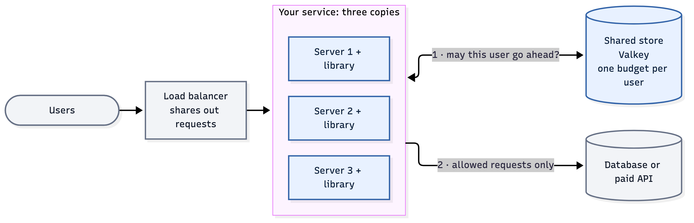
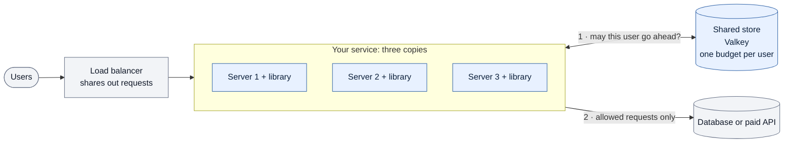

# Rate limiter

[](https://github.com/srir84/ratelimiter/actions/workflows/ci.yml)

A rate limiter decides how many requests each user may make, for example 10 a second. This one is for a service that runs on several servers at once. It gives each user exactly their share, however many servers there are, and gives a request back when the work behind it fails.

It is a Go library, a piece of code that each server includes. The shared counts live in a small, fast database called the store. The store is [Valkey](https://valkey.io), a free, open-source copy of the popular Redis database.

**Status:** a complete v1, built and tested end to end on one laptop. It has not run in production. The safety check passed in every test run, including runs where the store was stopped, paused, wiped or at its capacity limit. See [Results](#results). Engineers can skip to [What makes it different](#for-engineers-what-makes-it-different).

## The idea in plain words

Picture a coffee shop with a rule: two free refills per customer per hour. There are three baristas.

- If each barista keeps their own tally, a customer can get six refills by visiting each one.
- If they share one notebook but write in it at the same moment, they overwrite each other's marks.
- If the machine breaks mid-pour, the customer should get that refill back. They must get it back only once, even if two baristas both try to fix it.

This project is that shared notebook, done carefully:

Each request spends one token from the user's budget, the way each refill uses up one of the two.

- **One shared budget.** Every server asks the same store before doing any work: "may user 42 make a request?"
- **No double spending.** The store checks and updates the budget in one step, so two servers can never both take the last token.
- **Fair refunds.** If the work then fails for certain, the server hands the token back. It is credited exactly once, even when the hand-back is retried.
- **No guessing.** When the store is down, slow or damaged, the library says exactly what happened instead of quietly allowing or refusing.

Why it matters: limits protect a service from overload, stop one heavy user from crowding out everyone else, and cap spending on paid APIs.



<details><summary>Diagram source (mermaid — flowchart)</summary>



</details>

## For engineers: what makes it different

Most Redis rate limiters are an `INCR` plus `EXPIRE`, or a Lua script that trusts the app server's clock. This one is built to stay correct when things go wrong.

| Concern | Typical shared limiter | This library |
|---|---|---|
| Atomicity | Read-then-write from the app, or `MULTI`/`WATCH` | One Lua script per decision. Every check runs before the first write, so a script never half-applies |
| Time | Each server's own clock, so clock skew leaks budget | The store's clock, read inside the script. Budget time never moves backwards |
| Arithmetic | Floating-point refill | Integers only. An independent Python model reproduces every balance exactly |
| Store errors | Silently "allow" or "deny" | A closed set of results. "Did not run" and "may have run" are kept apart, so the caller knows whether it was charged |
| Failed work | The token is lost | Signed receipts and refund markers: a confirmed failure is credited exactly once |
| Config drift | Servers quietly enforce different limits | A server whose policy differs from the shared one refuses to serve |
| Lost state | A wiped key becomes a full bucket again | Missing or damaged state is held back until an operator repairs it, never reset to full |

The core promise: in any window of `T` seconds, one user's allowed calls are at most `capacity + rate × T`, plus any refunds. The tests check this against the logs of every integration and harness run.

Add it to a Go service with `go get github.com/srir84/ratelimiter/limiter`. You create a limiter once, then make one call per request:

```go
l, err := limiter.New(policy, instance, limiter.StoreOptions{Addr: "127.0.0.1:6390", User: "rl_lib", Password: pw})
// … handle err, defer l.Close()

switch r := l.Acquire(ctx, userID); r.Kind {
case limiter.Allowed, limiter.Degraded:
	if err := work(ctx); errors.Is(err, errConfirmedFailure) {
		r.Permit.Release() // the work failed for certain: give the token back
	} else {
		r.Permit.Done() // success, or unknown outcome: the charge stays
	}
case limiter.Limited:
	// over the limit: reply 429 and retry after r.RetryAfterNs
default:
	// the store could not decide (busy, unavailable, outcome_unknown, …)
}
```

## How it is tested

- **A written spec.** Every rule has an ID, and every test is named after the rule it checks ([SPEC.md](SPEC.md)).
- **Six layers of tests.** They run from unit tests with a fake store, through each Lua script against a real store and several limiters sharing one store, up to the full test rig and load tests. Each test starts its own real Valkey, and a missing tool fails the run instead of skipping.
- **An independent checker.** A small Python model, sharing no code with the Go, replays the test logs and recomputes every balance.
- **Planted bugs.** Mutation testing plants known bugs, and each must make a named test fail.
- **A test rig that breaks things.** It runs three API servers over PostgreSQL and sends traffic that repeats exactly from run to run. It also stops, pauses, wipes and fills the store on purpose, and runs each scenario with and without the limiter.

## Results

Measured on a MacBook Pro (M3 Max, 16 cores) in two rounds. The October runs used the default `durable` profile and had pass or fail targets. The November runs compared the four [store profiles](#store-profiles) on the same load test, with no targets. The full numbers are in [docs/results.md](docs/results.md).

- **Correct every time.** The safety check passed in every run of both rounds, including 8 fault runs where the store was down, paused, wiped or at its capacity limit.
- **The default profile missed its speed target.** In October the slowest 1% of decisions took about 0.5 s, against a target of about 60 ms. Typical decisions added 8–12 ms. The ramp test stopped at its first step, 100 requests a second, for that reason.
- **The cause is this Mac's disk, not the limiter.** The `durable` profile saves each decision to disk before answering, and this Mac's SSD pauses every few thousand saves. A plain disk test, with no limiter and no Valkey, showed the same pauses.
- **The faster profiles fix it.** With `barrier`, `everysec` or `buffered`, a decision typically took 0.2–0.8 ms (thousandths of a second), and the slowest 1% under 3 ms.
- **Load.** In November the test ramped up to 10,000 requests a second, and no request failed under any profile. With the three faster profiles the limiter made about 21,400 decisions a second at the top. That is more decisions than requests because clients retry after a "slow down" reply. Under `durable`, the disk pauses held the test client back, and 3.6% of the requests were never sent.
- **It protects the database.** In three tests where users asked for far more than their limit, the database received 22–40% fewer writes: 61,033 without the limiter, and 36,426 to 47,791 with it, depending on how many users there were. Only requests within the limit got through, which is the point.
- **Refunds held up.** In a 10-minute run, all 833 refunded calls were credited. Through a store outage, 710 refunds were applied once each. Two refunds that arrived twice were spotted, and their second copy was not credited.

### Store profiles

You choose how strictly the store saves to disk when you start it. The library does not change.

- **`durable`** (default): nothing answered is ever lost, even on a power cut.
- **`barrier`** (macOS): a crash loses nothing, and a power cut may lose the last few writes.
- **`everysec`**: a crash or power cut may lose about 1–2 seconds of decisions.
- **`buffered`**: a crash or power cut may lose 30 seconds or more. Use it for local testing.

```bash
deploy/start-store.sh --profile everysec --port 6390 --dir /path/to/store --aclfile /path/to/acl.conf
```

If a few extra requests after a rare crash are acceptable, as they are for most uses, `everysec` is much faster. If not, keep `durable`. The [operator guide](docs/operator-guide.md#store-profiles) explains how to pick one. None of this has been measured on Linux yet, where most servers run.

## What it does not do

- **One store.** There is no sharding, failover or multi-region setup.
- **One policy at a time.** Every user gets the same token bucket, and each call costs 1. Changing the policy resets every budget.
- **No deduplication.** A retried request spends another token.
- **Go only.** It is a library, not a network service.
- **Limited refunds.** Refunds are guaranteed only within set time limits. A server that restarts cannot refund calls it made before the restart.
- **Not every kind of damage is detectable.** For example, a store restored from an old backup looks valid.

## Try it

You need macOS with Homebrew, Go 1.24 or later, Valkey 9.1, Python 3.13 or later and PostgreSQL 14 or later. Then:

```bash
make setup    # checks versions, installs the lint tools, sets up the test database
make build
make test-unit
make run SCENARIO=scenarios/smoke-ramp.toml BASELINE=1   # a short run without the limiter
make run SCENARIO=scenarios/smoke-ramp.toml              # the same run with it: runs/<id>/report.md
```

The [developer guide](docs/developer-guide.md) covers starting a store, embedding the library, and every test command.

## How this was built

This project was built with AI coding agents. The author set the goals, made the design decisions (recorded in [DESIGN.md](DESIGN.md)), and reviewed the results. Claude Code and Codex helped write the documents and wrote the code in small steps, following [IMPLEMENTATION_PLAN.md](IMPLEMENTATION_PLAN.md) and the coding rules in [AGENTS.md](AGENTS.md). No step counted as done until the linters, the tests and the mutation tests passed. The agent instruction files stay in the repository so the process is visible.

## Where to read next

- **Curious how it fits together:** [ARCHITECTURE.md](ARCHITECTURE.md) §1 and §4 show the pieces and the main flows as pictures.
- **Adding it to a service:** [docs/host-integration.md](docs/host-integration.md).
- **Running the store:** [docs/operator-guide.md](docs/operator-guide.md).
- **Working on the code:** [docs/developer-guide.md](docs/developer-guide.md). There is also an interactive [code map](docs/code-map.html) linked to the source. GitHub shows that file as code, so download it and open it in a browser.
- **The exact rules:** [SPEC.md](SPEC.md) (what it must do), [DESIGN.md](DESIGN.md) (how it is built) and [HARNESS.md](HARNESS.md) (the test rig).

## License

[MIT](LICENSE).
