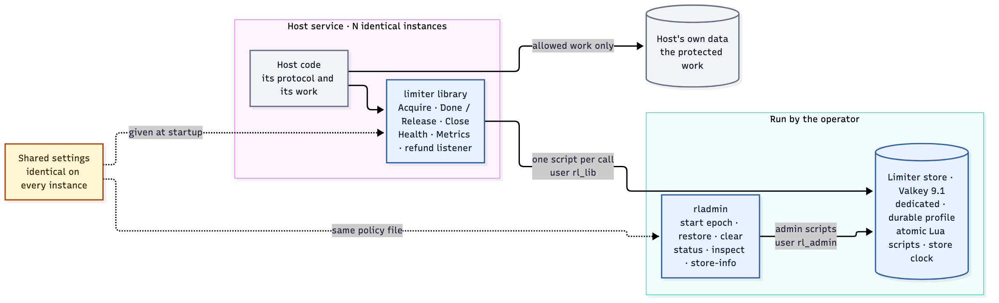
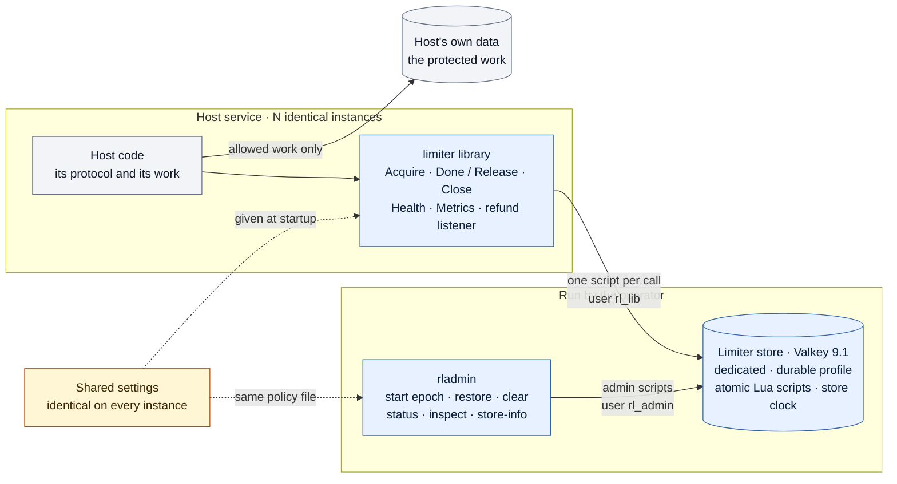
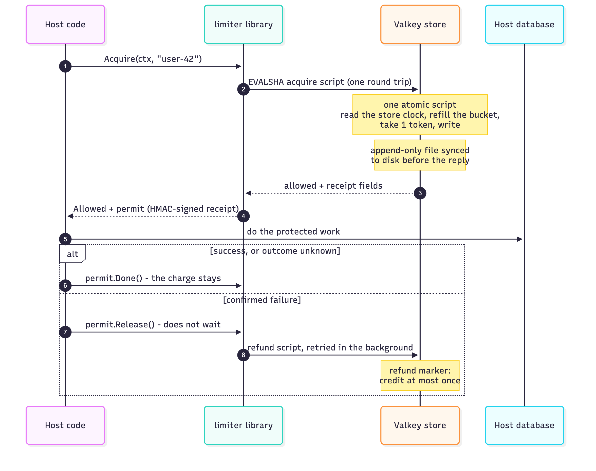
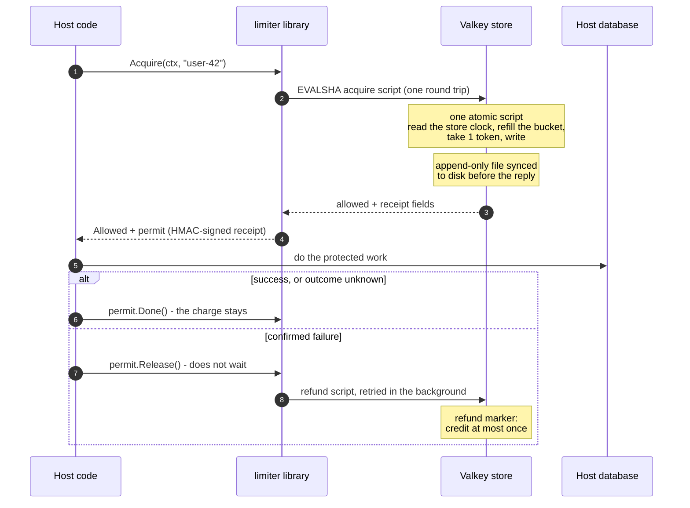

# Rate limiter

A Go library that lets every copy of a service share **one rate limit per user**, enforce it exactly, and **give the token back when the protected work fails**. The shared budgets live in one Valkey store, which is compatible with Redis. The repository also holds the test rig that measures the library under real traffic and injected faults.

**Status:** v1, built from scratch and tested end to end on one laptop. It has not run in production. Correctness held in every test run. Throughput reached 10,000 req/s with no errors. Tail latency did not meet its target: on this Mac, slow disk flushes push p99 to about 0.5 s (see [Measured results](#measured-results)).

## In one minute

- **The problem.** You run three copies of an API, and each user may make 10 requests a second with bursts of 20. If each copy counts on its own, a user gets up to three times the limit. If the copies share a naive counter, they race, their clocks disagree, and a failed request still costs the user a token.
- **What this does.** Every copy imports the library. One call, `Acquire(ctx, key)`, runs a single atomic script in the shared store and returns one of these:
  - **allowed**: go ahead, with a permit;
  - **limited**: the budget is spent; the result says how long to wait;
  - **degraded**: open mode only; the store was unreachable and nothing was charged, so the call may proceed uncounted;
  - a **refusal** that names its cause. For example, `unavailable` means the store provably did not run the command. `outcome_unknown` means it may have run, so the call may already be charged. Others include `busy` and `capacity_error`.
- **Fair refunds.** If your work fails for certain, `permit.Release()` returns the token in the background, exactly once, even when retries repeat the refund.
- **Admin tool.** `rladmin` sets the shared policy and repairs damaged state.



<details><summary>Diagram source (mermaid — flowchart)</summary>



</details>

## What you can use it for

| Use | How |
|---|---|
| Per-user or per-API-key quotas across replicas | The key is whatever you pass to `Acquire`: a user ID, an API key or a tenant. Every replica spends from the same bucket. |
| Shielding an expensive dependency | The check runs before the work, so a rejected call never touches your database or paid API. In the three s2 runs, with the same schedule of first attempts, database writes fell from 61,033 to between 36,426 and 47,791. |
| Metering where failures should not cost | `Release()` refunds a call that failed for certain. A call whose outcome is unknown keeps its charge. |
| Studying distributed rate limiting | The spec, design, independent reference model and fault-injection harness are all here. Every spec rule has an ID, and the tests are named after the spec's test IDs. |

**Not a fit** if you need sub-second p99 on macOS with per-decision durability, several stores or regions, a non-Go host, or live policy changes. The full list is under [What it does not do](#what-it-does-not-do).

## How one request works



<details><summary>Diagram source (mermaid — sequence diagram)</summary>



</details>

If the bucket is empty, the store's reply is `limited` with the wait time instead, and the host answers `429` with `Retry-After`. Nothing is queued.

**Terms used below**

| Term | Meaning |
|---|---|
| Permit, receipt | What an allowed call returns. The receipt is signed with HMAC under a key that lives only in this process's memory, so only the process that issued it can refund it. |
| Refund marker | A short-lived store entry written together with a refund credit. A repeated refund sees it and is not credited twice. |
| Budget time, high-water mark | Time read from the store's clock inside a script. The high-water mark is the latest budget time stored, and budget time never moves below it. |
| Epoch, fingerprint | `rladmin` starts an epoch: a record holding a hash (the fingerprint) of the shared policy. Instances join only if their settings hash the same. A new policy means a new epoch. |
| Quarantine, integrity hold | When stored state is missing or damaged, one key is refused (quarantine), or every key is refused (hold), until an operator restores it or starts a new epoch. |
| Closed and open mode | What happens when the store cannot be reached: refuse the call (closed) or let it through uncharged as `degraded` (open). |
| AOF, `appendfsync always` | Valkey's append-only log, synced to disk on every write, so an acknowledged decision survives a store crash. |

## What makes it different

Most Redis rate limiters are an `INCR` plus `EXPIRE`, or a Lua script that trusts the app server's clock. This one is built to stay correct when things go wrong:

| Concern | Typical shared limiter | This library |
|---|---|---|
| **Atomicity** | Read-then-write from the app, or `MULTI`/`WATCH` | One Lua script per decision. Every check runs before the first write, so a script never half-applies. No locks are kept in the store. |
| **Time** | Each app server's clock, so skew leaks budget | The store's own clock, read inside the script. Budget time never moves backwards. |
| **Arithmetic** | Floating-point refill | Integer units (1 token = `rate_period_ns` units). An independent Python model reproduces every balance exactly. |
| **Store errors** | Usually "allow" or "deny", silently | A closed set of results. `unavailable` and `outcome_unknown` are kept apart, so the host knows whether the call may have been charged. Open mode bypasses only when nothing could have been charged. |
| **Failed work** | The token is lost | Signed receipts plus refund markers. A confirmed failure is credited exactly once. |
| **Config drift** | Undetected: replicas enforce different limits | An instance whose policy fingerprint differs from the epoch's refuses to serve. |
| **State loss** | A wiped key becomes a full bucket again | A missing or damaged key is quarantined, and an epoch-wide loss holds every key. A damaged bucket is never silently reset to full. |
| **Durability** | Often in memory only | AOF with `appendfsync always`: each decision is on disk before the reply. This is also the main cost (see below). |
| **Memory** | Grows with keys | Fixed caps on tracked buckets and markers, plus a cleanup pass that removes full, idle buckets. |

**The core guarantee** (SPEC `BUD-11` and `BUD-11a`): in any window of `T` seconds of store time, one key's normal allows are at most `capacity + rate × T`, plus the refunds applied in that window. Integration and harness runs check this from their operation logs.

## How it is verified

- **[SPEC.md](SPEC.md)** gives every rule an ID. Its test table names the rules each test ID covers, and each test ID is a Go or Python test of the same name (`T-COR-1` → `TestT_COR_1`).
- **Six test layers:**
  - L0: store conformance;
  - L1: unit tests with a fake store;
  - L2: each Lua script against a real Valkey with a controlled clock;
  - L3: several limiters sharing one store;
  - L4: the full HTTP harness;
  - L5: scenario runs.

  Tests spawn their own store, and a missing tool fails the run rather than skipping. See [Tests](#tests).
- **An independent reference model** in Python uses integers only and shares no code with the Go. It replays integration-test operation logs and checks the guarantee above.
- **Mutation testing** (`make mutate`). Planted bugs must each make a named test fail. Every surviving automatic mutation is either killed by a new test or explained.
- **The harness** plays a real host:
  - an HTTP API over PostgreSQL, run as three processes;
  - seeded, open-loop traffic: requests leave on schedule and never wait for earlier replies;
  - faults: the store goes down, pauses, loses state or runs out of capacity;
  - each benchmark scenario runs with and without the limiter.

## Measured results

The October 2026 scenario runs (`runs/h6-manifest.json`) used:
- a MacBook Pro (Mac15,9, 16 cores);
- three `hitapi` instances unless noted;
- Valkey 9.1.2 with `appendfsync always`, and PostgreSQL 14;
- a policy of 10 tokens a second with capacity 20, per user.

Clients retry after a 429, up to 2 times, so the limiter runs send more requests than the runs without it. "Correctness" is the guarantee check.

| Scenario | Traffic | Requests | Allowed | DB rows: no limiter → limiter | Correctness | Performance verdict |
|---|---|---|---|---|---|---|
| s1-ramp | 100 req/s, doubling every 30 s, 10,000 users | 3,444 | 2,950 | stopped early | pass | **no sustainable step**: p99 0.50 s at 100 req/s (threshold 61 ms) |
| s1-ramp-1api | same, one instance | 11,179 | 8,167 | stopped early | pass | **100 req/s sustained** (p99 24 ms). 200 req/s failed (p99 0.52 s) |
| s2-users-100 | 500 → 10 → 500 req/s. 100 users away 60–150 s, plus 10 always active | 117,953 | 36,426 | 61,033 → 36,426 | pass | — |
| s2-users-1000 | same, 1,000 users | 100,882 | 43,991 | 61,033 → 43,991 | pass | — |
| s2-users-10000 | same, 10,000 users | 92,493 | 47,791 | 61,033 → 47,791 | pass | — |
| s3-busy-user | one user at 100/s beside 100 users at 5/s each | 94,426 | 61,163 | 71,866 → 61,163 | pass | — |
| s4-spike | 100 → 500 → 100 req/s | 25,039 | 18,175 | 19,961 → 18,175 | pass | **recovery not met**: p99 0.52 s after the spike (threshold 59 ms), 0 errors |
| s5-retry | 200 req/s over 10 users (heavy retry load) | 55,160 | 10,965 | 24,028 → 10,965 | pass | — |
| s7-long | 70 req/s for 10 min, two forced AOF rewrites, 2% of allowed calls released for refund | 43,018 | 41,022 | 41,170 → 41,022 | pass | — |
| s6 (8 runs) | store down, paused, state deleted, capacity exhausted, each in closed and open mode | — | — | — | pass | — |

- **Without the limiter**, the same API ran every step of the s1 ramp, up to 10,000 req/s (680,262 requests), with an overall p99 of 3.8 ms.
- **Refunds.** In s7-long, all 833 released calls were credited. In s6-down-closed, refunds went through a store outage: 710 were applied, 2 retries were recognized as already applied, and none were left unresolved.
- **Latency cost: durable profile.** The limiter adds about **8–12 ms at p50** and **0.5–0.75 s at p99**. Without it, the API's p50 is 0.2–0.8 ms and its p99 is 3.1–4.4 ms.
- **Cause: this Mac's SSD.**
  - Each decision waits for `F_FULLFSYNC`, about 6 ms.
  - About every 2,750 flushes, the SSD runs about 15 flushes at 0.23–0.51 s each, over 3.6 s. Those windows hold 8–15% of requests and set p99. Outside them, p99 is 19–25 ms.
  - A bare `F_FULLFSYNC` loop, with no Valkey and no limiter, shows the same pattern (5 min, 39,161 flushes: p50 6.4 ms, p99.9 262 ms, worst 513 ms).
- **The failed verdicts are flush slowdowns, not throughput.** Each step's p99 is judged over 30 s.
  - In s1-ramp, one slowdown at 28.5 s (251 requests, 7%) failed the 100 req/s step and stopped the run.
  - The one-instance ramp's first step had no slowdown and passed.
  - The design's p99 of 33 ms (DESIGN §A3.0 row 9) was a store-only benchmark. It did not include these slowdowns.

**Follow-up runs (2026-11-03)**

Same machine and harness. Test build (`run_kind = "test"`), no verdict, early stop off. These are kept outside `runs/` so the H6 evidence is unchanged.

| Run | `appendfsync` | Limiter p50 | Limiter p99 | Errors | Correctness |
|---|---|---|---|---|---|
| s2-users-1000 | always | 10.2 ms | 519 ms | 0 | pass |
| s2-users-1000 | everysec | **0.2 ms** | **1.1 ms** | 0 | pass |
| s1 ramp, every step to 10,000 req/s | always | 7.5–15.2 ms | 16–843 ms; 16–54 ms outside slowdowns | 0 | pass |
| s1 ramp, every step to 10,000 req/s | everysec | 0.1–0.3 ms | 0.4–4.0 ms | 0 | pass |

- **Throughput ceiling: not reached.** At the 10,000 req/s step, including 429 retries, the limiter decided about 21,400–21,700 calls a second with no errors under both settings. Valkey's CPU peaked at 59% of one core with `always` and 76% with `everysec`.
- **The trade-off.** `everysec` removes the latency cost, but a store crash can lose about 1 s of acknowledged decisions, or up to about 2 s when fsync is slow. It is not the shipped profile: SPEC `STA-16` would need rewording (DESIGN §D2 option B). Linux with a power-loss-protected SSD, where a plain `fsync` is durable, has not been measured.

## What it does not do

v1 scope, from SPEC §1:
- **One store.** There is no sharding, replica failover or multi-region setup.
- **One policy per epoch.** It is a single token bucket for every key, and each call costs 1. Changing the policy means starting a new epoch, which resets every budget.
- **No deduplication.** A retried request spends another token.
- **Go only.** It is a library, with no network API.
- **Limited refund guarantee.** Refunds are guaranteed only within the declared bounds: release delay, outage length and drain time. A crash that loses receipts, a longer outage or a forward clock jump is out of scope. Because the signing key lives only in memory, a restarted process cannot refund calls made before the restart.
- **Limited corruption detection.** Some corruption cannot be detected with bounded state, such as a bucket deleted together with its index entry, or a stale snapshot (SPEC `STA-11`).

## Where to read next

- **Try it:** [Prerequisites and setup](#prerequisites-and-setup), then [Quick start](#quick-start). To see it under load, use [Harness runs](#harness-runs) (`make run SCENARIO=…`).
- **Use it:** [docs/host-integration.md](docs/host-integration.md).
- **Understand it:**
  1. [ARCHITECTURE.md](ARCHITECTURE.md) §1 and §4: the pieces, and each main flow as a diagram.
  2. [docs/code-map.html](docs/code-map.html): an interactive map from overview to paths to components, linked to the source.
  3. [SPEC.md](SPEC.md), then [DESIGN.md](DESIGN.md): the exact rules, then how each is built.

The full document list is at the [end of this file](#documents).

## The pieces


| Part | What it is | Code |
|---|---|---|
| Limiter library (product) | The public API: `New`, `Acquire`, permits finished with `Done` or `Release`, a refund listener, `Close`, `Health`, `Metrics`. Inside: receipts and slots, refund workers, the epoch watch, the cleanup runner and the store adapter | `limiter/`, `internal/` |
| Limiter store (product) | One Valkey server per deployment with the durable profile (AOF `appendfsync always`, `noeviction`) and ACL users. It holds every budget, refund marker, cleanup index entry, quarantine flag and the epoch record. The library defines its contents and loads its scripts | `deploy/`, `internal/scripts/` |
| Admin tool (product) | `rladmin`: start or replace an epoch, restore and clear quarantined keys, status and inspect, store info and AOF rewrite | `cmd/rladmin/` |
| Test-only entry point (product) | `limitertest`: fixture hooks, compiled only with `-tags rltest`, never into production builds (`CMP-9`) | `limitertest/` |
| Harness | One host service plus the verification rig: `hitapi` (an HTTP API over PostgreSQL that embeds the library), `hitgen` (seeded open-loop traffic), the `orchestrator`, `sampler` and `faultctl`, a reference model in Python and a report builder | `cmd/hit*`, `cmd/orchestrator/`, `cmd/sampler/`, `cmd/faultctl/`, `harness/`, `refmodel/`, `report/`, `scenarios/` |

- The library is not a service: no limiter process, no sidecar. The operator runs one store and gives every instance the same settings.
- The harness never adds limiter requirements. It uses the library exactly as any host would ([HARNESS.md](HARNESS.md)).

## Layout

The repository is one Go module, `ratelimiter` (DESIGN §A1). `docs/` holds the two guides and the code map.

```
ratelimiter/
  limiter/        PRODUCT public API: type aliases of internal/core, plus New, DefaultPolicy, DefaultInstance
  limitertest/    PRODUCT test-only entry point; every file has //go:build rltest
  internal/
    core/         Limiter, acquire flow, permits, slots, refund workers, epoch watch, cleanup runner, reclaimer
    store/        store adapter: pipelined connections, EVALSHA, failure classification
    store/resp/   minimal RESP2 client
    scripts/      the Lua scripts, embedded
    receipt/  keys/  fingerprint/  settings/  metrics/
    testutil/     test helpers only: storeproc, scriptrun, storestate, golden, fakeresp, conformance
  cmd/
    rladmin/      PRODUCT admin tool
    hitapi/  hitgen/  orchestrator/  sampler/  faultctl/      HARNESS binaries
  harness/        HARNESS packages: config, runlog, httpapi, dbclient, fixtures, driver, spectest, e2e, pgtest
  refmodel/       HARNESS reference model (Python)
  report/         HARNESS report builder (Python)
  scenarios/      HARNESS scenario files
  deploy/         valkey-durable.conf, valkey-fast.conf, acl.conf.tmpl, pg-schema.sql
  docs/           host integration guide, operator guide, code map
  tools/trace/    repository checks: test IDs, import boundary, ACL lists, script lint, API, …
  tools/mutate/   mutation testing
  Makefile  harness.toml  AGENTS.md  SPEC.md  ARCHITECTURE.md  DESIGN.md  HARNESS.md
```

Every Go package has a package comment naming its DESIGN section: `go doc ./limiter`, `go doc ./cmd/rladmin`.

## Prerequisites and setup

| Need | Version | Used for |
|---|---|---|
| Go | 1.24 or later; `go.mod` pins `toolchain go1.27.1`, which the first build downloads | the library, `rladmin`, the harness binaries |
| Valkey | 9.1.x (`brew install valkey`); any Redis-compatible store with Lua 5.1 scripts, `#!lua` flags and `ZRANGE … BYSCORE` works (Redis 7.0 or later) | the limiter store |
| Python | 3.13 or later, standard library at runtime | reference model, report builder |
| PostgreSQL | 14 or later | the harness database only |

`make setup` (DESIGN §C8) checks those versions and installs the pinned lint tools: golangci-lint into `bin/tools/`, luacheck and stylua (Homebrew), and pytest, ruff and mypy from `requirements-dev.txt`. When no store binary is found it offers `brew unlink redis && brew install valkey` (the two formulas conflict). It also initializes the harness PostgreSQL cluster in `.data/pg` (`127.0.0.1:5433`, role `rl`, database `hits`, `deploy/pg-schema.sql`) and leaves it stopped. It is safe to rerun.

## Quick start

**1. Build.** `make build` puts `hitapi` and `rladmin` built without tags in `bin/bench/` (the product build) and every binary built with `-tags rltest` in `bin/test/`.

**2. Start the store** with the durable profile and a rendered ACL file. The profile leaves `port`, `dir` and `aclfile` to the command line. A production ACL file has only `rl_lib` and `rl_admin`. Here the passwords live only in the `RL_*_PASSWORD` variables and that file: `rladmin` reads `RL_ADMIN_PASSWORD`, and a host may hand `rl_lib`'s password to `StoreOptions` by any means it chooses (`CFG-7`, [operator guide](docs/operator-guide.md#acl-users-and-passwords)):

```bash
store="$PWD/.data/store"                   # .data/ is git-ignored: the ACL file holds passwords
umask 077 && mkdir -p "$store"             # the files below get mode 0600
export RL_LIB_PASSWORD="$(openssl rand -hex 32)" RL_ADMIN_PASSWORD="$(openssl rand -hex 32)"
# Render the ACL file with shell builtins (bash or zsh), so no password shows in a process's arguments.
acl=$(grep -v -e '^user rl_fixture ' -e '^user rl_ops ' deploy/acl.conf.tmpl)
acl=${acl//'{{.LibPassword}}'/$RL_LIB_PASSWORD}
acl=${acl//'{{.AdminPassword}}'/$RL_ADMIN_PASSWORD}
printf '%s\n' "$acl" > "$store/acl.conf"
valkey-server deploy/valkey-durable.conf --port 6390 --dir "$store" --aclfile "$store/acl.conf" \
  > "$store/valkey.log" 2>&1 &
```

Stop this store before `make run`, which starts its own on port 6390.

**3. Start an epoch.** Only `rladmin` creates the epoch record; instances only join it. The policy file holds the shared settings in a `[policy]` table (DESIGN §B2 keys); absent keys keep `limiter.DefaultPolicy()` values, and every instance must build the same `Policy`:

```bash
cat > shared.toml <<'EOF'
[policy]
max_tracked_buckets = 100_000
max_live_markers = 50_000
EOF
export RL_STORE_ADDR=127.0.0.1:6390
bin/bench/rladmin start-epoch --policy shared.toml     # prints the new epoch_id
bin/bench/rladmin status                               # epoch, hold, counts
```

That is `rladmin start-epoch --policy shared.toml`; exit codes and the other commands are in the [operator guide](docs/operator-guide.md#admin-tool-rladmin).

**4. Embed the library** in the host service (`import "ratelimiter/limiter"`):

```go
p := limiter.DefaultPolicy()
p.MaxTrackedBuckets, p.MaxLiveMarkers = 100_000, 50_000 // the same values as shared.toml
in := limiter.DefaultInstance(p)
in.MaxReleaseDelayNs = (5 * time.Second).Nanoseconds() // P: just before Acquire → Release
in.MarginNs = time.Second.Nanoseconds()
in.MaxHeldReceipts, in.MaxPendingRefunds = 1_152, 1_152
l, err := limiter.New(p, in, limiter.StoreOptions{
	Addr: "127.0.0.1:6390", User: "rl_lib", Password: os.Getenv("RL_LIB_PASSWORD"),
})
if err != nil {
	logger.Error("invalid limiter settings", "error", err) // l stays not_ready, never nil
}
defer l.Close() // drains pending refunds

ctx, cancel := context.WithDeadline(ctx, time.Now().Add(5*time.Second)) // P starts here
defer cancel()
switch r := l.Acquire(ctx, userID); r.Kind {
case limiter.Allowed, limiter.Degraded:
	if err := work(ctx); errors.Is(err, errConfirmedFailure) {
		r.Permit.Release() // confirmed failure: refunded in the background
	} else {
		r.Permit.Done() // success or unknown outcome: the charge stays
	}
case limiter.Limited:
	// quota rejection: retry after r.RetryAfterNs
default:
	// a refusal (busy, unavailable, outcome_unknown, …), never reported as a quota rejection
}
```

The [host integration guide](docs/host-integration.md) covers every host rule (`HOST-1`…`HOST-9`), and `limiter/example_test.go` holds compiled examples of `New`, `Acquire` and `Close`.

## Tests

| Layer | What it checks | Runs with | Command |
|---|---|---|---|
| L0 | Store conformance: the pinned Valkey behaves as DESIGN §A3.0 says | its own store per test (`storeproc.Start`) on a free port, durable and fast profiles | `make test-store` |
| L1 | Go unit tests: keys, fingerprint, receipts, refill math, permit transitions, classification (fake RESP server) | Go only, `-race` | `make test-unit` |
| L2 | Each Lua script against a real store with a controlled clock, then the script discipline run | a fast-profile store per test (`scriptrun.Store`); `rl:ctl:time` driven by the test | `make test-scripts` |
| L3 | Library integration through the direct driver: several limiters in one test process (SPEC §10) | `-tags rltest`, fast profile | `make test-integration` |
| L4 | Harness end to end: `hitapi` processes, PostgreSQL, the generator (HARNESS §8) | `bin/test` binaries, the harness PostgreSQL | `make test-e2e` |
| L5 | Scenarios and benchmarks | `bin/bench` (benchmarks) or `bin/test` (test runs) | `make run SCENARIO=…` |
| Python | Reference model and report builder | pytest | `make test-py` |

- Tests that need a store spawn their own on a free loopback port with fresh passwords; the store binary is `RL_STORE_BIN`, else `valkey-server`, else `redis-server`. A missing store or tool fails the test; nothing is skipped.
- Test order is shuffled: `bin/trace gotest` adds `-shuffle=on` (repeat an order with `-shuffle=<seed>`), and pytest takes `--shuffle-seed=N`.
- `make check` runs golangci-lint (untagged and with each of `rltest`, `conformance`, `scripttest`), stylua, ruff, mypy and `tools/trace`; `make fmt` formats. `make slice-check S=<id>` is the gate for a build slice, `make mutate` runs mutation testing, `make test-report` runs the smoke runs and the report tests.

## Harness runs

```bash
make run SCENARIO=scenarios/smoke-ramp.toml BASELINE=1   # the limiter off: freezes the thresholds once
make run SCENARIO=scenarios/smoke-ramp.toml              # the limiter run: runs/<id>/report.md
```

- `make run` builds, then runs `bin/test/orchestrator` in the repository root. It starts a fresh store on port 6390, the harness PostgreSQL on 5433, `rladmin start-epoch`, one or three `hitapi` instances on 8081–8083, `hitgen` and the sampler, then builds `runs/<id>/report.md` and `report.json` from the run logs.
- `scenarios/` holds the scenario files: the smoke runs and the `TRF-S1`…`TRF-S7` scenarios, such as `scenarios/s1-ramp.toml`. Benchmark runs take `hitapi` and `rladmin` from `bin/bench` (production construction, no fixtures; the orchestrator refuses a benchmark otherwise, `HAR-24`); the orchestrator, `hitgen` and the sampler always run from `bin/test`. Test runs take every binary from `bin/test` and may inject faults.
- Run benchmarks on an otherwise idle machine, one at a time. Each benchmark limiter run needs its baseline first ([HARNESS.md](HARNESS.md), DESIGN §B5, §B9).

## Documents

| Document | What it answers |
|---|---|
| [SPEC.md](SPEC.md) | What the limiter must do: rules and test IDs |
| [ARCHITECTURE.md](ARCHITECTURE.md) | The pieces and how the main flows move |
| [DESIGN.md](DESIGN.md) | How it is built: store layout, scripts, library internals, numbers, tooling |
| [HARNESS.md](HARNESS.md) | The test harness: its host role, HTTP contract, traffic, faults and reports |
| [IMPLEMENTATION_PLAN.md](IMPLEMENTATION_PLAN.md) | The build slices and their checks |
| [AGENTS.md](AGENTS.md) | Coding rules for anyone changing the code |
| [docs/host-integration.md](docs/host-integration.md) | How a service embeds the library |
| [docs/operator-guide.md](docs/operator-guide.md) | How to run the store and `rladmin`, size them and respond to alerts |
| [docs/code-map.html](docs/code-map.html) | Which code does each job and how one `Acquire` moves through it, checked against the source (built from `docs/code-map.toml`) |
