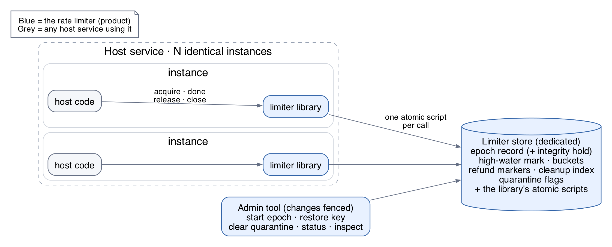
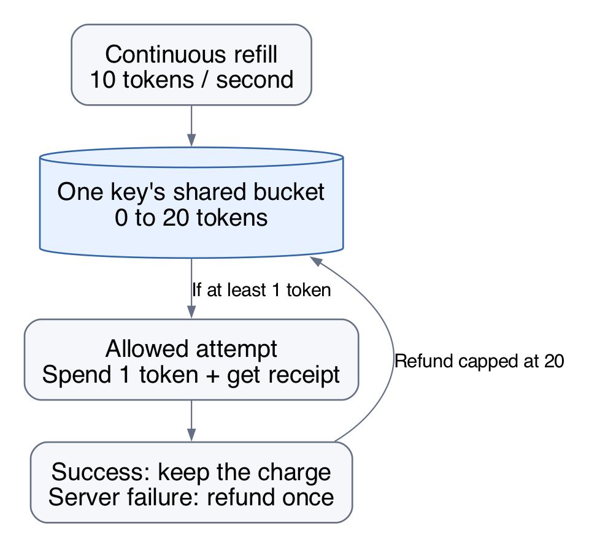
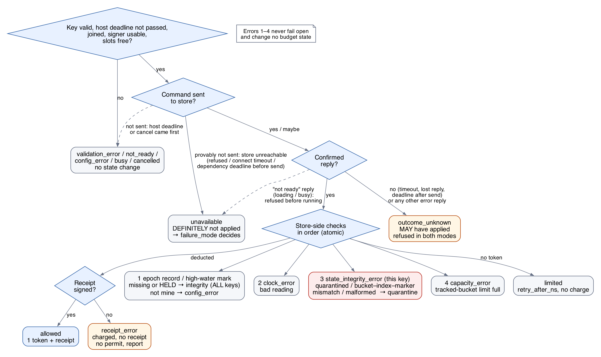
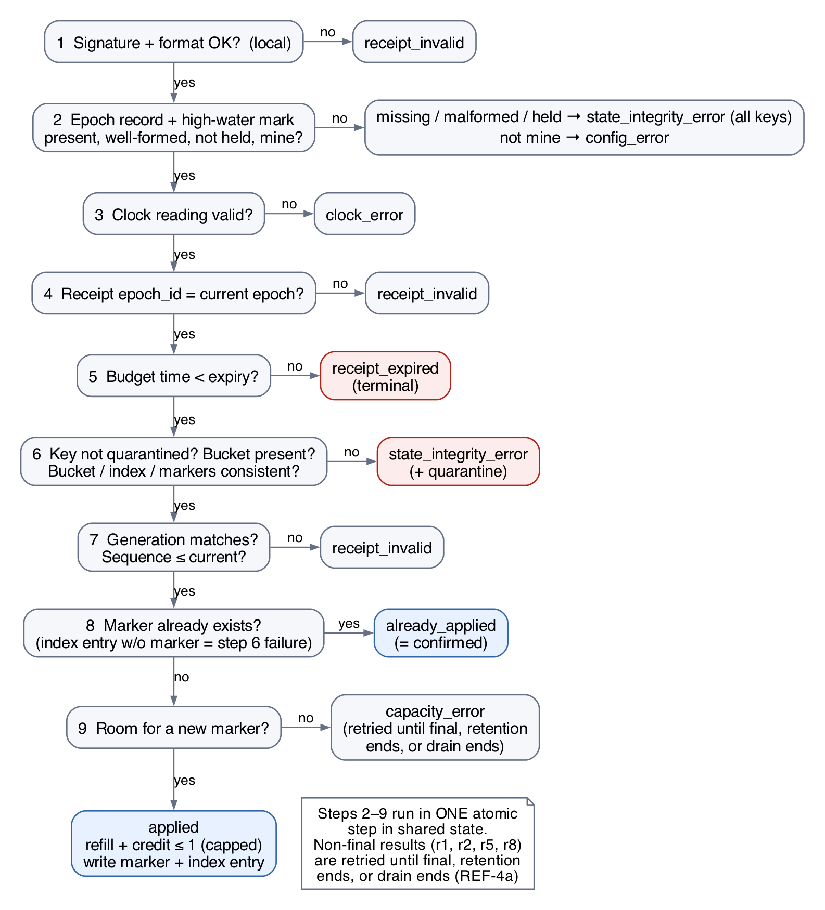
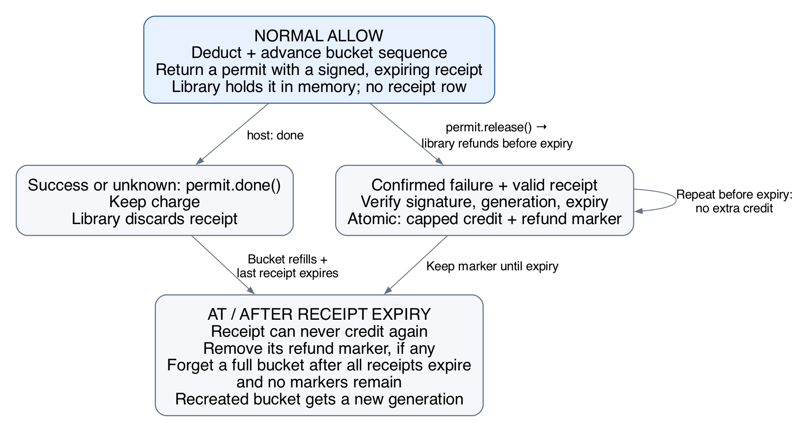
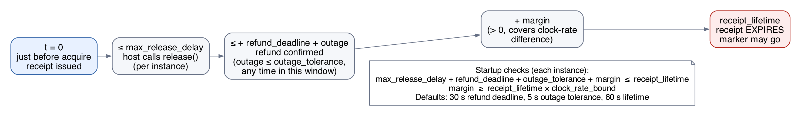
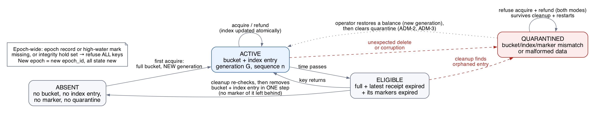

# Rate limiter specification

**Status:** Documentation phase. These requirements describe planned behavior; no implementation exists yet.

**This spec covers only the rate limiter, the product.** It is written for any service that imports the limiter. The test harness that verifies it (HTTP APIs, harness database, traffic generator, fault tools) is specified separately in [HARNESS.md](HARNESS.md).

- Build the rate limiter ourselves, including its budget logic and store scripts. Storage primitives and a standard crypto library are allowed; ready-made rate-limiting libraries are not the implementation.
- The limiter is a **library** imported by each instance of a host service, plus one **dedicated store** shared by all instances, plus an **admin tool**. It is not a separate service.
- This spec makes the must-haves in [PROJECT_BRIEF.md](PROJECT_BRIEF.md) concrete for the product. The brief's HTTP and database items are met by the harness.

**How to read this spec**

- Every rule has an ID such as `BUD-3`. Plans, code, and tests cite these IDs.
- Each rule is stated once. Other sections link to it instead of repeating it.
- Tests are in [section 10](#10-verification); each one lists the rules it covers. Tests run through the harness, but they judge limiter behavior only.
- Rule IDs from HARNESS.md (`HTTP`, `ERR`, `TRF`, `FLT`, `PRF`, `HAR`) never define limiter behavior. They appear here only as "how a test injects this".

## Contents

| § | Section | ID prefix |
|---|---|---|
| 0 | [Glossary](#0-glossary) | — |
| 1 | [Components and scope](#1-components-and-scope) | `CMP` |
| 2 | [Budget rules](#2-budget-rules) | `BUD` |
| 3 | [Budget time (clock)](#3-budget-time-clock) | `CLK` |
| 4 | [Limiter API and settings](#4-limiter-api-and-settings) | `API`, `CFG` |
| 5 | [Signed receipts](#5-signed-receipts) | `RCP` |
| 6 | [Refunds](#6-refunds) | `REF` |
| 7 | [Shared state, store, and cleanup](#7-shared-state-store-and-cleanup) | `STA` |
| 8 | [Admin operations](#8-admin-operations) | `ADM` |
| 9 | [Host integration contract](#9-host-integration-contract) | `HOST` |
| 10 | [Verification](#10-verification) | `T-*` |
| 11 | [Decisions for the design doc](#11-decisions-for-the-design-doc) | — |

## 0. Glossary

| Term | Meaning |
|---|---|
| Host service (host) | Any application that imports the limiter library. It runs as one or more identical instances. It keeps no limiter state. |
| Instance | One running process of the host, with its own copy of the library. |
| Protected work | Whatever the host does only after an allow (e.g., a database write). The limiter never sees it. |
| Budget key | Opaque, host-chosen identifier of a budget (e.g., a user ID, a hashed API key, a tenant, or a route) (`API-1`). |
| Budget / bucket | One key's token bucket in shared state. "Budget" is the policy idea; "bucket" is the stored record. |
| Token | One unit of allowance. One normal allowed `acquire` costs one token. |
| Budget time | The clock reading used for refill, receipts, expiry, and cleanup. Integer nanoseconds from a fixed time origin, read inside the store's atomic step. Never moves backwards across steps that change state (`CLK-4`). |
| Epoch | One lifetime of the limiter's shared state, with one fixed policy. Created by the admin operation *start epoch* (`ADM-1`). An `epoch_id` is unique without relying on any store contents: a wiped or replaced store never yields a previously issued ID. |
| Epoch record | Shared-state record holding the `epoch_id`, the policy fingerprint, and the integrity hold. Its absence after an instance has joined means state was wiped. |
| Integrity hold | Flag in the epoch record, set when corruption is found whose key cannot be determined, or when an instance sees the store go back in time. While set, every key is refused until a new epoch replaces it (`STA-9`). |
| High-water mark | Shared-state value: the latest budget time stored by an operation in this epoch (`CLK-4`). A step that changes nothing may use a later time without storing it. |
| Policy fingerprint | Hash of every shared setting all instances must agree on, plus the store schema version (`CFG-1`). Does not include the `epoch_id`. |
| Store schema version | Version of the store layout and script behavior. Changes only when a new library version cannot safely share state with the previous one (`CFG-1`). |
| Generation | A unique identity given to a bucket each time it is created or restored. Never reused within an epoch. |
| Sequence | Per-bucket counter, increased by one with each deduction. |
| Deduction | One token taken by a normal allow. Identified by `(epoch_id, key, generation, sequence)`; the host sees it as an opaque `deduction_id` (`API-4`). |
| Receipt | A signed, expiring proof of one deduction. Held and verified only by the issuing library instance (inside a permit), never stored in shared state. |
| Permit | What `acquire` returns on an allow. The host finishes it with `release()` (confirmed failure) or `done()` (anything else). Lifecycle in `API-1h`. |
| Refund marker | Shared-state record saying "this deduction was refunded", with the credit's budget time. Kept until the receipt expires. |
| Cleanup index | Shared-state list of every live bucket **and** every refund marker, each with a budget time no later than when it becomes eligible for removal (`STA-5`). |
| Quarantine | Shared-state flag on a key after state loss was detected. Cleanup never removes it (`STA-10`). |
| Dependency deadline | Maximum time the library waits for one store call. Per-instance setting, default 2 s (`CFG-8`). |
| Normal allow | `acquire` confirmed a deduction and returned a permit with a receipt. |
| Degraded bypass | Open-mode admission while the store is unreachable. No charge, no receipt. |
| Definitely not applied | The library can prove the store change did not happen because no command was sent (`API-22`). |
| Outcome unknown | The change may have happened, but no confirmed reply arrived. |
| Confirmed failure | The host knows its protected work failed (e.g., a database rollback). Timeouts and crashes alone are not confirmed failures. |
| `decision_ns` | Budget time of an acquire decision (`API-4`, `API-6`) or of a refund credit (`API-13`, `API-14`). |
| Test-only entry point | Separate construction path that wires fixtures (store-adapter and signer wrappers) and the `controlled` clock source. Unreachable from production construction (`CMP-9`). |
| Controlled time value | Store value read as budget time when the clock source is `controlled`; written only by the test clock driver (`CMP-4`). |
| Barrier | Fixture pause between two steps that proves a stage was reached (HARNESS §9.4). |
| `max_release_delay` | Per-instance setting declared by the host: the longest time from just before `acquire` is called until the host calls `release()` for a confirmed failure (`RCP-8`, `HOST-3`). |

## 1. Components and scope

| ID | Component | What it does |
|---|---|---|
| CMP-1 | Limiter library | Imported by every host instance. Public API (`acquire`, permits, `close`, cleanup pass, listener, health, metrics), receipt signing and verification, background refund retries, the cleanup runner, epoch watching, and the store adapter. Holds no budgets. |
| CMP-2 | Limiter store | One dedicated store shared by all instances. Holds all shared state (`CMP-4`) and runs the library's scripts one at a time, reading its own clock. Each script is **all-or-nothing**: a script that fails, at runtime or on a memory limit, leaves no writes. On stores without rollback, every script performs all checks, reads, and computations before its first write, and no write can fail after the first. Started by the operator, empty; the library defines its contents. |
| CMP-3 | Admin tool | Operator operations on shared state: start an epoch, restore a key, clear quarantine, status and per-key inspect (`ADM-*`). |
| CMP-4 | Shared limiter state | The epoch record (`epoch_id`, fingerprint, integrity hold), the high-water mark, buckets (balance in units, last-update budget time, generation, sequence, latest receipt expiry), refund markers (with credit budget time), the cleanup index, and quarantine flags. With clock source `controlled` only: the controlled time value, written by the test clock driver before `ADM-1`. No per-admission records. Changed only by atomic scripts, except the controlled time value (test clock driver) and, in test deployments, the state tamper tool (`STA-16`). |

- CMP-5 These are logical components. The language and store product are design choices ([section 11](#11-decisions-for-the-design-doc)).
- CMP-6 The library works for any number of instances (N ≥ 1). All instances of one deployment share one store and one epoch.
- CMP-7 The store is dedicated to the limiter. The library assumes it owns every key under its namespace; anything unexpected there is treated as state loss (`STA-9`).
- CMP-8 The limiter never reads host data or judges whether protected work succeeded. The host says so with `permit.release()` (`HOST-2`).
- CMP-9 Production construction always uses the product's own store adapter, signer, and store clock; the host supplies settings and connection details only (`CFG-7`). Test implementations (store-adapter wrapper, signer wrapper, controlled clock driver) are wired only through a separate test-only entry point. A production-built instance with clock source `controlled` fails validation and never becomes ready (`CFG-4`).
- CMP-10 Deployment scope: one store, reachable from every instance. Several stores, sharding, multiple regions, store failover, and store host moves are later scope.

**Scope (v1)**

- One token-bucket policy per epoch, applied to every key. Cost is 1 token per allow.
- Policy changes take effect only through a new epoch (`CFG-5`). Live policy updates are later scope.
- Later scope, not precluded by this contract: `acquire(key, cost)`, several named policies, idempotent acquire by request ID, a separate limiter service wrapping the library.

## 2. Budget rules

| ID | Rule | v1 behavior |
|---|---|---|
| BUD-1 | Budget key | One budget per key, shared by every instance. The host chooses what a key means. |
| BUD-2 | Algorithm | Token bucket with continuous refill. [Token bucket definition](https://www.rfc-editor.org/rfc/rfc3290.html#section-A.2) |
| BUD-3 | Refill rate | `rate_tokens` per `rate_period_ns`, both positive integers. Default **10 tokens per 1,000,000,000 ns** (10/s). |
| BUD-4 | Capacity | Default **20 tokens** (maximum stored allowance). |
| BUD-5 | Cost | **1 token** per normal allow. A degraded bypass charges nothing (`API-5`). |
| BUD-6 | New bucket | Starts full. Only allowed for an *expected* absence (`STA-8`). |
| BUD-7 | Empty bucket | Return `limited` immediately. Never queue for later. |
| BUD-8 | Refill | Lazy: computed from the bucket's last-update budget time when it is read or changed. Never above capacity; balance never negative. |
| BUD-9 | Repeats | Every normal allow spends a token, even when the host considers the call a retry. The limiter does not deduplicate by request ID. |
| BUD-10 | Configurable | Rate and capacity change without code changes, through a new epoch (`CFG-5`). |

**Exact arithmetic**

- BUD-13 All budget math is integer, so the limiter and an independent reference model agree exactly.

| Quantity | Definition |
|---|---|
| Unit | 1 token = `rate_period_ns` units. Balance is stored in units. |
| Refill | `units += elapsed_ns × rate_tokens`, capped at `capacity × rate_period_ns`. Clamp `elapsed_ns` to the time-to-full before multiplying (no overflow). |
| Allow | Needs `units ≥ rate_period_ns`; subtracts `rate_period_ns`. |
| Refund credit | Adds `rate_period_ns`, capped at capacity. |
| Retry delay | `retry_after_ns = ceil((rate_period_ns − units) / rate_tokens)`. |
| Range | All values fit in signed 64-bit integers at the validated limits (`CFG-4`). |

**Invariants**

- BUD-11 With no refunds, one key's normal allows in any interval of `T` budget-time seconds are at most `capacity + rate × T` (defaults: `20 + 10 × T`). This is burst plus refill, not "10 per calendar second". Judged by each allow's `decision_ns` (`API-4`), within one epoch. A balance written by `ADM-2` counts as credit applied at that restore's budget time, as refunds do in `BUD-11a`.
- BUD-11a With refunds, the bound becomes `capacity + rate × T + refunds applied in that interval`, judged by each credit's own `decision_ns` (kept in its marker and reported by `API-13`/`API-14`).
- BUD-12 With refunds, extra admissions are legitimate. Deductions, refund credits, refill, and balance must match an independent reference model (`T-COR-1`).
- BUD-14 Budgets are independent: no operation on one key changes another key's balance, generation, sequence, or markers.
- Degraded bypasses are outside these invariants; they are counted separately.

**Worked examples (controlled time)**

| ID | Setup | Expected |
|---|---|---|
| EX-1 | 100 acquires for one key at one frozen instant, spread across several instances | Exactly 20 allowed, 80 limited |
| EX-2 | Empty bucket, advance time 100 ms | 1 token available |
| EX-3 | Empty bucket, idle 2 s | Bucket back to 20 |
| EX-4 | Empty bucket, refund a released permit before any refill | 1 token available |
| EX-5 | Same receipt refunded repeatedly or concurrently | At most one credit; balance ≤ 20 |

## 3. Budget time (clock)

| ID | Rule |
|---|---|
| CLK-1 | Budget time is read **inside** the atomic acquire, refund, or cleanup step in the store, never in the host and never passed in by the host. |
| CLK-2 | Clock source is a fingerprinted setting: `store` (default: the store's own clock) or `controlled` (a value in the store that only a test driver advances, so all instances see the same controlled time). `controlled` is selectable only through the test-only entry point (`CMP-9`). The library reports the active source at startup and in health. |
| CLK-3 | Budget time is nonnegative integer nanoseconds from one source and one fixed time origin for refill, receipt issue, expiry, and cleanup. The source keeps its time origin across store-process restarts and store-host reboots (e.g., the store host's real-time clock); a clock that restarts from zero is not acceptable. Regressions are absorbed by `CLK-4`. |
| CLK-4 | **Budget time never moves backwards across state changes, epoch-wide.** *Start epoch* initializes the high-water mark. Every acquire, refund, and cleanup step that passes the epoch-record and high-water check (`API-1a` step 1) uses `budget_time = max(clock reading, high-water mark)`. Every refund step, and every acquire or cleanup step that writes limiter state other than the integrity hold, stores that budget time back in the same atomic step. A step that writes nothing else does not store it: a limited, capacity-refused, or already-quarantined acquire, and a cleanup step that finds its entry gone or not yet due. It changed nothing that a later step could contradict. The read that selects a cleanup pass's due entries does store it, so the pass's cutoff never exceeds a later step's budget time. |
| CLK-5 | A clock regression must neither create allowance nor make an expired receipt valid again. |
| CLK-6 | Host timestamps (e.g., request arrival times) and duration measurements use their own clocks. Neither is budget time. |
| CLK-7 | A missing or malformed high-water mark after *start epoch* is an epoch-wide `state_integrity_error` (`STA-9`). It is never re-initialized mid-epoch. |
| CLK-8 | An unreadable or negative clock reading (including a missing controlled time value) returns `clock_error` and changes nothing. |
| CLK-9 | Forward clock jumps are out of scope for the refund guarantee. They can expire receipts early (refund reported expired, never extra credit) and grant at most a refill up to capacity. |

- Which writes count as "no state change": results marked "no state change" never touch balances, generations, sequences, markers, the index, quarantine flags, or the integrity hold. Epoch-wide `state_integrity_error`, `config_error`, `clock_error`, `cancelled`, and validation errors also leave the high-water mark untouched. Every other result, including per-key `state_integrity_error` (from acquire, refund, or cleanup), `limited`, `capacity_error`, `receipt_invalid`, and `receipt_expired`, may advance it, except the steps `CLK-4` lists as not storing it. Two exceptions write in the same atomic step as the detection: per-key state loss writes that key's quarantine flag (`STA-10`), and unattributable corruption, or a store seen going back in time, sets the integrity hold (`STA-9`); neither advances the high-water mark when the result is epoch-wide.
- Why `CLK-4` is epoch-wide and not per bucket: cleanup may remove a refund marker at time `t`. If the clock then regresses and the bucket's own last time is earlier than `t`, a per-bucket check could see the receipt as unexpired with no marker, and credit it twice.
- On one shared store every operation is already serialized, so one high-water value adds no extra coordination. A sharded or multi-store design must revisit this rule.
- Clock lag (high-water mark minus clock reading) is reported as a metric (`API-1g`): a large lag means budget time is being held after a clock regression.

## 4. Limiter API and settings

This interface is transport-neutral: it knows nothing about HTTP, databases, or the host's protocol.

### Calls

| ID | Call | Contract |
|---|---|---|
| API-1 | `acquire(key, deadline?)` | `key` = opaque host-chosen string, **1–256 bytes of UTF-8**. The library encodes it for the store, so any characters are safe and distinct keys never collide. Empty, longer, or invalid UTF-8 → `validation_error`. Cost 1 token. Optional `deadline`; the effective deadline is the earlier of it and the dependency deadline (`CFG-8`); a later value is capped, never an error. If the host's own deadline passes, or the host cancels the call, **before any command is sent** → `cancelled`; if the dependency deadline is reached first, before any command is sent (including while connecting) → `unavailable` (`API-22`); after a command was sent → `outcome_unknown`. A reply that arrives after the call returned is finished internally: an allow stays charged (as `done()`); it holds no slots, because they were freed when `acquire` returned (`API-1h`). On `allowed` or `degraded` it returns a permit. |
| API-1b | `permit.release()` | Host call on a confirmed failure (`REF-2`). Returns at once. The library refunds the receipt in the background (`REF-4`). Behavior in every permit state: `API-1h`. |
| API-1c | `permit.done()` | Host call on success or unknown outcome. Keeps the charge and frees the permit's slots. Behavior in every permit state: `API-1h`. |
| API-1d | Refund listener | Optional host callback. For each released permit that has a receipt, the library emits **one final event**: `applied`, `already_applied`, `receipt_invalid`, `receipt_expired`, or `unresolved` (reason `closed`, `retention`, or `expired`). Each event carries the permit's `deduction_id`, the attempt count (refund commands actually sent to the store; attempts that ended `unavailable` or `cancelled`, or sent nothing, are not counted), and the credit's original `decision_ns` when a credit is known (`API-13`, `API-14`). Events pass through a bounded queue (`CFG-8`); on overflow the event is dropped and a drop counter (metric and health) increases. The promise holds exactly while the drop counter is 0. Listener delays, errors, and drops never affect accounting, retries, or slots. The library writes no files. |
| API-1e | `close(drain_timeout?)` | Host call during graceful shutdown (`HOST-6`). From then on new acquires return `not_ready`; the refund worker keeps retrying pending refunds, with normal store checks, until all are final or the drain timeout has passed (the argument if given, else the `drain_timeout` setting, `CFG-8`), and `close` returns as soon as all are final. Remaining refunds emit `unresolved` (reason `closed`); then the cleanup runner and epoch watch stop. |
| API-1f | `run_cleanup_pass()` | Runs one full cleanup pass now (`STA-5`), with exactly the checks of a timed pass. Returns confirmed counts (removed, moved, quarantined) and a status: `complete`, or stopped with the result that stopped it (epoch-wide `state_integrity_error`, `config_error`, `clock_error`, `unavailable`, or `outcome_unknown`). The pass stops at the first epoch-wide error or store failure. Per-key quarantines are counted, not errors. A step whose outcome is unknown is not counted. For operators and tests. |
| API-1g | Health and metrics | `health()` returns `ready` or `not_ready` with a reason (`no_epoch`, `fingerprint_mismatch`, `state_lost`, `integrity_hold`, `closing`, `settings_invalid`), the epoch ID, the clock source, the per-instance settings, and the listener drop count. Minimum bounded metrics (labels per `STA-14`): receipt and refund slots in use; pending refunds; final refund results by type; cleanup passes, removed, moved, quarantined, stop errors, and lag (age of the oldest due entry); clock lag (§3); listener drops; integrity hold present; acquire results by type; store-call latency; tracked buckets, live markers, and quarantined keys in the current epoch. Hosts may add their own per-call measurements. The host decides how to expose these. |
| API-1h | Permit lifecycle | See the table below. |
| API-2 | `refund(receipt)` | **Internal:** run only by the library's refund worker, never by the host. Checks run in the fixed order of the refund decision diagram below. The first failing check decides the result. |
| API-3 | Clock source | Read at the store boundary (`CLK-1`–`CLK-3`). |

**Permit lifecycle (`API-1h`)**

| State | Entered when | Slots held | `done()` | `release()` | Final listener event |
|---|---|---|---|---|---|
| OPEN | `acquire` returned `allowed` | receipt + refund | → DONE | → RELEASED | — |
| DONE | first finish was `done()` | none | no-op | no-op | none |
| RELEASED | first finish was `release()` | receipt + refund, until its final event | no-op | no-op | exactly one (`API-1d`) |
| EXPIRED | the library's own timer passed the receipt lifetime while OPEN | none | → DONE (first finish; no event) | first finish if none yet: nothing sent | `unresolved` (reason `expired`) on that `release()` |
| DEGRADED | `acquire` returned `degraded` | none | no-op | no-op | none |

- The first finish call wins; any later `done()` or `release()` is a no-op with no event.
- `release()` on an OPEN permit after `close()` sends nothing and emits `unresolved` (reason `closed`).
- Slots reserved for an acquire that returns anything other than `allowed` are freed when `acquire` returns.

- API-1a Acquire order: key valid, deadline not passed, instance joined to a matching epoch (`CFG-6`), signer usable, receipt and refund slots reserved (local, `RCP-9`) → *atomic step:* **1** epoch record and high-water mark present, well-formed, and not held (else epoch-wide `state_integrity_error`) and matching the command's `epoch_id` and fingerprint (else `config_error`) → **2** clock valid → **3** key not quarantined, and bucket, index entries, and markers for the key consistent (`STA-9`) → **4** tracked-bucket capacity (new bucket only) → refill → allow or limit. The first failing check decides the result. An unusable signer returns `config_error` with no charge.

- API-2a Refund order: **1** verify signature and format locally → *atomic step:* **2** epoch record and high-water mark (as `API-1a` step 1) → **3** clock valid → **4** receipt `epoch_id` matches → **5** expiry → **6** key not quarantined, bucket present, and bucket, index entries, and markers for the key consistent (`STA-9`) → **7** generation matches and sequence ≤ current → **8** marker exists (`already_applied`) → **9** marker capacity (epoch-wide and per key) → refill, credit, write marker (with the credit's `decision_ns`), add marker to cleanup index. A marker index entry without its marker is state loss, never "no marker", so a deleted marker can never allow a second credit.
- API-2b A refund never creates a bucket.

### `acquire` results

| ID | Result | Fields / effect |
|---|---|---|
| API-4 | `allowed` | `allowed=true`, `retry_after_ns=0`, `degraded=false`, `decision_ns` (budget time of the decision), permit with a signed receipt and an opaque, unique `deduction_id`. Token deducted. |
| API-5 | `degraded` (open mode only) | `allowed=true`, `retry_after_ns=0`, `degraded=true`, permit with **no receipt, no charge, no `deduction_id`**. Quota enforcement is suspended for these. |
| API-6 | `limited` | `allowed=false`, `retry_after_ns` = exact wait at the decision instant, rounded up to the next whole nanosecond, and `decision_ns`. No receipt, no deduction. It is advice, not a reserved token. |
| API-7 | `validation_error` | Bad key (`API-1`). No state change. |
| API-7a | `clock_error` | Unreadable or negative clock reading (`CLK-8`). No state change. |
| API-7b | `busy` | No free receipt or refund slot in this instance's library (`RCP-9`). Nothing sent, no state change. |
| API-7c | `cancelled` | The host's own deadline passed, or the host cancelled the call, before any command was sent (`API-1`). Nothing sent, no state change. |
| API-8 | `config_error` | The epoch record does not match this instance's fingerprint, or the command's `epoch_id` is no longer current (`CFG-3`), or the signer is unusable. No state change. |
| API-8a | `not_ready` | Instance has not joined any epoch since startup (no record found), its settings failed validation (`CFG-4`), or it is closing (`API-1e`; new acquires only). No state change. |
| API-9 | `state_integrity_error` | Detected state loss or corruption (`STA-9`), per key or epoch-wide (including the integrity hold). No state change except the quarantine flag or the integrity hold. |
| API-10 | `capacity_error` | A shared-state limit is full (`STA-6a`). No partial deduction. Never triggers fail-open. |
| API-11 | `unavailable` | The store could not be reached and the command **definitely was not sent**, or the store refused it before running it because it was not ready to serve (`API-22`). `failure_mode` decides (`API-20a`/`API-20b`). |
| API-12 | `outcome_unknown` | A command was sent and no confirmed reply arrived (timeout, lost reply, deadline after send), or the store answered with an error reply (`API-22`). A deduction cannot be ruled out. No allow, no bypass, in either mode. |
| API-12a | `receipt_error` | The store confirmed a deduction but signing failed. Charge known, no receipt, no permit, so no protected work. |

### `refund` results (internal, reported through the listener)

| ID | Result | Meaning |
|---|---|---|
| API-13 | `applied` | First accepted refund for this deduction. Marker written with the credit's `decision_ns`. Credit is 1, or less if capped at capacity (may be 0). |
| API-14 | `already_applied` | A marker for this deduction already exists. Counts as **confirmed**; no extra credit. Returns the marker's original credit `decision_ns`. This is how a retry after a lost reply learns the first attempt worked. |
| API-15 | `receipt_invalid` | Malformed, bad signature, wrong `epoch_id`, generation does not match the current bucket, or sequence not issued. Final. No state change. |
| API-16 | `receipt_expired` | Budget time ≥ signed expiry, as decided by the store. Final. No credit, even if the marker has already been cleaned up. Checked before the marker, so a repeat at expiry is `receipt_expired`. |
| API-17 | `unavailable` / `outcome_unknown` / `cancelled` | Not confirmed. The library retries the same receipt (`REF-4`). Never reported as a successful refund, in either failure mode. |
| API-18 | `capacity_error` | Marker limit full and no marker exists yet. No credit, no marker. Retried. |
| API-19 | `config_error` / `state_integrity_error` / `clock_error` / `not_ready` | As for acquire, except that closing does not apply: the refund worker keeps running during the drain (`API-1e`). Retried until the library stops (`REF-4a`). No state change, except that a per-key `state_integrity_error` writes the key's quarantine flag (`STA-10`) and may advance the high-water mark, as in `API-9`. |

### Failure mode

| ID | `failure_mode` | Behavior on acquire `unavailable` (definitely not sent) |
|---|---|---|
| API-20a | `closed` (default) | Return `unavailable`. The host refuses the protected work (`HOST-4`). |
| API-20b | `open` | Return `degraded` (`API-5`). The host proceeds without a receipt and reports the admission as degraded. |

- API-21 `failure_mode` applies **only** to acquire `unavailable`. Validation, clock, config, not-ready, busy, cancelled, integrity (including the integrity hold), capacity, receipt, and unknown outcomes refuse work in both modes.
- API-22 Classification, decided only by the store adapter: **`unavailable`** only when the store could not be reached and no command bytes were sent (connection refused, connect timeout, no usable connection, or the dependency deadline reached before sending). **`cancelled`** when the host's own deadline or cancellation ends the call before sending. **`outcome_unknown`** for everything after a command was sent without a confirmed reply, and for **every error reply** from a reachable store, unless the design proves a reply implies no writes, in which case it maps to an existing non-bypass result (e.g., an out-of-memory reply → `capacity_error`). A "script not loaded" reply triggers one reload and retry within the same call and deadline; if that retry does not return a confirmed result, the call is `outcome_unknown`, never `unavailable`. An error reply is never `unavailable`, with one exception: a reply proving the store refused the command before running it because it is not ready to serve (still loading its data after a restart, or blocked by a script past its time limit) counts as not sent, so it is `unavailable`.
- API-23 Fail-open never turns a failed refund into a successful one.
- API-24 If a receipt is lost (process crash), or an acquire's outcome is unknown, there is no safe refund. Never resolve it by sending a second acquire.

### Shared configuration

| ID | Rule |
|---|---|
| CFG-1 | The policy fingerprint covers every setting marked "fingerprinted" in `CFG-8`, plus the **store schema version**. The schema version changes only when the store layout or a script's behavior cannot safely share state with the previous version; library versions with the same schema version may run side by side (rolling upgrade). An incompatible change requires a new epoch. The `epoch_id` is not part of the fingerprint. Per-instance settings are validated locally and reported by `health()`. |
| CFG-2 | **Only the admin operation *start epoch*** (`ADM-1`) creates the epoch record (`epoch_id`, fingerprint, no hold) and the high-water mark. Library instances only join an existing epoch. |
| CFG-3 | Every store command carries the `epoch_id` the instance held when it sent the command; permits and receipts keep their original `epoch_id`. Every acquire, refund, and cleanup step checks, in the same atomic step, that the epoch record exists, is not held, and matches the command's `epoch_id` and the instance's fingerprint. A mismatch returns `config_error`. A missing record after joining, or a held one, returns epoch-wide `state_integrity_error` (`STA-9`). All refuse in both modes. |
| CFG-4 | Settings are validated at startup: positive integer `rate_tokens` and `rate_period_ns`, integer capacity ≥ 1, positive resource limits, 64-bit range for all budget math (`BUD-13`), the receipt-lifetime bound including the clock-rate margin (`RCP-8`), a usable signer (`RCP-4`), and clock source `store` for production construction (`CMP-9`). An instance with invalid settings never becomes ready (health reason `settings_invalid`). |
| CFG-5 | The policy is fixed for an epoch. Changing it means starting a new epoch (`ADM-1`), which resets every budget to full. Outstanding receipts can never be credited: a refund from an instance that has joined the new epoch ends `receipt_invalid` (`API-2a` step 4); from an instance that cannot join, it gets `config_error`, is retried, and ends `unresolved` without credit (`REF-4a`). |
| CFG-6 | **Epoch watch.** At startup and then every re-read interval (`CFG-8`, default 1 s), and once early after any epoch-wide `config_error` or `state_integrity_error` (at most once per interval), the library reads the epoch record and the high-water mark (an instance whose settings failed validation, `CFG-4`, never joins):  • record present, well-formed, and not held, high-water mark present and well-formed, fingerprint matches → join it, including a replacement epoch → `ready`  • no record at all and never joined → `not_ready` (reason `no_epoch`); acquire returns `not_ready`  • fingerprint does not match → `not_ready` (reason `fingerprint_mismatch`); acquire, refund, and cleanup return `config_error`  • record missing after joining, malformed, or held, or high-water mark missing or malformed → `not_ready` (reason `state_lost` or `integrity_hold`); calls return epoch-wide `state_integrity_error`  The bullets are checked in this order: integrity (record missing after joining, malformed, or held; high-water mark missing or malformed) before fingerprint, as in `API-1a` step 1. Instances never create or repair the record. |
| CFG-7 | The host supplies settings and store connection details when it constructs the library, by any delivery it chooses. No receipt keys are supplied (`RCP-4`). Every instance of one deployment must receive identical shared settings; the fingerprint enforces this (`CFG-1`, `CFG-3`). |
| CFG-8 | Settings table (below). It is the single source for defaults, scope, and what the fingerprint covers. |

**Settings (`CFG-8`)**

| Setting | Scope | Unit | Default | Validation | Fingerprinted |
|---|---|---|---|---|---|
| `rate_tokens`, `rate_period_ns` | shared | tokens, ns | 10 per 1,000,000,000 | positive integers | yes |
| `capacity` | shared | tokens | 20 | integer ≥ 1 | yes |
| `failure_mode` | shared | — | `closed` | `closed` or `open` | yes |
| `max_tracked_buckets`, `max_live_markers` | shared | count | none; each deployment chooses (`STA-7`) | 1 … 2^31 − 1 | yes |
| `max_markers_per_key` | shared | count | 1,000 | 1 … 2^31 − 1, ≤ `max_live_markers` | yes |
| `receipt_lifetime` | shared | ns | 60 s | `RCP-8` | yes |
| `refund_deadline` | shared | ns | 30 s | `RCP-8` | yes |
| `outage_tolerance` | shared | ns | 5 s | `RCP-8` | yes |
| `cleanup_interval` | shared | ns | 5 s | positive | yes |
| `clock_source` and time origin | shared | — | `store` | `store`; `controlled` only via the test-only entry point | yes |
| store schema version | shared (library constant) | — | — | — | yes |
| `max_release_delay` | per instance | ns | none; required | `RCP-8` | no |
| `margin` | per instance | ns | none; required | > 0 and ≥ `receipt_lifetime × clock_rate_bound` | no |
| `clock_rate_bound` | per instance | ratio | chosen by the design doc | ≥ 0 | no |
| `dependency_deadline` | per instance | ns | 2 s | positive | no |
| `epoch_reread_interval` | per instance | ns | 1 s | positive | no |
| `drain_timeout` | per instance | ns | `refund_deadline + outage_tolerance` | ≥ 0 (shorter than default: `REF-9`) | no |
| `max_held_receipts`, `max_pending_refunds` | per instance | count | none; required | 1 … 2^31 − 1 | no |
| `listener_queue_size` | per instance | events | chosen by the design doc | 1 … 2^31 − 1 | no |
| refund retry backoff | per instance | ns | chosen by the design doc | must keep `REF-5` true for an outage anywhere in the window | no |

## 5. Signed receipts

| ID | Requirement | What must hold |
|---|---|---|
| RCP-1 | Contents | `epoch_id`, budget key, bucket generation, sequence, cost (1), issue time, expiry time. Every field authenticated. Issue time = the acquire's `decision_ns`; expiry time = issue time + `receipt_lifetime` (budget time), both set in the acquire's atomic step. |
| RCP-2 | Unique deduction | A new or restored bucket gets a generation never used before for that key in this epoch. The sequence increases atomically with each deduction. Because `epoch_id` is in the receipt and never reused, a deduction identity is never reused, including after cleanup, instance restart, or a new epoch. |
| RCP-3 | Issuance | Sign only a confirmed deduction. Update balance, sequence, latest receipt expiry, and cleanup index in the same atomic step as the deduction. No per-admission receipt write. Return `allowed` only with a usable receipt (`API-12a` otherwise). |
| RCP-4 | Signing key | Receipts are **process-local**. Each library instance generates a random signing key at construction with a standard cryptographic library (building the limiter ourselves does not mean inventing cryptography). The key is held only in memory and is never host-supplied, stored, exported, logged, or fingerprinted. Only the issuing instance verifies its receipts. If key generation fails, the instance never becomes ready. [HMAC](https://www.rfc-editor.org/rfc/rfc2104.html#section-1) |
| RCP-5 | Validity | Accept a refund only while `epoch_id` matches the current epoch, budget time < signed expiry, the generation matches the current bucket, and the sequence is one this bucket issued (≤ current sequence). |
| RCP-6 | Marker | Keyed by `(key, generation, sequence)`, holding the credit's `decision_ns`. Kept until the receipt's signed expiry. Never removed early; never extended by a repeat. |
| RCP-7 | State growth | Successful admissions create no stored records beyond the bucket update. Stored state grows with recently active keys and unexpired refunds, not with total admissions. Signing time counts toward acquire latency. |
| RCP-8 | Lifetime | `receipt_lifetime`, `refund_deadline`, and `outage_tolerance` are shared and fingerprinted (`CFG-8`). Each instance checks at startup that `max_release_delay + refund_deadline + outage_tolerance + margin ≤ receipt_lifetime`, and that `margin ≥ receipt_lifetime × clock_rate_bound`, where `clock_rate_bound` is the instance's declared maximum rate difference between its own duration clock and budget time. `max_release_delay` is measured from **just before acquire is sent**, so it includes acquire latency and signing. An instance that fails either check never becomes ready. |
| RCP-9 | Library retention | The library holds a receipt only while its permit is OPEN or RELEASED with its refund outstanding (`API-1h`). Before sending acquire, the library reserves one held-receipt slot and one pending-refund slot; if either is full it returns `busy` without acquiring, so a later `release()` can never find the refund queue full (`STA-6b`). |

## 6. Refunds

This is the single source for refund behavior. Other sections link here.

| ID | Situation | Required behavior |
|---|---|---|
| REF-1 | Success | Keep the charge. The limiter does not track host success. |
| REF-2 | Confirmed failure with a known, valid receipt | The host calls `permit.release()`; the library runs `refund(receipt)`. Exactly one accepted refund before expiry; credit capped at capacity. Effects of the protected work that happened before the failure are the host's concern. A degraded bypass has no receipt and nothing to refund. |
| REF-3 | Repeat or concurrent refunds of one receipt | At most one credit. Later calls return `already_applied`. |
| REF-4 | Refund `unavailable`, `outcome_unknown`, `cancelled`, `capacity_error`, or other retryable result | The library keeps the same receipt and retries with bounded backoff in the background. `release()` does not wait, so the host's reply to its own caller is never delayed by a refund. Safe, because credit and marker (with the credit's `decision_ns`) are written together in one all-or-nothing script (`CMP-2`). A retry never sends another acquire. |
| REF-4a | When the library stops | On a final result (`applied`, `already_applied`, `receipt_invalid`, `receipt_expired`); when its own monotonic timer since acquire passes the receipt lifetime, emitting `unresolved` (reason `retention`); or at the end of `close` (`API-1e`), emitting `unresolved` (reason `closed`). |
| REF-5 | Refund deadline | When `release()` is called within `max_release_delay` (`RCP-8`), the refund is confirmed (`applied` or `already_applied`) within **`refund_deadline` + outage time** of the `release()` call, where the outage time (store unavailability plus any `clock_error` time) is at most `outage_tolerance`, in one contiguous segment that may fall anywhere in that window (each further segment adds retry delay, so no finite deadline covers unlimited segments). Always before expiry (guaranteed by `RCP-8`). A `release()` after `max_release_delay` is still attempted but has no deadline guarantee. Missing the deadline never authorizes extra credit. |
| REF-6 | No confirmation before the library stops | Emit `receipt_expired` only when the store returned it (`API-16`). If the library's own timer ends retention first (e.g., the store stayed unreachable, or budget time is being held), emit `unresolved` (reason `retention`); a credit may have happened behind a lost reply. Neither counts as a successful refund. |
| REF-7 | Acquire outcome unknown or cancelled | No permit, so nothing to release. The host must not do the protected work. Never reacquire for the same call. |
| REF-8 | Process crash | Budgets in shared state survive. The crashed instance's held receipts and pending refunds are lost, and the library cannot report them after the crash. A host that needs an account reconstructs it from its own records (permits' `deduction_id`s and listener events). No automatic reconciliation. |

- REF-9 Scope of the guarantee: refunds are guaranteed only (a) for confirmed failures with a known receipt, (b) within the declared release delay, outage, refund deadline, and failure-load bounds, (c) while the instance keeps running or drains for at least the default `drain_timeout`, and (d) while none of these occurs before the refund is confirmed: a new epoch (`ADM-1`, either form), epoch-wide state loss (`STA-9`, including an integrity hold), a `clock_error` that, together with store unavailability, lasts longer than `outage_tolerance`, or a quarantine of the key (`STA-10`). A shorter drain, arbitrary crashes, lost receipts, or longer outages need a separate recovery policy and are out of scope.
- REF-10 Refunds also allow extra attempts. The library bounds its own slots and retries; the host must bound its own work separately (`HOST-7`).

## 7. Shared state, store, and cleanup

| ID | Requirement | What must hold |
|---|---|---|
| STA-1 | Atomic shared state | Concurrent instances cannot spend the same token or apply one receipt's refund twice. A local process lock alone is not enough. |
| STA-2 | Instance restart | Budgets, generations, sequences, markers, cleanup index, quarantine flags, epoch record, and high-water mark survive in shared state. A restart cannot grant fresh allowance. The restarted instance generates a new signing key; its own held receipts are lost (`REF-8`). Other instances are unaffected. |
| STA-3 | Marker cleanup | Remove a marker at or after its receipt's expiry, using **budget time** from the cleanup index. Never use store-native expiry (TTL): it runs on raw store time, ignores the high-water mark and the controlled clock, and cannot detect orphaned entries. Expired receipts stay rejected after the marker is gone (`API-16`). |
| STA-4 | Bucket cleanup | Remove a bucket only when it has refilled to capacity, its latest receipt has expired, all its markers have expired, and the key is not quarantined (for a quarantined key the step moves the entry's due time instead). **No marker outlives its bucket:** the removal step deletes the bucket's remaining expired markers and their index entries in the same atomic step as the bucket. The removal step re-checks every condition atomically and does nothing if any changed since the scan (e.g., an acquire happened in between). Remove the bucket, its index entry, and those markers **in one atomic step**. A recreated bucket gets a new generation. |
| STA-5 | Reclamation deadline | A cleanup pass runs every cleanup interval (default **5 s**, real monotonic time) in every instance, and on demand (`API-1f`). Each pass handles every index entry (bucket or marker) whose eligible budget time ≤ current budget time, including for keys that never return and for markers of buckets that stay active. If the entry's bucket or marker is missing, the pass quarantines the key (`STA-10`) and keeps the entry; it never silently deletes an orphaned entry. Concurrent passes in several instances are safe because each entry is re-checked atomically when it is handled (one atomic step may handle all of one key's entries). **Bound:** by the end of a pass that completes, every entry that was due when the pass started has been reclaimed, kept with its key quarantined (`STA-4`, `STA-10`), or found by its atomic re-check to be already handled or no longer due. So every due entry is reclaimed or its key quarantined by the end of the first completed pass that starts after it becomes due, unless it stops being due first. |
| STA-6a | Shared-state limits (fingerprinted) | Maximum tracked buckets, live (unexpired) markers, and live markers per key (so one key can neither use up the shared marker limit nor make its own steps slow). An operation that cannot fit is refused (`capacity_error`). Never evict an active bucket, live marker, or quarantine flag. A quarantine flag takes over the affected key's tracked-bucket slot, so writing one never needs new capacity and never fails. |
| STA-6b | Library per-instance limits | Maximum held receipts and pending refunds, reserved inside acquire before anything is sent (full → `busy`, `RCP-9`). Reported by `health()`. |
| STA-7 | Supported failure load and sizing | The deployment declares the failure load it supports and the maximum live markers (in total and per key) and pending refunds it creates. Limits and store memory must be sized so this load cannot strand a valid refund, counting tracked buckets until they become eligible (`STA-4`), retained quarantine flags, and old-epoch data awaiting reclamation (`ADM-1`). Running out of capacity inside the declared load is a defect. |
| STA-8 | Expected absence | A missing bucket is normal only when the key has no bucket, no index entry, no marker, and no quarantine flag (new key, or removed by `STA-4`). Creating a full bucket with a new generation is allowed then, and only by acquire. |
| STA-9 | State loss → `state_integrity_error` | Epoch-wide (refuse **all** acquires and refunds):  • epoch record or high-water mark missing or malformed after joining  • the integrity hold is set  • the store seen going back in time: a high-water mark or generation lower than one an instance read earlier in this epoch, or an epoch the instance already left, sets the hold (best effort: a rollback no instance saw stays out of scope, `STA-11`)  Per key (refuse that key):  • index entry present but bucket missing (cleanup removes both together, so this is never normal)  • bucket present but index entry missing  • marker present but bucket missing  • refund of an unexpired, correctly signed receipt for the current epoch whose bucket is missing  • malformed bucket, marker, or index entry whose key is known  Unclear scope (e.g., a malformed entry whose key cannot be read) sets the epoch's **integrity hold** in the same atomic step, which refuses every key until a new epoch (`ADM-1`). Never silently recreate an affected bucket as full. Both modes refuse. |
| STA-10 | Quarantine and resuming | On detecting per-key state loss (through acquire, refund, or cleanup), return `state_integrity_error` and write a quarantine flag for that key in the same atomic step. Cleanup never removes it, and it survives index deadlines and instance restarts. Resume only by (a) an operator restoring a balance (`ADM-2`) and then clearing the flag (`ADM-3`), which returns the key to ACTIVE, never to a fresh full bucket unless the operator chose a full balance; or (b) starting a new epoch (`ADM-1`), which resets every key. Outstanding refunds for the key end as `receipt_invalid`, `receipt_expired`, or `unresolved`. |
| STA-11 | Detection limits | Deleting a bucket, its index entry, and its markers together, valid-looking corruption, and stale snapshots are undetectable with bounded state and are out of scope. |
| STA-16 | Store requirements | The store never evicts or expires limiter data on its own. It acknowledges a write only after the write is durable against a store-process crash and a host restart or power loss; a persistence setting that can lose acknowledged writes is not allowed, because a partial loss keeps the epoch record and is undetectable (`STA-11`). A restart that loses all data is a wipe and needs `ADM-1`. In production only the library and the admin tool can reach the store; test deployments may also connect fixtures (controlled clock driver, state tamper tool, store-side observation). Memory is sized per `STA-7`. Scripts are loaded under content- or schema-derived names, so no library version overwrites another version's scripts. |

- STA-12 Defaults are in the settings table (`CFG-8`). Resource limits have no universal default; each deployment chooses and validates them. `max_markers_per_key` has a default because it also bounds a step's cost; deployments still validate it under `STA-7`. These are starting settings, not capacity claims.
- STA-13 Health, metrics, status, and inspect calls spend no allowance, change no budget state, and never show secrets.
- STA-14 Metric labels are bounded: no series per key or per request. Per-call detail reaches the host through results and listener events, never through limiter state or metrics. The minimum metric set is in `API-1g`.
- STA-15 `close` (`API-1e`) is the library's part of a graceful shutdown. Only refunds still pending after the drain are lost, and they are emitted as `unresolved`. A kill without `close` is a crash (`REF-8`).

## 8. Admin operations

Run by the operator through the admin tool (`CMP-3`). Each mutating operation is atomic in the store and **fenced** in the same atomic step as the change: `ADM-1` with the replace flag, `ADM-2`, and `ADM-3` take the expected current `epoch_id` and check it; `ADM-1` without the flag checks that no readable epoch record exists.

| ID | Operation | Contract |
|---|---|---|
| ADM-1 | Start epoch | Creates the epoch record (new `epoch_id`, fingerprint of the given settings, no integrity hold) and the high-water mark. **Without the replace flag** it requires that no readable epoch record exists: none (a fresh store, or after a wipe), or a malformed one, which it replaces. **With the replace flag** it requires a readable record whose `epoch_id` equals the expected one. Either form atomically switches to the new epoch, which starts with no budget state. Data from any previous epoch is never read or changed through the new epoch (every script and admin operation is fenced by `epoch_id`), does not count toward `STA-6a` limits or `ADM-4`, and is reclaimed within bounded time without ever deleting new-epoch data. Commands sent under the old epoch get `config_error`; instances whose fingerprint matches then join the new epoch (`CFG-6`); mismatched instances keep returning `config_error` and report `not_ready` (`fingerprint_mismatch`). The new `epoch_id` never repeats a previous one, even after a wipe (Glossary). With clock source `controlled`, the controlled time value must already exist, or the operation returns `clock_error`. |
| ADM-2 | Restore key | For one quarantined key in the expected epoch: takes a balance in units (default 0, at most capacity). In one atomic step it deletes every bucket, marker, and index entry stored for the key (including orphaned entries and malformed ones whose key is known), keeping only the quarantine flag, then writes a bucket with a generation from the same never-reused source as `RCP-2`, sequence 0, last-update = current budget time (passing `CLK-4`), latest receipt expiry = current budget time + `receipt_lifetime` (so the bucket outlives every receipt issued before the restore), and its single index entry. Old receipts for the key then end `receipt_invalid` (generation mismatch) before their signed expiry, and `receipt_expired` after it (`API-2a` checks expiry first). Refused unless the key is quarantined. |
| ADM-3 | Clear quarantine | For one key in the expected epoch: removes the quarantine flag only if a bucket is present and the key passes every `STA-9` consistency check. A key with only its flag left is refused, so a key never resumes as an unchosen fresh full bucket. |
| ADM-4 | Status and inspect | Read-only, unfenced. Status: `epoch_id`, fingerprint, integrity hold, tracked buckets, live markers, quarantined key count, high-water mark. Per-key inspect: present or absent, balance in units, last-update time, generation, sequence, latest receipt expiry, marker count and expiries, index entries, quarantine flag. |

## 9. Host integration contract

What any host service must do so that the guarantees above hold. The limiter cannot enforce these; a host that breaks them loses the matching guarantee. The test harness is one such host ([HARNESS.md](HARNESS.md)).

| ID | Host must | Guarantee at stake |
|---|---|---|
| HOST-1 | Call `acquire(key)` before the protected work, and do the work only on `allowed` or `degraded`. | Enforcement before work (`BUD-11`) |
| HOST-2 | Finish every permit: `release()` only for a confirmed failure, `done()` for success or an unknown outcome. | Fair refunds without free work (`REF-2`, `REF-7`) |
| HOST-3 | Call `release()` within its declared `max_release_delay`, measured from just before `acquire`. Enforce this with its own deadline and cancellation; past the deadline, call `release()` only if failure is still confirmed. | Refund deadline (`RCP-8`, `REF-5`) |
| HOST-4 | Treat results distinctly: `limited` is a quota rejection with `retry_after_ns`; `busy`, `cancelled`, `unavailable` (closed mode), `outcome_unknown`, `receipt_error`, `config_error`, `not_ready`, `clock_error`, `state_integrity_error`, `capacity_error`, and `validation_error` are refusals that must not be reported as quota rejections; `degraded` proceeds and is reported separately. Protocol codes are the host's choice. | Predictable failures (`API-21`) |
| HOST-5 | Give every instance identical shared settings (`CFG-7`). | Fleet agreement (`CFG-1`) |
| HOST-6 | On graceful shutdown: stop taking new work, let in-flight work finish or cancel within `max_release_delay`, then call `close(drain_timeout)`. The platform's kill grace period must exceed `max_release_delay + drain_timeout` plus shutdown overhead (common platform defaults, such as 30 s, are too short for the default drain). | Pending refunds survive a planned stop (`STA-15`) |
| HOST-7 | Bound its own concurrent work and queues. The library's slots bound only receipts and refunds. | Bounded work under repeated failures (`REF-10`) |
| HOST-8 | Keep the refund listener fast or hand events off; never call back into the library from it. | Listener isolation (`API-1d`) |
| HOST-9 | *Guidance:* draw keys from a bounded identity space (an attacker-chosen key space can fill the tracked-bucket limit and return `capacity_error` for every new key), and never use secrets such as raw API keys as keys; hash them, because keys appear in inspect output and diagnostics. | Availability (`STA-6a`); no secrets shown (`STA-13`) |

## 10. Verification

Tests run through the harness (several host instances, the controlled clock, fault wrappers, and a direct library driver; see HARNESS.md §9.4). They judge **limiter results and store state**, not HTTP codes. Harness-only tests (HTTP contract, traffic, reports) are in HARNESS.md.

- Tests marked **[D]** use the direct library driver (HARNESS §9.4), because they need calls the HTTP host cannot make (arbitrary keys, unfinished or repeated permit finishes, blocking listeners, per-attempt capture, cancellation, chosen-instance cleanup).
- Per-key reads use `ADM-4` inspect.

### Correctness tests (must pass at every tested load)

| ID | Setup | Expected | Covers |
|---|---|---|---|
| T-COR-1 | Reference model vs limiter under controlled shared time: fractional refill, refunds, capacity clipping, default and one non-default policy (e.g., capacity 40, 3 tokens per 7 s) | Identical decisions, balances (in units), and `retry_after_ns`; allows per key stay within `BUD-11`/`BUD-11a` using each credit's `decision_ns` | BUD-2, BUD-3, BUD-4, BUD-5, BUD-8, BUD-11, BUD-11a, BUD-12, BUD-13 |
| T-COR-2 | EX-1 frozen burst across several instances | Exactly 20 allowed; the 20 permits carry 20 distinct `deduction_id`s | BUD-4, STA-1, API-4, CMP-6 |
| T-COR-3 | EX-2, EX-3, EX-4 | Only the expected allowance returns | BUD-3, BUD-8, REF-2 |
| T-COR-4 | Concurrent acquires and repeated/concurrent refunds | Zero double spends, zero duplicate credits; history has a legal ordering (winners may differ) | STA-1, REF-3 |
| T-COR-5 | Exact `retry_after_ns` at chosen instants | Matches reference model to the nanosecond | API-6, BUD-13 |
| T-COR-6 | (a) Frozen time: exhaust key A across instances and refund some of A's receipts; advance time by a few seconds, then exhaust key B, so B's latest receipt expiry is later than A's. (b) Advance budget time until A's receipts have expired and B's have not, then run cleanup. | (a) B gets exactly 20; B's stored record (units, generation, sequence, markers) unchanged by A's operations. (b) A removed; B's record equals the reference model with refill only. | BUD-1, BUD-14 |
| T-COR-7 | New key; empty bucket; idle key | Full start; immediate `limited` (no queuing); bucket created only by acquire | BUD-6, BUD-7, API-2b |
| T-COR-8 | Repeat acquire for the same key with the same host request ID | Each allow spends a token | BUD-9 |
| T-KEY-1 [D] | Keys of 1 and 256 bytes; keys with `:`, `*`, spaces, and non-ASCII characters; keys that differ only in one byte; empty key, 257 bytes, invalid UTF-8 | Valid keys get independent budgets and never collide; invalid keys get `validation_error` with no state change | API-1, API-7, BUD-1 |
| T-API-1 [D] | `acquire` with (a) a deadline that passes before the command is sent, (b) a deadline that passes after send while the store is delayed, then the delayed allow arrives, (c) a deadline later than the dependency deadline, (d) the same with a store whose connect hangs | (a) `cancelled`, nothing sent, no state change, refused in both modes. (b) `outcome_unknown`; both slots are freed when acquire returns; the late allow stays charged (inspect shows the deduction) and does not change the slot count. (c) A deadline later than the dependency deadline is capped, not rejected. (d) With such a deadline and a store whose connect hangs, the call ends at the dependency deadline as `unavailable` (closed: refused; open: `degraded`) | API-1, API-7c, API-12, API-21, API-22, REF-7 |
| T-API-2 [D] | Store answers with error replies (e.g., read-only, unknown command, script runtime error) in both modes; store loses its loaded scripts; store restarts and is still loading its data; a script past its time limit blocks the store | Error replies → `outcome_unknown`, never `degraded`; script not loaded → one reload and the call succeeds; a "still loading" or "busy" reply → `unavailable` (closed: refuse, open: `degraded`), nothing written; any other error code (e.g., `BUSYKEY`) → `outcome_unknown` | API-22, API-12, API-11, API-21 |
| T-CLK-1 | Controlled clock source; delay a command between send and execution | Decision uses the reading taken inside the atomic step; `health()` reports the source | CLK-1, CLK-2, API-3, API-1g |
| T-CLK-2 | Backwards clock readings, including after a marker is cleaned up | No extra allowance; expired receipt stays expired; clock-lag metric rises | CLK-4, CLK-5 |
| T-CLK-3 | Delete or corrupt the high-water mark mid-epoch (injected via `FLT-11`), then regress the clock | Epoch-wide `state_integrity_error`; no re-initialization; no double credit; health `not_ready` (`state_lost`) | CLK-7, STA-9, CFG-6 |
| T-CLK-4 | Unreadable / negative clock reading, and a missing controlled time value, on acquire, refund, cleanup, and `ADM-1` | `clock_error` (cleanup: `API-1f` status `clock_error`); nothing written, high-water mark unchanged | CLK-8, API-7a, API-1f, CMP-4 |
| T-CLK-5 | Restart the store process (data kept) after hours of uptime | Budget time continues from the same origin: refill, expiry, and cleanup proceed; clock lag stays near 0 (the reboot clause of `CLK-3` is checked in design review) | CLK-3 |
| T-RCP-1 | Signer wrapper alters each authenticated receipt field after signing; refund via the library | `receipt_invalid` at local verification; no credit, no marker | RCP-1, RCP-4, API-15 |
| T-RCP-3 | Refund just before expiry, at expiry, after marker removal | Before: applies once. At/after: `receipt_expired` (also when a marker exists) | RCP-5, RCP-6, API-16 |
| T-RCP-4 | Bucket cleaned up and recreated; old receipt refunded | `receipt_expired`; new generation ≠ old; no deduction identity repeats | RCP-2, STA-4, API-2a |
| T-RCP-5 | An instance holds an epoch-A receipt; epoch B replaces A with the same settings; the instance re-joins B; then it refunds the epoch-A receipt | `receipt_invalid` (wrong `epoch_id`); no credit | RCP-1, RCP-2, RCP-5, CFG-5 |
| T-RCP-6 | Signing fails after a confirmed deduction (signer wrapper, `FLT-10`) | `receipt_error`; no permit; charge reported as known | API-12a, RCP-3 |
| T-RCP-7 [D] | Permit lifecycle: (a) `done()` after success; (b) a permit never finished; (c) `release()` on a degraded permit; (d) `release()` then `done()`, and `done()` then `release()`; (e) `release()` after the receipt lifetime passed; (f) `release()` after `close()`; (g) acquire results other than `allowed` | (a) Charge kept, slots freed at once. (b) Charge kept, slots freed at receipt expiry. (c) No refund, no event. (d) First call wins; second is a no-op with no event. (e) Nothing sent; `unresolved` (`expired`); `done()` instead is a silent first finish. (f) Nothing sent; `unresolved` (`closed`). (g) Slots freed when acquire returns | API-1c, API-1b, API-1h, RCP-9, REF-1 |
| T-REF-1 | Lose the refund reply after the store applied it (`FLT-4`), then retry | Retry returns `already_applied` carrying the original credit `decision_ns`; one credit total; one listener event whose `deduction_id` equals the permit's and whose attempt count is 2 | API-14, REF-4, API-1d, API-4 |
| T-REF-2 | Every confirmed-failure path with a known receipt and `release()` at `max_release_delay`: (a) a store outage of `outage_tolerance` that starts while the refund is shown still pending (adapter barrier or dropped first reply) late in the window; (b) an outage that starts at `release()` | Confirmed within `refund_deadline` + outage and before expiry; credit may be 0 when capped | REF-2, REF-5, RCP-8, API-13, STA-7, API-1b |
| T-REF-3 | Store unreachable for longer than the receipt lifetime after `release()`; separately, the store answers after expiry | Unreachable: library stops; `unresolved` (`retention`). Answers: `receipt_expired`. Neither counted as success | REF-4a, REF-6 |
| T-REF-4 | Lost refund reply when the marker pool is full | Retry returns `already_applied`, not `capacity_error` | API-18, API-2a |
| T-REF-5 | `release()` while the store is slow | `release()` returns before the refund completes; refund finishes in background | REF-4 |
| T-REF-6 | Graceful stop of one instance with pending refunds: (a) store healthy, (b) store unreachable longer than the drain timeout, (c) default drain with a 5 s outage late in the refund window | (a) All refunds final before exit; refunds keep running while closing; a new acquire on that instance returns `not_ready` with nothing sent, and health is `not_ready` (`closing`). (b) Exits after the drain timeout; the rest emitted as `unresolved` (`closed`). (c) Refunds confirmed within `REF-5`. Other instances keep serving; no extra allowance | STA-15, API-1e, HOST-6, REF-9, API-8a, API-1g |
| T-REF-7 [D] | Listener that blocks for 5 s or throws on every event; then a queue overflow | Refund results, retries, credits, and slot release unchanged; overflow increments the drop counter | API-1d, HOST-8 |
| T-REF-8 | Kill an instance with pending refunds | Budgets intact; other instances unaffected; the killed instance's refunds emit no events | REF-8, STA-2 |
| T-CLN-1 | Keys stop and never return | Markers and eligible buckets reclaimed within the `STA-5` bound (by the end of the first completed pass that starts after they become due) | STA-3, STA-4, STA-5 |
| T-CLN-2 | Successful-only traffic | Zero receipt records, zero markers | RCP-7 |
| T-CLN-3 | Fixed recent-key and refund population over time | Stored state plateaus | RCP-7, STA-5 |
| T-CLN-4 | Restart instance 1 (`FLT-6`) while instance 2 holds an unexpired receipt; then eligible cleanup and the key returns | Instance 2's refund applies after the restart; no extra allowance; old receipts unusable after recreation | STA-2, STA-4 |
| T-CLN-5 | One key keeps acquiring (bucket never eligible) while early refund markers expire | Each expired marker removed by the first completed pass that starts after it becomes due | STA-3, STA-5 |
| T-CLN-6 | Store-adapter barrier: acquire for key K between a cleanup pass's scan and its removal step | Bucket kept; no extra allowance; K's live receipt still refundable | STA-4 |
| T-CLN-7 [D] | `run_cleanup_pass()` in two instances at once over the same due entries; then one pass during an epoch-wide error | Each entry handled once; counts add up; no false quarantine; the failing pass returns its stop status | API-1f, STA-5 |
| T-CLN-8 | Key whose markers expire together with its bucket's eligibility; barrier lets an acquire for the key run between cleanup steps | Never quarantined; no marker or marker index entry outlives the bucket (removed in the same atomic step); the key gets a correct bucket | STA-4, STA-8 |
| T-INT-1 | New key; key returning after eligible cleanup | Full bucket, new generation (expected absence) | STA-8 |
| T-INT-2 | Delete an indexed bucket before it is eligible (`FLT-7`) | `state_integrity_error` for that key, both modes; quarantine written | STA-9, STA-10, API-9 |
| T-INT-3 | Each corruption tried through every path that can reach it: malformed bucket / marker / index entry (acquire, refund, cleanup); malformed epoch record or high-water mark (all paths); bucket without index entry (acquire, refund); unexpired marker without bucket (acquire, refund, cleanup at its due time); marker deleted but its index entry kept (refund, cleanup); bucket and index deleted but a live marker kept (acquire, refund) | `state_integrity_error`, both modes; no credit, no fresh bucket; quarantine written for per-key cases | STA-8, STA-9, STA-10, API-2a, CMP-7 |
| T-INT-4 | Wipe shared state mid-epoch (`FLT-7`) | Joined instances refuse all acquires and refunds, both modes, with health `not_ready` (`state_lost`); a restarted instance reports `not_ready` (`no_epoch`) | STA-9, CFG-3, CFG-6 |
| T-INT-5 | After T-INT-2: advance past the old eligibility time, run cleanup, restart an instance, restore connectivity | Key still refused (quarantine survives) until restore + clear or a new epoch | STA-10 |
| T-INT-6 | Delete a bucket early; send no traffic for that key until past its eligible time; run cleanup; then acquire | Cleanup quarantines the key instead of deleting the entry; acquire gets `state_integrity_error` | STA-5, STA-10 |
| T-INT-7 | Quarantine a key whose bucket was depleted; (a) clear without restoring, (b) restore a balance of 3 tokens, advance budget time past the restored bucket's eligibility and run a cleanup pass, then clear, (c) restore a key that is not quarantined, (d) restore or clear with a stale `epoch_id`, (e) a key quarantined by "marker deleted, index entry kept": restore, then clear, (f) restore a full balance and clear at once, then refund a receipt issued before the restore while it is unexpired; then advance past restore time + `receipt_lifetime` and run a cleanup pass | (a) Refused, key stays quarantined. (b) Cleanup keeps the quarantined key's bucket; the clear succeeds; the key resumes on the `ADM-2` bucket (same generation, no new bucket created) with the balance the reference model gives from 3 tokens plus refill; old receipts end `receipt_expired` (they expired before the clear). (c) Refused. (d) Refused. (e) Restore removes the orphaned entry; the clear succeeds. (f) The refund ends `receipt_invalid` and the key is not quarantined again; the later pass removes the bucket | STA-10, STA-4, ADM-2, ADM-3 |
| T-INT-8 | Fill the tracked-bucket limit, then trigger per-key state loss | `state_integrity_error` and quarantine written; never `capacity_error` | STA-6a, STA-10 |
| T-INT-9 | Cleanup on instance 1 finds a malformed index entry whose key cannot be read; then acquire an unrelated key on instance 2, restart instance 2, then `ADM-1` replace | Integrity hold set; the unrelated key is refused in both modes, also after the restart; health `not_ready` (`integrity_hold`); `ADM-4` status and the integrity-hold metric show the hold until the replace; replace clears it and instances re-join | STA-9, API-9, ADM-1, CFG-6, ADM-4, API-1g |
| T-INT-10 | Refund an unexpired, correctly signed receipt whose bucket was deleted | `state_integrity_error`; quarantine flag written; a later acquire for the key is refused | API-19, STA-10 |
| T-INT-11 | Restart the store process with persistence on; restart it with its data lost and recover with `ADM-1` without the replace flag; separately, corrupt the epoch record and recover the same way | Persistence on: state intact, no integrity errors. Data lost or record malformed: joined instances refuse with epoch-wide `state_integrity_error` until the new epoch; then instances re-join automatically | STA-16, CFG-6, ADM-1 |
| T-CFG-1 | Start an instance with a different fingerprint (e.g., other `failure_mode`, clock source, or store schema version) | `config_error` on calls; health `not_ready` (`fingerprint_mismatch`); the already-running instances keep serving with unchanged results afterwards (their scripts are not replaced) | CFG-1, CFG-3, API-8, CFG-7, CFG-8, HOST-5, STA-16 |
| T-CFG-2 | Start an instance before *start epoch*, then start the epoch | Before: `not_ready` (`no_epoch`), never creates an epoch record. After: joins within one re-read interval and serves traffic | CFG-2, CFG-6, API-8a, ADM-1 |
| T-CFG-3 | (a) Lifetime settings that violate `RCP-8` (including a margin below `receipt_lifetime × clock_rate_bound`) for one instance; (b) rate/capacity outside 64-bit range; (c) production construction with clock source `controlled`; (d) signing-key generation fails at construction (test-only entry point) | That instance never becomes ready (`settings_invalid`), and acquire returns `not_ready`; others with valid settings do | RCP-8, CFG-4, CMP-9, CLK-2, RCP-4, API-8a |
| T-CFG-5 | Start a new epoch with the replace flag (same settings) while instances run; include a command delayed before execution; start one new-settings instance before the replace with new settings; also try without the flag and with a stale expected `epoch_id` | With flag: the delayed old-epoch command gets `config_error`; matching instances re-join within one re-read interval; their old receipts end `receipt_invalid`; every key starts full. Filled near `max_tracked_buckets` before the replace: the new epoch can still create `max_tracked_buckets` buckets at once, old-epoch data is not counted by `ADM-4`, store-side evidence shows it reclaimed within the design doc's bound, and no new-epoch key changes during reclamation. New-settings case: waits `not_ready` (`fingerprint_mismatch`), joins after a replace with its settings, while old-settings instances return `config_error` on acquire, refund, and cleanup and report `not_ready` (`fingerprint_mismatch`). Without flag or with stale ID: refused, old epoch untouched | CFG-3, CFG-5, CFG-6, ADM-1, BUD-10 |
| T-CFG-6 | Run epoch A; wipe the store; start a new epoch with the same settings; an old instance re-joins | Its pre-wipe receipts end `receipt_invalid` with no credit; its delayed old-epoch commands get `config_error` | ADM-1, RCP-2, CFG-3 |
| T-ADM-1 | `ADM-4` status and inspect during traffic | Values match the store; no state change; no secrets | ADM-4, STA-13 |
| T-FLT-1 | Refused-connection store outage in closed mode: (a) a real closed store port, no wrapper; (b) the `FLT-1` wrapper | `unavailable`, no charge; (a) exercises the production adapter's classification | API-20a, API-22, API-11 |
| T-FLT-2 | Refused-connection outage, open mode, with refunds pending | Degraded admissions counted separately and carry no `deduction_id`; refunds never reported successful during the outage | API-20b, API-5, API-17, API-23 |
| T-FLT-3 | Blackhole store outage (`FLT-2`), both modes, for commands proven sent | `outcome_unknown`; no bypass. Commands never sent may be `unavailable` | API-12, API-22 |
| T-FLT-4 | Lose the acquire reply after deduction (`FLT-3`), both modes | `outcome_unknown`, no permit, no second acquire | API-12, API-24, REF-7 |
| T-FLT-5 | Exceed declared shared-state limits (`FLT-8`), including the per-key marker limit | Refused; no partial deduction, credit, or marker; nothing evicted | STA-6a, API-10 |
| T-FLT-6 [D] | Fill library receipt or refund slots | `busy`; nothing sent to the store; slots free again after `done()` / final refund result | API-7b, RCP-9, STA-6b, REF-10 |
| T-ORD-1 [D] | Inject two failing conditions at once (e.g., epoch record wiped + bad clock; config mismatch + quarantined key; expired + already refunded; full marker pool + existing marker; unusable signer + empty bucket; deadline passed + empty bucket) | The earlier check in the documented order decides the result | API-1a, API-2, API-2a, API-19, CLK-4 |
| T-OBS-1 | Call `health()`, metrics, status, and inspect under load with many keys | No allowance spent; every `API-1g` metric present; series count stays bounded as keys grow | STA-13, STA-14, API-1g |

- HOST-1…HOST-8 are exercised by the harness host: HARNESS `T-HTTP-4`, `T-HTTP-9`, `T-HFLT-1`…`T-HFLT-5`, `T-HAR-1` (HOST-8 also by `T-REF-7`). `HOST-9` is guidance and review-only.
- Review-only rules (checked in design and code review, not by a test): `CMP-1`…`CMP-5`, `CMP-8`, `CMP-10`, `API-21`, `CLK-6`, `CLK-9`, `REF-9`, `STA-11`, `STA-12`, `HOST-9`; also the reboot clause of `CLK-3`, the durability clause of `STA-16`, and `RCP-4`'s "never stored, exported, logged, or fingerprinted". `API-21` is also exercised by `T-FLT-1`…`T-FLT-3` and `T-API-1`/`T-API-2`. `CMP-2`'s all-or-nothing scripts also need a design proof (§11).
- Capacity-exhaustion and state-loss tests check **safe refusal**. Passing them does not prove timely refunds; report any expired or unresolved refunds.

## 11. Decisions for the design doc

- **Store product:** must support server-side atomic scripts, a clock readable inside them with a stable time origin that is not boot-relative (`CLK-3`), writes acknowledged only when durable against a crash or power loss, and no eviction (`STA-16`). Name the persistence setting.
- **Exact arithmetic:** scripts compute every `BUD-13` quantity and nanosecond timestamp exactly over the full signed 64-bit range; floating point that rounds above 2^53 is not acceptable. Prove how (multiword representations allowed).
- **All-or-nothing scripts:** prove `CMP-2` for the chosen store (checks before the first write; no write can fail after it).
- **Schema version and script naming:** define compatibility between library versions and test it; load scripts under content- or schema-derived names (`CFG-1`, `STA-16`).
- **Sources of identity:** `epoch_id` unique without store state (e.g., 128-bit random); generation source for new and restored buckets (`RCP-2`, `ADM-2`).
- **Old-epoch reclamation:** mechanism (e.g., epoch-namespaced keys) and its bound, counted in sizing (`ADM-1`, `STA-7`).
- **Store key layout** and how the library encodes keys (`API-1`).
- **Atomic scripts:** acquire, refund, and cleanup, including the epoch-record check, the integrity hold, the high-water mark, cleanup-index updates (buckets and markers), quarantine, and the `STA-4` marker handling.
- **Receipt encoding** and signing (`RCP-1`, `RCP-4`).
- **Store adapter:** how it proves "no command sent" and which error replies, if any, provably imply no writes (`API-22`).
- **Test-only entry point:** how fixtures and the `controlled` clock are wired without being reachable from production construction (`CMP-9`).
- **Numbers:** `clock_rate_bound` default, refund retry backoff with a proof that `REF-5` holds for an outage anywhere in the window (including dependency waits and queueing), `listener_queue_size`, resource limits, supported failure load.
- **Admin tool interface,** the replace-epoch procedure, and how a malformed epoch record is replaced (`ADM-1`).
- **Diagnostics:** bounded diagnostic fields, at minimum the `state_integrity_error` scope (key or epoch).
- **Several limiters per process:** whether one process may hold several limiter objects, each with independent slots, runners, and epoch, each bound to its own deployment and dedicated store.
- **Reference model:** how it is built and kept independent of the limiter code.

Any change to budget scope, refund fairness, API behavior, or the host contract needs an explicit update to this spec.
