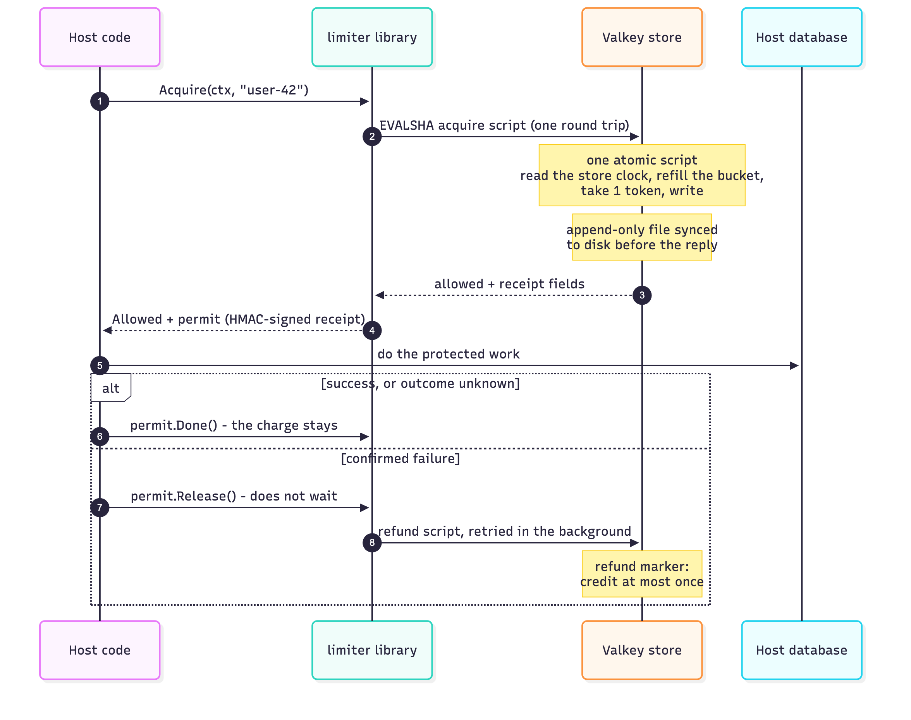
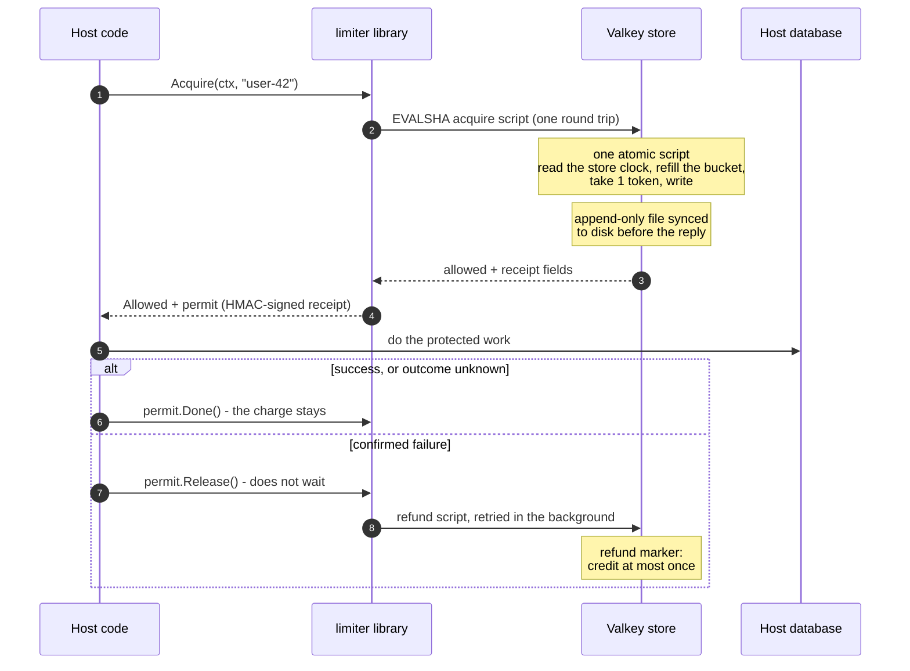
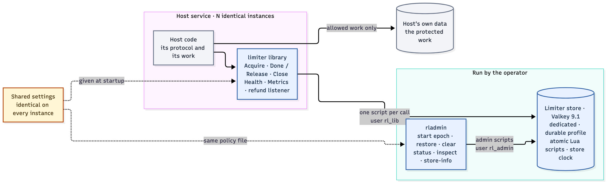
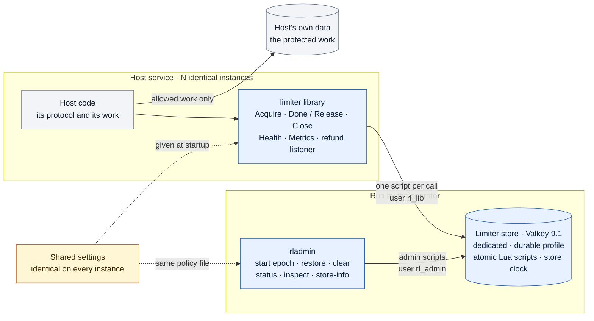

# Developer guide

How to set up the repository, run the library and its tests, and find your way around the code. For what the project is and why, start with the [README](../README.md).

- **New here?** Read [Terms](#terms), then [The pieces](#the-pieces) and [Quick start](#quick-start).
- **Want the numbers?** They are in [results.md](results.md).
- **Changing code?** The coding rules are in [AGENTS.md](../AGENTS.md), and `make check` must pass.

## Terms

| Term | Meaning |
|---|---|
| Permit, receipt | What an allowed call returns. The receipt is signed with HMAC under a key that lives only in this process's memory, so only the process that issued it can refund it. |
| Refund marker | A short-lived store entry written together with a refund credit. A repeated refund sees it and is not credited twice. |
| Budget time, high-water mark | Time read from the store's clock inside a script. The high-water mark is the latest budget time stored, and budget time never moves below it. |
| Epoch, fingerprint | `rladmin` starts an epoch: a record holding a hash (the fingerprint) of the shared policy. Instances join only if their settings hash the same. A new policy means a new epoch. |
| Quarantine, integrity hold | When stored state is missing or damaged, one key is refused (quarantine), or every key is refused (hold), until an operator restores it or starts a new epoch. |
| Closed and open mode | What happens when the store cannot be reached: refuse the call (closed) or let it through uncharged as `degraded` (open). |
| AOF, `appendfsync always` | Valkey's append-only log, synced to disk on every write, so an acknowledged decision survives a store crash. |

## How one request works



<details><summary>Diagram source (mermaid — sequence diagram)</summary>



</details>

If the bucket is empty, the store's reply is `limited` with the wait time instead, and the host answers `429` with `Retry-After`. Nothing is queued.

## The pieces



<details><summary>Diagram source (mermaid — flowchart)</summary>



</details>

| Part | What it is | Code |
|---|---|---|
| Limiter library (product) | The public API: `New`, `Acquire`, permits finished with `Done` or `Release`, a refund listener, `Close`, `Health`, `Metrics`. Inside: receipts and slots, refund workers, the epoch watch, the cleanup runner and the store adapter | `limiter/`, `internal/` |
| Limiter store (product) | One Valkey server per deployment with the durable profile by default (AOF `appendfsync always`, `noeviction`; opt-in [store profiles](results.md#store-profiles) trade crash safety for speed) and ACL users. It holds every budget, refund marker, cleanup index entry, quarantine flag and the epoch record. The library defines its contents and loads its scripts | `deploy/`, `internal/scripts/` |
| Admin tool (product) | `rladmin`: start or replace an epoch, restore and clear quarantined keys, status and inspect, store info and AOF rewrite | `cmd/rladmin/` |
| Test-only entry point (product) | `limitertest`: fixture hooks, compiled only with `-tags rltest`, never into production builds (`CMP-9`) | `limitertest/` |
| Harness | One host service plus the verification rig: `hitapi` (an HTTP API over PostgreSQL that embeds the library), `hitgen` (seeded open-loop traffic), the `orchestrator`, `sampler` and `faultctl`, a reference model in Python and a report builder | `cmd/hit*`, `cmd/orchestrator/`, `cmd/sampler/`, `cmd/faultctl/`, `harness/`, `refmodel/`, `report/`, `scenarios/` |

- The library is not a service: no limiter process, no sidecar. The operator runs one store and gives every instance the same settings.
- The harness never adds limiter requirements. It uses the library exactly as any host would ([HARNESS.md](../HARNESS.md)).

## Layout

The repository is one Go module, `github.com/srir84/ratelimiter` (DESIGN §A1). `docs/` holds the guides, the results and the code map.

```
ratelimiter/
  limiter/        PRODUCT public API: type aliases of internal/core, plus New, DefaultPolicy, DefaultInstance
  limitertest/    PRODUCT test-only entry point; every file has //go:build rltest
  internal/
    core/         Limiter, acquire flow, permits, slots, refund workers, epoch watch, cleanup runner, reclaimer
    store/        store adapter: pipelined connections, EVALSHA, failure classification
    store/resp/   minimal RESP2 client
    scripts/      the Lua scripts, embedded
    receipt/  keys/  fingerprint/  settings/  metrics/
    testutil/     test helpers only: storeproc, scriptrun, storestate, golden, fakeresp, conformance
  cmd/
    rladmin/      PRODUCT admin tool
    hitapi/  hitgen/  orchestrator/  sampler/  faultctl/      HARNESS binaries
  harness/        HARNESS packages: config, runlog, httpapi, dbclient, fixtures, driver, spectest, e2e, pgtest
  refmodel/       HARNESS reference model (Python)
  report/         HARNESS report builder (Python)
  scenarios/      HARNESS scenario files
  deploy/         store profiles (valkey-durable/-barrier/-everysec/-buffered.conf), valkey-fast.conf,
                  start-store.sh, build-valkey-barrier.sh + valkey-barrier.patch, acl.conf.tmpl, pg-schema.sql
  docs/           developer guide, host integration guide, operator guide, results, code map
  tools/trace/    repository checks: test IDs, import boundary, ACL lists, script lint, API, …
  tools/mutate/   mutation testing
  Makefile  harness.toml  LICENSE  AGENTS.md  SPEC.md  ARCHITECTURE.md  DESIGN.md  HARNESS.md
```

Every Go package has a package comment naming its DESIGN section: `go doc ./limiter`, `go doc ./cmd/rladmin`.

## Prerequisites and setup

| Need | Version | Used for |
|---|---|---|
| Go | 1.24 or later; `go.mod` pins `toolchain go1.27.1`, which the first build downloads | the library, `rladmin`, the harness binaries |
| Valkey | 9.1.x (`brew install valkey`); any Redis-compatible store with Lua 5.1 scripts, `#!lua` flags and `ZRANGE … BYSCORE` works (Redis 7.0 or later) | the limiter store |
| Python | 3.13 or later, standard library at runtime | reference model, report builder |
| PostgreSQL | 14 or later | the harness database only |

`make setup` (DESIGN §C8) checks those versions and installs the pinned lint tools: golangci-lint into `bin/tools/`, luacheck and stylua (Homebrew), and pytest, ruff and mypy from `requirements-dev.txt`. When no store binary is found it offers `brew unlink redis && brew install valkey` (the two formulas conflict). It also initializes the harness PostgreSQL cluster in `.data/pg` (`127.0.0.1:5433`, role `rl`, database `hits`, `deploy/pg-schema.sql`) and leaves it stopped. It is safe to rerun.

## Quick start

**1. Build.** `make build` puts `hitapi` and `rladmin` built without tags in `bin/bench/` (the product build) and every binary built with `-tags rltest` in `bin/test/`.

**2. Start the store** with the durable profile and a rendered ACL file. The profile leaves `port`, `dir` and `aclfile` to the command line. A production ACL file has only `rl_lib` and `rl_admin`. Here the passwords live only in the `RL_*_PASSWORD` variables and that file: `rladmin` reads `RL_ADMIN_PASSWORD`, and a host may hand `rl_lib`'s password to `StoreOptions` by any means it chooses (`CFG-7`, [operator guide](operator-guide.md#acl-users-and-passwords)):

```bash
store="$PWD/.data/store"                   # .data/ is git-ignored: the ACL file holds passwords
umask 077 && mkdir -p "$store"             # the files below get mode 0600
export RL_LIB_PASSWORD="$(openssl rand -hex 32)" RL_ADMIN_PASSWORD="$(openssl rand -hex 32)"
# Render the ACL file with shell builtins (bash or zsh), so no password shows in a process's arguments.
acl=$(grep -v -e '^user rl_fixture ' -e '^user rl_ops ' deploy/acl.conf.tmpl)
acl=${acl//'{{.LibPassword}}'/$RL_LIB_PASSWORD}
acl=${acl//'{{.AdminPassword}}'/$RL_ADMIN_PASSWORD}
printf '%s\n' "$acl" > "$store/acl.conf"
valkey-server deploy/valkey-durable.conf --port 6390 --dir "$store" --aclfile "$store/acl.conf" \
  > "$store/valkey.log" 2>&1 &
```

Stop this store before `make run`, which starts its own on port 6390.

**3. Start an epoch.** Only `rladmin` creates the epoch record; instances only join it. The policy file holds the shared settings in a `[policy]` table (DESIGN §B2 keys); absent keys keep `limiter.DefaultPolicy()` values, and every instance must build the same `Policy`:

```bash
cat > shared.toml <<'EOF'
[policy]
max_tracked_buckets = 100_000
max_live_markers = 50_000
EOF
export RL_STORE_ADDR=127.0.0.1:6390
bin/bench/rladmin start-epoch --policy shared.toml     # prints the new epoch_id
bin/bench/rladmin status                               # epoch, hold, counts
```

That is `rladmin start-epoch --policy shared.toml`; exit codes and the other commands are in the [operator guide](operator-guide.md#admin-tool-rladmin).

**4. Embed the library** in the host service (`import "github.com/srir84/ratelimiter/limiter"`):

```go
p := limiter.DefaultPolicy()
p.MaxTrackedBuckets, p.MaxLiveMarkers = 100_000, 50_000 // the same values as shared.toml
in := limiter.DefaultInstance(p)
in.MaxReleaseDelayNs = (5 * time.Second).Nanoseconds() // P: just before Acquire → Release
in.MarginNs = time.Second.Nanoseconds()
in.MaxHeldReceipts, in.MaxPendingRefunds = 1_152, 1_152
l, err := limiter.New(p, in, limiter.StoreOptions{
	Addr: "127.0.0.1:6390", User: "rl_lib", Password: os.Getenv("RL_LIB_PASSWORD"),
})
if err != nil {
	logger.Error("invalid limiter settings", "error", err) // l stays not_ready, never nil
}
defer l.Close() // drains pending refunds

ctx, cancel := context.WithDeadline(ctx, time.Now().Add(5*time.Second)) // P starts here
defer cancel()
switch r := l.Acquire(ctx, userID); r.Kind {
case limiter.Allowed, limiter.Degraded:
	if err := work(ctx); errors.Is(err, errConfirmedFailure) {
		r.Permit.Release() // confirmed failure: refunded in the background
	} else {
		r.Permit.Done() // success or unknown outcome: the charge stays
	}
case limiter.Limited:
	// quota rejection: retry after r.RetryAfterNs
default:
	// a refusal (busy, unavailable, outcome_unknown, …), never reported as a quota rejection
}
```

The [host integration guide](host-integration.md) covers every host rule (`HOST-1`…`HOST-9`), and `limiter/example_test.go` holds compiled examples of `New`, `Acquire` and `Close`.

## Tests

| Layer | What it checks | Runs with | Command |
|---|---|---|---|
| L0 | Store conformance: the pinned Valkey behaves as DESIGN §A3.0 says | its own store per test (`storeproc.Start`) on a free port, durable and fast profiles | `make test-store` |
| L1 | Go unit tests: keys, fingerprint, receipts, refill math, permit transitions, classification (fake RESP server) | Go only, `-race` | `make test-unit` |
| L2 | Each Lua script against a real store with a controlled clock, then the script discipline run | a fast-profile store per test (`scriptrun.Store`); `rl:ctl:time` driven by the test | `make test-scripts` |
| L3 | Library integration through the direct driver: several limiters in one test process (SPEC §10) | `-tags rltest`, fast profile | `make test-integration` |
| L4 | Harness end to end: `hitapi` processes, PostgreSQL, the generator (HARNESS §8) | `bin/test` binaries, the harness PostgreSQL | `make test-e2e` |
| L5 | Scenarios and benchmarks | `bin/bench` (benchmarks) or `bin/test` (test runs) | `make run SCENARIO=…` |
| Python | Reference model and report builder | pytest | `make test-py` |

- Tests that need a store spawn their own on a free loopback port with fresh passwords; the store binary is `RL_STORE_BIN`, else `valkey-server`, else `redis-server`. A missing store or tool fails the test; nothing is skipped.
- Test order is shuffled: `bin/trace gotest` adds `-shuffle=on` (repeat an order with `-shuffle=<seed>`), and pytest takes `--shuffle-seed=N`.
- `make check` runs golangci-lint (untagged and with each of `rltest`, `conformance`, `scripttest`), stylua, ruff, mypy and `tools/trace`; `make fmt` formats. `make slice-check S=<id>` is the gate for a build slice, `make mutate` runs mutation testing, `make test-report` runs the smoke runs and the report tests.

## Automatic tests on GitHub

`.github/workflows/ci.yml` runs on a GitHub macOS runner (`macos-15`, Apple silicon). It is started by hand from the Actions tab for now (the repository is private, and macOS minutes count ten times). It runs two jobs side by side:

- **lint, unit and Python tests:** `make check`, `make test-unit`, `make test-py` (about 5 minutes);
- **store, script and integration tests:** `make test-store-quick`, `make test-scripts`, `make test-integration` (about 9 minutes). Ticking *extended* adds the full `make test-store`.

`.github/actions/setup` installs the same tools `make setup` checks for, including stylua 2.5.2 from its release archive, since Homebrew's is newer. When a test fails, the job log shows its output, and `.out/` is attached to the run. Benchmarks never run there, because a shared machine's timing means nothing.

## Harness runs

```bash
make run SCENARIO=scenarios/smoke-ramp.toml BASELINE=1   # the limiter off: freezes the thresholds once
make run SCENARIO=scenarios/smoke-ramp.toml              # the limiter run: runs/<id>/report.md
```

- `make run` builds, then runs `bin/test/orchestrator` in the repository root. It starts a fresh store on port 6390, the harness PostgreSQL on 5433, `rladmin start-epoch`, one or three `hitapi` instances on 8081–8083, `hitgen` and the sampler, then builds `runs/<id>/report.md` and `report.json` from the run logs.
- `scenarios/` holds the scenario files: the smoke runs and the `TRF-S1`…`TRF-S7` scenarios, such as `scenarios/s1-ramp.toml`. Benchmark runs take `hitapi` and `rladmin` from `bin/bench` (production construction, no fixtures; the orchestrator refuses a benchmark otherwise, `HAR-24`); the orchestrator, `hitgen` and the sampler always run from `bin/test`. Test runs take every binary from `bin/test` and may inject faults.
- Run benchmarks on an otherwise idle machine, one at a time. Each benchmark limiter run needs its baseline first ([HARNESS.md](../HARNESS.md), DESIGN §B5, §B9).
