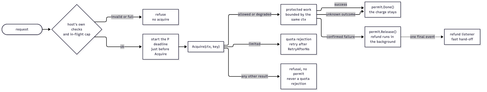
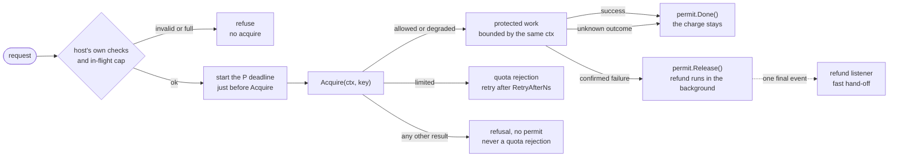
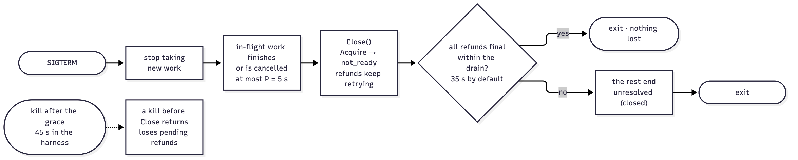
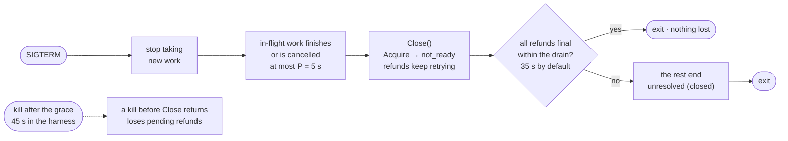

# Host integration guide

How to embed the limiter library in a service so that the guarantees in [SPEC.md](../SPEC.md) hold. The library cannot enforce these host rules; a host that breaks one loses the guarantee it protects ([SPEC §9](../SPEC.md#9-host-integration-contract)). The harness API process, `hitapi`, is one such host, and each section shows what it does.



<details><summary>Diagram source (mermaid — flowchart)</summary>



</details>

| Rule | The host must | Guarantee at stake |
|---|---|---|
| [`HOST-1`](#host-1-acquire-before-the-work) | Call `Acquire` before the protected work, and do the work only on `allowed` or `degraded` | Enforcement before work |
| [`HOST-2`](#host-2-finish-every-permit) | Finish every permit: `Release` only for a confirmed failure, `Done` for success or an unknown outcome | Fair refunds without free work |
| [`HOST-3`](#host-3-release-within-max_release_delay) | Call `Release` within `max_release_delay` of just before `Acquire`, enforced by its own deadline | The refund deadline |
| [`HOST-4`](#host-4-treat-results-distinctly) | Treat each result distinctly; only `limited` is a quota rejection | Predictable failures |
| [`HOST-5`](#host-5-identical-shared-settings) | Give every instance identical shared settings | Fleet agreement |
| [`HOST-6`](#host-6-graceful-shutdown-and-kill-grace) | Stop work, then `Close`; kill grace above `max_release_delay` + drain + overhead | Pending refunds survive a planned stop |
| [`HOST-7`](#host-7-bound-your-own-work) | Bound its own concurrent work and queues | Bounded work under repeated failures |
| [`HOST-8`](#host-8-keep-the-refund-listener-fast) | Keep the refund listener fast; never call back into the library from it | Listener isolation |
| [`HOST-9`](#host-9-choose-keys-from-a-bounded-identity-space) | *Guidance:* bounded key space, no secrets as keys | Availability; no secrets shown |

The compiled examples in [`limiter/example_test.go`](../limiter/example_test.go) show construction, one protected operation and shutdown. `go doc ./limiter` shows the overview, the aliases and the wrappers only; the methods and fields are documented on the internal types these alias: `go doc ./internal/core Limiter` (also `Permit`, `Result`, `Health`, …), `go doc ./internal/settings Policy` (also `Instance`, `StoreOptions`, `FailureMode`, `ClockSource`) and `go doc ./internal/metrics MetricsSnapshot`. DESIGN [§A5.2](../DESIGN.md#a52-public-api-go) lists the whole surface.

## HOST-1 Acquire before the work

- Call `Acquire(ctx, key)` before the protected work. Run the work only when `r.Kind` is `limiter.Allowed` or `limiter.Degraded`; only then is `r.Permit` non-nil.
- Checks that need no budget (request validation, the host's own capacity, `HOST-7`) come first and refuse without acquiring.
- **Harness:** `hitapi` validates the headers (`ERR-5`), takes an in-flight slot (`ERR-7`), starts `P`, acquires, and inserts the database row only on `allowed` or `degraded` (`T-HTTP-4`).

```go
r := l.Acquire(ctx, key)
if r.Kind != limiter.Allowed && r.Kind != limiter.Degraded {
	return refuse(r) // the HOST-4 table below: no permit, no work
}
```

## HOST-2 Finish every permit

| Outcome of the protected work | Call | Effect |
|---|---|---|
| Success | `r.Permit.Done()` | The charge stays; the permit's receipt and refund slots are freed |
| Confirmed failure: the work did not happen, or the host decides it failed | `r.Permit.Release()` | Returns at once; the library refunds the token in the background, retrying until a final result, and emits one final listener event |
| Unknown outcome: a lost reply, a timeout after sending, `P` passing during a commit | `r.Permit.Done()` | The charge stays; never refunded |

- The first finish wins; any later `Done` or `Release` is a no-op. On a degraded permit both are no-ops: it has no receipt and nothing was charged.
- An unfinished permit keeps its two slots until `receipt_lifetime` (60 s) passes, and is then never refunded. Leaking permits ends in `busy`.
- Never acquire again to make up for an unknown outcome (`REF-7`, `API-24`).
- **Harness** (`hitapi`, DESIGN [§B3](../DESIGN.md#b3-hitapi-request-handling)):

| Database outcome | Permit | Response |
|---|---|---|
| Row inserted, or the existing row read | `Done()` | 200 (`ERR-1`, `ERR-2`) |
| Nothing was sent (`pgconn.SafeToRetry`), or a server error with SQLSTATE (the statement failed and rolled back), including the 2.5 s `statement_timeout`, but not one of severity `PANIC` | `Release()` | 503 `database_unavailable` (`ERR-14`) |
| The fixture's "fail after commit" (test builds) | `Release()` | 500 `internal_error` (`ERR-13`) |
| The application refuses after acquire (`refuse_after_acquire_bp`, or SIGTERM before the first statement) | `Release()` | 503 `service_aborted_after_acquire` (`ERR-15`) |
| Timeout or connection loss after sending, a server error of severity `PANIC` (crash recovery decides whether the row exists), or `P` passed without a confirmed rollback | `Done()` | 503 `application_outcome_unknown` (`ERR-16`) |

## HOST-3 Release within max_release_delay

The host declares `MaxReleaseDelayNs` (`P`): the longest time from just before `Acquire` until `Release` for a confirmed failure. The startup check `RCP-8` builds on it ([below](#settings-and-startup-checks)), and the refund deadline holds only for releases within it (`REF-5`).

- Create one deadline just before `Acquire` and use it for the acquire and for the work. The library caps the acquire itself at `DependencyDeadlineNs` (2 s), so a slow acquire shortens the time left for the work, never the refund window (HARNESS [`HTTP-13`](../HARNESS.md#3-http-contract)).
- `hitapi` builds it on a context that a client disconnect cannot cancel (`context.WithoutCancel`), so `P` and the work decide the outcome, not the client.
- Past `P`, call `Release` only if the failure is still confirmed; otherwise `Done`.

```go
// hitapi (harness/httpapi/hit.go): P = 5 s, measured from just before Acquire.
ctx, cancel := context.WithDeadline(context.WithoutCancel(r.Context()), time.Now().Add(p))
defer cancel()
dec := lim.Acquire(ctx, userID)
// … the database work runs with the same ctx …
```

| When the deadline ends the call | Result | Host |
|---|---|---|
| Before the acquire command was sent, host deadline first | `cancelled` | Refuse, no work (`ERR-9a`) |
| Before it was sent, `DependencyDeadlineNs` first | `unavailable` | Closed mode: refuse (`ERR-8`). Open mode: `degraded`, and the work runs in what is left of `P` |
| After it was sent, before a confirmed reply | `outcome_unknown` | Refuse, no work, maybe charged (`ERR-9`) |
| During the work | — | Cancel the work: a confirmed rollback is `Release` (`ERR-14`), anything else `Done` (`ERR-16`) |

## HOST-4 Treat results distinctly

`Result.Kind` is a closed set. Only `limited` is a quota rejection; every refusal is reported as its own failure, and `degraded` is reported apart from `allowed`. Protocol codes are the host's choice; the harness mapping below is one example (HARNESS [error catalog](../HARNESS.md#error-catalog-single-source-for-http-outcomes)).

| Result | Meaning | Permit | Host does | `hitapi` (`ERR` row) |
|---|---|---|---|---|
| `allowed` | One token deducted; `DecisionNs` is the budget time | yes | Do the work, then `Done` or `Release` | the work's outcome (`ERR-1`, `ERR-2`, `ERR-13`…`ERR-16`) |
| `degraded` | Open mode only, whenever the acquire would be `unavailable`: the store could not be reached and nothing was sent, or it refused the command before running it because it was not ready (`LOADING`, `BUSY`); no receipt, no charge | yes, without a receipt | Do the work, report it as degraded | the work's outcome: 200 with `degraded=true` on success (`ERR-3`), else `ERR-13`…`ERR-16` (`release()` and `done()` are no-ops) |
| `limited` | Quota rejection; `RetryAfterNs` is the exact wait | no | Reject, with retry advice | 429 `rate_limited` + `Retry-After` (`ERR-4`) |
| `busy` | No free receipt or refund slot in this instance | no | Refuse as overload | 503 `service_overloaded` (`ERR-7`) |
| `cancelled` | The host's deadline or cancel came before anything was sent | no | Refuse; never acquire again for this call (`REF-7`) | 503 `limiter_deadline_exceeded` (`ERR-9a`) |
| `unavailable` | Closed mode: the store could not be reached and nothing was sent, or it refused while not ready (`LOADING`, `BUSY`) | no | Refuse | 503 `limiter_unavailable` (`ERR-8`) |
| `outcome_unknown` | Sent without a confirmed reply, or an error reply: maybe charged | no | Refuse; never acquire again for this call (`REF-7`, `API-24`) | 503 `limiter_outcome_unknown` (`ERR-9`) |
| `receipt_error` | Charged, but signing failed | no | Refuse; the charge stands (`API-12a`) | 503 `limiter_receipt_error` (`ERR-12c`) |
| `config_error` | Fingerprint or epoch mismatch, or an unusable signer | no | Refuse; check settings (`HOST-5`) | 503 `limiter_config_error` (`ERR-12`) |
| `not_ready` | No epoch joined yet, invalid settings, or closing | no | Refuse | 503 `limiter_not_ready` (`ERR-12a`) |
| `clock_error` | The store's clock is unreadable or negative | no | Refuse | 503 `limiter_clock_error` (`ERR-12b`) |
| `state_integrity_error` | State loss for the key or the whole epoch; `Diag.Scope` says which | no | Refuse; an operator repairs it | 503 `limiter_state_integrity_error` (`ERR-11`) |
| `capacity_error` | A shared-state limit is full, or the store is out of memory; never fails open | no | Refuse | 503 `limiter_capacity_exceeded` (`ERR-10`) |
| `validation_error` | The key is empty, longer than 256 bytes, or not UTF-8 | no | Reject the request | 400 `invalid_request` (`ERR-12d`) |

- `failure_mode` changes only `unavailable`: closed mode refuses, open mode returns `degraded`. Every other refusal refuses in both modes (`API-21`).
- `Result.Diag` (`Scope`, `Reason`, `StoreError`) explains a refusal for operators: log it, never put it in a metric label.

## HOST-5 Identical shared settings

- `Policy` is the shared part, and all of it is fingerprinted with the store schema version: rate, period, capacity, `FailureMode`, the three capacity limits, receipt lifetime, refund deadline, outage tolerance, cleanup interval and clock source. Every instance, and the policy file given to `rladmin start-epoch --policy`, must hold the same values.
- `Instance` is per instance: validated locally and reported by `Health`.
- A mismatched instance returns `config_error` and reports `not_ready` (`fingerprint_mismatch`); instances already running keep serving (`T-CFG-1`). Changing the policy needs a new epoch, which restarts every budget full ([operator guide](operator-guide.md#procedures)).
- **Harness:** every `hitapi` of a run reads the run's `config.toml` (`harness.toml` with the scenario's overrides merged in), and the orchestrator runs `rladmin start-epoch --policy runs/<id>/config.toml` with the same file.

## HOST-6 Graceful shutdown and kill grace



<details><summary>Diagram source (mermaid — flowchart)</summary>



</details>

- **Sequence:** stop taking new work, let in-flight work finish or cancel within `P`, then call `Close()`. `Close` drains pending refunds for `DrainTimeoutNs` (default `refund_deadline + outage_tolerance` = 35 s) and returns as soon as all are final and the refund listener has handled their events. It waits for a slow listener only until the drain deadline, or 100 ms past the drain's end when that is later.
- **Kill grace** must exceed `P + drain_timeout` plus shutdown overhead. The harness uses `P + drain_timeout + 5 s` = 5 + 35 + 5 = **45 s** (DESIGN [§B10](../DESIGN.md#b10-harness-numbers)). A 30 s platform default is too short for the default drain.
- `Close(limiter.WithDrainTimeout(d))` overrides the drain. A drain shorter than the default gives up the refund guarantee for the refunds still pending (`REF-9`); those end `unresolved` (`closed`).
- From the start of `Close`, `Acquire` returns `not_ready` with nothing sent, `Health` reports `closing`, and `Release` on an open permit ends `unresolved` (`closed`) without sending.
- A kill without `Close` is a crash: the instance's pending refunds are lost, with no events (`REF-8`, `STA-15`). Budgets in the store are never affected.
- **Harness** (`HAR-15`, `T-HFLT-5`): on SIGTERM `hitapi` stops accepting `/hit`, refuses work not yet at its first database statement (`Release`, `ERR-15`), waits at most `P` for the rest, calls `Close` with the default drain, empties its run-log queue and exits 0.

```go
// A Go host: see ExampleLimiter_Close.
<-sigterm
srv.Shutdown(stopCtx) // stop taking new work
inFlight.Wait()       // each piece ends by its own P deadline
l.Close()             // drains for DrainTimeoutNs; or l.Close(limiter.WithDrainTimeout(d))
```

## HOST-7 Bound your own work

- The library bounds only its own receipts and refunds: `MaxHeldReceipts` and `MaxPendingRefunds`, reserved inside `Acquire` (full → `busy`). Concurrency, queues and dependency waits are the host's to bound.
- Reserve host capacity before `Acquire`, and refuse without acquiring when it is full.
- Refunds give the budget back, so a caller can retry after a refunded failure (`REF-10`): bound the work whatever the refund rate.
- Size the slots for the in-flight cap plus the released backlog: in the harness 512 + 50/s × 11 s = 1,062 ≤ 1,152 (DESIGN [§A7](../DESIGN.md#a7-numbers-and-proofs)).
- **Harness:** each `hitapi` has an in-flight cap of 512 with no queue; when it is full the request gets 503 `service_overloaded` (`ERR-7`) and no acquire is sent (`HAR-14`, `T-HFLT-1`). Its PostgreSQL pool has 64 connections and a 2.5 s `statement_timeout`.

## HOST-8 Keep the refund listener fast

`limiter.WithRefundListener(f)` gives `f` one final event for each released permit that has a receipt (`API-1d`):

| Field | Meaning |
|---|---|
| `DeductionID` | The permit's `DeductionID()`, to match the event to the host's own request |
| `Result` | `Applied`, `AlreadyApplied` (both confirmed), `ReceiptInvalid`, `ReceiptExpired` or `Unresolved` |
| `Reason` | For `Unresolved` only: `UnresolvedClosed` (the drain ended, or `Release` came after `Close` began), `UnresolvedRetention` (retention ended first) or `UnresolvedExpired` (released after retention ended) |
| `Attempts` | Refund commands actually sent to the store |
| `CreditDecisionNs` | The credit's budget time; 0 when unknown |
| `ReleaseMonoNs`, `FinalMonoNs` | Monotonic times of `Release` and of the final result |

- Events pass through a bounded queue (`ListenerQueueSize`, 10,000) to one dispatcher goroutine. A full queue drops the event and counts it in `Health().ListenerDrops` and `rl_listener_drops_total`; the one-event promise holds while that count is 0.
- Keep `f` fast or hand events off without blocking. Never call back into the limiter from `f`.
- A slow or panicking `f` never changes accounting, retries or slots, but a slow one fills the queue.
- **Harness:** `hitapi`'s listener (`httpapi.RefundListener`) enqueues each event as a run-log record and returns at once; the run-log writer's queue never blocks (`HAR-13`).

```go
events := make(chan limiter.RefundEvent, 1_024) // the host's own bounded queue
l, err := limiter.New(p, in, st, limiter.WithRefundListener(func(ev limiter.RefundEvent) {
	select {
	case events <- ev: // a host goroutine matches ev.DeductionID to its records
	default: // full: the host counts its own drop
	}
}))
```

## HOST-9 Choose keys from a bounded identity space

*Guidance, checked in review only.*

- A key is any string of 1–256 bytes of UTF-8 (`validation_error` otherwise). The library encodes it for the store, so any characters are safe and distinct keys never collide.
- Draw keys from a bounded identity space, such as user or tenant IDs. Each active key takes a tracked bucket; an attacker-chosen key space can fill `MaxTrackedBuckets`, and then every new key gets `capacity_error`.
- Never use secrets, such as raw API keys, as keys: keys appear in inspect output and diagnostics (`HOST-9`). As built, the library encodes a key with base64url, which anyone can reverse, not a hash. The encoded key is part of the store's key names and of the script arguments, so it can show in `rladmin store-info`'s slow log and in the raw store replies that a `RunCleanupPass` report's `Diag.StoreError` carries, and operators type the key itself into `rladmin inspect --key`. Hash secrets first, for example to the 64 hex characters of a SHA-256.
- **Harness:** the key is the `X-User-ID` header, 1–64 characters of `[A-Za-z0-9_-]`, a simulated identity.

## Settings and startup checks

Start from `limiter.DefaultPolicy()` and `limiter.DefaultInstance(p)` and overwrite fields. A zero field means the literal 0; required fields fail validation while 0 (DESIGN [§A5.10](../DESIGN.md#a510-settings-and-validation)).

| Setting | Scope | Product default | Harness | Validation |
|---|---|---|---|---|
| `RateTokens` / `RatePeriodNs` / `Capacity` | shared | 10 / 1 s / 20 | same | positive; §A3.1 bounds |
| `FailureMode` | shared | `Closed` | both, per scenario | — |
| `MaxTrackedBuckets` / `MaxLiveMarkers` | shared | required | 100,000 / 50,000 | 1 … 2^31−1 |
| `MaxMarkersPerKey` | shared | 1,000 | same | 1 … 2^31−1, ≤ `MaxLiveMarkers` |
| `ReceiptLifetimeNs` / `RefundDeadlineNs` / `OutageToleranceNs` | shared | 60 s / 30 s / 5 s | same | whole µs; `RCP-8` |
| `CleanupIntervalNs` | shared | 5 s | same | whole µs |
| `ClockSource` | shared | `Store` | `Store`; `Controlled` in some test runs | `Controlled` only through `limitertest` |
| `MaxReleaseDelayNs` (`P`) | instance | required | 5 s | `RCP-8` |
| `MarginNs` | instance | required | 1 s | ≥ lifetime × clock-rate bound |
| `ClockRateBoundPPM` | instance | 1,000 | same | ≥ 0 |
| `DependencyDeadlineNs` (`D`) | instance | 2 s | same | positive |
| `EpochRereadIntervalNs` | instance | 1 s | same | positive |
| `DrainTimeoutNs` | instance | `RefundDeadlineNs + OutageToleranceNs` (35 s) | same | ≥ 0 |
| `MaxHeldReceipts` / `MaxPendingRefunds` (`N`) | instance | required | 1,152 / 1,152 | 1 … 2^31−1 |
| `RefundWorkers` / refund backoff | instance | 128 / 50 ms → 1 s | same | `RefundWorkers` 1 … 2^31−1; the refund inequality below |
| `ListenerQueueSize` | instance | 10,000 | same | 1 … 2^31−1 |
| `StoreConns` / `RefundConns` / `CleanupBatch` / `CleanupPipelines` / `ReclaimBatch` | instance | 8 / 2 / 1,000 / 4 / 1,000 (plus one maintenance connection) | same | 1 … 2^31−1 |

Every count setting takes 1 … 2^31−1, the `RateTokens` range (DESIGN §A5.10, `internal/settings`).

Every `*Ns` setting, shared or per instance, must also be a whole number of microseconds, a multiple of 1,000 ns (DESIGN [§A3.1](../DESIGN.md#a31-time-and-number-domain)); `New` refuses any other value, and the instance is never ready (`settings_invalid`).

**Startup checks** (`New` checks them; with harness values):

| Check | Rule | Harness numbers |
|---|---|---|
| `RCP-8` lifetime | `max_release_delay + refund_deadline + outage_tolerance + margin ≤ receipt_lifetime` | 5 s + 30 s + 5 s + 1 s = 41 s ≤ 60 s |
| `RCP-8` margin | `margin ≥ receipt_lifetime × clock_rate_bound` | 1 s ≥ 60 s × 0.001 = 60 ms |
| Refund inequality (`REF-5` by construction, DESIGN §A5.6, §A7) | `backoff_max + reconnect_max + (ceil(N / refund_workers) + 3) × D ≤ refund_deadline` | 1 + 1 + (9 + 3) × 2 = 26 s ≤ 30 s, with `N` = 1,152 and ceil(1,152 / 128) = 9 |

A failed check (or any `CFG-4` rule, or a failed signing-key generation) gives a limiter that is never ready: `New` returns it with the error, `Acquire` returns `not_ready`, `Health` reports `settings_invalid`, and nothing contacts the store.

## Health and metrics

The library has no logger. It reports through `Result.Diag`, `Health()`, `Metrics()` and refund events, and the host decides how to expose them (DESIGN [§A5.11](../DESIGN.md#a511-listener-health-metrics-diagnostics)). The harness serves `Health` as JSON at `/health` and the metrics as Prometheus text at `/metrics`.

| `Health` field | Meaning |
|---|---|
| `Status` | `ready` or `not_ready` |
| `Reason` | `ready`, or `no_epoch`, `fingerprint_mismatch`, `state_lost`, `integrity_hold`, `closing`, `settings_invalid` |
| `EpochID` | The epoch joined last; empty before the first join |
| `ClockSource` | `store` (or `controlled` in test builds) |
| `Instance` | The per-instance settings |
| `ListenerDrops` | Refund events dropped by the listener queue |
| `StoreError` | The last store error; empty once an epoch read succeeds |
| `Fixtures` | true only for limiters built through `limitertest` |

`Metrics()` returns a `MetricsSnapshot` of 17 fixed families. Label values come only from fixed sets, never from keys or requests (`STA-14`):

- Slots and refunds: `rl_slots_in_use` (`kind` receipt or refund), `rl_pending_refunds`, `rl_refund_results_total` (`result`), `rl_listener_drops_total`.
- Acquire and the store: `rl_acquire_results_total` (`result`, 14 kinds), `rl_store_call_seconds` (histogram per script), `rl_store_connections` (`kind` call, refund or maintenance).
- Cleanup: `rl_cleanup_passes_total`, `rl_cleanup_entries_total`, `rl_cleanup_stops_total`, `rl_cleanup_lag_seconds`, `rl_reclaim_keys_total`.
- Epoch state, from each epoch read: `rl_integrity_hold`, `rl_clock_lag_microseconds`, `rl_tracked_buckets`, `rl_live_markers`, `rl_quarantined_keys`.

The [operator guide](operator-guide.md#monitoring-and-alerts) gives each metric's meaning and the alert thresholds.
