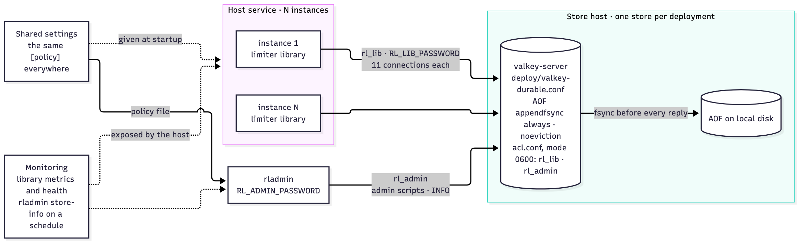
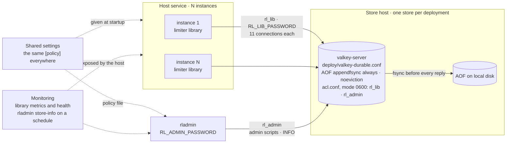
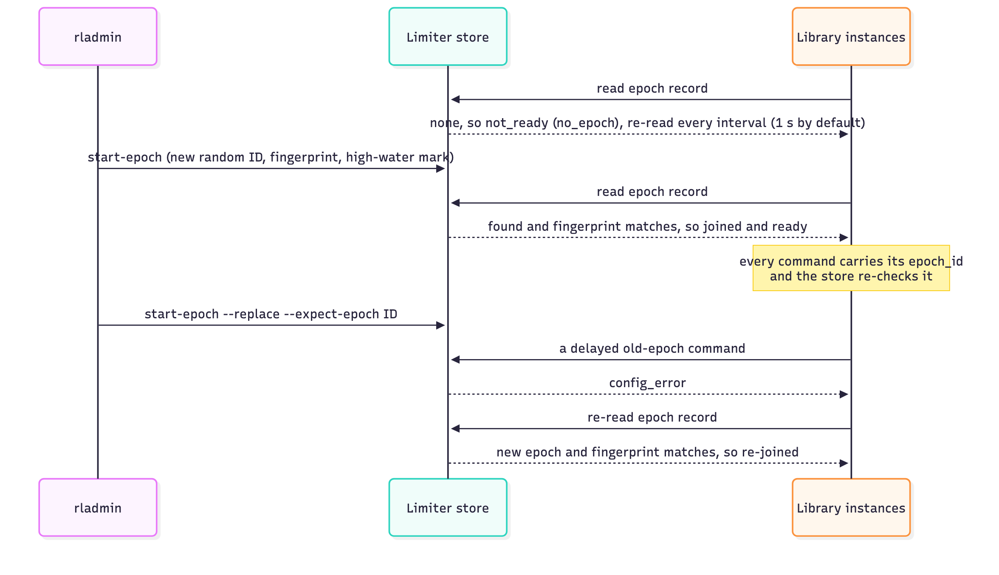
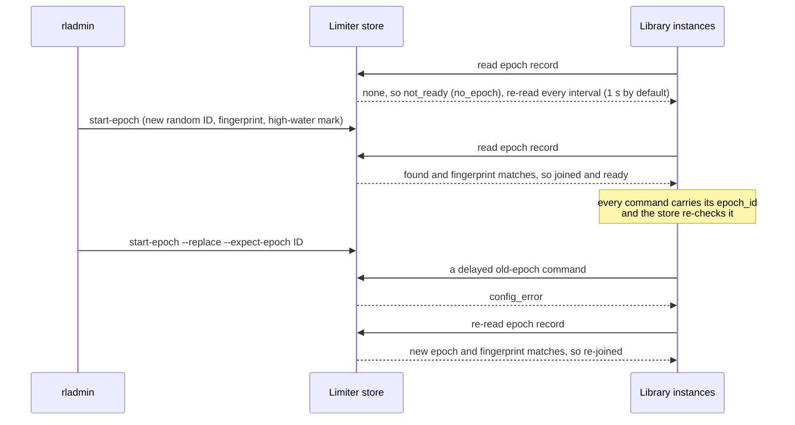

# Operator guide

How to run the limiter's store and admin tool: the deployment, the store profile and ACL users, sizing, `rladmin`, monitoring and alerts, recovery procedures, and the durability choice. The sources are DESIGN [§A2](../DESIGN.md#a2-store-deployment-profile), [§A6](../DESIGN.md#a6-admin-tool-rladmin), [§A7](../DESIGN.md#a7-numbers-and-proofs), [§A8](../DESIGN.md#a8-operations-runbook), [§D2](../DESIGN.md#d2-decisions-for-the-owner) and ARCHITECTURE [§4.4](../ARCHITECTURE.md#44-epoch-start-join-and-repair). How a service embeds the library is in the [host integration guide](host-integration.md).



<details><summary>Diagram source (mermaid — flowchart)</summary>



</details>

| The operator provides | Notes |
|---|---|
| One store server per deployment | A dedicated Valkey 9.1 server, started once and empty, with the durable profile. Each deployment has its own store (DESIGN §A5.2, §A8) |
| The ACL file | Rendered from [`deploy/acl.conf.tmpl`](../deploy/acl.conf.tmpl) with fresh passwords, mode 0600; in production only `rl_lib` and `rl_admin` |
| Shared settings | The same `Policy` for every instance (`HOST-5`), and the same `[policy]` table in the file given to `rladmin` |
| `rladmin` | Starts the epoch, repairs keys, shows status, reads the store's `INFO` |
| Monitoring | Each instance's health and metrics, which the host exposes, and `rladmin store-info` |

## Store profile

[`deploy/valkey-durable.conf`](../deploy/valkey-durable.conf) is the profile for production, benchmarks and durability tests. Three opt-in profiles trade crash safety for speed; see [Store profiles](#store-profiles). The fast profile ([`deploy/valkey-fast.conf`](../deploy/valkey-fast.conf), `appendfsync no`) is for logic tests only. Every profile file leaves `port`, `dir` and `aclfile` to the command line:

```bash
valkey-server deploy/valkey-durable.conf --port 6390 --dir /path/to/store --aclfile /path/to/store/acl.conf
```

| Setting | Durable profile | Rule |
|---|---|---|
| `appendonly` / `appendfsync` | `yes` / `always`: a reply only after the write is on disk | `STA-16` |
| `no-appendfsync-on-rewrite` | `no`: keep fsync during AOF rewrites | `STA-16` |
| `aof-use-rdb-preamble`, `save` | `yes`, `""`: the AOF is the record | — |
| `maxmemory` / `maxmemory-policy` | sized per `STA-7` (512 MB in the shipped file, the harness size) / `noeviction` | `STA-16` |
| `maxclients` | 4,096 | the connection budget below |
| `auto-aof-rewrite-percentage` / `auto-aof-rewrite-min-size` | production: 100 / `1gb`, about one rewrite every 4–5 min at 10,000 allowed acquires/s (~400 B of AOF each; limited acquires write nothing). Capacity benchmarks pass `--auto-aof-rewrite-percentage 0` (the min-size stays `1gb`) and rewrite between runs | DESIGN §D1 |
| `bind`, `protected-mode`, `port` | `127.0.0.1`, `yes`; the harness uses port 6390 | `HAR-20` |
| ACL file | Rendered with freshly generated passwords, mode 0600; its first line is `user default off`, so only the listed users connect | `STA-16` |

- The store never evicts or expires limiter data, and acknowledges a write only once it is durable. In production only the library and the admin tool reach it (`STA-16`).
- The library defines everything inside the store. It calls each script with `EVALSHA`, by the SHA-1 of its text, and loads it on first use, not at startup: a `NOSCRIPT` reply gets one `SCRIPT LOAD` and one resend (DESIGN §A5.4), so a restarted store, whose script cache is empty, needs no instance restart. Because scripts are named by their SHA-1, library versions never overwrite each other's scripts.

## ACL users and passwords

The store checks ACLs on every command a script calls, so each user lists its client commands and its scripts' inner commands; `tools/trace` checks the lists against the scripts (DESIGN §A2).

| User | Client commands | Inner commands (called by its scripts) | Keys | Used by | Password variable |
|---|---|---|---|---|---|
| `rl_lib` | `+evalsha +script\|load +scan +ping +auth` | `+hgetall +hexists +hset +hdel +hincrby +hlen +zscore +zadd +zrem +zrange +del +unlink +get +time` | `~rl:*` | The library: `acquire`, `refund`, `due_entries`, `cleanup_entry`, `reclaim`, `read_epoch`, `hold` | `RL_LIB_PASSWORD` |
| `rl_admin` | `+evalsha +script\|load +ping +auth +info +slowlog\|get +bgrewriteaof` | `+hgetall +hget +hexists +hset +hdel +hincrby +hlen +zscore +zadd +zrem +zrange +zcard +del +get +time` | `~rl:*` | `rladmin`: the `admin_*` scripts and `read_epoch` | `RL_ADMIN_PASSWORD` |
| `rl_fixture` | `+set +get +del +hset +hdel +zrem +zadd +flushall +ping +auth +type +eval` | — | `~rl:*` | Test deployments only: the controlled clock driver and the state tamper tool | `RL_FIXTURE_PASSWORD` |
| `rl_ops` | `+config\|get +config\|set +info +bgrewriteaof +shutdown +ping +auth` | — | none | Harness and test deployments only: the orchestrator, `faultctl`, store conformance tests | `RL_OPS_PASSWORD` |

- A production ACL file has only `user default off`, `rl_lib` and `rl_admin`. `store-info` and `store-rewrite` give operators what they need through `rl_admin`, so no other user reaches the store.
- For `rladmin` and this repository's other binaries, passwords come only from the `RL_*_PASSWORD` variables and the rendered ACL file (mode 0600). The library takes `rl_lib`'s password from the host in `StoreOptions`, and a host may deliver it by any means it chooses (`CFG-7`). Passwords are never in the repository, the fingerprint, `Diag`, `Health`, a metric or a log.
- `rladmin` reads `RL_STORE_ADDR` (or `--store`), `RL_ADMIN_USER` (default `rl_admin`) and `RL_ADMIN_PASSWORD`.

## Sizing

The deployment declares the failure load it supports and sizes the limits and store memory for it (`STA-7`). The harness's worst cases (DESIGN [§A7](../DESIGN.md#a7-numbers-and-proofs)):

| Quantity | Formula | Harness worst case |
|---|---|---|
| Tracked buckets (`max_tracked_buckets`) | Distinct keys active within time-to-full + receipt lifetime + cleanup interval + cleanup lag (2 + 60 + 5 + 10 s), plus quarantined keys | 10,000-user scenario: ≤ 10,000, well under 100,000 |
| Live markers (`max_live_markers`) | Peak refund rate × (receipt lifetime + cleanup interval + cleanup lag) | 150/s × 75 s = 11,250, well under 50,000 |
| Markers per key (`max_markers_per_key`) | Peak per-key refund rate (≈ f × rate ÷ (1 − f) for refund fraction f) × 75 s | f ≤ 5 % on a 10/s key: ≈ 0.5/s × 75 s ≈ 40, well under 1,000 |
| Slots in use per instance (`max_held_receipts`, `max_pending_refunds`) | Open permits (≤ the host's in-flight cap) + released backlog: refund rate × (outage + backoff_max + reconnect_max + 2D) | 512 + 50/s × 11 s = 1,062 ≤ 1,152 |
| Store memory (`maxmemory`) | ≈ 300 B per bucket + 100 B per marker + 80 B per cleanup index entry; after an epoch replace, the old epoch's data until reclaimed (up to one more namespace) | ~50 MB, ×2 after a replace, well under 512 MB |
| Store connections (`maxclients`) | Per instance `store_conns` + `refund_conns` + 1 maintenance = 8 + 2 + 1 = **11**, one more during a reconnect | 3 × 11 + admin + sampler ≈ 38 |
| Per-key step cost | O(markers on the key), at most `max_markers_per_key`, for acquire, refund and cleanup | measured at 1,000 and 10,000 markers |

- **Connection budget:** at 11 connections per instance, plus one during a reconnect, a store with `maxclients` 4,096 serves about **340 instances** (4,096 ÷ 12). Alert at 80 % of `maxclients`; past that, raise `maxclients` and the file limit, or split deployments (one store per deployment).
- Valkey needs `maxclients` + 32 file descriptors. It raises its own `RLIMIT_NOFILE` that far when the hard limit allows, and otherwise lowers `maxclients` by itself: give the store process a hard limit of at least `maxclients` + 32 (the harness raises the soft limit to 8,192 and refuses a run unless `CONFIG GET maxclients` returns 4,096).

## Admin tool (`rladmin`)

`rladmin` is the only way to create an epoch; instances only join one. Every changing command is fenced in the same atomic step as the change: by `--expect-epoch`, or for a first start by "no readable epoch record" (DESIGN [§A6](../DESIGN.md#a6-admin-tool-rladmin), SPEC `ADM-1`…`ADM-4`). Every command takes `--store ADDR` and `--json` (a table by default); `go doc ./cmd/rladmin` has the details.

| Command | Operation | Output and exit |
|---|---|---|
| `rladmin start-epoch --policy shared.toml [--replace --expect-epoch ID]` | `ADM-1`: a new epoch with a new 128-bit ID and the policy's fingerprint. Without `--replace` it needs no readable record (a fresh or wiped store, or a malformed record); with it, the current ID must equal `ID`. Every budget restarts full | prints `epoch_id`; exit 0, 2 refused, 3 store error, 4 `clock_error` |
| `rladmin status` | `ADM-4`: epoch ID, fingerprint, integrity hold, high-water mark, tracked buckets, live markers, quarantined keys | table or `--json` |
| `rladmin inspect --key K` | `ADM-4`: one key's stored state: present, balance, last update, generation, sequence, latest receipt expiry, markers, index entry, quarantine flag | table or `--json` |
| `rladmin restore --policy shared.toml --key K [--balance-units U \| --balance-tokens T] --expect-epoch ID` | `ADM-2`, for a quarantined key: deletes its stored data except the flag and writes a bucket with a new generation and the balance: 0 units by default, `0 ≤ U ≤ capacity × rate_period_ns`, `T` sent as `T × rate_period_ns` | the new generation |
| `rladmin clear --policy shared.toml --key K --expect-epoch ID` | `ADM-3`: removes the quarantine flag once a bucket is present and the key passes every consistency check | exit 0, 2 refused, 3 store or integrity problem, 4 `clock_error` |
| `rladmin store-info [--json]` | The store's `INFO` (persistence, clients, memory, stats) and `SLOWLOG GET 20` | table or JSON; monitoring runs it on a schedule |
| `rladmin store-rewrite` | `BGREWRITEAOF`, then waits for it to finish | exit 0, 3 |

**Exit codes** (all commands):

| Code | Meaning |
|---|---|
| 0 | ok |
| 2 | refused (`{41}`, the reason printed); also an invalid policy file or a usage error |
| 3 | a store or integrity problem: `{20}`, `{22}`, `{25}`, an error reply, a reply that fails the layout or range checks (printed raw), "epoch changed during read", or a failed connection, AUTH or exchange, including the command's deadline (30 s; 10 min for `store-rewrite`) or a signal ending it. A SIGINT or SIGTERM after the first has been handled takes its default action, which ends `rladmin` by that signal (with no exit code) unless the kernel holds the call it waits in uninterruptibly (a macOS hard mount without `intr`, where even SIGKILL waits). A SIGINT that was ignored when `rladmin` started (a script's background job) still cancels the command the first time, but is ignored again once the first signal has been handled, so from then on only SIGTERM ends `rladmin` |
| 4 | `clock_error` (`{21}`) |

- `status` shows the current epoch ID that `--expect-epoch` needs. On a missing or malformed epoch record, `status` and `inspect` print the reason and point to `start-epoch` without `--replace`.
- The policy file is TOML; only its `[policy]` table is read (DESIGN §B2 keys), and absent keys keep the library defaults. It must match the instances' `Policy` exactly, or they report `fingerprint_mismatch`.

## Epoch lifecycle



<details><summary>Diagram source (mermaid — sequence diagram)</summary>



</details>

- Instances re-read the epoch record every re-read interval (each instance's `EpochRereadIntervalNs`, 1 s by default), and once early (at most once per interval) after an epoch-wide `config_error` or `state_integrity_error`. A replacement epoch with a matching fingerprint is joined automatically; instances never create or repair the record (`CFG-2`, `CFG-6`).
- A new epoch resets every budget to full. Old-epoch data is never read again and is reclaimed by the cleanup runners (`rl_reclaim_keys_total`); outstanding refunds from the old epoch end `receipt_invalid` or `unresolved`.

| Health reason | Meaning | Calls return |
|---|---|---|
| `ready` | Joined to a matching epoch | normal results |
| `no_epoch` | This instance never joined an epoch: no epoch record exists, or no read has succeeded yet (just started, the store unreachable, or a wrong `rl_lib` password or ACL) | `not_ready` |
| `fingerprint_mismatch` | The instance's settings differ from the epoch record's | `config_error` |
| `state_lost` | The record is missing after joining, the record is malformed, or the high-water mark is missing or malformed (before any join, a missing record is `no_epoch`) | epoch-wide `state_integrity_error` |
| `integrity_hold` | The epoch's integrity hold is set: unattributable corruption, or a store rollback | epoch-wide `state_integrity_error` |
| `closing` | `Close` has begun | `not_ready` |
| `settings_invalid` | The instance's settings failed validation; it never contacts the store | `not_ready` |

## Monitoring and alerts

Every signal comes from the library (each instance's `Health` and `Metrics`, exposed by the host) or from the store's own `INFO` through `rladmin store-info`, so production needs no other store user. Metric labels come only from fixed sets: no series per key or request.

| Metric | Type | Labels | Meaning |
|---|---|---|---|
| `rl_slots_in_use` | gauge | `kind`: receipt, refund | Receipt and refund slots in use in this instance |
| `rl_pending_refunds` | gauge | — | Refunds released and not yet final |
| `rl_refund_results_total` | counter | `result`: applied, already_applied, receipt_invalid, receipt_expired, unresolved | Final refund results |
| `rl_cleanup_passes_total` | counter | `status`: complete or the result that stopped the pass | Cleanup passes |
| `rl_cleanup_entries_total` | counter | `action`: removed, moved, quarantined, skipped | Cleanup steps by outcome |
| `rl_cleanup_stops_total` | counter | `result`: what stopped a pass (5 values) | Passes stopped early |
| `rl_cleanup_lag_seconds` | gauge | — | Age of the oldest due cleanup entry at the start of the last pass |
| `rl_clock_lag_microseconds` | gauge | — | How far the store clock is behind the high-water mark (0 when it is not behind, or unreadable) |
| `rl_listener_drops_total` | counter | — | Refund events dropped because the host's listener queue was full, or because `Close` stopped the listener before they were delivered |
| `rl_integrity_hold` | gauge | — | 1 while the epoch's integrity hold is set |
| `rl_reclaim_keys_total` | counter | — | Old-epoch keys unlinked |
| `rl_acquire_results_total` | counter | `result`: the 14 result kinds | Acquire results |
| `rl_store_call_seconds` | histogram | `script`: the 7 scripts `rl_lib` runs; buckets 1 ms … 2 s | Store call latency |
| `rl_tracked_buckets` | gauge | — | Tracked buckets in the current epoch |
| `rl_live_markers` | gauge | — | Live refund markers in the current epoch |
| `rl_quarantined_keys` | gauge | — | Quarantined keys in the current epoch |
| `rl_store_connections` | gauge | `kind`: call, refund, maintenance | Ready store connections |

Recovery from state problems needs a person by design (instances never recreate state), so the state signals page (DESIGN [§A8](../DESIGN.md#a8-operations-runbook)):

| Signal | Threshold | Meaning | Action |
|---|---|---|---|
| `rl_integrity_hold` = 1, health `integrity_hold` | any | Epoch-wide refusal: unattributable corruption or a store rollback | `rladmin status` for the reason; fix the cause; `rladmin start-epoch --policy shared.toml --replace --expect-epoch ID` (budgets restart full) |
| health `state_lost` | any | Epoch record missing after joining or malformed, or high-water mark missing or malformed | Record missing or malformed: `rladmin start-epoch --policy shared.toml`. Only the high-water mark lost: add `--replace --expect-epoch ID` |
| health `no_epoch` after a store restart | any | The store came back empty (a wipe) | `rladmin start-epoch --policy shared.toml` |
| health `fingerprint_mismatch` | any instance | Settings drift, or a policy rollout in progress | Finish or roll back the rollout ([procedures](#procedures)) |
| `rl_quarantined_keys` | > 0 | Per-key state loss | `rladmin inspect --key K`, then `restore` and `clear` |
| `rl_clock_lag_microseconds` | > 1 s for 1 min | The store clock stepped back: refill pauses at the high-water mark | Wait for the clock to catch up, or `rladmin start-epoch --policy shared.toml --replace --expect-epoch ID` if the step is large |
| `rl_cleanup_lag_seconds` | > 2 × `cleanup_interval` | Cleanup is behind or stopped | `rl_cleanup_stops_total` reasons; store latency |
| `rl_tracked_buckets` ÷ `max_tracked_buckets`, `rl_live_markers` ÷ `max_live_markers` | > 80 % | Capacity headroom shrinking | Raise the limits (a new epoch), or find the key flood (`HOST-9`) |
| `rl_acquire_results_total` `unavailable` + `outcome_unknown` | > 1 % of acquires for 1 min | Store unreachable, restarting or slow | Store health; see the planned restart below |
| `rl_store_call_seconds` p99 | > 100 ms for 5 min | Slow disk, an AOF rewrite, or a hot key | `rladmin store-info` (persistence, slow log) |
| store `connected_clients` | > 80 % of `maxclients` | Too many instances for one store | Raise `maxclients` and the file limit, or split deployments |
| `rl_listener_drops_total` | rising | The host's refund listener is too slow | Host fix (`HOST-8`) |

`rl_store_connections` shows the ready connections per kind. While a kind has none and its last dial failed within the reconnect backoff, calls of that kind fail fast as `unavailable`, with nothing sent (DESIGN §A5.4).

## Procedures

Every budget-resetting step below starts a new epoch, so budgets restart full and refunds still outstanding end `receipt_invalid` or `unresolved` (ARCHITECTURE §4.4).

**Start the first epoch.** Start the store with the durable profile, then `rladmin start-epoch --policy shared.toml`. Instances waiting with `no_epoch` join within one re-read interval (`EpochRereadIntervalNs`, 1 s by default).

**Repair one quarantined key.**

1. `rladmin inspect --key K` to see what is stored for the key.
2. `rladmin status` for the current epoch ID.
3. `rladmin restore --policy shared.toml --key K --balance-tokens T --expect-epoch ID` (the default balance is 0).
4. `rladmin clear --policy shared.toml --key K --expect-epoch ID`.

Only that key changes. Its old receipts end `receipt_invalid`, or `receipt_expired` once expired.

**Reset a live epoch with the same settings** (for example, to clear an integrity hold): `rladmin start-epoch --policy shared.toml --replace --expect-epoch ID`. Instances re-join within one re-read interval.

**Recover after a store wipe or a malformed epoch record:** `rladmin start-epoch --policy shared.toml` without `--replace` (no readable record exists).

**Change the policy, or move to an incompatible store schema version.**

1. Deploy instances with the new settings. They wait `not_ready` (`fingerprint_mismatch`); a rollout gated on readiness pauses here.
2. `rladmin start-epoch --policy new.toml --replace --expect-epoch ID`. The new instances join; old ones return `config_error`.
3. Retire the old-settings instances.

**Rolling upgrade with the same schema version:** a normal rolling deploy; no epoch change. Each stopping instance needs its kill grace ([`HOST-6`](host-integration.md#host-6-graceful-shutdown-and-kill-grace)).

**Planned store restart.** Run `rladmin store-rewrite` first so the reload is short, then restart the store through the OS service manager (a clean stop fsyncs). Calls not yet sent, and calls refused while the store reloads, get `unavailable` (closed mode refuses, open mode degrades); calls in flight when it stopped get `outcome_unknown`. Instances reconnect with backoff and budgets continue.

**Never restore a backup or promote a replica onto a live epoch.** A rolled-back store is a stale snapshot, undetectable in general (`STA-11`). Start a new epoch right after any restore, before traffic resumes.

**Disk full or AOF write errors.** With `appendfsync always` the store exits rather than acknowledge a write it cannot persist. Calls in flight get `outcome_unknown`; later calls get `unavailable`. Free space and restart the store: it reloads the AOF, dropping at most an incomplete final write that was never acknowledged. Confirm with `rladmin status`.

## Store profiles

The store can run in one of four profiles. They differ only in how hard Valkey pushes each write to disk before it answers, which trades safety on a crash or power cut for speed. `durable` is the default and the only profile SPEC `STA-16` calls durable; the other three are opt-in under `STA-16a` (owner decision, DESIGN §D2 decision 1).

| Profile | What happens on each write | What a crash can lose |
|---|---|---|
| `durable` (default) | `appendfsync always`: written and fully flushed to the drive (`F_FULLFSYNC` on macOS) before the reply | Nothing that was answered, even on a power cut |
| `barrier` | `appendfsync always`, but on macOS the flush is `F_BARRIERFSYNC`: the write is on its way to the drive, in order, before the reply | Valkey or OS crash: nothing. Power cut: the last few writes, never out of order |
| `everysec` | `appendfsync everysec`: written to the OS at once, flushed about once a second | OS crash or power cut: about 1–2 s. A Valkey crash during a slow flush: up to about 2 s |
| `buffered` | `appendfsync no`: written to the OS at once; the OS decides when it reaches the drive | OS crash or power cut: about 30 s or more |

Any loss under the opt-in profiles cannot be detected afterwards (like a stale snapshot, `STA-11`), and the `BUD-11` guarantee does not cover the lost writes: a user may get some tokens twice.

**How to choose one**

- Start the store with `deploy/start-store.sh --profile <name>` followed by the usual `--port`, `--dir` and `--aclfile`. `RL_STORE_PROFILE=<name>` does the same; `--profile` wins.
- `barrier` needs the patched Valkey first: `deploy/build-valkey-barrier.sh` downloads Valkey 9.1.2, checks its checksum, applies `deploy/valkey-barrier.patch` (one call in `aof.c`) and writes `.data/valkey-barrier/valkey-server`. On Linux the patch changes nothing, so `barrier` behaves like `durable` there.
- Harness runs take `--store-profile <name>` (`bin/test/orchestrator --scenario … --store-profile everysec`), and `context.json` records it as `store_profile`. The H6 results and every verdict in this repository use `durable`.
- The library needs no change: it works the same with every profile.

**Measured on the development Mac (2026-11-03)**

MacBook Pro (Mac15,9, 16 cores), three `hitapi` instances, test build, no verdict. Each profile ran `scenarios/profile-s2-users-1000.toml` (500 → 10 → 500 req/s over 1,010 users) and `scenarios/profile-ramp.toml` (100 req/s doubling to 6,400, then 10,000, 30 s each, 10,000 users, no early stop). Limiter time is the `Acquire` call as each API instance saw it.

| Profile | s2-users-1000: p50 / p99 / worst | Ramp, all steps: p50 / p99 / worst | Ramp top step: decisions/s | Runs |
|---|---|---|---|---|
| `durable` | 10.4 ms / 506 ms / 559 ms | 13.2 ms / 547 ms / 763 ms | 19,737 (the client fell behind from 3,200 req/s) | `20261103-222009-profile-s2-users-1000-1`, `20261103-222345-profile-ramp-1` |
| `barrier` | 0.80 ms / 2.6 ms / 22 ms | 0.56 ms / 1.7 ms / 20 ms | 21,397 | `20261103-223635-…`, `20261103-224010-…` |
| `everysec` | 0.21 ms / 1.4 ms / 14 ms | 0.20 ms / 0.82 ms / 144 ms | 21,389 | `20261103-222822-…`, `20261103-223157-…` |
| `buffered` | 0.21 ms / 1.2 ms / 14 ms | 0.20 ms / 0.84 ms / 16 ms | 21,390 | `20261103-224448-…`, `20261103-224824-…` |

- **Correctness passed and no request failed in all eight runs.** Valkey's CPU peaked at 68–78% of one core on the top step.
- **`durable` is slow here because of this Mac's drive, not the limiter.** Each full flush takes about 6 ms, and about every 2,800 full flushes the drive pauses for about 3.6 s. During those pauses the test client reached its cap of 20,000 requests in flight, so from 3,200 req/s it could not send everything (24,180 of 680,262 scheduled requests unsent). A bare flush loop with no Valkey shows the same pauses; the evidence is in `.data/logs/perf-2026-11-03/` on the development machine.
- **`barrier` is the closest to `durable` in safety and keeps p99 under 3 ms.** `everysec` and `buffered` are faster still at the median but can lose more.
- **Linux has not been measured.** There `fsync` normally makes data durable, and on a server SSD with power-loss protection the `durable` profile is expected to cost well under 1 ms per flush; measure before relying on it.

**Which to use**

A lost decision means a user gets back budget they had already spent, so they may make a few extra requests right after the crash. Nobody loses data, and nothing breaks.

- A few extra requests after a rare crash or power cut are fine (most uses): `everysec`.
- Every decision must survive a power cut, for example quotas you bill on or legal caps: `durable`. Measure it on the real server first, ideally Linux.
- A Mac where `durable`'s pauses hurt, but you want close to its safety: `barrier`.
- Local development and load tests: `buffered` or `everysec`.
